# Deep rule networks

## Setup

Part 1: the 20 artificial datasets of Beck & Fürnkranz (2021), as used by Seip, Fürnkranz et
al. (catalog tag `artificial`; all 1,024 combinations of ten Boolean features, labeled by a
random deep NNF), stratified 10-fold cross-validation. The Boolean columns become
`x` and `not x`, the features and negations the SAT paper's networks take. Architectures as
in the paper: NNF(1) `[20]`, NNF(3) `[32, 8, 2]`, NNF(5) `[32, 16, 8, 4, 2]`,
first layer AND, output OR, the output learning the formula's class (`target_class=True`,
as the papers' networks do). Learners: `DeepSAT` (plain SAT, an exact fit; Glucose 4),
`DeepLocalSearch` (Beck's stochastic hill climbing, consistent moves, random start),
`DeepGenetic` (the memetic algorithm, node-wise crossover, random start), `DeepNeuroFuzzy`
(gradient descent on the fuzzy relaxation, random binarization, random start),
`DeepSAT(minimize="weights")` on NNF(1) with 60 s (the smallest exact fit found
by then), Pypper.

Part 2: tic-tac-toe, kr-vs-kp, vote, mushroom, breast-cancer, SPECT, parity-4-of-10, stratified
5-fold (parity-4-of-10: the parity of four of ten Boolean features, all 1,024 rows).
NNF(1) and NNF(3); local search, the genetic algorithm, MaxSAT (`DeepSAT(minimize="weights")`
with soft examples, 300 s) and `DeepNeuroFuzzy`, each from a random start and
from Pypper's rules (`RuleSetInit(Pypper())`), all minimizing the training errors plus
lambda = 1 per edge (`size_penalty`), with `trace=True`; Pypper as the reference.
Local search, the genetic algorithm and `DeepNeuroFuzzy` stop after 900 s at the
latest (`max_seconds`), with their best network so far.

Part 3: KRK illegality, 1000 positions (coordinates only), stratified 5-fold,
network `[128, 16, 4]`; local search, the genetic algorithm and `DeepNeuroFuzzy`, random
and from Pypper, lambda = 1, each with 1500 s (`max_seconds`, epochs and
generations unbounded). No MaxSAT: the formula would have millions of variables.

Part 4: parts 2 and 3 with the learners started from FOIL's rules instead of Pypper's
(`FoilInit`: `PFoil` for the output's class, at most one rule per first-layer node).

Each fit is capped at 1800 s; a time-out drops the learner's whole
cross-validation on that dataset (the folds not yet started are skipped; `time-out (k/n)`:
k of the n folds that ran failed, the others -- already running -- finished). Times are
wall-clock.

## Part 1: the SAT paper's artificial datasets

Accuracy (%) per dataset, ours next to the paper's Table 1 (its SAT and stochastic hill climbing, SHS). Our folds are not the paper's (both stratified 10-fold), so single datasets can differ by chance; the means are the comparison.

| dataset | SAT NNF(1) (ours) | SAT NNF(1) (paper) | local search NNF(1) (ours) | SHS NNF(1) (paper) | genetic NNF(1) (ours) | neuro-fuzzy NNF(1) (ours) | SAT NNF(3) (ours) | SAT NNF(3) (paper) | local search NNF(3) (ours) | SHS NNF(3) (paper) | genetic NNF(3) (ours) | neuro-fuzzy NNF(3) (ours) | SAT NNF(5) (ours) | SAT NNF(5) (paper) | local search NNF(5) (ours) | SHS NNF(5) (paper) | genetic NNF(5) (ours) | neuro-fuzzy NNF(5) (ours) | MaxSAT NNF(1) | Pypper |
|---|--:|--:|--:|--:|--:|--:|--:|--:|--:|--:|--:|--:|--:|--:|--:|--:|--:|--:|--:|--:|
| artificial-nnf-107 | 99.02 | 99.51 | 74.06 | 86.43 | 92.58 | 92.00 | time-out (1/10) | 97.95 | 93.45 | 87.30 | 92.49 | 99.12 | time-out (4/10) | 97.55 | 92.87 | 89.65 | 94.05 | 93.05 | 99.80 | 93.65 |
| artificial-nnf-112 | 98.53 | 98.63 | 94.14 | 91.89 | 93.85 | 93.95 | time-out (1/10) | 98.34 | 95.12 | 92.48 | 93.36 | 98.34 | time-out (5/10) | 98.24 | 93.65 | 93.46 | 94.34 | 87.90 | 99.71 | 96.09 |
| artificial-nnf-118 | 98.24 | 99.12 | 95.99 | 94.34 | 96.68 | 98.14 | 98.34 | 98.24 | 97.27 | 94.14 | 98.24 | 98.73 | 98.34 | 99.12 | 97.07 | 96.88 | 97.95 | 94.22 | 99.51 | 97.26 |
| artificial-nnf-16 | 98.34 | 99.02 | 97.26 | 96.29 | 97.75 | 94.91 | 99.02 | 98.04 | 97.27 | 97.07 | 97.66 | 99.12 | time-out (1/10) | 97.65 | 98.34 | 96.39 | 96.78 | 93.73 | 99.61 | 98.24 |
| artificial-nnf-19 | 99.80 | 100.00 | 66.11 | 97.46 | 98.73 | 100.00 | 99.71 | 100.00 | 99.90 | 99.02 | 100.00 | 100.00 | 99.71 | 100.00 | 99.61 | 100.00 | 100.00 | 98.06 | 100.00 | 100.00 |
| artificial-nnf-24 | 98.53 | 99.32 | 87.31 | 91.60 | 94.92 | 95.79 | 98.63 | 98.83 | 95.12 | 90.43 | 92.78 | 99.22 | 98.63 | 98.83 | 94.73 | 90.53 | 93.35 | 94.16 | 99.81 | 95.02 |
| artificial-nnf-36 | time-out | time-out | 79.87 | 90.43 | 93.36 | 94.23 | time-out (3/4) | 97.75 | 92.38 | 92.09 | 92.77 | 97.46 | time-out | 96.48 | 93.07 | 88.28 | 91.79 | 95.12 | time-out (8/10) | 93.27 |
| artificial-nnf-44 | 98.43 | 99.02 | 95.03 | 93.26 | 95.81 | 86.68 | 98.44 | 97.85 | 96.00 | 95.51 | 96.39 | 99.12 | time-out (3/10) | 98.25 | 96.39 | 96.29 | 97.17 | 90.05 | 99.61 | 97.95 |
| artificial-nnf-5 | 98.04 | 99.80 | 76.59 | 95.31 | 96.78 | 99.22 | 98.34 | 98.73 | 98.24 | 98.63 | 97.56 | 100.00 | 98.53 | 98.83 | 98.73 | 95.80 | 97.75 | 94.91 | 100.00 | 98.63 |
| artificial-nnf-53 | 99.41 | 99.71 | 78.91 | 97.75 | 98.53 | 98.05 | 99.41 | 98.92 | 98.93 | 98.05 | 98.05 | 98.05 | 99.41 | 98.73 | 97.75 | 98.05 | 98.14 | 90.59 | 100.00 | 99.02 |
| artificial-nnf-57 | 99.61 | 99.61 | 95.53 | 96.39 | 98.44 | 97.18 | 99.61 | 99.32 | 99.41 | 97.36 | 99.41 | 99.71 | 99.61 | 99.61 | 99.41 | 98.24 | 99.51 | 94.95 | 99.71 | 99.61 |
| artificial-nnf-60 | 99.22 | 99.22 | 93.85 | 92.09 | 95.80 | 93.55 | 98.83 | 98.24 | 95.41 | 94.53 | 94.43 | 98.44 | 98.83 | 97.36 | 95.31 | 94.43 | 94.34 | 90.24 | 99.42 | 97.95 |
| artificial-nnf-65 | 99.41 | 99.81 | 73.34 | 94.14 | 97.36 | 100.00 | 98.73 | 99.80 | 97.95 | 96.88 | 98.25 | 100.00 | 98.73 | 99.32 | 97.27 | 98.54 | 98.54 | 99.51 | 100.00 | 99.80 |
| artificial-nnf-68 | 99.32 | 99.12 | 80.75 | 96.19 | 97.07 | 93.86 | 98.24 | 97.17 | 96.78 | 94.43 | 97.17 | 97.17 | 98.24 | 98.05 | 95.70 | 92.48 | 96.78 | 97.36 | 99.41 | 92.97 |
| artificial-nnf-69 | 97.85 | 98.24 | 75.58 | 91.99 | 96.09 | 97.75 | 98.24 | 97.27 | 96.19 | 96.58 | 96.97 | 98.24 | 98.24 | 97.76 | 95.90 | 95.51 | 95.41 | 90.99 | 98.63 | 97.08 |
| artificial-nnf-70 | 98.73 | 99.12 | 91.90 | 92.29 | 94.73 | 81.54 | 97.85 | 97.66 | 93.75 | 90.62 | 92.09 | 97.95 | time-out | 98.15 | 91.81 | 90.14 | 94.23 | 86.12 | 99.51 | 91.50 |
| artificial-nnf-81 | 98.63 | 99.51 | 77.83 | 88.57 | 92.97 | 95.12 | 97.56 | 97.26 | 95.99 | 91.31 | 93.07 | 96.39 | time-out (4/10) | 98.83 | 94.82 | 90.04 | 93.45 | 92.47 | 99.41 | 95.40 |
| artificial-nnf-82 | 100.00 | 99.90 | 94.25 | 97.17 | 99.80 | 100.00 | 100.00 | 99.90 | 99.51 | 99.80 | 100.00 | 100.00 | 100.00 | 99.90 | 100.00 | 99.41 | 100.00 | 97.16 | 100.00 | 100.00 |
| artificial-nnf-85 | 100.00 | 100.00 | 77.04 | 97.36 | 98.43 | 100.00 | 100.00 | 99.90 | 100.00 | 99.80 | 100.00 | 100.00 | 100.00 | 99.71 | 99.80 | 100.00 | 99.61 | 100.00 | 100.00 | 100.00 |
| artificial-nnf-89 | 98.73 | 99.80 | 83.59 | 96.29 | 97.75 | 75.59 | time-out (1/10) | 99.22 | 96.68 | 94.34 | 95.70 | 99.22 | time-out (8/10) | 99.02 | 96.48 | 89.26 | 93.36 | 93.45 | 100.00 | 91.01 |
| **mean** | 98.94 | 99.39 | 84.45 | 93.86 | 96.37 | 94.38 | 98.81 | 98.52 | 96.77 | 95.02 | 96.32 | 98.81 | 99.02 | 98.57 | 96.44 | 94.67 | 96.33 | 93.70 | 99.69 | 96.72 |

Mean fit time (s): Pypper 0.1, SAT NNF(1) 90.5, SAT NNF(3) 213.1, SAT NNF(5) 410.0, MaxSAT NNF(1) 52.4, local search NNF(1) 0.6, local search NNF(3) 4.2, local search NNF(5) 10.7, genetic NNF(1) 2.6, genetic NNF(3) 12.5, genetic NNF(5) 29.9, neuro-fuzzy NNF(1) 0.6, neuro-fuzzy NNF(3) 1.3, neuro-fuzzy NNF(5) 1.8.

Time-outs (failed folds / folds run; the fit cap of 1800 s, or DeepSAT finding no network within its own limit; after a time-out the folds not yet started are skipped): MaxSAT NNF(1): artificial-nnf-36 (8/10); SAT NNF(1): artificial-nnf-36 (4/4, 6 skipped); SAT NNF(3): artificial-nnf-107 (1/10), artificial-nnf-112 (1/10), artificial-nnf-36 (3/4, 6 skipped), artificial-nnf-89 (1/10); SAT NNF(5): artificial-nnf-107 (4/10), artificial-nnf-112 (5/10), artificial-nnf-16 (1/10), artificial-nnf-36 (4/4, 6 skipped), artificial-nnf-44 (3/10), artificial-nnf-70 (10/10), artificial-nnf-81 (4/10), artificial-nnf-89 (8/10).

## Part 2: the learners over time

Each curve is the test accuracy (top) and the size (bottom: edges of the network's backbone, `DeepModel.pruned`) of the best network found so far, against the seconds of the fit, averaged over the folds where a network exists by then (shown once that is at least half of all folds; a failed fold never has one). All four learners minimize the training errors plus 1 per edge; solid from a random start, dashed from Pypper's rules.

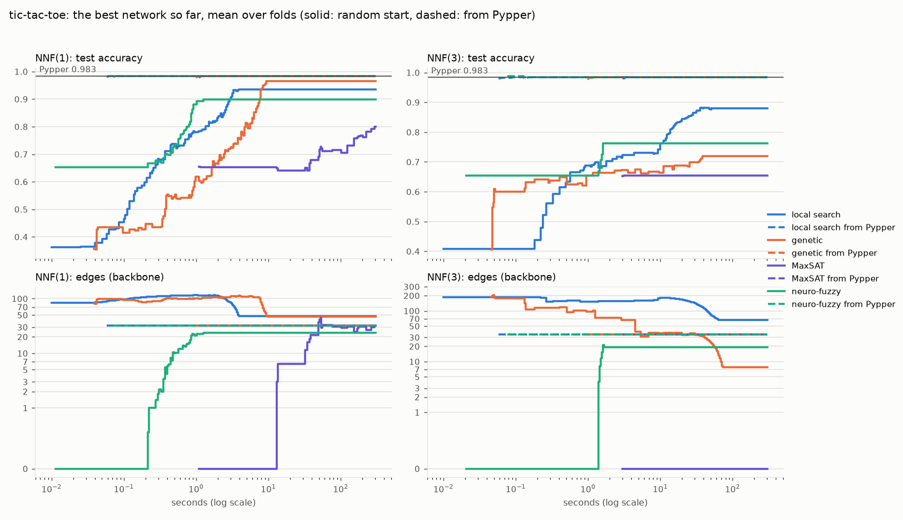

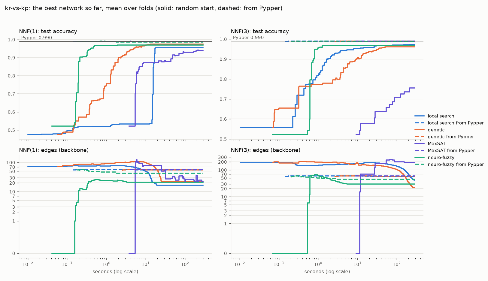

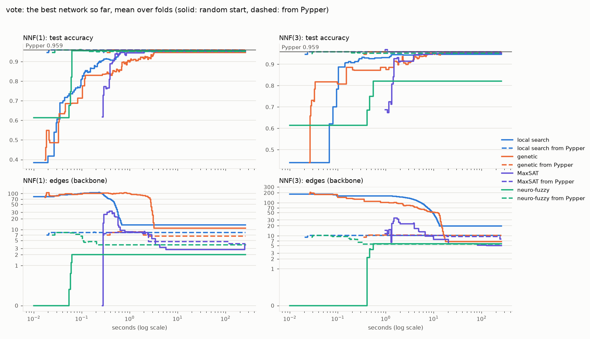

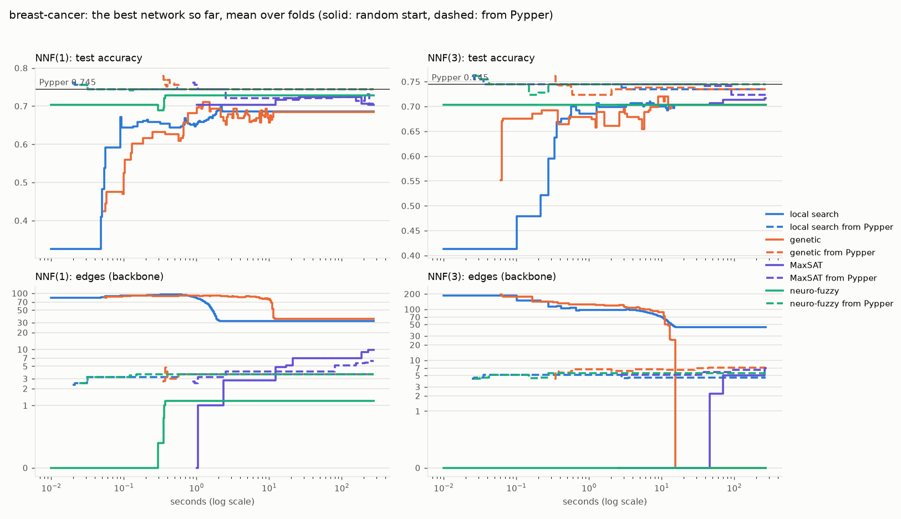

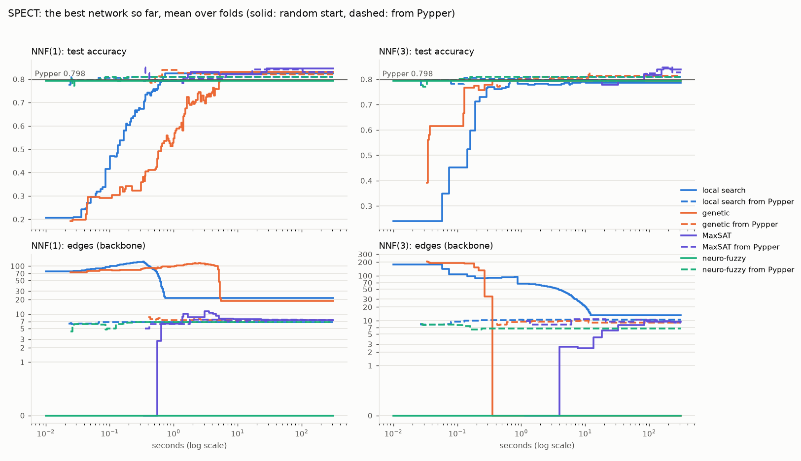

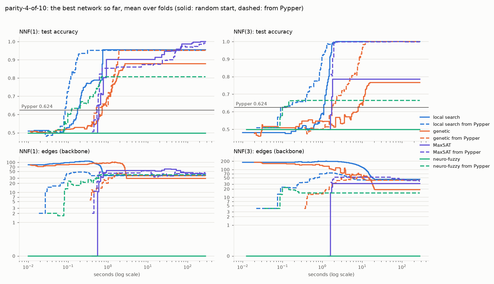

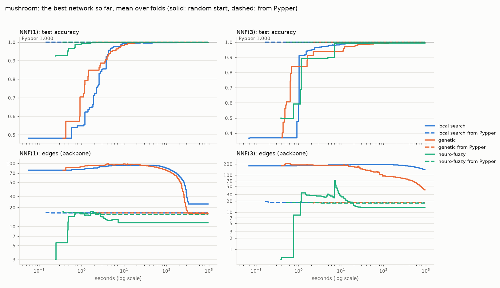

Final test accuracy (%) and mean fit time (s):

| dataset | Pypper | local search NNF(1) | local search from Pypper NNF(1) | genetic NNF(1) | genetic from Pypper NNF(1) | MaxSAT NNF(1) | MaxSAT from Pypper NNF(1) | neuro-fuzzy NNF(1) | neuro-fuzzy from Pypper NNF(1) | local search NNF(3) | local search from Pypper NNF(3) | genetic NNF(3) | genetic from Pypper NNF(3) | MaxSAT NNF(3) | MaxSAT from Pypper NNF(3) | neuro-fuzzy NNF(3) | neuro-fuzzy from Pypper NNF(3) |
|---|--:|--:|--:|--:|--:|--:|--:|--:|--:|--:|--:|--:|--:|--:|--:|--:|--:|
| SPECT | 79.80 (0 s) | 82.40 (1 s) | 80.92 (0 s) | 83.14 (5 s) | 83.13 (3 s) | 84.63 (300 s) | 83.14 (300 s) | 79.40 (0 s) | 80.91 (0 s) | 78.64 (4 s) | 80.92 (1 s) | 79.40 (8 s) | 80.53 (16 s) | 83.89 (301 s) | 82.75 (301 s) | 79.40 (0 s) | 80.91 (0 s) |
| breast-cancer | 74.45 (0 s) | 68.55 (2 s) | 74.46 (1 s) | 68.52 (11 s) | 74.46 (8 s) | 70.30 (300 s) | 70.65 (300 s) | 72.73 (0 s) | 74.46 (0 s) | 70.31 (10 s) | 73.41 (3 s) | 70.28 (32 s) | 73.42 (42 s) | 71.68 (301 s) | 72.38 (301 s) | 70.28 (1 s) | 74.46 (1 s) |
| kr-vs-kp | 98.97 (0 s) | 95.43 (18 s) | 99.00 (5 s) | 97.50 (23 s) | 99.00 (10 s) | 93.90 (304 s) | 98.97 (304 s) | 97.00 (4 s) | 98.59 (4 s) | 97.28 (227 s) | 98.94 (20 s) | 96.18 (203 s) | 99.00 (28 s) | 75.57 (307 s) | 98.97 (306 s) | 96.87 (7 s) | 98.53 (7 s) |
| mushroom | 99.96 (0 s) | 99.83 (313 s) | 99.96 (40 s) | 99.84 (280 s) | 99.96 (34 s) | time-out (nan s) | time-out (nan s) | 99.85 (22 s) | 99.96 (22 s) | 99.69 (903 s) | 99.96 (110 s) | 99.53 (885 s) | 99.96 (83 s) | time-out (nan s) | time-out (nan s) | 99.45 (36 s) | 99.96 (36 s) |
| parity-4-of-10 | 62.39 (0 s) | 95.51 (1 s) | 95.12 (0 s) | 87.80 (3 s) | 95.12 (3 s) | 100.00 (300 s) | 99.22 (300 s) | 49.80 (1 s) | 80.77 (1 s) | 100.00 (17 s) | 100.00 (4 s) | 76.73 (17 s) | 100.00 (11 s) | 78.49 (310 s) | 99.80 (301 s) | 49.80 (1 s) | 66.40 (1 s) |
| tic-tac-toe | 98.33 (0 s) | 93.43 (4 s) | 98.33 (1 s) | 96.45 (9 s) | 98.33 (4 s) | 79.96 (301 s) | 98.33 (301 s) | 89.86 (1 s) | 98.33 (1 s) | 88.00 (47 s) | 98.33 (5 s) | 71.94 (29 s) | 98.33 (15 s) | 65.34 (314 s) | 98.33 (302 s) | 76.30 (2 s) | 98.33 (2 s) |
| vote | 95.86 (0 s) | 95.17 (1 s) | 95.86 (0 s) | 94.71 (3 s) | 95.86 (2 s) | 95.17 (266 s) | 95.17 (300 s) | 95.63 (0 s) | 95.17 (0 s) | 94.71 (11 s) | 95.86 (1 s) | 95.40 (15 s) | 95.63 (9 s) | 95.17 (301 s) | 95.63 (301 s) | 82.07 (1 s) | 95.17 (1 s) |
MaxSAT is not run on mushroom: its formula would have tens of millions of clauses.

## Part 3: KRK illegality

krk-illegal-1000: the coordinates only, stratified 5-fold; network `[128, 16, 4]`, 1500 s per fit, errors plus 1 per edge. Reference lines: Pypper on the coordinates, and Pypper with the 24 relations given (`relations=True`), what the background knowledge allows.

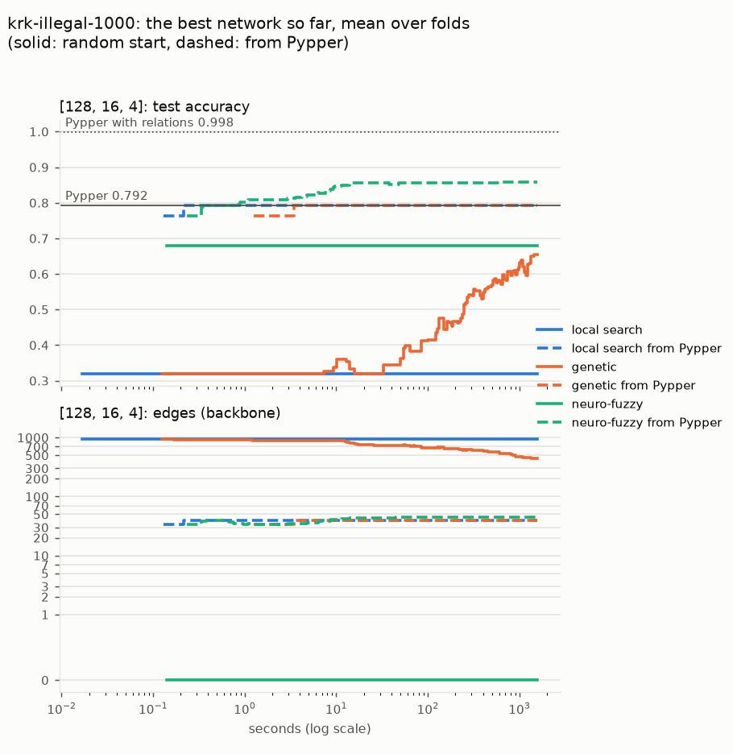

Final test accuracy (%), backbone edges and mean fit time (s):

| learner | accuracy | edges | seconds |
|---|--:|--:|--:|
| Pypper | 79.20 |  | 0 |
| local search | 32.00 | 953 | 1500 |
| local search from Pypper | 79.20 | 40 | 1500 |
| genetic | 65.50 | 445 | 1500 |
| genetic from Pypper | 79.20 | 40 | 1500 |
| neuro-fuzzy | 68.00 | 0 | 1500 |
| neuro-fuzzy from Pypper | 85.80 | 45 | 1500 |
| Pypper with relations | 99.80 | | |

## Part 4: FOIL as the start

Parts 2 and 3 with the learners started from FOIL's rules (`PFoil` for the class the network learns, at most one rule per first-layer node: `FoilInit`) instead of Pypper's. Final test accuracy (%) with the backbone's edges in brackets; *start*: the rule set itself (Pypper; FOIL cut to the layer's width).

**NNF(1)** `[20]`:

| dataset | Pypper (start) | FOIL (start) | local search from Pypper | local search from FOIL | genetic from Pypper | genetic from FOIL | MaxSAT from Pypper | MaxSAT from FOIL | neuro-fuzzy from Pypper | neuro-fuzzy from FOIL |
|---|--:|--:|--:|--:|--:|--:|--:|--:|--:|--:|
| tic-tac-toe | 98.33 | 93.62 | 98.33 (32) | 96.87 (53) | 98.33 (32) | 96.66 (52) | 98.33 (32) | 93.62 (60) | 98.33 (32) | 98.33 (32) |
| kr-vs-kp | 98.97 | 98.97 | 99.00 (56) | 99.16 (83) | 99.00 (55) | 99.22 (83) | 98.97 (57) | 98.97 (93) | 98.59 (43) | 98.66 (47) |
| vote | 95.86 | 89.20 | 95.86 (8) | 95.40 (27) | 95.86 (7) | 95.86 (19) | 95.17 (4) | 95.17 (3) | 95.17 (4) | 95.63 (3) |
| breast-cancer | 74.45 | 52.45 | 74.46 (4) | 66.09 (51) | 74.46 (4) | 67.48 (53) | 70.65 (6) | 71.66 (8) | 74.46 (4) | 72.70 (7) |
| SPECT | 79.80 | 56.19 | 80.92 (7) | 79.40 (22) | 83.13 (7) | 78.67 (22) | 83.14 (7) | 83.14 (7) | 80.91 (7) | 82.02 (7) |
| parity-4-of-10 | 62.39 | 73.71 | 95.12 (36) | 100.00 (40) | 95.12 (36) | 100.00 (40) | 99.22 (45) | 100.00 (43) | 80.77 (39) | 100.00 (40) |
| mushroom | 99.96 | 100.00 | 99.96 (16) | 100.00 (16) | 99.96 (16) | 100.00 (16) | not run | not run | 99.96 (16) | 100.00 (16) |

**NNF(3)** `[32, 8, 2]`:

| dataset | Pypper (start) | FOIL (start) | local search from Pypper | local search from FOIL | genetic from Pypper | genetic from FOIL | MaxSAT from Pypper | MaxSAT from FOIL | neuro-fuzzy from Pypper | neuro-fuzzy from FOIL |
|---|--:|--:|--:|--:|--:|--:|--:|--:|--:|--:|
| tic-tac-toe | 98.33 | 93.62 | 98.33 (34) | 96.87 (53) | 98.33 (34) | 96.87 (51) | 98.33 (34) | 93.62 (62) | 98.33 (34) | 98.33 (34) |
| kr-vs-kp | 98.97 | 98.44 | 98.94 (57) | 99.12 (88) | 99.00 (57) | 99.31 (80) | 98.97 (59) | 98.44 (106) | 98.53 (45) | 98.66 (46) |
| vote | 95.86 | 89.20 | 95.86 (10) | 95.40 (29) | 95.63 (10) | 95.63 (22) | 95.63 (8) | 95.63 (5) | 95.17 (6) | 95.63 (6) |
| breast-cancer | 74.45 | 52.45 | 73.41 (5) | 65.74 (41) | 73.42 (7) | 70.98 (2) | 72.38 (6) | 71.68 (4) | 74.46 (6) | 73.41 (9) |
| SPECT | 79.80 | 56.19 | 80.92 (10) | 77.53 (21) | 80.53 (9) | 79.40 (0) | 82.75 (9) | 84.26 (9) | 80.91 (7) | 79.76 (6) |
| parity-4-of-10 | 62.39 | 84.24 | 100.00 (43) | 100.00 (42) | 100.00 (41) | 100.00 (42) | 99.80 (38) | 97.95 (50) | 66.40 (14) | 100.00 (42) |
| mushroom | 99.96 | 100.00 | 99.96 (18) | 100.00 (18) | 99.96 (18) | 100.00 (18) | not run | not run | 99.96 (18) | 100.00 (18) |

**KRK** (`[128, 16, 4]`, 1500 s per fit):

| learner | from Pypper | from FOIL |
|---|--:|--:|
| the start | 79.20 | 73.30 |
| local search | 79.20 (40) | 68.00 (0) |
| genetic | 79.20 (40) | 81.60 (220) |
| neuro-fuzzy | 85.80 (45) | 88.40 (59) |

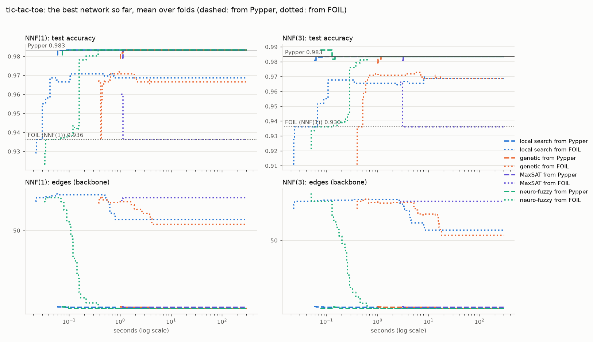

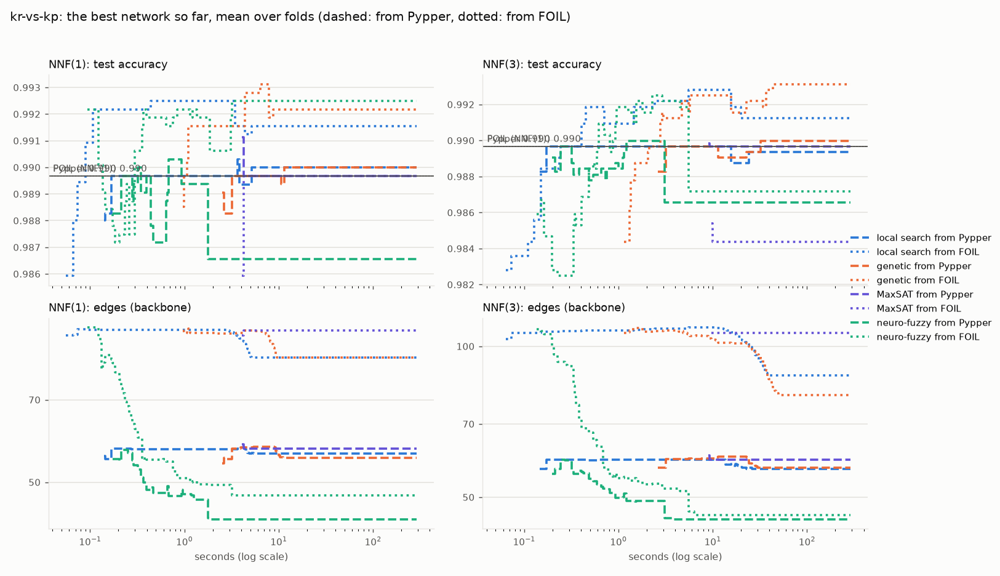

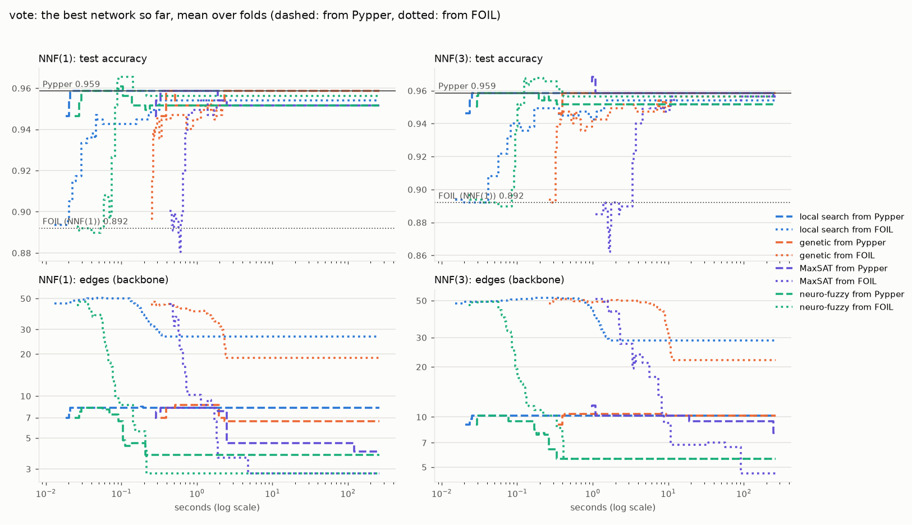

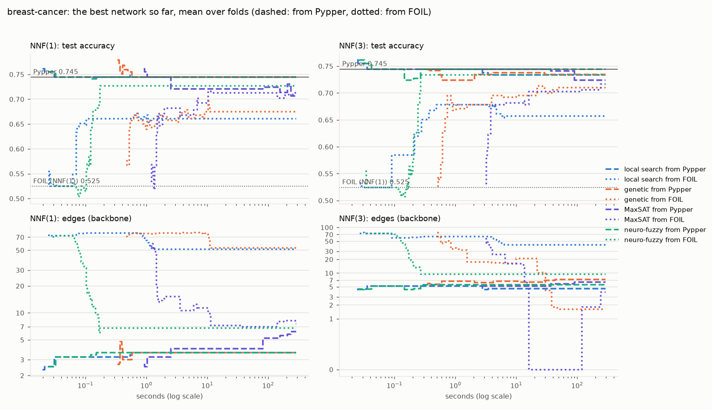

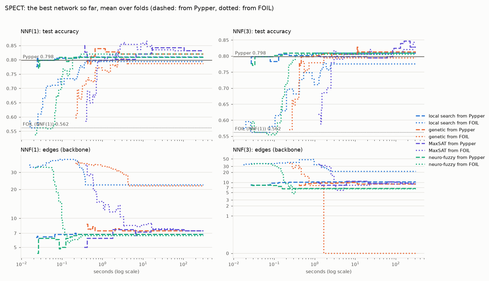

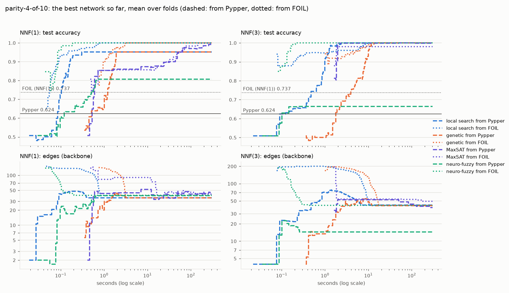

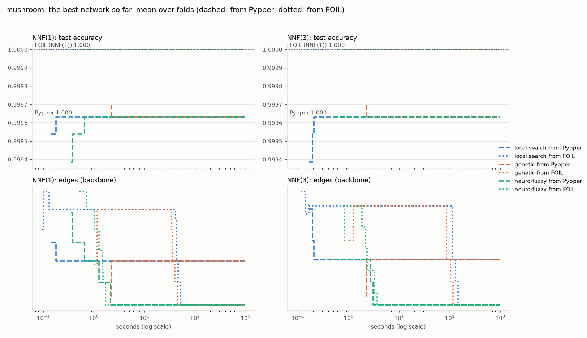

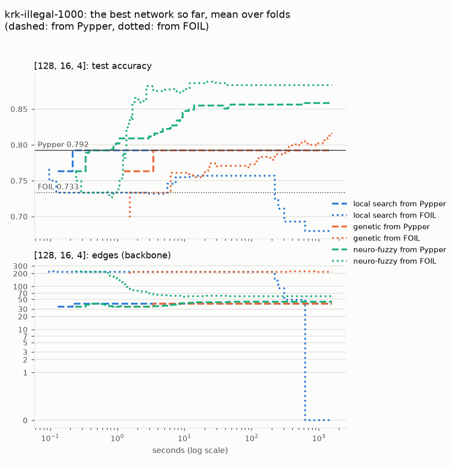
