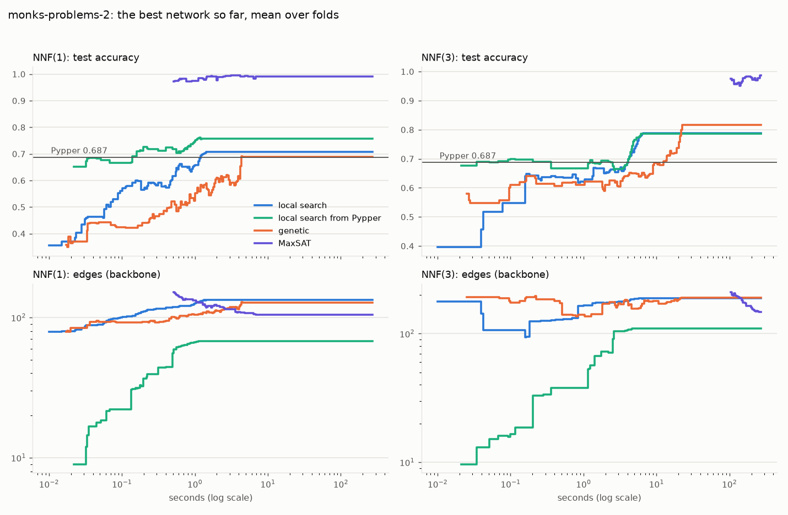
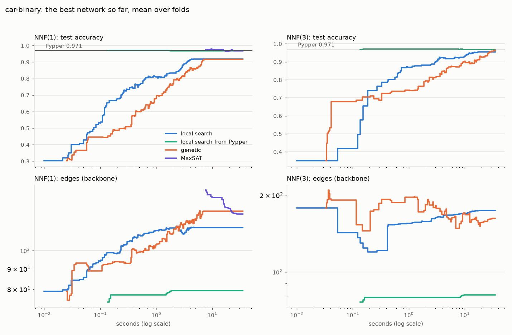
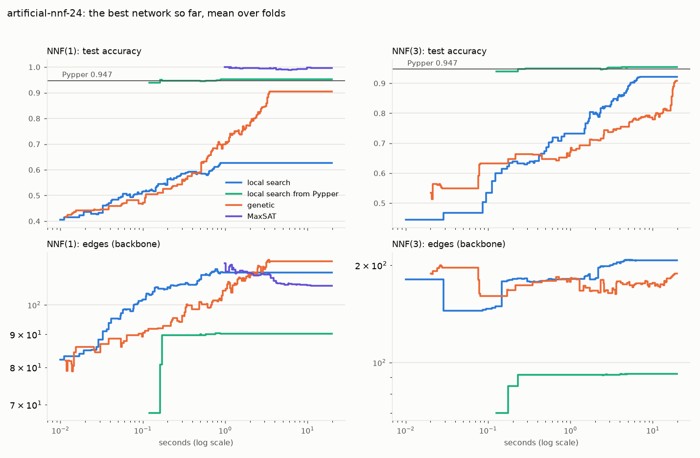

# Deep rule networks

## Setup

Part 1: the 20 artificial datasets of Beck & Fürnkranz (2021), as used by Seip, Fürnkranz et
al. (catalog tag `artificial`; all 1,024 combinations of ten Boolean features, labeled by a
random deep NNF), stratified 10-fold cross-validation. The Boolean columns become
`x` and `not x`, the features and negations the SAT paper's networks take. Architectures as
in the paper: NNF(1) `[20]`, NNF(3) `[32, 8, 2]`, NNF(5) `[32, 16, 8, 4, 2]`,
first layer AND, output OR. Learners: `DeepSAT` (plain SAT, an exact fit; Glucose 4),
`DeepLocalSearch` (Beck's stochastic hill climbing, consistent moves, random start),
`DeepSAT(minimize="weights")` on NNF(1) with 60 s (the smallest exact fit found
by then), Pypper.

Part 2: tic-tac-toe, monks-problems-2, car-binary, artificial-nnf-24, kr-vs-kp, stratified 5-fold. NNF(1) and NNF(3);
local search (random start, and started from Pypper's rules, `RuleSetInit(Pypper())`),
the genetic algorithm (`DeepGenetic`, node-wise crossover), MaxSAT (`DeepSAT(minimize=
"weights")`, 300 s), all with `trace=True`; Pypper as the reference.

Each fit is capped at 1800 s; a time-out drops the learner's whole
cross-validation on that dataset. Times are wall-clock.

## Part 1: the SAT paper's artificial datasets

Accuracy (%) per dataset, ours next to the paper's Table 1 (its SAT and stochastic hill climbing, SHS). Our folds are not the paper's (both stratified 10-fold), so single datasets can differ by chance; the means are the comparison.

| dataset | SAT NNF(1) (ours) | SAT NNF(1) (paper) | local search NNF(1) (ours) | SHS NNF(1) (paper) | SAT NNF(3) (ours) | SAT NNF(3) (paper) | local search NNF(3) (ours) | SHS NNF(3) (paper) | SAT NNF(5) (ours) | SAT NNF(5) (paper) | local search NNF(5) (ours) | SHS NNF(5) (paper) | MaxSAT NNF(1) | Pypper |
|---|--:|--:|--:|--:|--:|--:|--:|--:|--:|--:|--:|--:|--:|--:|
| artificial-nnf-107 | time-out | 99.51 | 70.12 | 86.43 | time-out | 97.95 | 93.75 | 87.30 | time-out | 97.55 | 89.74 | 89.65 | time-out | 93.65 |
| artificial-nnf-112 | 97.65 | 98.63 | 52.23 | 91.89 | 97.66 | 98.34 | 83.18 | 92.48 | 97.66 | 98.24 | 94.04 | 93.46 | 99.02 | 96.09 |
| artificial-nnf-118 | 98.24 | 99.12 | 71.49 | 94.34 | 97.17 | 98.24 | 95.31 | 94.14 | time-out | 99.12 | 95.60 | 96.88 | 99.61 | 97.26 |
| artificial-nnf-16 | 98.92 | 99.02 | 60.28 | 96.29 | 98.92 | 98.04 | 85.24 | 97.07 | 98.92 | 97.65 | 97.46 | 96.39 | 99.12 | 98.24 |
| artificial-nnf-19 | 100.00 | 100.00 | 71.39 | 97.46 | 100.00 | 100.00 | 99.80 | 99.02 | 100.00 | 100.00 | 99.22 | 100.00 | 100.00 | 100.00 |
| artificial-nnf-24 | 98.54 | 99.32 | 66.21 | 91.60 | 99.61 | 98.83 | 91.12 | 90.43 | 99.61 | 98.83 | 92.18 | 90.53 | 99.81 | 95.02 |
| artificial-nnf-36 | time-out | time-out | 64.27 | 90.43 | time-out | 97.75 | 93.17 | 92.09 | time-out | 96.48 | 93.85 | 88.28 | time-out | 93.27 |
| artificial-nnf-44 | 98.15 | 99.02 | 58.70 | 93.26 | 98.34 | 97.85 | 84.77 | 95.51 | 98.34 | 98.25 | 96.10 | 96.29 | 99.12 | 97.95 |
| artificial-nnf-5 | 98.04 | 99.80 | 76.59 | 95.31 | 98.34 | 98.73 | 98.24 | 98.63 | 98.53 | 98.83 | 98.73 | 95.80 | 100.00 | 98.63 |
| artificial-nnf-53 | 100.00 | 99.71 | 67.17 | 97.75 | 100.00 | 98.92 | 98.83 | 98.05 | 100.00 | 98.73 | 98.53 | 98.05 | 100.00 | 99.02 |
| artificial-nnf-57 | 99.02 | 99.61 | 62.01 | 96.39 | 98.92 | 99.32 | 90.07 | 97.36 | 99.02 | 99.61 | 98.24 | 98.24 | 99.71 | 99.61 |
| artificial-nnf-60 | 98.24 | 99.22 | 57.54 | 92.09 | 97.95 | 98.24 | 95.50 | 94.53 | 98.14 | 97.36 | 95.80 | 94.43 | 100.00 | 97.95 |
| artificial-nnf-65 | 98.92 | 99.81 | 69.53 | 94.14 | 98.92 | 99.80 | 95.60 | 96.88 | 98.92 | 99.32 | 95.41 | 98.54 | 100.00 | 99.80 |
| artificial-nnf-68 | time-out | 99.12 | 74.70 | 96.19 | 99.12 | 97.17 | 92.38 | 94.43 | time-out | 98.05 | 91.89 | 92.48 | time-out | 92.97 |
| artificial-nnf-69 | 98.34 | 98.24 | 61.33 | 91.99 | 98.24 | 97.27 | 96.68 | 96.58 | time-out | 97.76 | 96.39 | 95.51 | 98.73 | 97.08 |
| artificial-nnf-70 | time-out | 99.12 | 70.60 | 92.29 | 98.53 | 97.66 | 89.45 | 90.62 | time-out | 98.15 | 90.72 | 90.14 | time-out | 91.50 |
| artificial-nnf-81 | time-out | 99.51 | 65.23 | 88.57 | 97.26 | 97.26 | 93.84 | 91.31 | time-out | 98.83 | 93.94 | 90.04 | time-out | 95.40 |
| artificial-nnf-82 | 100.00 | 99.90 | 64.25 | 97.17 | 100.00 | 99.90 | 96.47 | 99.80 | 100.00 | 99.90 | 99.90 | 99.41 | 100.00 | 100.00 |
| artificial-nnf-85 | 100.00 | 100.00 | 75.49 | 97.36 | 100.00 | 99.90 | 99.51 | 99.80 | 100.00 | 99.71 | 99.80 | 100.00 | 100.00 | 100.00 |
| artificial-nnf-89 | time-out | 99.80 | 65.54 | 96.29 | 98.83 | 99.22 | 90.63 | 94.34 | time-out | 99.02 | 91.60 | 89.26 | time-out | 91.01 |
| **mean** | 98.86 | 99.39 | 66.23 | 93.86 | 98.77 | 98.52 | 93.18 | 95.02 | 99.10 | 98.57 | 95.46 | 94.67 | 99.65 | 96.72 |

Mean fit time (s): Pypper 0.1, SAT NNF(1) 504.4, SAT NNF(3) 217.2, SAT NNF(5) 407.5, MaxSAT NNF(1) 55.2, local search NNF(1) 0.8, local search NNF(3) 5.0, local search NNF(5) 13.8.

Time-outs (failed folds / folds; the fit cap of 1800 s, or DeepSAT finding no network within its own limit): MaxSAT NNF(1): artificial-nnf-107 (10/10), artificial-nnf-36 (10/10), artificial-nnf-68 (10/10), artificial-nnf-70 (10/10), artificial-nnf-81 (6/10), artificial-nnf-89 (10/10); SAT NNF(1): artificial-nnf-107 (10/10), artificial-nnf-36 (10/10), artificial-nnf-68 (10/10), artificial-nnf-70 (10/10), artificial-nnf-81 (10/10), artificial-nnf-89 (10/10); SAT NNF(3): artificial-nnf-107 (10/10), artificial-nnf-36 (10/10); SAT NNF(5): artificial-nnf-107 (10/10), artificial-nnf-118 (10/10), artificial-nnf-36 (10/10), artificial-nnf-68 (10/10), artificial-nnf-69 (10/10), artificial-nnf-70 (10/10), artificial-nnf-81 (10/10), artificial-nnf-89 (10/10).

## Part 2: the learners over time

Each curve is the test accuracy (top) and the size (bottom: edges of the network's backbone, `DeepModel.pruned`) of the best network found so far, against the seconds of the fit, averaged over the folds where a network exists by then (shown once that is at least half of all folds; a failed fold never has one). Local search and the genetic algorithm improve the training error; MaxSAT starts from an exact fit and makes it smaller.

Final test accuracy (%) and mean fit time (s):

| dataset | Pypper | local search NNF(1) | local search from Pypper NNF(1) | genetic NNF(1) | MaxSAT NNF(1) | local search NNF(3) | local search from Pypper NNF(3) | genetic NNF(3) | MaxSAT NNF(3) |
|---|--:|--:|--:|--:|--:|--:|--:|--:|--:|
| artificial-nnf-24 | 94.73 (0 s) | 62.60 (1 s) | 95.21 (1 s) | 90.43 (3 s) | 99.61 (301 s) | 92.09 (6 s) | 95.41 (3 s) | 90.92 (18 s) | time-out (308 s) |
| car-binary | 97.11 (0 s) | 91.84 (4 s) | 96.82 (2 s) | 91.61 (7 s) | time-out (304 s) | 95.54 (15 s) | 96.82 (9 s) | 96.24 (29 s) | time-out (321 s) |
| kr-vs-kp | 98.97 (0 s) | 53.32 (3 s) | 99.03 (5 s) | 97.09 (10 s) | time-out (304 s) | 97.25 (38 s) | 99.06 (20 s) | 97.44 (49 s) | time-out (308 s) |
| monks-problems-2 | 68.72 (0 s) | 70.70 (1 s) | 75.71 (1 s) | 68.89 (4 s) | 99.17 (301 s) | 78.88 (6 s) | 78.53 (5 s) | 81.69 (22 s) | 98.67 (303 s) |
| tic-tac-toe | 98.33 (0 s) | 90.92 (3 s) | 98.33 (1 s) | 94.78 (8 s) | 96.87 (301 s) | 90.92 (20 s) | 98.33 (5 s) | 91.44 (43 s) | time-out (316 s) |

Time-outs (failed folds / folds; the fit cap of 1800 s, or DeepSAT finding no network within its own limit): MaxSAT NNF(1): car-binary (2/5), kr-vs-kp (3/5); MaxSAT NNF(3): artificial-nnf-24 (5/5), car-binary (5/5), kr-vs-kp (5/5), tic-tac-toe (5/5).
