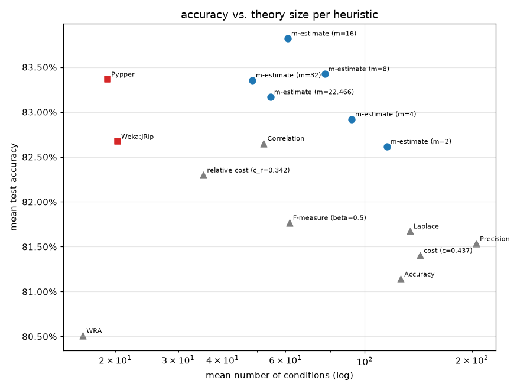
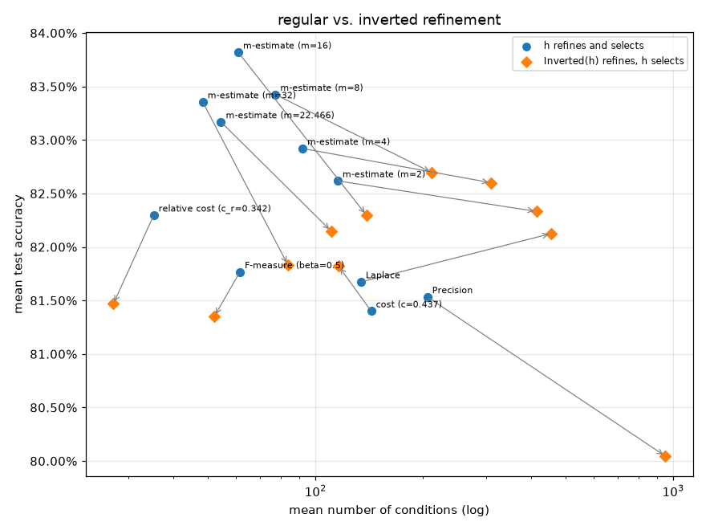

# Rule learning heuristics in separate-and-conquer (after Janssen & Fürnkranz)

## Setup

**Full run** (36 datasets, 10-fold). Quick sanity check instead: `python demos/heuristic_comparison.py` with no arguments.

Rule learning heuristics compared inside one plain separate-and-conquer
learner, after Janssen & Fürnkranz (Machine Learning, 2010). The learner
follows the paper's Algorithms 1 and 2: greedy top-down search that
refines until no refinement is left and returns the best rule
encountered (`BeamSearch(beam_width=1)`), no stopping criterion and no
pruning; covering stops once a new rule covers no more positives than
negatives; multi-class problems use ordered class binarization (least
frequent class first, the largest class as the default rule).

Heuristics: the paper's standard ones (Precision, Laplace, Accuracy,
WRA, Correlation), its tuned parametrized ones (cost c=0.437, relative
cost c_r=0.342, F-measure beta=0.5, m-estimate m=22.466), and an
m-estimate sweep over m in {2, 4, 8, 16, 32}.
Benchmarks: Weka's JRip and pyrulearn's Pypper, both with their own
pruning, and both also use ordered class binarization. What each
heuristic prefers is visualized by its coverage-space isometrics in the
companion demo, [heuristic_isometrics](heuristic_isometrics_report.md).

Datasets: 36 of the paper's datasets that are in
`pyrulearn.experiments.catalog` (20 binary,
16 multi-class). Numeric attributes are discretized per
training fold (`build_dataspec(discretizer=TreeDiscretizer(max_intervals=8))`) instead
of the paper's tests at every midpoint. Each fit is capped at
600s; a timeout counts as a failure.

A fold that times out fails the whole cross-validation of that learner on that dataset (`run_cv`'s `stop_on_timeout`): its remaining folds are not run, and all its folds count as failures, so no mean rests on just the folds that finished.

Measures: test accuracy, number of rules and conditions, fit time.

Every learner runs single-threaded; fits run 8 at a time (`run_cv`'s `n_jobs`), each in its own process and timed there, with the numerical libraries limited to one thread (`OMP_NUM_THREADS=1` and its relatives). A check of the `dense_vs_modular` learners on 11 datasets found the fit times of 5 concurrent fits as close to a sequential run as a second sequential run (per-learner ratios and rankings alike); time ratios between learners are reproducible to about +-10% either way.

The summary and the per-dataset results below are for the heuristics as
in the paper; the [last section](#inverted-heuristics-for-refinement)
compares them with inverted refinement.

## Summary by learner (mean across every dataset and fold)

| learner | accuracy | n_rules | n_conditions | conds/rule | fit_time (s) | wins | mean rank | failures |
|---|--:|--:|--:|--:|--:|--:|--:|--:|
| m-estimate (m=16) | 83.82% | 17.2 | 60.8 | 3.3 | 0.10 | 6.3 | 6.40 | 0 |
| m-estimate (m=8) | 83.42% | 22.4 | 77.3 | 3.1 | 0.10 | 1.1 | 7.88 | 0 |
| Pypper | 83.36% | 7.1 | 19.0 | 2.4 | 0.12 | 4.7 | 6.62 | 0 |
| m-estimate (m=32) | 83.36% | 12.9 | 48.4 | 3.6 | 0.09 | 2.3 | 6.72 | 0 |
| m-estimate (m=22.466) | 83.17% | 14.9 | 54.4 | 3.4 | 0.09 | 1.3 | 7.42 | 0 |
| m-estimate (m=4) | 82.92% | 28.2 | 91.9 | 3.0 | 0.10 | 1.4 | 8.08 | 0 |
| Weka:JRip | 82.67% | 7.7 | 20.3 | 2.4 | 0.85 | 6.2 | 7.65 | 0 |
| Correlation | 82.65% | 14.4 | 52.1 | 3.3 | 0.07 | 4.1 | 8.31 | 0 |
| m-estimate (m=2) | 82.62% | 35.6 | 115.3 | 2.9 | 0.12 | 1.4 | 8.24 | 0 |
| relative cost (c_r=0.342) | 82.30% | 9.6 | 35.3 | 3.3 | 0.07 | 0.5 | 8.88 | 0 |
| F-measure (beta=0.5) | 81.77% | 19.5 | 61.5 | 2.9 | 0.09 | 1.1 | 9.22 | 0 |
| Laplace | 81.67% | 43.6 | 134.0 | 2.7 | 0.11 | 0.4 | 10.43 | 0 |
| Precision | 81.53% | 68.0 | 205.5 | 2.7 | 0.17 | 1.1 | 10.57 | 0 |
| cost (c=0.437) | 81.40% | 44.4 | 143.1 | 2.6 | 0.12 | 1.1 | 9.93 | 0 |
| Accuracy | 81.14% | 39.1 | 126.2 | 2.6 | 0.11 | 0.1 | 10.18 | 0 |
| WRA | 80.51% | 4.7 | 16.2 | 3.2 | 0.05 | 3.0 | 9.47 | 0 |

`wins` -- datasets where a learner's mean accuracy was (tied-for-)best, a tie split evenly; `mean rank` -- average accuracy rank across datasets, failures tied for last.

## Per-dataset results, per learner (mean across folds)

| dataset | learner | accuracy | n_rules | conds_per_rule | n_conditions | fit_time |
|---|---|---|---|---|---|---|
| anneal | Accuracy | 94.76% | 16.5 | 1.8 | 30.6 | 0.032 |
| anneal | Correlation | 93.99% | 11.0 | 2.0 | 22.2 | 0.033 |
| anneal | F-measure (beta=0.5) | 96.43% | 17.3 | 2.1 | 36.2 | 0.055 |
| anneal | Laplace | 96.32% | 22.1 | 2.5 | 55.6 | 0.037 |
| anneal | Precision | 96.32% | 26.8 | 2.7 | 73.0 | 0.053 |
| anneal | Pypper | 94.32% | 8.9 | 2.5 | 22.5 | 0.193 |
| anneal | WRA | 91.64% | 6.1 | 2.5 | 15.5 | 0.020 |
| anneal | Weka:JRip | 89.98% | 6.7 | 1.6 | 10.9 | 1.056 |
| anneal | cost (c=0.437) | 94.20% | 16.9 | 1.8 | 30.6 | 0.030 |
| anneal | m-estimate (m=16) | 96.55% | 15.3 | 2.1 | 32.1 | 0.041 |
| anneal | m-estimate (m=2) | 96.99% | 21.8 | 2.3 | 50.9 | 0.043 |
| anneal | m-estimate (m=22.466) | 95.99% | 13.0 | 2.0 | 26.0 | 0.037 |
| anneal | m-estimate (m=32) | 94.65% | 11.8 | 1.7 | 20.1 | 0.033 |
| anneal | m-estimate (m=4) | 97.66% | 20.3 | 2.3 | 46.1 | 0.042 |
| anneal | m-estimate (m=8) | 96.66% | 18.1 | 2.1 | 37.7 | 0.040 |
| anneal | relative cost (c_r=0.342) | 93.09% | 8.0 | 2.1 | 16.5 | 0.021 |
| audiology | Accuracy | 80.99% | 40.4 | 2.1 | 85.1 | 0.081 |
| audiology | Correlation | 84.05% | 34.0 | 2.1 | 72.5 | 0.081 |
| audiology | F-measure (beta=0.5) | 77.49% | 42.3 | 2.0 | 85.5 | 0.073 |
| audiology | Laplace | 74.33% | 55.0 | 1.9 | 105.2 | 0.076 |
| audiology | Precision | 75.22% | 67.0 | 1.9 | 130.3 | 0.101 |
| audiology | Pypper | 75.71% | 11.1 | 1.6 | 17.3 | 0.176 |
| audiology | WRA | 82.77% | 23.2 | 2.5 | 59.1 | 0.101 |
| audiology | Weka:JRip | 74.84% | 14.7 | 1.8 | 26.2 | 0.884 |
| audiology | cost (c=0.437) | 79.17% | 44.0 | 2.1 | 93.3 | 0.070 |
| audiology | m-estimate (m=16) | 83.18% | 31.8 | 2.2 | 70.0 | 0.064 |
| audiology | m-estimate (m=2) | 77.94% | 44.6 | 2.0 | 88.2 | 0.078 |
| audiology | m-estimate (m=22.466) | 83.62% | 29.1 | 2.3 | 68.0 | 0.073 |
| audiology | m-estimate (m=32) | 84.98% | 27.7 | 2.3 | 63.9 | 0.091 |
| audiology | m-estimate (m=4) | 79.66% | 39.0 | 2.1 | 82.7 | 0.065 |
| audiology | m-estimate (m=8) | 80.55% | 34.9 | 2.2 | 75.4 | 0.068 |
| audiology | relative cost (c_r=0.342) | 82.75% | 24.3 | 2.6 | 62.1 | 0.104 |
| balance-scale | Accuracy | 77.61% | 65.6 | 3.7 | 240.8 | 0.181 |
| balance-scale | Correlation | 78.72% | 13.3 | 3.2 | 41.7 | 0.058 |
| balance-scale | F-measure (beta=0.5) | 80.63% | 16.2 | 2.9 | 47.5 | 0.066 |
| balance-scale | Laplace | 78.88% | 92.7 | 3.5 | 326.9 | 0.224 |
| balance-scale | Precision | 77.27% | 125.4 | 3.4 | 425.5 | 0.312 |
| balance-scale | Pypper | 78.38% | 7.9 | 3.0 | 23.8 | 0.104 |
| balance-scale | WRA | 72.65% | 2.5 | 2.5 | 6.5 | 0.017 |
| balance-scale | Weka:JRip | 80.31% | 8.1 | 3.1 | 25.2 | 0.562 |
| balance-scale | cost (c=0.437) | 80.63% | 70.1 | 3.6 | 255.3 | 0.189 |
| balance-scale | m-estimate (m=16) | 82.70% | 13.0 | 3.0 | 39.2 | 0.054 |
| balance-scale | m-estimate (m=2) | 73.10% | 78.0 | 4.3 | 335.2 | 0.222 |
| balance-scale | m-estimate (m=22.466) | 79.83% | 11.1 | 3.0 | 33.1 | 0.057 |
| balance-scale | m-estimate (m=32) | 80.94% | 8.4 | 2.9 | 25.1 | 0.045 |
| balance-scale | m-estimate (m=4) | 77.26% | 27.8 | 3.2 | 89.8 | 0.085 |
| balance-scale | m-estimate (m=8) | 76.64% | 21.8 | 3.3 | 71.1 | 0.080 |
| balance-scale | relative cost (c_r=0.342) | 76.62% | 4.9 | 2.5 | 12.2 | 0.027 |
| breast-cancer | Accuracy | 72.38% | 10.9 | 2.4 | 27.2 | 0.017 |
| breast-cancer | Correlation | 67.49% | 3.3 | 8.1 | 35.9 | 0.021 |
| breast-cancer | F-measure (beta=0.5) | 67.54% | 8.4 | 4.6 | 38.3 | 0.038 |
| breast-cancer | Laplace | 70.58% | 22.7 | 2.5 | 58.4 | 0.023 |
| breast-cancer | Precision | 68.84% | 36.3 | 2.6 | 95.1 | 0.043 |
| breast-cancer | Pypper | 74.84% | 1.0 | 2.0 | 2.0 | 0.045 |
| breast-cancer | WRA | 68.46% | 1.2 | 5.0 | 6.1 | 0.010 |
| breast-cancer | Weka:JRip | 71.37% | 1.3 | 1.9 | 2.5 | 0.650 |
| breast-cancer | cost (c=0.437) | 71.32% | 14.8 | 2.2 | 34.9 | 0.016 |
| breast-cancer | m-estimate (m=16) | 63.26% | 8.9 | 4.8 | 41.3 | 0.037 |
| breast-cancer | m-estimate (m=2) | 70.23% | 24.4 | 2.8 | 69.8 | 0.040 |
| breast-cancer | m-estimate (m=22.466) | 63.24% | 8.9 | 4.9 | 43.1 | 0.040 |
| breast-cancer | m-estimate (m=32) | 66.48% | 6.5 | 5.6 | 35.6 | 0.029 |
| breast-cancer | m-estimate (m=4) | 67.84% | 21.9 | 3.2 | 70.0 | 0.047 |
| breast-cancer | m-estimate (m=8) | 67.78% | 15.8 | 4.3 | 68.2 | 0.047 |
| breast-cancer | relative cost (c_r=0.342) | 66.79% | 10.7 | 3.8 | 38.7 | 0.033 |
| breast-w | Accuracy | 95.71% | 8.9 | 1.7 | 14.9 | 0.040 |
| breast-w | Correlation | 94.56% | 6.1 | 1.9 | 11.8 | 0.033 |
| breast-w | F-measure (beta=0.5) | 95.57% | 11.0 | 2.1 | 23.5 | 0.053 |
| breast-w | Laplace | 94.99% | 21.0 | 1.6 | 34.1 | 0.066 |
| breast-w | Precision | 94.57% | 42.9 | 1.6 | 69.2 | 0.142 |
| breast-w | Pypper | 95.57% | 3.9 | 2.1 | 8.1 | 0.077 |
| breast-w | WRA | 94.56% | 2.9 | 2.5 | 7.1 | 0.037 |
| breast-w | Weka:JRip | 95.42% | 4.5 | 1.9 | 8.5 | 0.777 |
| breast-w | cost (c=0.437) | 96.00% | 10.0 | 1.7 | 17.0 | 0.038 |
| breast-w | m-estimate (m=16) | 95.28% | 6.7 | 3.7 | 24.8 | 0.049 |
| breast-w | m-estimate (m=2) | 95.28% | 16.8 | 1.8 | 29.8 | 0.059 |
| breast-w | m-estimate (m=22.466) | 96.00% | 6.0 | 3.7 | 22.3 | 0.062 |
| breast-w | m-estimate (m=32) | 96.28% | 5.5 | 3.9 | 21.5 | 0.063 |
| breast-w | m-estimate (m=4) | 94.85% | 13.0 | 2.1 | 26.7 | 0.049 |
| breast-w | m-estimate (m=8) | 94.99% | 9.2 | 2.8 | 25.5 | 0.043 |
| breast-w | relative cost (c_r=0.342) | 94.13% | 3.0 | 2.0 | 5.9 | 0.033 |
| colic | Accuracy | 80.18% | 24.7 | 2.5 | 61.0 | 0.075 |
| colic | Correlation | 83.73% | 13.7 | 3.1 | 42.0 | 0.068 |
| colic | F-measure (beta=0.5) | 82.35% | 15.9 | 2.8 | 44.2 | 0.091 |
| colic | Laplace | 76.39% | 37.8 | 2.6 | 98.3 | 0.112 |
| colic | Precision | 76.91% | 61.7 | 2.6 | 158.2 | 0.207 |
| colic | Pypper | 83.72% | 3.0 | 2.3 | 7.0 | 0.057 |
| colic | WRA | 83.72% | 1.4 | 2.3 | 3.5 | 0.018 |
| colic | Weka:JRip | 84.50% | 3.4 | 2.5 | 8.4 | 0.627 |
| colic | cost (c=0.437) | 79.08% | 26.8 | 2.4 | 64.2 | 0.078 |
| colic | m-estimate (m=16) | 79.08% | 10.6 | 4.0 | 39.3 | 0.072 |
| colic | m-estimate (m=2) | 76.12% | 28.4 | 3.0 | 84.5 | 0.101 |
| colic | m-estimate (m=22.466) | 80.46% | 8.5 | 4.2 | 35.3 | 0.078 |
| colic | m-estimate (m=32) | 81.55% | 7.0 | 4.4 | 30.2 | 0.070 |
| colic | m-estimate (m=4) | 77.21% | 22.8 | 3.2 | 72.7 | 0.091 |
| colic | m-estimate (m=8) | 74.47% | 13.8 | 3.7 | 50.4 | 0.081 |
| colic | relative cost (c_r=0.342) | 83.18% | 5.4 | 3.9 | 21.4 | 0.052 |
| credit-approval | Accuracy | 82.32% | 17.7 | 2.3 | 44.3 | 0.043 |
| credit-approval | Correlation | 81.88% | 14.1 | 3.0 | 43.4 | 0.057 |
| credit-approval | F-measure (beta=0.5) | 81.74% | 22.8 | 3.6 | 82.4 | 0.133 |
| credit-approval | Laplace | 80.14% | 49.7 | 2.8 | 144.3 | 0.101 |
| credit-approval | Precision | 80.29% | 97.1 | 2.8 | 273.0 | 0.202 |
| credit-approval | Pypper | 85.36% | 2.7 | 2.0 | 6.3 | 0.065 |
| credit-approval | WRA | 83.62% | 1.0 | 3.4 | 3.4 | 0.017 |
| credit-approval | Weka:JRip | 84.78% | 4.2 | 2.2 | 10.1 | 0.616 |
| credit-approval | cost (c=0.437) | 83.04% | 21.2 | 2.4 | 54.1 | 0.060 |
| credit-approval | m-estimate (m=16) | 83.48% | 14.7 | 5.5 | 81.6 | 0.140 |
| credit-approval | m-estimate (m=2) | 82.46% | 41.8 | 3.1 | 131.5 | 0.123 |
| credit-approval | m-estimate (m=22.466) | 83.33% | 9.1 | 5.5 | 49.5 | 0.118 |
| credit-approval | m-estimate (m=32) | 83.62% | 7.6 | 5.2 | 39.5 | 0.095 |
| credit-approval | m-estimate (m=4) | 82.46% | 37.2 | 3.5 | 130.5 | 0.120 |
| credit-approval | m-estimate (m=8) | 81.59% | 24.8 | 4.1 | 101.0 | 0.144 |
| credit-approval | relative cost (c_r=0.342) | 85.36% | 2.4 | 4.2 | 9.8 | 0.037 |
| credit-g | Accuracy | 68.00% | 139.8 | 3.3 | 458.2 | 0.329 |
| credit-g | Correlation | 67.40% | 29.1 | 6.1 | 176.5 | 0.127 |
| credit-g | F-measure (beta=0.5) | 67.40% | 34.0 | 5.3 | 182.0 | 0.181 |
| credit-g | Laplace | 68.10% | 134.0 | 3.2 | 431.3 | 0.275 |
| credit-g | Precision | 69.40% | 193.0 | 3.2 | 619.1 | 0.437 |
| credit-g | Pypper | 70.40% | 3.4 | 3.7 | 13.0 | 0.100 |
| credit-g | WRA | 69.00% | 1.2 | 7.8 | 9.1 | 0.021 |
| credit-g | Weka:JRip | 71.20% | 3.6 | 3.5 | 12.9 | 0.716 |
| credit-g | cost (c=0.437) | 68.10% | 159.5 | 3.2 | 513.3 | 0.337 |
| credit-g | m-estimate (m=16) | 66.20% | 45.0 | 5.4 | 244.4 | 0.260 |
| credit-g | m-estimate (m=2) | 70.90% | 100.6 | 3.4 | 338.7 | 0.310 |
| credit-g | m-estimate (m=22.466) | 67.00% | 37.0 | 6.1 | 225.8 | 0.260 |
| credit-g | m-estimate (m=32) | 68.10% | 29.9 | 7.0 | 208.7 | 0.279 |
| credit-g | m-estimate (m=4) | 68.30% | 78.9 | 3.7 | 288.7 | 0.264 |
| credit-g | m-estimate (m=8) | 67.00% | 61.4 | 4.3 | 263.0 | 0.254 |
| credit-g | relative cost (c_r=0.342) | 67.70% | 19.8 | 6.5 | 129.7 | 0.178 |
| diabetes | Accuracy | 74.48% | 23.1 | 2.7 | 64.4 | 0.063 |
| diabetes | Correlation | 74.48% | 6.1 | 5.7 | 35.6 | 0.047 |
| diabetes | F-measure (beta=0.5) | 73.05% | 7.0 | 4.6 | 34.1 | 0.066 |
| diabetes | Laplace | 72.53% | 59.7 | 3.6 | 219.4 | 0.145 |
| diabetes | Precision | 72.14% | 101.7 | 3.6 | 375.0 | 0.245 |
| diabetes | Pypper | 74.22% | 3.8 | 3.2 | 12.6 | 0.082 |
| diabetes | WRA | 73.29% | 1.1 | 2.2 | 2.6 | 0.015 |
| diabetes | Weka:JRip | 72.53% | 3.9 | 3.1 | 12.4 | 0.577 |
| diabetes | cost (c=0.437) | 74.62% | 29.5 | 2.9 | 85.7 | 0.084 |
| diabetes | m-estimate (m=16) | 75.26% | 15.1 | 5.3 | 79.7 | 0.113 |
| diabetes | m-estimate (m=2) | 71.48% | 53.8 | 4.3 | 232.3 | 0.202 |
| diabetes | m-estimate (m=22.466) | 72.79% | 10.3 | 5.0 | 52.4 | 0.083 |
| diabetes | m-estimate (m=32) | 73.56% | 8.6 | 5.1 | 44.4 | 0.073 |
| diabetes | m-estimate (m=4) | 71.22% | 38.4 | 4.4 | 172.1 | 0.172 |
| diabetes | m-estimate (m=8) | 73.70% | 24.5 | 4.7 | 115.7 | 0.142 |
| diabetes | relative cost (c_r=0.342) | 73.84% | 6.7 | 3.5 | 23.4 | 0.048 |
| glass | Accuracy | 64.05% | 27.0 | 2.7 | 73.2 | 0.103 |
| glass | Correlation | 63.55% | 20.7 | 3.0 | 62.9 | 0.115 |
| glass | F-measure (beta=0.5) | 65.91% | 28.0 | 2.9 | 81.0 | 0.124 |
| glass | Laplace | 65.04% | 33.7 | 2.7 | 91.9 | 0.105 |
| glass | Precision | 66.97% | 50.0 | 2.8 | 139.7 | 0.164 |
| glass | Pypper | 67.38% | 6.2 | 2.3 | 14.3 | 0.113 |
| glass | WRA | 69.70% | 4.7 | 4.3 | 20.0 | 0.073 |
| glass | Weka:JRip | 66.84% | 6.6 | 2.4 | 16.1 | 0.574 |
| glass | cost (c=0.437) | 62.19% | 30.2 | 2.7 | 81.3 | 0.098 |
| glass | m-estimate (m=16) | 72.03% | 17.9 | 3.2 | 58.0 | 0.106 |
| glass | m-estimate (m=2) | 66.95% | 30.2 | 2.8 | 85.7 | 0.086 |
| glass | m-estimate (m=22.466) | 65.04% | 14.9 | 3.4 | 51.0 | 0.112 |
| glass | m-estimate (m=32) | 64.52% | 12.3 | 3.6 | 44.2 | 0.104 |
| glass | m-estimate (m=4) | 67.40% | 25.4 | 2.9 | 74.7 | 0.087 |
| glass | m-estimate (m=8) | 70.13% | 22.6 | 3.1 | 70.9 | 0.094 |
| glass | relative cost (c_r=0.342) | 68.27% | 13.6 | 3.5 | 47.3 | 0.110 |
| hayes-roth | Accuracy | 76.25% | 6.6 | 1.5 | 10.1 | 0.020 |
| hayes-roth | Correlation | 84.38% | 6.2 | 1.5 | 9.4 | 0.020 |
| hayes-roth | F-measure (beta=0.5) | 82.50% | 7.5 | 1.7 | 12.7 | 0.027 |
| hayes-roth | Laplace | 83.75% | 9.4 | 2.0 | 18.9 | 0.024 |
| hayes-roth | Precision | 83.75% | 11.8 | 2.1 | 24.8 | 0.031 |
| hayes-roth | Pypper | 84.38% | 6.1 | 1.6 | 9.6 | 0.094 |
| hayes-roth | WRA | 75.00% | 5.0 | 1.2 | 6.1 | 0.018 |
| hayes-roth | Weka:JRip | 83.12% | 5.8 | 1.5 | 8.5 | 0.536 |
| hayes-roth | cost (c=0.437) | 84.38% | 8.2 | 1.8 | 15.1 | 0.020 |
| hayes-roth | m-estimate (m=16) | 84.38% | 7.1 | 1.6 | 11.5 | 0.027 |
| hayes-roth | m-estimate (m=2) | 85.00% | 8.9 | 1.9 | 17.0 | 0.031 |
| hayes-roth | m-estimate (m=22.466) | 83.75% | 6.8 | 1.6 | 10.9 | 0.023 |
| hayes-roth | m-estimate (m=32) | 83.75% | 6.6 | 1.6 | 10.3 | 0.024 |
| hayes-roth | m-estimate (m=4) | 85.62% | 7.9 | 1.8 | 14.0 | 0.030 |
| hayes-roth | m-estimate (m=8) | 86.25% | 7.6 | 1.7 | 12.8 | 0.027 |
| hayes-roth | relative cost (c_r=0.342) | 84.38% | 6.8 | 1.6 | 10.6 | 0.019 |
| heart-c | Accuracy | 71.63% | 22.4 | 2.9 | 65.9 | 0.035 |
| heart-c | Correlation | 73.27% | 10.6 | 4.2 | 45.0 | 0.025 |
| heart-c | F-measure (beta=0.5) | 74.28% | 15.7 | 3.4 | 53.4 | 0.038 |
| heart-c | Laplace | 75.97% | 33.9 | 2.8 | 96.0 | 0.045 |
| heart-c | Precision | 74.96% | 59.5 | 2.6 | 154.2 | 0.086 |
| heart-c | Pypper | 79.23% | 3.4 | 2.6 | 9.0 | 0.040 |
| heart-c | WRA | 73.96% | 2.4 | 3.6 | 9.7 | 0.011 |
| heart-c | Weka:JRip | 81.23% | 3.4 | 2.2 | 7.6 | 0.830 |
| heart-c | cost (c=0.437) | 76.26% | 28.2 | 2.9 | 80.6 | 0.045 |
| heart-c | m-estimate (m=16) | 75.61% | 13.3 | 4.2 | 55.9 | 0.046 |
| heart-c | m-estimate (m=2) | 78.56% | 25.8 | 3.1 | 78.7 | 0.048 |
| heart-c | m-estimate (m=22.466) | 76.32% | 9.6 | 4.1 | 40.7 | 0.037 |
| heart-c | m-estimate (m=32) | 76.97% | 8.8 | 4.3 | 38.1 | 0.034 |
| heart-c | m-estimate (m=4) | 78.24% | 21.3 | 3.3 | 69.2 | 0.048 |
| heart-c | m-estimate (m=8) | 76.29% | 16.6 | 3.8 | 63.3 | 0.046 |
| heart-c | relative cost (c_r=0.342) | 74.92% | 6.6 | 3.6 | 23.5 | 0.022 |
| heart-h | Accuracy | 76.53% | 20.1 | 2.8 | 58.2 | 0.051 |
| heart-h | Correlation | 73.13% | 10.0 | 4.2 | 39.3 | 0.046 |
| heart-h | F-measure (beta=0.5) | 76.85% | 13.3 | 3.9 | 51.6 | 0.070 |
| heart-h | Laplace | 77.90% | 30.0 | 2.7 | 82.4 | 0.062 |
| heart-h | Precision | 75.83% | 46.7 | 2.5 | 119.2 | 0.099 |
| heart-h | Pypper | 76.82% | 1.8 | 2.2 | 4.0 | 0.037 |
| heart-h | WRA | 75.53% | 1.7 | 3.7 | 6.4 | 0.023 |
| heart-h | Weka:JRip | 77.89% | 2.2 | 1.8 | 4.3 | 0.485 |
| heart-h | cost (c=0.437) | 75.54% | 22.8 | 2.8 | 65.7 | 0.051 |
| heart-h | m-estimate (m=16) | 77.87% | 10.2 | 3.8 | 37.9 | 0.057 |
| heart-h | m-estimate (m=2) | 78.61% | 22.7 | 3.0 | 68.1 | 0.057 |
| heart-h | m-estimate (m=22.466) | 75.48% | 7.2 | 4.2 | 28.7 | 0.050 |
| heart-h | m-estimate (m=32) | 77.89% | 5.3 | 5.5 | 28.3 | 0.047 |
| heart-h | m-estimate (m=4) | 74.46% | 18.4 | 3.2 | 59.8 | 0.059 |
| heart-h | m-estimate (m=8) | 76.86% | 13.3 | 3.8 | 50.3 | 0.060 |
| heart-h | relative cost (c_r=0.342) | 77.90% | 4.3 | 4.0 | 16.1 | 0.029 |
| heart-statlog | Accuracy | 73.33% | 18.2 | 2.8 | 50.0 | 0.051 |
| heart-statlog | Correlation | 76.67% | 10.7 | 3.7 | 39.1 | 0.050 |
| heart-statlog | F-measure (beta=0.5) | 75.56% | 14.3 | 3.2 | 45.3 | 0.069 |
| heart-statlog | Laplace | 74.07% | 29.6 | 2.8 | 81.6 | 0.069 |
| heart-statlog | Precision | 72.22% | 54.2 | 2.6 | 139.2 | 0.138 |
| heart-statlog | Pypper | 81.48% | 2.9 | 2.4 | 6.9 | 0.076 |
| heart-statlog | WRA | 75.93% | 2.3 | 3.8 | 9.0 | 0.030 |
| heart-statlog | Weka:JRip | 79.26% | 3.4 | 2.2 | 7.6 | 0.583 |
| heart-statlog | cost (c=0.437) | 73.70% | 23.5 | 2.7 | 63.9 | 0.061 |
| heart-statlog | m-estimate (m=16) | 77.04% | 11.3 | 3.7 | 41.9 | 0.057 |
| heart-statlog | m-estimate (m=2) | 74.44% | 24.1 | 2.9 | 69.2 | 0.076 |
| heart-statlog | m-estimate (m=22.466) | 74.81% | 8.8 | 3.9 | 34.5 | 0.060 |
| heart-statlog | m-estimate (m=32) | 78.89% | 7.5 | 4.2 | 32.1 | 0.050 |
| heart-statlog | m-estimate (m=4) | 77.41% | 19.5 | 3.2 | 61.8 | 0.064 |
| heart-statlog | m-estimate (m=8) | 80.00% | 15.3 | 3.5 | 53.5 | 0.066 |
| heart-statlog | relative cost (c_r=0.342) | 75.56% | 8.3 | 3.7 | 31.1 | 0.052 |
| hepatitis | Accuracy | 75.75% | 11.7 | 2.4 | 28.7 | 0.054 |
| hepatitis | Correlation | 73.79% | 6.7 | 3.0 | 20.0 | 0.050 |
| hepatitis | F-measure (beta=0.5) | 73.21% | 8.5 | 2.7 | 22.9 | 0.062 |
| hepatitis | Laplace | 73.83% | 12.6 | 2.2 | 27.5 | 0.052 |
| hepatitis | Precision | 73.21% | 18.2 | 2.2 | 39.6 | 0.068 |
| hepatitis | Pypper | 80.75% | 2.1 | 2.1 | 4.5 | 0.047 |
| hepatitis | WRA | 76.75% | 1.2 | 4.2 | 4.9 | 0.019 |
| hepatitis | Weka:JRip | 78.75% | 2.1 | 1.8 | 4.0 | 0.625 |
| hepatitis | cost (c=0.437) | 75.75% | 11.9 | 2.3 | 27.0 | 0.056 |
| hepatitis | m-estimate (m=16) | 77.75% | 5.6 | 3.0 | 16.5 | 0.047 |
| hepatitis | m-estimate (m=2) | 77.58% | 9.8 | 2.5 | 24.5 | 0.039 |
| hepatitis | m-estimate (m=22.466) | 78.38% | 5.4 | 3.1 | 16.8 | 0.048 |
| hepatitis | m-estimate (m=32) | 78.25% | 4.4 | 3.1 | 13.9 | 0.033 |
| hepatitis | m-estimate (m=4) | 76.42% | 8.1 | 2.7 | 21.6 | 0.037 |
| hepatitis | m-estimate (m=8) | 78.33% | 6.2 | 2.8 | 17.7 | 0.044 |
| hepatitis | relative cost (c_r=0.342) | 78.33% | 3.6 | 3.2 | 11.8 | 0.031 |
| hypothyroid | Accuracy | 98.99% | 13.4 | 2.7 | 35.7 | 0.101 |
| hypothyroid | Correlation | 98.94% | 8.8 | 2.8 | 24.5 | 0.092 |
| hypothyroid | F-measure (beta=0.5) | 98.83% | 13.9 | 3.1 | 42.9 | 0.130 |
| hypothyroid | Laplace | 98.28% | 33.2 | 3.2 | 107.4 | 0.188 |
| hypothyroid | Precision | 98.25% | 82.7 | 3.2 | 267.9 | 0.432 |
| hypothyroid | Pypper | 99.36% | 3.9 | 2.5 | 9.8 | 0.142 |
| hypothyroid | WRA | 97.08% | 2.1 | 3.6 | 7.7 | 0.059 |
| hypothyroid | Weka:JRip | 99.20% | 3.4 | 2.6 | 8.9 | 1.235 |
| hypothyroid | cost (c=0.437) | 98.78% | 17.0 | 2.8 | 48.2 | 0.129 |
| hypothyroid | m-estimate (m=16) | 99.13% | 10.9 | 3.6 | 39.2 | 0.155 |
| hypothyroid | m-estimate (m=2) | 98.67% | 23.0 | 3.5 | 81.0 | 0.196 |
| hypothyroid | m-estimate (m=22.466) | 99.05% | 10.5 | 3.8 | 40.2 | 0.138 |
| hypothyroid | m-estimate (m=32) | 98.91% | 8.3 | 3.8 | 31.4 | 0.125 |
| hypothyroid | m-estimate (m=4) | 98.86% | 18.8 | 3.8 | 71.0 | 0.180 |
| hypothyroid | m-estimate (m=8) | 98.81% | 14.1 | 3.8 | 52.9 | 0.175 |
| hypothyroid | relative cost (c_r=0.342) | 99.20% | 3.8 | 3.3 | 12.5 | 0.077 |
| ionosphere | Accuracy | 86.33% | 14.1 | 1.7 | 24.4 | 0.065 |
| ionosphere | Correlation | 87.47% | 10.2 | 1.8 | 18.8 | 0.048 |
| ionosphere | F-measure (beta=0.5) | 90.90% | 13.0 | 1.8 | 24.0 | 0.100 |
| ionosphere | Laplace | 91.47% | 15.7 | 1.7 | 25.9 | 0.045 |
| ionosphere | Precision | 92.32% | 19.4 | 1.7 | 33.0 | 0.061 |
| ionosphere | Pypper | 89.17% | 4.4 | 1.5 | 7.0 | 0.051 |
| ionosphere | WRA | 89.17% | 2.0 | 1.1 | 2.3 | 0.101 |
| ionosphere | Weka:JRip | 86.88% | 5.8 | 1.6 | 10.0 | 0.711 |
| ionosphere | cost (c=0.437) | 88.90% | 14.6 | 1.7 | 25.4 | 0.055 |
| ionosphere | m-estimate (m=16) | 90.59% | 9.8 | 2.1 | 20.2 | 0.089 |
| ionosphere | m-estimate (m=2) | 92.02% | 14.5 | 1.7 | 24.3 | 0.041 |
| ionosphere | m-estimate (m=22.466) | 90.31% | 9.2 | 2.2 | 20.7 | 0.096 |
| ionosphere | m-estimate (m=32) | 89.17% | 7.6 | 3.5 | 24.6 | 0.130 |
| ionosphere | m-estimate (m=4) | 92.02% | 12.8 | 1.8 | 22.6 | 0.041 |
| ionosphere | m-estimate (m=8) | 92.30% | 11.2 | 1.9 | 20.9 | 0.038 |
| ionosphere | relative cost (c_r=0.342) | 87.18% | 4.6 | 2.3 | 11.8 | 0.135 |
| iris | Accuracy | 92.00% | 4.4 | 2.1 | 9.1 | 0.022 |
| iris | Correlation | 93.33% | 3.7 | 2.4 | 8.9 | 0.024 |
| iris | F-measure (beta=0.5) | 92.00% | 4.8 | 2.2 | 10.3 | 0.024 |
| iris | Laplace | 92.00% | 7.1 | 1.9 | 13.6 | 0.031 |
| iris | Precision | 92.00% | 10.9 | 1.7 | 18.8 | 0.047 |
| iris | Pypper | 93.33% | 2.0 | 1.4 | 2.8 | 0.061 |
| iris | WRA | 93.33% | 2.3 | 1.6 | 3.9 | 0.025 |
| iris | Weka:JRip | 95.33% | 2.5 | 1.6 | 3.9 | 0.746 |
| iris | cost (c=0.437) | 92.00% | 4.6 | 2.1 | 9.6 | 0.017 |
| iris | m-estimate (m=16) | 92.67% | 3.8 | 2.1 | 8.1 | 0.025 |
| iris | m-estimate (m=2) | 92.67% | 5.6 | 2.0 | 11.1 | 0.025 |
| iris | m-estimate (m=22.466) | 92.67% | 3.7 | 2.2 | 8.0 | 0.034 |
| iris | m-estimate (m=32) | 92.67% | 3.7 | 2.1 | 7.9 | 0.026 |
| iris | m-estimate (m=4) | 92.67% | 5.1 | 2.2 | 11.1 | 0.022 |
| iris | m-estimate (m=8) | 92.00% | 3.8 | 2.0 | 7.7 | 0.029 |
| iris | relative cost (c_r=0.342) | 92.67% | 3.7 | 2.2 | 8.0 | 0.031 |
| kr-vs-kp | Accuracy | 96.93% | 41.2 | 4.7 | 192.3 | 0.213 |
| kr-vs-kp | Correlation | 98.25% | 9.7 | 2.8 | 27.0 | 0.062 |
| kr-vs-kp | F-measure (beta=0.5) | 98.12% | 13.4 | 3.2 | 43.7 | 0.104 |
| kr-vs-kp | Laplace | 99.28% | 40.7 | 3.4 | 139.6 | 0.160 |
| kr-vs-kp | Precision | 99.22% | 67.8 | 3.3 | 224.9 | 0.285 |
| kr-vs-kp | Pypper | 99.12% | 14.3 | 3.2 | 45.4 | 0.258 |
| kr-vs-kp | WRA | 94.34% | 3.0 | 2.7 | 8.1 | 0.034 |
| kr-vs-kp | Weka:JRip | 99.31% | 14.6 | 3.2 | 46.2 | 1.436 |
| kr-vs-kp | cost (c=0.437) | 96.75% | 51.1 | 4.6 | 235.4 | 0.250 |
| kr-vs-kp | m-estimate (m=16) | 99.50% | 21.5 | 3.1 | 67.3 | 0.132 |
| kr-vs-kp | m-estimate (m=2) | 99.28% | 32.1 | 3.4 | 108.5 | 0.167 |
| kr-vs-kp | m-estimate (m=22.466) | 99.44% | 20.0 | 3.2 | 64.6 | 0.138 |
| kr-vs-kp | m-estimate (m=32) | 99.47% | 17.6 | 3.8 | 67.6 | 0.140 |
| kr-vs-kp | m-estimate (m=4) | 99.31% | 29.5 | 3.3 | 98.8 | 0.156 |
| kr-vs-kp | m-estimate (m=8) | 99.34% | 26.7 | 3.6 | 95.9 | 0.157 |
| kr-vs-kp | relative cost (c_r=0.342) | 95.21% | 6.0 | 3.3 | 20.0 | 0.054 |
| lymph | Accuracy | 80.24% | 12.7 | 2.1 | 27.1 | 0.020 |
| lymph | Correlation | 86.52% | 8.5 | 2.5 | 21.3 | 0.016 |
| lymph | F-measure (beta=0.5) | 83.86% | 11.2 | 2.4 | 26.4 | 0.016 |
| lymph | Laplace | 76.33% | 19.6 | 2.1 | 42.0 | 0.022 |
| lymph | Precision | 77.81% | 29.3 | 2.1 | 62.4 | 0.032 |
| lymph | Pypper | 77.05% | 3.1 | 2.2 | 6.8 | 0.034 |
| lymph | WRA | 85.00% | 5.6 | 3.2 | 17.7 | 0.017 |
| lymph | Weka:JRip | 79.86% | 4.6 | 2.0 | 9.2 | 1.205 |
| lymph | cost (c=0.437) | 83.67% | 14.9 | 2.3 | 34.4 | 0.017 |
| lymph | m-estimate (m=16) | 79.14% | 9.2 | 2.7 | 25.2 | 0.022 |
| lymph | m-estimate (m=2) | 79.00% | 15.4 | 2.1 | 32.6 | 0.019 |
| lymph | m-estimate (m=22.466) | 78.48% | 8.5 | 2.7 | 22.5 | 0.020 |
| lymph | m-estimate (m=32) | 79.81% | 7.7 | 2.9 | 22.2 | 0.022 |
| lymph | m-estimate (m=4) | 80.48% | 13.0 | 2.2 | 29.2 | 0.017 |
| lymph | m-estimate (m=8) | 78.43% | 10.1 | 2.5 | 25.2 | 0.019 |
| lymph | relative cost (c_r=0.342) | 83.05% | 6.5 | 2.9 | 18.8 | 0.016 |
| molecular-biology_promoters | Accuracy | 83.36% | 4.1 | 2.4 | 9.7 | 0.019 |
| molecular-biology_promoters | Correlation | 81.27% | 3.2 | 3.3 | 9.7 | 0.015 |
| molecular-biology_promoters | F-measure (beta=0.5) | 78.64% | 5.4 | 2.3 | 12.0 | 0.021 |
| molecular-biology_promoters | Laplace | 73.45% | 6.7 | 1.9 | 13.0 | 0.022 |
| molecular-biology_promoters | Precision | 77.36% | 13.9 | 2.0 | 27.5 | 0.046 |
| molecular-biology_promoters | Pypper | 83.18% | 2.1 | 1.8 | 3.8 | 0.028 |
| molecular-biology_promoters | WRA | 80.45% | 2.3 | 4.0 | 9.0 | 0.016 |
| molecular-biology_promoters | Weka:JRip | 77.45% | 2.5 | 2.1 | 5.4 | 0.440 |
| molecular-biology_promoters | cost (c=0.437) | 78.36% | 5.2 | 2.5 | 12.3 | 0.020 |
| molecular-biology_promoters | m-estimate (m=16) | 85.00% | 4.1 | 2.6 | 10.4 | 0.018 |
| molecular-biology_promoters | m-estimate (m=2) | 72.64% | 6.2 | 2.0 | 12.3 | 0.020 |
| molecular-biology_promoters | m-estimate (m=22.466) | 82.27% | 3.7 | 3.0 | 10.6 | 0.018 |
| molecular-biology_promoters | m-estimate (m=32) | 84.09% | 3.6 | 3.1 | 10.6 | 0.016 |
| molecular-biology_promoters | m-estimate (m=4) | 83.09% | 5.3 | 2.2 | 11.5 | 0.018 |
| molecular-biology_promoters | m-estimate (m=8) | 79.27% | 4.6 | 2.4 | 10.7 | 0.018 |
| molecular-biology_promoters | relative cost (c_r=0.342) | 80.18% | 3.0 | 3.3 | 9.5 | 0.017 |
| monks-problems-1 | Accuracy | 80.45% | 1.6 | 1.1 | 2.2 | 0.003 |
| monks-problems-1 | Correlation | 77.00% | 1.4 | 1.1 | 1.8 | 0.004 |
| monks-problems-1 | F-measure (beta=0.5) | 80.78% | 2.4 | 2.0 | 5.3 | 0.006 |
| monks-problems-1 | Laplace | 100.00% | 10.6 | 3.0 | 33.0 | 0.014 |
| monks-problems-1 | Precision | 99.82% | 17.3 | 2.9 | 53.3 | 0.025 |
| monks-problems-1 | Pypper | 95.30% | 3.6 | 2.8 | 10.3 | 0.030 |
| monks-problems-1 | WRA | 77.00% | 1.4 | 1.1 | 1.8 | 0.004 |
| monks-problems-1 | Weka:JRip | 93.04% | 3.7 | 2.5 | 10.4 | 1.225 |
| monks-problems-1 | cost (c=0.437) | 84.60% | 3.3 | 1.6 | 7.8 | 0.005 |
| monks-problems-1 | m-estimate (m=16) | 92.79% | 6.9 | 3.1 | 22.0 | 0.013 |
| monks-problems-1 | m-estimate (m=2) | 100.00% | 11.2 | 3.1 | 36.6 | 0.020 |
| monks-problems-1 | m-estimate (m=22.466) | 92.48% | 5.4 | 3.6 | 19.0 | 0.011 |
| monks-problems-1 | m-estimate (m=32) | 88.17% | 3.8 | 3.0 | 11.6 | 0.008 |
| monks-problems-1 | m-estimate (m=4) | 100.00% | 11.0 | 3.1 | 36.0 | 0.018 |
| monks-problems-1 | m-estimate (m=8) | 98.75% | 10.2 | 3.1 | 34.4 | 0.017 |
| monks-problems-1 | relative cost (c_r=0.342) | 88.87% | 5.0 | 2.8 | 14.8 | 0.009 |
| monks-problems-2 | Accuracy | 65.89% | 90.3 | 5.7 | 513.5 | 0.210 |
| monks-problems-2 | Correlation | 87.19% | 8.5 | 6.5 | 54.8 | 0.021 |
| monks-problems-2 | F-measure (beta=0.5) | 67.24% | 0.9 | 4.2 | 3.9 | 0.005 |
| monks-problems-2 | Laplace | 67.23% | 84.6 | 5.8 | 491.3 | 0.187 |
| monks-problems-2 | Precision | 63.07% | 127.3 | 5.8 | 741.5 | 0.316 |
| monks-problems-2 | Pypper | 72.22% | 4.4 | 5.9 | 24.2 | 0.072 |
| monks-problems-2 | WRA | 65.74% | 0.9 | 3.8 | 3.6 | 0.004 |
| monks-problems-2 | Weka:JRip | 80.57% | 7.6 | 5.8 | 44.6 | 0.900 |
| monks-problems-2 | cost (c=0.437) | 68.39% | 105.2 | 5.9 | 615.8 | 0.254 |
| monks-problems-2 | m-estimate (m=16) | 82.87% | 14.3 | 6.0 | 84.9 | 0.031 |
| monks-problems-2 | m-estimate (m=2) | 74.22% | 58.6 | 6.1 | 357.5 | 0.146 |
| monks-problems-2 | m-estimate (m=22.466) | 77.05% | 11.8 | 5.9 | 69.8 | 0.026 |
| monks-problems-2 | m-estimate (m=32) | 80.37% | 9.3 | 6.0 | 55.6 | 0.021 |
| monks-problems-2 | m-estimate (m=4) | 74.88% | 34.6 | 6.0 | 207.4 | 0.081 |
| monks-problems-2 | m-estimate (m=8) | 81.21% | 21.8 | 6.1 | 132.1 | 0.050 |
| monks-problems-2 | relative cost (c_r=0.342) | 64.58% | 18.0 | 5.4 | 97.1 | 0.036 |
| monks-problems-3 | Accuracy | 95.86% | 2.3 | 1.4 | 3.6 | 0.006 |
| monks-problems-3 | Correlation | 95.68% | 2.4 | 1.9 | 5.4 | 0.007 |
| monks-problems-3 | F-measure (beta=0.5) | 96.40% | 2.8 | 1.7 | 5.7 | 0.008 |
| monks-problems-3 | Laplace | 95.67% | 6.5 | 2.2 | 13.9 | 0.010 |
| monks-problems-3 | Precision | 97.10% | 9.3 | 2.0 | 18.9 | 0.013 |
| monks-problems-3 | Pypper | 98.92% | 3.0 | 1.7 | 5.0 | 0.022 |
| monks-problems-3 | WRA | 96.40% | 2.0 | 1.0 | 2.0 | 0.005 |
| monks-problems-3 | Weka:JRip | 98.92% | 3.0 | 1.7 | 5.0 | 1.090 |
| monks-problems-3 | cost (c=0.437) | 96.04% | 2.2 | 1.3 | 3.2 | 0.005 |
| monks-problems-3 | m-estimate (m=16) | 98.92% | 3.0 | 1.7 | 5.0 | 0.007 |
| monks-problems-3 | m-estimate (m=2) | 97.48% | 5.9 | 2.2 | 13.3 | 0.012 |
| monks-problems-3 | m-estimate (m=22.466) | 98.92% | 3.0 | 1.7 | 5.0 | 0.007 |
| monks-problems-3 | m-estimate (m=32) | 98.92% | 3.0 | 1.7 | 5.0 | 0.007 |
| monks-problems-3 | m-estimate (m=4) | 98.38% | 4.5 | 2.0 | 9.3 | 0.009 |
| monks-problems-3 | m-estimate (m=8) | 98.56% | 3.2 | 1.8 | 6.0 | 0.007 |
| monks-problems-3 | relative cost (c_r=0.342) | 96.40% | 2.0 | 1.0 | 2.0 | 0.005 |
| mushroom | Accuracy | 100.00% | 7.8 | 1.7 | 13.6 | 0.054 |
| mushroom | Correlation | 100.00% | 6.9 | 1.6 | 10.9 | 0.054 |
| mushroom | F-measure (beta=0.5) | 100.00% | 10.9 | 1.2 | 12.9 | 0.076 |
| mushroom | Laplace | 100.00% | 10.9 | 1.2 | 12.9 | 0.075 |
| mushroom | Precision | 100.00% | 15.0 | 1.2 | 18.0 | 0.105 |
| mushroom | Pypper | 99.96% | 5.2 | 2.1 | 10.6 | 0.126 |
| mushroom | WRA | 99.96% | 3.0 | 3.7 | 11.1 | 0.032 |
| mushroom | Weka:JRip | 99.98% | 6.0 | 1.7 | 10.1 | 3.248 |
| mushroom | cost (c=0.437) | 100.00% | 7.8 | 1.7 | 13.6 | 0.058 |
| mushroom | m-estimate (m=16) | 100.00% | 10.9 | 1.2 | 12.9 | 0.068 |
| mushroom | m-estimate (m=2) | 100.00% | 10.9 | 1.2 | 12.9 | 0.063 |
| mushroom | m-estimate (m=22.466) | 100.00% | 10.9 | 1.2 | 12.9 | 0.071 |
| mushroom | m-estimate (m=32) | 100.00% | 10.9 | 1.2 | 12.9 | 0.070 |
| mushroom | m-estimate (m=4) | 100.00% | 10.9 | 1.2 | 12.9 | 0.061 |
| mushroom | m-estimate (m=8) | 100.00% | 10.9 | 1.2 | 12.9 | 0.062 |
| mushroom | relative cost (c_r=0.342) | 99.89% | 4.0 | 3.0 | 12.1 | 0.058 |
| primary-tumor | Accuracy | 33.90% | 73.3 | 3.6 | 264.2 | 0.180 |
| primary-tumor | Correlation | 40.41% | 59.7 | 4.9 | 295.7 | 0.226 |
| primary-tumor | F-measure (beta=0.5) | 39.53% | 67.9 | 4.1 | 279.9 | 0.269 |
| primary-tumor | Laplace | 34.81% | 89.3 | 3.9 | 351.5 | 0.208 |
| primary-tumor | Precision | 35.98% | 117.2 | 3.9 | 455.9 | 0.260 |
| primary-tumor | Pypper | 38.66% | 8.6 | 2.9 | 24.8 | 0.191 |
| primary-tumor | WRA | 41.91% | 9.9 | 4.0 | 40.2 | 0.097 |
| primary-tumor | Weka:JRip | 36.00% | 6.4 | 3.4 | 21.9 | 0.515 |
| primary-tumor | cost (c=0.437) | 32.74% | 76.2 | 3.6 | 273.3 | 0.212 |
| primary-tumor | m-estimate (m=16) | 41.90% | 39.5 | 4.5 | 179.3 | 0.241 |
| primary-tumor | m-estimate (m=2) | 38.05% | 77.8 | 4.1 | 323.1 | 0.305 |
| primary-tumor | m-estimate (m=22.466) | 43.97% | 34.6 | 4.4 | 151.8 | 0.206 |
| primary-tumor | m-estimate (m=32) | 41.31% | 28.3 | 4.5 | 127.0 | 0.201 |
| primary-tumor | m-estimate (m=4) | 36.58% | 62.8 | 4.3 | 269.5 | 0.291 |
| primary-tumor | m-estimate (m=8) | 41.02% | 49.1 | 4.4 | 215.5 | 0.267 |
| primary-tumor | relative cost (c_r=0.342) | 43.09% | 20.3 | 4.2 | 84.8 | 0.160 |
| segment | Accuracy | 90.30% | 164.4 | 3.4 | 560.3 | 0.596 |
| segment | Correlation | 95.32% | 26.5 | 4.0 | 104.8 | 0.189 |
| segment | F-measure (beta=0.5) | 93.98% | 39.6 | 3.7 | 144.8 | 0.280 |
| segment | Laplace | 93.81% | 90.9 | 3.3 | 298.9 | 0.307 |
| segment | Precision | 93.16% | 170.1 | 3.2 | 536.4 | 0.577 |
| segment | Pypper | 94.81% | 16.1 | 3.2 | 51.3 | 0.291 |
| segment | WRA | 90.69% | 7.8 | 3.8 | 29.8 | 0.121 |
| segment | Weka:JRip | 94.59% | 21.5 | 3.0 | 65.0 | 1.591 |
| segment | cost (c=0.437) | 90.35% | 173.5 | 3.4 | 588.2 | 0.579 |
| segment | m-estimate (m=16) | 93.85% | 38.7 | 3.6 | 138.5 | 0.340 |
| segment | m-estimate (m=2) | 94.20% | 70.5 | 3.3 | 234.4 | 0.337 |
| segment | m-estimate (m=22.466) | 94.29% | 35.9 | 3.7 | 132.9 | 0.290 |
| segment | m-estimate (m=32) | 94.03% | 31.5 | 3.6 | 114.4 | 0.299 |
| segment | m-estimate (m=4) | 93.94% | 57.9 | 3.5 | 203.4 | 0.342 |
| segment | m-estimate (m=8) | 93.72% | 49.4 | 3.7 | 181.8 | 0.341 |
| segment | relative cost (c_r=0.342) | 91.65% | 17.9 | 3.5 | 63.7 | 0.227 |
| solar-flare | Accuracy | 74.20% | 20.2 | 2.3 | 47.9 | 0.089 |
| solar-flare | Correlation | 74.49% | 5.2 | 2.6 | 13.8 | 0.084 |
| solar-flare | F-measure (beta=0.5) | 71.58% | 12.0 | 4.0 | 48.9 | 0.146 |
| solar-flare | Laplace | 74.39% | 43.4 | 3.1 | 136.4 | 0.164 |
| solar-flare | Precision | 74.48% | 67.9 | 3.2 | 215.4 | 0.228 |
| solar-flare | Pypper | 74.39% | 5.5 | 1.9 | 10.7 | 0.120 |
| solar-flare | WRA | 73.46% | 3.0 | 1.4 | 4.2 | 0.054 |
| solar-flare | Weka:JRip | 71.21% | 6.5 | 2.6 | 16.9 | 0.668 |
| solar-flare | cost (c=0.437) | 73.83% | 20.7 | 2.3 | 48.7 | 0.084 |
| solar-flare | m-estimate (m=16) | 73.17% | 10.9 | 3.5 | 38.4 | 0.117 |
| solar-flare | m-estimate (m=2) | 73.45% | 38.3 | 3.7 | 141.3 | 0.174 |
| solar-flare | m-estimate (m=22.466) | 73.27% | 9.4 | 3.7 | 34.5 | 0.120 |
| solar-flare | m-estimate (m=32) | 73.64% | 7.3 | 4.0 | 29.8 | 0.096 |
| solar-flare | m-estimate (m=4) | 72.70% | 28.0 | 4.0 | 112.9 | 0.187 |
| solar-flare | m-estimate (m=8) | 73.17% | 19.9 | 3.6 | 70.8 | 0.160 |
| solar-flare | relative cost (c_r=0.342) | 72.99% | 3.0 | 1.9 | 5.8 | 0.059 |
| sonar | Accuracy | 72.62% | 14.8 | 2.1 | 31.4 | 0.105 |
| sonar | Correlation | 72.64% | 8.3 | 2.8 | 22.6 | 0.082 |
| sonar | F-measure (beta=0.5) | 74.05% | 11.8 | 2.3 | 26.7 | 0.067 |
| sonar | Laplace | 64.93% | 25.3 | 1.7 | 42.7 | 0.093 |
| sonar | Precision | 61.02% | 49.4 | 1.8 | 87.3 | 0.196 |
| sonar | Pypper | 75.05% | 3.0 | 1.9 | 5.8 | 0.056 |
| sonar | WRA | 75.57% | 3.5 | 7.2 | 24.7 | 0.180 |
| sonar | Weka:JRip | 72.60% | 4.7 | 2.1 | 10.1 | 0.610 |
| sonar | cost (c=0.437) | 66.33% | 18.5 | 2.0 | 36.3 | 0.090 |
| sonar | m-estimate (m=16) | 74.50% | 8.6 | 2.6 | 22.6 | 0.054 |
| sonar | m-estimate (m=2) | 67.81% | 19.5 | 1.7 | 33.6 | 0.085 |
| sonar | m-estimate (m=22.466) | 73.00% | 7.8 | 2.8 | 21.7 | 0.049 |
| sonar | m-estimate (m=32) | 68.79% | 6.3 | 3.4 | 20.9 | 0.068 |
| sonar | m-estimate (m=4) | 65.31% | 14.0 | 1.9 | 26.4 | 0.074 |
| sonar | m-estimate (m=8) | 75.00% | 11.4 | 2.2 | 24.5 | 0.062 |
| sonar | relative cost (c_r=0.342) | 74.57% | 5.8 | 5.1 | 29.5 | 0.086 |
| soybean | Accuracy | 90.05% | 55.0 | 2.3 | 124.3 | 0.162 |
| soybean | Correlation | 93.13% | 33.4 | 2.2 | 73.4 | 0.129 |
| soybean | F-measure (beta=0.5) | 91.38% | 46.6 | 2.2 | 101.3 | 0.184 |
| soybean | Laplace | 89.76% | 62.6 | 2.3 | 142.5 | 0.139 |
| soybean | Precision | 88.45% | 96.4 | 2.2 | 213.7 | 0.204 |
| soybean | Pypper | 91.07% | 25.8 | 1.9 | 49.2 | 0.314 |
| soybean | WRA | 93.86% | 20.5 | 2.6 | 52.7 | 0.134 |
| soybean | Weka:JRip | 77.77% | 25.5 | 1.8 | 46.0 | 0.777 |
| soybean | cost (c=0.437) | 89.77% | 60.1 | 2.3 | 139.1 | 0.187 |
| soybean | m-estimate (m=16) | 92.99% | 37.5 | 2.2 | 81.3 | 0.137 |
| soybean | m-estimate (m=2) | 90.78% | 52.7 | 2.3 | 119.7 | 0.141 |
| soybean | m-estimate (m=22.466) | 92.84% | 34.9 | 2.1 | 73.9 | 0.151 |
| soybean | m-estimate (m=32) | 92.11% | 32.9 | 2.2 | 71.4 | 0.150 |
| soybean | m-estimate (m=4) | 91.96% | 47.8 | 2.3 | 108.7 | 0.118 |
| soybean | m-estimate (m=8) | 90.93% | 42.7 | 2.2 | 95.6 | 0.129 |
| soybean | relative cost (c_r=0.342) | 93.27% | 26.4 | 2.4 | 64.7 | 0.143 |
| tic-tac-toe | Accuracy | 87.48% | 76.8 | 4.2 | 320.9 | 0.222 |
| tic-tac-toe | Correlation | 88.85% | 12.8 | 4.9 | 62.7 | 0.045 |
| tic-tac-toe | F-measure (beta=0.5) | 82.46% | 10.8 | 3.6 | 38.6 | 0.035 |
| tic-tac-toe | Laplace | 96.97% | 20.9 | 3.7 | 78.0 | 0.049 |
| tic-tac-toe | Precision | 97.39% | 25.5 | 3.7 | 95.3 | 0.064 |
| tic-tac-toe | Pypper | 98.02% | 8.6 | 3.2 | 27.5 | 0.126 |
| tic-tac-toe | WRA | 69.00% | 1.5 | 1.8 | 3.0 | 0.008 |
| tic-tac-toe | Weka:JRip | 98.12% | 8.4 | 3.1 | 26.6 | 0.624 |
| tic-tac-toe | cost (c=0.437) | 86.02% | 94.6 | 4.2 | 393.4 | 0.253 |
| tic-tac-toe | m-estimate (m=16) | 97.29% | 11.4 | 3.5 | 40.5 | 0.042 |
| tic-tac-toe | m-estimate (m=2) | 96.45% | 15.6 | 3.9 | 60.7 | 0.049 |
| tic-tac-toe | m-estimate (m=22.466) | 97.60% | 10.2 | 3.3 | 34.8 | 0.037 |
| tic-tac-toe | m-estimate (m=32) | 97.50% | 9.9 | 3.3 | 33.0 | 0.035 |
| tic-tac-toe | m-estimate (m=4) | 96.97% | 15.0 | 3.9 | 59.2 | 0.047 |
| tic-tac-toe | m-estimate (m=8) | 96.66% | 13.5 | 3.7 | 49.5 | 0.054 |
| tic-tac-toe | relative cost (c_r=0.342) | 92.48% | 8.1 | 3.1 | 25.2 | 0.026 |
| vehicle | Accuracy | 66.79% | 157.3 | 3.2 | 499.2 | 0.408 |
| vehicle | Correlation | 70.45% | 26.3 | 4.8 | 125.6 | 0.201 |
| vehicle | F-measure (beta=0.5) | 70.58% | 43.2 | 3.9 | 168.5 | 0.303 |
| vehicle | Laplace | 70.71% | 137.0 | 3.0 | 411.8 | 0.260 |
| vehicle | Precision | 72.36% | 219.6 | 2.9 | 633.1 | 0.422 |
| vehicle | Pypper | 67.74% | 14.0 | 2.8 | 39.3 | 0.228 |
| vehicle | WRA | 60.04% | 5.4 | 5.8 | 31.5 | 0.115 |
| vehicle | Weka:JRip | 68.45% | 13.9 | 2.8 | 38.4 | 0.874 |
| vehicle | cost (c=0.437) | 66.90% | 179.2 | 3.1 | 556.1 | 0.393 |
| vehicle | m-estimate (m=16) | 72.46% | 37.8 | 4.5 | 169.0 | 0.425 |
| vehicle | m-estimate (m=2) | 71.53% | 102.2 | 3.2 | 325.9 | 0.348 |
| vehicle | m-estimate (m=22.466) | 69.87% | 31.3 | 5.5 | 174.1 | 0.378 |
| vehicle | m-estimate (m=32) | 69.51% | 24.6 | 5.6 | 137.7 | 0.340 |
| vehicle | m-estimate (m=4) | 71.52% | 81.2 | 3.4 | 278.1 | 0.358 |
| vehicle | m-estimate (m=8) | 70.35% | 60.1 | 4.5 | 272.6 | 0.445 |
| vehicle | relative cost (c_r=0.342) | 70.70% | 16.8 | 5.5 | 93.5 | 0.245 |
| vote | Accuracy | 94.50% | 3.7 | 2.9 | 10.7 | 0.020 |
| vote | Correlation | 93.81% | 3.4 | 3.0 | 10.2 | 0.016 |
| vote | F-measure (beta=0.5) | 94.71% | 4.6 | 3.0 | 13.8 | 0.039 |
| vote | Laplace | 94.02% | 10.4 | 3.7 | 38.5 | 0.060 |
| vote | Precision | 94.25% | 17.6 | 3.6 | 63.0 | 0.089 |
| vote | Pypper | 95.18% | 1.8 | 1.6 | 3.5 | 0.057 |
| vote | WRA | 94.04% | 2.7 | 3.0 | 8.5 | 0.017 |
| vote | Weka:JRip | 95.42% | 3.1 | 2.2 | 7.6 | 0.622 |
| vote | cost (c=0.437) | 94.50% | 3.7 | 2.9 | 10.7 | 0.015 |
| vote | m-estimate (m=16) | 93.57% | 5.6 | 3.3 | 18.3 | 0.034 |
| vote | m-estimate (m=2) | 94.03% | 8.5 | 3.6 | 31.1 | 0.058 |
| vote | m-estimate (m=22.466) | 94.95% | 4.9 | 3.3 | 16.3 | 0.037 |
| vote | m-estimate (m=32) | 94.73% | 4.9 | 3.3 | 16.0 | 0.034 |
| vote | m-estimate (m=4) | 93.80% | 6.5 | 3.8 | 24.6 | 0.045 |
| vote | m-estimate (m=8) | 94.03% | 5.1 | 3.4 | 17.4 | 0.035 |
| vote | relative cost (c_r=0.342) | 93.81% | 2.9 | 3.2 | 9.2 | 0.019 |
| vowel | Accuracy | 80.10% | 181.8 | 2.8 | 508.3 | 0.324 |
| vowel | Correlation | 81.62% | 72.0 | 3.6 | 262.7 | 0.272 |
| vowel | F-measure (beta=0.5) | 82.32% | 108.7 | 3.1 | 333.8 | 0.315 |
| vowel | Laplace | 80.10% | 195.3 | 2.7 | 528.2 | 0.328 |
| vowel | Precision | 79.09% | 277.4 | 2.7 | 749.7 | 0.497 |
| vowel | Pypper | 74.85% | 48.1 | 3.6 | 173.6 | 0.667 |
| vowel | WRA | 62.12% | 23.3 | 5.7 | 132.3 | 0.218 |
| vowel | Weka:JRip | 76.06% | 49.4 | 3.3 | 162.8 | 1.140 |
| vowel | cost (c=0.437) | 79.90% | 212.7 | 2.8 | 585.4 | 0.407 |
| vowel | m-estimate (m=16) | 80.10% | 93.0 | 3.3 | 303.9 | 0.285 |
| vowel | m-estimate (m=2) | 81.11% | 165.4 | 2.8 | 458.1 | 0.404 |
| vowel | m-estimate (m=22.466) | 81.21% | 82.7 | 3.4 | 282.3 | 0.274 |
| vowel | m-estimate (m=32) | 79.80% | 72.4 | 3.6 | 261.8 | 0.275 |
| vowel | m-estimate (m=4) | 82.02% | 142.5 | 2.9 | 406.2 | 0.354 |
| vowel | m-estimate (m=8) | 81.11% | 117.3 | 3.0 | 350.5 | 0.319 |
| vowel | relative cost (c_r=0.342) | 72.12% | 45.9 | 4.4 | 202.9 | 0.265 |
| wine | Accuracy | 95.00% | 4.2 | 2.0 | 8.4 | 0.017 |
| wine | Correlation | 94.97% | 4.3 | 2.0 | 8.6 | 0.016 |
| wine | F-measure (beta=0.5) | 92.75% | 5.7 | 1.8 | 10.2 | 0.020 |
| wine | Laplace | 92.19% | 6.7 | 1.7 | 11.3 | 0.019 |
| wine | Precision | 92.19% | 11.1 | 1.7 | 19.1 | 0.034 |
| wine | Pypper | 92.09% | 2.8 | 1.6 | 4.3 | 0.042 |
| wine | WRA | 96.63% | 3.5 | 2.1 | 7.3 | 0.015 |
| wine | Weka:JRip | 94.41% | 2.7 | 1.9 | 5.1 | 0.552 |
| wine | cost (c=0.437) | 96.67% | 4.8 | 2.0 | 9.4 | 0.014 |
| wine | m-estimate (m=16) | 94.38% | 5.7 | 1.8 | 10.0 | 0.019 |
| wine | m-estimate (m=2) | 92.19% | 6.4 | 1.7 | 11.0 | 0.019 |
| wine | m-estimate (m=22.466) | 94.38% | 5.1 | 1.8 | 9.3 | 0.017 |
| wine | m-estimate (m=32) | 94.38% | 4.9 | 1.8 | 9.0 | 0.016 |
| wine | m-estimate (m=4) | 91.63% | 6.2 | 1.7 | 10.7 | 0.019 |
| wine | m-estimate (m=8) | 94.38% | 5.9 | 1.7 | 10.3 | 0.019 |
| wine | relative cost (c_r=0.342) | 94.97% | 4.0 | 2.0 | 8.2 | 0.017 |
| zoo | Accuracy | 92.00% | 9.8 | 2.3 | 22.8 | 0.018 |
| zoo | Correlation | 93.00% | 7.7 | 2.2 | 16.7 | 0.017 |
| zoo | F-measure (beta=0.5) | 93.00% | 8.8 | 2.2 | 19.5 | 0.024 |
| zoo | Laplace | 92.00% | 9.4 | 2.2 | 21.1 | 0.017 |
| zoo | Precision | 92.00% | 12.4 | 2.2 | 27.9 | 0.024 |
| zoo | Pypper | 89.09% | 5.4 | 1.5 | 8.1 | 0.075 |
| zoo | WRA | 96.00% | 6.2 | 2.1 | 13.2 | 0.015 |
| zoo | Weka:JRip | 89.00% | 6.6 | 1.7 | 11.1 | 0.460 |
| zoo | cost (c=0.437) | 92.00% | 9.8 | 2.3 | 22.8 | 0.020 |
| zoo | m-estimate (m=16) | 93.00% | 8.2 | 2.2 | 18.4 | 0.019 |
| zoo | m-estimate (m=2) | 93.00% | 8.7 | 2.2 | 19.4 | 0.017 |
| zoo | m-estimate (m=22.466) | 92.00% | 7.7 | 2.2 | 16.7 | 0.016 |
| zoo | m-estimate (m=32) | 93.00% | 7.5 | 2.2 | 16.2 | 0.017 |
| zoo | m-estimate (m=4) | 93.00% | 8.5 | 2.3 | 19.2 | 0.022 |
| zoo | m-estimate (m=8) | 93.00% | 8.3 | 2.2 | 18.6 | 0.021 |
| zoo | relative cost (c_r=0.342) | 93.00% | 7.9 | 2.2 | 17.3 | 0.016 |

## Inverted heuristics for refinement

The same learner, but refining by the inverted heuristic: the search adds the condition that is best by `Inverted(h)`, h(N - n, P - p), and returns the rule on its refinement path that is best by `h` itself (`SingleRuleLearner(Inverted(h), selection=h)`), after Stecher, Janssen & Fürnkranz (ECML PKDD 2014). `P` and `N` are the examples left in the current covering step. The inverted heuristic judges a refinement from the universal rule, where the search starts, rather than from the empty rule: it prefers the refinement whose excluded examples are the purest in negatives (see the [isometrics](heuristic_isometrics_report.md#inverted-heuristics)). Correlation, WRA and Accuracy are left out: they rank every rule the same way inverted or not. The inverted cost measures rank like the cost measures with the inverse cost ratio, so for them inverted refinement means refining by another cost.

| heuristic | accuracy | inverted | n_rules | inverted | conds/rule | inverted | n_conditions | inverted | inverted better / worse / tied | inverted failures |
|---|--:|--:|--:|--:|--:|--:|--:|--:|--:|--:|
| m-estimate (m=16) | 83.82% | 82.30% | 17.2 | 9.5 | 3.3 | 11.7 | 60.8 | 138.7 | 14 / 20 / 2 | 0 |
| m-estimate (m=8) | 83.42% | 82.69% | 22.4 | 12.5 | 3.1 | 12.9 | 77.3 | 211.6 | 17 / 16 / 3 | 0 |
| m-estimate (m=32) | 83.36% | 81.83% | 12.9 | 7.3 | 3.6 | 9.7 | 48.4 | 83.7 | 15 / 19 / 2 | 0 |
| m-estimate (m=22.466) | 83.17% | 82.15% | 14.9 | 8.4 | 3.4 | 10.7 | 54.4 | 110.5 | 14 / 20 / 2 | 0 |
| m-estimate (m=4) | 82.92% | 82.60% | 28.2 | 16.7 | 3.0 | 13.9 | 91.9 | 309.3 | 20 / 14 / 2 | 0 |
| m-estimate (m=2) | 82.62% | 82.33% | 35.6 | 22.0 | 2.9 | 14.5 | 115.3 | 414.7 | 15 / 19 / 2 | 0 |
| relative cost (c_r=0.342) | 82.30% | 81.47% | 9.6 | 5.1 | 3.3 | 5.8 | 35.3 | 27.2 | 18 / 14 / 4 | 0 |
| F-measure (beta=0.5) | 81.77% | 81.35% | 19.5 | 13.6 | 2.9 | 4.0 | 61.5 | 52.2 | 14 / 19 / 3 | 0 |
| Laplace | 81.67% | 82.12% | 43.6 | 24.7 | 2.7 | 14.2 | 134.0 | 455.7 | 18 / 16 / 2 | 0 |
| Precision | 81.53% | 80.05% | 68.0 | 50.2 | 2.7 | 13.0 | 205.5 | 950.1 | 8 / 28 / 0 | 0 |
| cost (c=0.437) | 81.40% | 81.82% | 44.4 | 34.6 | 2.6 | 2.9 | 143.1 | 116.1 | 19 / 13 / 4 | 0 |

Means across every dataset and fold. `n_rules`: rules per rule set, `conds/rule`: conditions per rule (the mean rule length), `n_conditions`: conditions in the whole rule set; `inverted better / worse / tied`: datasets where the mean accuracy with inverted refinement is higher, lower, or the same.

### Per-dataset results with inverted refinement (mean across folds)

| dataset | learner | accuracy | n_rules | conds_per_rule | n_conditions | fit_time |
|---|---|---|---|---|---|---|
| anneal | F-measure (beta=0.5), inverted refinement | 93.09% | 11.3 | 1.5 | 16.5 | 0.031 |
| anneal | Laplace, inverted refinement | 95.99% | 20.2 | 13.2 | 269.2 | 0.243 |
| anneal | Precision, inverted refinement | 96.21% | 24.1 | 12.3 | 297.9 | 0.179 |
| anneal | cost (c=0.437), inverted refinement | 93.98% | 14.7 | 1.7 | 25.6 | 0.028 |
| anneal | m-estimate (m=16), inverted refinement | 94.43% | 9.5 | 6.1 | 58.2 | 0.085 |
| anneal | m-estimate (m=2), inverted refinement | 95.88% | 18.1 | 12.5 | 227.8 | 0.235 |
| anneal | m-estimate (m=22.466), inverted refinement | 92.87% | 7.5 | 6.1 | 45.7 | 0.061 |
| anneal | m-estimate (m=32), inverted refinement | 91.87% | 6.5 | 5.3 | 34.8 | 0.053 |
| anneal | m-estimate (m=4), inverted refinement | 95.88% | 15.5 | 11.4 | 176.3 | 0.189 |
| anneal | m-estimate (m=8), inverted refinement | 94.54% | 13.4 | 10.6 | 143.9 | 0.160 |
| anneal | relative cost (c_r=0.342), inverted refinement | 93.76% | 6.9 | 3.2 | 22.1 | 0.018 |
| audiology | F-measure (beta=0.5), inverted refinement | 80.97% | 36.6 | 2.2 | 80.8 | 0.112 |
| audiology | Laplace, inverted refinement | 83.20% | 27.7 | 2.4 | 66.0 | 0.185 |
| audiology | Precision, inverted refinement | 74.35% | 60.9 | 4.6 | 277.4 | 0.181 |
| audiology | cost (c=0.437), inverted refinement | 80.97% | 40.3 | 2.1 | 86.6 | 0.096 |
| audiology | m-estimate (m=16), inverted refinement | 82.31% | 24.1 | 2.6 | 61.8 | 0.127 |
| audiology | m-estimate (m=2), inverted refinement | 84.55% | 25.2 | 2.5 | 61.8 | 0.174 |
| audiology | m-estimate (m=22.466), inverted refinement | 82.31% | 24.1 | 2.6 | 61.8 | 0.132 |
| audiology | m-estimate (m=32), inverted refinement | 82.77% | 23.2 | 2.5 | 59.1 | 0.122 |
| audiology | m-estimate (m=4), inverted refinement | 84.55% | 25.1 | 2.5 | 61.5 | 0.168 |
| audiology | m-estimate (m=8), inverted refinement | 82.77% | 24.5 | 2.5 | 60.7 | 0.155 |
| audiology | relative cost (c_r=0.342), inverted refinement | 82.77% | 23.2 | 2.5 | 59.1 | 0.121 |
| balance-scale | F-measure (beta=0.5), inverted refinement | 79.37% | 14.9 | 3.0 | 45.0 | 0.060 |
| balance-scale | Laplace, inverted refinement | 61.11% | 76.2 | 12.0 | 915.5 | 0.553 |
| balance-scale | Precision, inverted refinement | 62.72% | 84.8 | 12.0 | 1014.4 | 0.606 |
| balance-scale | cost (c=0.437), inverted refinement | 75.04% | 63.3 | 3.7 | 233.7 | 0.140 |
| balance-scale | m-estimate (m=16), inverted refinement | 76.13% | 7.9 | 6.4 | 51.4 | 0.074 |
| balance-scale | m-estimate (m=2), inverted refinement | 63.67% | 60.3 | 12.4 | 747.7 | 0.529 |
| balance-scale | m-estimate (m=22.466), inverted refinement | 77.57% | 6.2 | 5.9 | 36.4 | 0.053 |
| balance-scale | m-estimate (m=32), inverted refinement | 77.75% | 5.5 | 5.1 | 28.1 | 0.049 |
| balance-scale | m-estimate (m=4), inverted refinement | 77.90% | 14.6 | 7.9 | 116.8 | 0.139 |
| balance-scale | m-estimate (m=8), inverted refinement | 78.38% | 10.6 | 6.8 | 72.8 | 0.100 |
| balance-scale | relative cost (c_r=0.342), inverted refinement | 76.48% | 3.7 | 2.9 | 10.9 | 0.027 |
| breast-cancer | F-measure (beta=0.5), inverted refinement | 68.57% | 1.7 | 5.8 | 10.7 | 0.012 |
| breast-cancer | Laplace, inverted refinement | 65.09% | 27.4 | 21.9 | 600.0 | 0.332 |
| breast-cancer | Precision, inverted refinement | 64.70% | 40.2 | 21.8 | 875.8 | 0.411 |
| breast-cancer | cost (c=0.437), inverted refinement | 69.58% | 11.9 | 2.8 | 34.5 | 0.024 |
| breast-cancer | m-estimate (m=16), inverted refinement | 61.83% | 5.4 | 19.0 | 105.0 | 0.069 |
| breast-cancer | m-estimate (m=2), inverted refinement | 62.68% | 24.1 | 22.1 | 532.1 | 0.317 |
| breast-cancer | m-estimate (m=22.466), inverted refinement | 63.58% | 2.8 | 15.4 | 46.2 | 0.035 |
| breast-cancer | m-estimate (m=32), inverted refinement | 63.93% | 1.9 | 14.2 | 27.6 | 0.021 |
| breast-cancer | m-estimate (m=4), inverted refinement | 60.91% | 15.4 | 22.0 | 342.2 | 0.208 |
| breast-cancer | m-estimate (m=8), inverted refinement | 63.66% | 7.4 | 19.4 | 148.1 | 0.094 |
| breast-cancer | relative cost (c_r=0.342), inverted refinement | 67.43% | 1.4 | 12.5 | 17.9 | 0.019 |
| breast-w | F-measure (beta=0.5), inverted refinement | 94.71% | 6.1 | 4.6 | 28.1 | 0.107 |
| breast-w | Laplace, inverted refinement | 90.55% | 6.8 | 17.2 | 117.3 | 0.213 |
| breast-w | Precision, inverted refinement | 94.27% | 33.2 | 4.4 | 148.0 | 0.227 |
| breast-w | cost (c=0.437), inverted refinement | 94.28% | 6.8 | 2.0 | 13.4 | 0.058 |
| breast-w | m-estimate (m=16), inverted refinement | 93.27% | 4.6 | 15.9 | 73.7 | 0.166 |
| breast-w | m-estimate (m=2), inverted refinement | 89.84% | 6.8 | 18.2 | 124.5 | 0.261 |
| breast-w | m-estimate (m=22.466), inverted refinement | 92.98% | 4.4 | 14.5 | 65.1 | 0.166 |
| breast-w | m-estimate (m=32), inverted refinement | 92.27% | 3.8 | 12.4 | 46.5 | 0.131 |
| breast-w | m-estimate (m=4), inverted refinement | 90.41% | 5.8 | 18.9 | 109.9 | 0.231 |
| breast-w | m-estimate (m=8), inverted refinement | 93.27% | 5.4 | 18.1 | 97.1 | 0.227 |
| breast-w | relative cost (c_r=0.342), inverted refinement | 94.13% | 2.6 | 3.6 | 8.7 | 0.045 |
| colic | F-measure (beta=0.5), inverted refinement | 81.80% | 8.6 | 3.0 | 25.7 | 0.063 |
| colic | Laplace, inverted refinement | 77.47% | 20.8 | 11.7 | 242.8 | 0.314 |
| colic | Precision, inverted refinement | 75.02% | 50.6 | 7.7 | 389.4 | 0.364 |
| colic | cost (c=0.437), inverted refinement | 81.80% | 22.7 | 2.5 | 57.7 | 0.081 |
| colic | m-estimate (m=16), inverted refinement | 79.65% | 7.3 | 11.0 | 80.6 | 0.183 |
| colic | m-estimate (m=2), inverted refinement | 75.81% | 18.6 | 12.6 | 232.6 | 0.369 |
| colic | m-estimate (m=22.466), inverted refinement | 79.92% | 6.2 | 10.7 | 66.6 | 0.147 |
| colic | m-estimate (m=32), inverted refinement | 80.71% | 4.0 | 9.8 | 40.1 | 0.124 |
| colic | m-estimate (m=4), inverted refinement | 78.57% | 15.1 | 12.6 | 188.8 | 0.313 |
| colic | m-estimate (m=8), inverted refinement | 76.94% | 10.6 | 12.0 | 125.9 | 0.239 |
| colic | relative cost (c_r=0.342), inverted refinement | 85.61% | 1.1 | 2.9 | 3.9 | 0.043 |
| credit-approval | F-measure (beta=0.5), inverted refinement | 83.33% | 9.7 | 8.4 | 60.7 | 0.074 |
| credit-approval | Laplace, inverted refinement | 75.94% | 35.9 | 25.1 | 901.9 | 0.754 |
| credit-approval | Precision, inverted refinement | 78.12% | 69.7 | 25.5 | 1780.0 | 1.093 |
| credit-approval | cost (c=0.437), inverted refinement | 81.59% | 20.6 | 2.7 | 57.4 | 0.056 |
| credit-approval | m-estimate (m=16), inverted refinement | 84.20% | 6.1 | 16.8 | 106.7 | 0.146 |
| credit-approval | m-estimate (m=2), inverted refinement | 80.72% | 28.1 | 27.9 | 786.1 | 0.712 |
| credit-approval | m-estimate (m=22.466), inverted refinement | 84.06% | 4.2 | 15.0 | 63.6 | 0.101 |
| credit-approval | m-estimate (m=32), inverted refinement | 85.51% | 4.1 | 15.2 | 62.7 | 0.093 |
| credit-approval | m-estimate (m=4), inverted refinement | 81.30% | 18.8 | 25.5 | 483.1 | 0.453 |
| credit-approval | m-estimate (m=8), inverted refinement | 82.46% | 10.4 | 22.2 | 238.1 | 0.248 |
| credit-approval | relative cost (c_r=0.342), inverted refinement | 83.62% | 1.2 | 7.5 | 8.9 | 0.025 |
| credit-g | F-measure (beta=0.5), inverted refinement | 75.10% | 2.0 | 11.2 | 21.8 | 0.030 |
| credit-g | Laplace, inverted refinement | 69.10% | 43.6 | 33.3 | 1452.1 | 0.947 |
| credit-g | Precision, inverted refinement | 67.60% | 125.9 | 31.1 | 3923.8 | 2.273 |
| credit-g | cost (c=0.437), inverted refinement | 69.70% | 109.9 | 3.5 | 380.9 | 0.288 |
| credit-g | m-estimate (m=16), inverted refinement | 67.70% | 17.2 | 29.3 | 506.3 | 0.397 |
| credit-g | m-estimate (m=2), inverted refinement | 68.60% | 42.8 | 33.3 | 1425.5 | 1.049 |
| credit-g | m-estimate (m=22.466), inverted refinement | 67.70% | 12.3 | 27.9 | 343.3 | 0.273 |
| credit-g | m-estimate (m=32), inverted refinement | 71.20% | 7.1 | 25.0 | 181.1 | 0.185 |
| credit-g | m-estimate (m=4), inverted refinement | 68.60% | 37.3 | 33.1 | 1234.5 | 0.902 |
| credit-g | m-estimate (m=8), inverted refinement | 69.00% | 29.6 | 31.5 | 932.6 | 0.676 |
| credit-g | relative cost (c_r=0.342), inverted refinement | 71.40% | 1.3 | 20.2 | 26.8 | 0.045 |
| diabetes | F-measure (beta=0.5), inverted refinement | 75.27% | 2.9 | 4.3 | 12.3 | 0.027 |
| diabetes | Laplace, inverted refinement | 71.61% | 48.0 | 19.5 | 936.7 | 0.780 |
| diabetes | Precision, inverted refinement | 68.88% | 81.8 | 20.0 | 1639.8 | 1.048 |
| diabetes | cost (c=0.437), inverted refinement | 73.96% | 20.7 | 3.0 | 63.3 | 0.069 |
| diabetes | m-estimate (m=16), inverted refinement | 72.24% | 7.1 | 12.5 | 89.2 | 0.110 |
| diabetes | m-estimate (m=2), inverted refinement | 72.00% | 38.4 | 18.0 | 693.4 | 0.680 |
| diabetes | m-estimate (m=22.466), inverted refinement | 71.86% | 5.3 | 11.6 | 61.9 | 0.084 |
| diabetes | m-estimate (m=32), inverted refinement | 71.86% | 4.0 | 10.3 | 41.8 | 0.065 |
| diabetes | m-estimate (m=4), inverted refinement | 74.09% | 21.5 | 16.8 | 361.0 | 0.353 |
| diabetes | m-estimate (m=8), inverted refinement | 72.00% | 10.6 | 14.0 | 149.7 | 0.181 |
| diabetes | relative cost (c_r=0.342), inverted refinement | 73.03% | 1.9 | 6.1 | 12.1 | 0.033 |
| glass | F-measure (beta=0.5), inverted refinement | 63.53% | 20.2 | 3.6 | 73.3 | 0.109 |
| glass | Laplace, inverted refinement | 70.54% | 21.2 | 9.9 | 208.8 | 0.279 |
| glass | Precision, inverted refinement | 63.59% | 41.4 | 12.1 | 502.7 | 0.415 |
| glass | cost (c=0.437), inverted refinement | 63.55% | 26.9 | 2.8 | 75.8 | 0.076 |
| glass | m-estimate (m=16), inverted refinement | 70.52% | 10.0 | 9.3 | 91.2 | 0.189 |
| glass | m-estimate (m=2), inverted refinement | 70.06% | 19.3 | 10.5 | 202.1 | 0.307 |
| glass | m-estimate (m=22.466), inverted refinement | 67.19% | 8.7 | 9.8 | 84.6 | 0.167 |
| glass | m-estimate (m=32), inverted refinement | 65.32% | 8.1 | 9.5 | 77.0 | 0.161 |
| glass | m-estimate (m=4), inverted refinement | 69.13% | 16.9 | 11.1 | 186.1 | 0.279 |
| glass | m-estimate (m=8), inverted refinement | 71.06% | 12.8 | 10.6 | 135.8 | 0.230 |
| glass | relative cost (c_r=0.342), inverted refinement | 64.07% | 6.6 | 7.0 | 46.3 | 0.103 |
| hayes-roth | F-measure (beta=0.5), inverted refinement | 85.62% | 6.8 | 1.8 | 12.5 | 0.043 |
| hayes-roth | Laplace, inverted refinement | 85.00% | 8.8 | 4.7 | 41.3 | 0.070 |
| hayes-roth | Precision, inverted refinement | 84.38% | 9.5 | 4.7 | 45.4 | 0.055 |
| hayes-roth | cost (c=0.437), inverted refinement | 83.75% | 7.8 | 1.8 | 13.9 | 0.026 |
| hayes-roth | m-estimate (m=16), inverted refinement | 86.25% | 7.0 | 2.4 | 17.3 | 0.045 |
| hayes-roth | m-estimate (m=2), inverted refinement | 85.62% | 8.6 | 4.0 | 35.1 | 0.069 |
| hayes-roth | m-estimate (m=22.466), inverted refinement | 85.00% | 6.8 | 2.3 | 15.7 | 0.043 |
| hayes-roth | m-estimate (m=32), inverted refinement | 84.38% | 6.4 | 2.1 | 13.8 | 0.035 |
| hayes-roth | m-estimate (m=4), inverted refinement | 86.25% | 8.0 | 3.5 | 28.8 | 0.062 |
| hayes-roth | m-estimate (m=8), inverted refinement | 86.25% | 7.8 | 3.4 | 27.0 | 0.057 |
| hayes-roth | relative cost (c_r=0.342), inverted refinement | 85.62% | 6.4 | 2.2 | 14.1 | 0.036 |
| heart-c | F-measure (beta=0.5), inverted refinement | 74.28% | 12.3 | 4.2 | 48.4 | 0.052 |
| heart-c | Laplace, inverted refinement | 72.94% | 17.4 | 14.0 | 243.9 | 0.185 |
| heart-c | Precision, inverted refinement | 66.04% | 42.0 | 14.3 | 604.0 | 0.377 |
| heart-c | cost (c=0.437), inverted refinement | 73.95% | 20.2 | 3.2 | 64.1 | 0.040 |
| heart-c | m-estimate (m=16), inverted refinement | 73.57% | 6.8 | 11.0 | 76.5 | 0.080 |
| heart-c | m-estimate (m=2), inverted refinement | 74.92% | 16.2 | 14.6 | 235.7 | 0.201 |
| heart-c | m-estimate (m=22.466), inverted refinement | 71.62% | 5.0 | 9.4 | 47.9 | 0.065 |
| heart-c | m-estimate (m=32), inverted refinement | 73.96% | 3.7 | 7.8 | 30.8 | 0.035 |
| heart-c | m-estimate (m=4), inverted refinement | 71.61% | 13.9 | 13.9 | 192.3 | 0.165 |
| heart-c | m-estimate (m=8), inverted refinement | 71.32% | 9.8 | 12.6 | 124.3 | 0.105 |
| heart-c | relative cost (c_r=0.342), inverted refinement | 77.19% | 2.7 | 5.4 | 14.9 | 0.026 |
| heart-h | F-measure (beta=0.5), inverted refinement | 76.85% | 7.3 | 5.0 | 34.7 | 0.088 |
| heart-h | Laplace, inverted refinement | 68.39% | 22.4 | 15.6 | 350.8 | 0.343 |
| heart-h | Precision, inverted refinement | 70.03% | 40.7 | 15.7 | 640.3 | 0.468 |
| heart-h | cost (c=0.437), inverted refinement | 75.54% | 17.4 | 3.2 | 56.7 | 0.094 |
| heart-h | m-estimate (m=16), inverted refinement | 76.17% | 4.1 | 12.3 | 50.6 | 0.088 |
| heart-h | m-estimate (m=2), inverted refinement | 72.74% | 17.8 | 15.5 | 276.7 | 0.333 |
| heart-h | m-estimate (m=22.466), inverted refinement | 77.23% | 4.2 | 11.5 | 48.4 | 0.103 |
| heart-h | m-estimate (m=32), inverted refinement | 78.24% | 2.9 | 9.9 | 29.4 | 0.065 |
| heart-h | m-estimate (m=4), inverted refinement | 73.80% | 10.7 | 14.2 | 151.2 | 0.218 |
| heart-h | m-estimate (m=8), inverted refinement | 78.59% | 7.0 | 14.2 | 99.5 | 0.148 |
| heart-h | relative cost (c_r=0.342), inverted refinement | 75.86% | 1.8 | 5.6 | 11.0 | 0.039 |
| heart-statlog | F-measure (beta=0.5), inverted refinement | 70.00% | 12.9 | 4.3 | 53.7 | 0.139 |
| heart-statlog | Laplace, inverted refinement | 68.15% | 16.9 | 13.7 | 233.1 | 0.256 |
| heart-statlog | Precision, inverted refinement | 68.52% | 38.5 | 15.1 | 583.3 | 0.535 |
| heart-statlog | cost (c=0.437), inverted refinement | 70.74% | 17.6 | 3.2 | 56.5 | 0.106 |
| heart-statlog | m-estimate (m=16), inverted refinement | 72.22% | 6.3 | 10.2 | 66.1 | 0.108 |
| heart-statlog | m-estimate (m=2), inverted refinement | 69.63% | 16.1 | 14.8 | 239.5 | 0.339 |
| heart-statlog | m-estimate (m=22.466), inverted refinement | 72.96% | 5.3 | 9.3 | 49.6 | 0.130 |
| heart-statlog | m-estimate (m=32), inverted refinement | 71.85% | 4.0 | 8.8 | 35.6 | 0.082 |
| heart-statlog | m-estimate (m=4), inverted refinement | 71.11% | 13.0 | 14.1 | 184.5 | 0.276 |
| heart-statlog | m-estimate (m=8), inverted refinement | 72.59% | 8.3 | 13.0 | 108.2 | 0.162 |
| heart-statlog | relative cost (c_r=0.342), inverted refinement | 77.41% | 3.1 | 6.6 | 21.4 | 0.075 |
| hepatitis | F-measure (beta=0.5), inverted refinement | 77.58% | 8.0 | 3.5 | 27.2 | 0.052 |
| hepatitis | Laplace, inverted refinement | 79.54% | 7.5 | 6.9 | 51.4 | 0.081 |
| hepatitis | Precision, inverted refinement | 78.29% | 13.9 | 6.3 | 87.4 | 0.088 |
| hepatitis | cost (c=0.437), inverted refinement | 77.62% | 9.4 | 2.5 | 24.0 | 0.039 |
| hepatitis | m-estimate (m=16), inverted refinement | 78.21% | 4.0 | 6.3 | 25.3 | 0.054 |
| hepatitis | m-estimate (m=2), inverted refinement | 77.62% | 6.7 | 7.3 | 48.9 | 0.100 |
| hepatitis | m-estimate (m=22.466), inverted refinement | 78.25% | 3.4 | 6.3 | 22.0 | 0.047 |
| hepatitis | m-estimate (m=32), inverted refinement | 76.29% | 2.4 | 6.2 | 14.6 | 0.042 |
| hepatitis | m-estimate (m=4), inverted refinement | 80.12% | 5.7 | 7.5 | 42.7 | 0.089 |
| hepatitis | m-estimate (m=8), inverted refinement | 77.62% | 4.1 | 6.7 | 27.3 | 0.064 |
| hepatitis | relative cost (c_r=0.342), inverted refinement | 76.88% | 1.7 | 6.6 | 11.1 | 0.022 |
| hypothyroid | F-measure (beta=0.5), inverted refinement | 98.91% | 12.7 | 3.7 | 47.1 | 0.129 |
| hypothyroid | Laplace, inverted refinement | 98.75% | 16.7 | 15.7 | 265.6 | 0.402 |
| hypothyroid | Precision, inverted refinement | 98.86% | 48.6 | 20.3 | 991.4 | 0.957 |
| hypothyroid | cost (c=0.437), inverted refinement | 98.91% | 14.8 | 2.9 | 43.3 | 0.106 |
| hypothyroid | m-estimate (m=16), inverted refinement | 99.07% | 6.7 | 9.3 | 62.1 | 0.137 |
| hypothyroid | m-estimate (m=2), inverted refinement | 98.89% | 12.6 | 14.5 | 186.0 | 0.290 |
| hypothyroid | m-estimate (m=22.466), inverted refinement | 99.02% | 6.0 | 8.7 | 51.7 | 0.128 |
| hypothyroid | m-estimate (m=32), inverted refinement | 99.07% | 5.4 | 7.0 | 38.8 | 0.116 |
| hypothyroid | m-estimate (m=4), inverted refinement | 99.05% | 9.5 | 12.6 | 120.8 | 0.213 |
| hypothyroid | m-estimate (m=8), inverted refinement | 99.07% | 7.3 | 11.3 | 82.1 | 0.153 |
| hypothyroid | relative cost (c_r=0.342), inverted refinement | 98.94% | 3.7 | 3.4 | 12.6 | 0.073 |
| ionosphere | F-measure (beta=0.5), inverted refinement | 90.61% | 11.9 | 2.3 | 27.5 | 0.117 |
| ionosphere | Laplace, inverted refinement | 88.59% | 8.6 | 14.8 | 126.3 | 0.616 |
| ionosphere | Precision, inverted refinement | 91.45% | 17.0 | 7.1 | 122.3 | 0.138 |
| ionosphere | cost (c=0.437), inverted refinement | 88.62% | 13.6 | 2.0 | 27.4 | 0.067 |
| ionosphere | m-estimate (m=16), inverted refinement | 86.33% | 6.6 | 21.9 | 146.0 | 0.444 |
| ionosphere | m-estimate (m=2), inverted refinement | 89.44% | 8.4 | 17.3 | 144.6 | 0.596 |
| ionosphere | m-estimate (m=22.466), inverted refinement | 89.17% | 6.3 | 19.6 | 123.2 | 0.446 |
| ionosphere | m-estimate (m=32), inverted refinement | 85.20% | 4.6 | 13.7 | 64.2 | 0.331 |
| ionosphere | m-estimate (m=4), inverted refinement | 88.87% | 8.2 | 18.9 | 154.5 | 0.553 |
| ionosphere | m-estimate (m=8), inverted refinement | 88.02% | 7.3 | 14.5 | 105.4 | 0.502 |
| ionosphere | relative cost (c_r=0.342), inverted refinement | 89.17% | 2.0 | 1.1 | 2.3 | 0.095 |
| iris | F-measure (beta=0.5), inverted refinement | 92.67% | 4.1 | 3.6 | 14.6 | 0.046 |
| iris | Laplace, inverted refinement | 93.33% | 4.1 | 4.4 | 17.7 | 0.046 |
| iris | Precision, inverted refinement | 91.33% | 12.3 | 5.3 | 65.7 | 0.111 |
| iris | cost (c=0.437), inverted refinement | 93.33% | 4.0 | 3.3 | 12.7 | 0.021 |
| iris | m-estimate (m=16), inverted refinement | 91.33% | 2.1 | 4.2 | 8.8 | 0.044 |
| iris | m-estimate (m=2), inverted refinement | 92.67% | 4.0 | 4.4 | 17.4 | 0.060 |
| iris | m-estimate (m=22.466), inverted refinement | 91.33% | 2.1 | 4.2 | 8.8 | 0.041 |
| iris | m-estimate (m=32), inverted refinement | 91.33% | 2.1 | 4.2 | 8.8 | 0.047 |
| iris | m-estimate (m=4), inverted refinement | 93.33% | 3.9 | 4.4 | 17.1 | 0.061 |
| iris | m-estimate (m=8), inverted refinement | 92.67% | 3.5 | 4.1 | 14.3 | 0.058 |
| iris | relative cost (c_r=0.342), inverted refinement | 92.67% | 2.2 | 3.6 | 7.8 | 0.033 |
| kr-vs-kp | F-measure (beta=0.5), inverted refinement | 96.34% | 6.0 | 2.6 | 15.5 | 0.054 |
| kr-vs-kp | Laplace, inverted refinement | 98.53% | 33.9 | 17.0 | 575.8 | 0.570 |
| kr-vs-kp | Precision, inverted refinement | 98.97% | 46.0 | 18.9 | 868.8 | 0.610 |
| kr-vs-kp | cost (c=0.437), inverted refinement | 97.09% | 37.5 | 4.6 | 173.6 | 0.195 |
| kr-vs-kp | m-estimate (m=16), inverted refinement | 97.56% | 11.9 | 13.4 | 159.8 | 0.225 |
| kr-vs-kp | m-estimate (m=2), inverted refinement | 98.56% | 33.3 | 17.1 | 572.1 | 0.590 |
| kr-vs-kp | m-estimate (m=22.466), inverted refinement | 97.87% | 10.3 | 12.3 | 126.6 | 0.187 |
| kr-vs-kp | m-estimate (m=32), inverted refinement | 97.94% | 9.2 | 10.9 | 100.9 | 0.179 |
| kr-vs-kp | m-estimate (m=4), inverted refinement | 98.15% | 26.2 | 16.1 | 423.1 | 0.482 |
| kr-vs-kp | m-estimate (m=8), inverted refinement | 97.56% | 18.0 | 15.3 | 278.6 | 0.332 |
| kr-vs-kp | relative cost (c_r=0.342), inverted refinement | 94.34% | 3.0 | 3.3 | 9.8 | 0.048 |
| lymph | F-measure (beta=0.5), inverted refinement | 86.52% | 8.0 | 2.8 | 23.2 | 0.027 |
| lymph | Laplace, inverted refinement | 81.86% | 8.2 | 10.6 | 86.3 | 0.056 |
| lymph | Precision, inverted refinement | 79.10% | 20.3 | 10.7 | 217.5 | 0.155 |
| lymph | cost (c=0.437), inverted refinement | 83.67% | 11.4 | 2.3 | 26.3 | 0.018 |
| lymph | m-estimate (m=16), inverted refinement | 79.76% | 6.0 | 9.1 | 54.9 | 0.036 |
| lymph | m-estimate (m=2), inverted refinement | 83.14% | 7.9 | 11.4 | 90.1 | 0.056 |
| lymph | m-estimate (m=22.466), inverted refinement | 80.43% | 5.6 | 7.1 | 40.6 | 0.031 |
| lymph | m-estimate (m=32), inverted refinement | 85.10% | 5.0 | 6.1 | 30.2 | 0.030 |
| lymph | m-estimate (m=4), inverted refinement | 81.14% | 7.5 | 10.7 | 80.0 | 0.056 |
| lymph | m-estimate (m=8), inverted refinement | 81.90% | 6.8 | 10.4 | 70.8 | 0.044 |
| lymph | relative cost (c_r=0.342), inverted refinement | 85.76% | 5.2 | 4.7 | 24.9 | 0.025 |
| molecular-biology_promoters | F-measure (beta=0.5), inverted refinement | 77.36% | 3.1 | 3.9 | 11.1 | 0.024 |
| molecular-biology_promoters | Laplace, inverted refinement | 83.27% | 2.3 | 5.2 | 11.7 | 0.018 |
| molecular-biology_promoters | Precision, inverted refinement | 68.91% | 10.6 | 4.3 | 45.8 | 0.061 |
| molecular-biology_promoters | cost (c=0.437), inverted refinement | 79.36% | 3.8 | 3.1 | 11.0 | 0.018 |
| molecular-biology_promoters | m-estimate (m=16), inverted refinement | 85.91% | 2.4 | 4.9 | 11.5 | 0.027 |
| molecular-biology_promoters | m-estimate (m=2), inverted refinement | 83.27% | 2.3 | 5.2 | 11.7 | 0.025 |
| molecular-biology_promoters | m-estimate (m=22.466), inverted refinement | 86.09% | 2.5 | 4.7 | 11.4 | 0.024 |
| molecular-biology_promoters | m-estimate (m=32), inverted refinement | 79.36% | 2.7 | 4.2 | 11.2 | 0.030 |
| molecular-biology_promoters | m-estimate (m=4), inverted refinement | 83.27% | 2.3 | 5.2 | 11.7 | 0.027 |
| molecular-biology_promoters | m-estimate (m=8), inverted refinement | 83.27% | 2.3 | 5.3 | 11.9 | 0.026 |
| molecular-biology_promoters | relative cost (c_r=0.342), inverted refinement | 77.64% | 2.5 | 4.1 | 10.1 | 0.021 |
| monks-problems-1 | F-measure (beta=0.5), inverted refinement | 89.44% | 2.4 | 2.4 | 6.2 | 0.007 |
| monks-problems-1 | Laplace, inverted refinement | 100.00% | 7.5 | 5.0 | 45.1 | 0.018 |
| monks-problems-1 | Precision, inverted refinement | 99.46% | 11.8 | 6.4 | 77.4 | 0.034 |
| monks-problems-1 | cost (c=0.437), inverted refinement | 89.64% | 3.6 | 2.2 | 10.4 | 0.008 |
| monks-problems-1 | m-estimate (m=16), inverted refinement | 94.06% | 5.0 | 4.6 | 26.4 | 0.020 |
| monks-problems-1 | m-estimate (m=2), inverted refinement | 99.82% | 7.7 | 5.1 | 47.1 | 0.027 |
| monks-problems-1 | m-estimate (m=22.466), inverted refinement | 92.06% | 3.5 | 3.6 | 14.2 | 0.010 |
| monks-problems-1 | m-estimate (m=32), inverted refinement | 92.80% | 3.4 | 3.4 | 13.0 | 0.009 |
| monks-problems-1 | m-estimate (m=4), inverted refinement | 99.82% | 7.7 | 5.1 | 47.1 | 0.023 |
| monks-problems-1 | m-estimate (m=8), inverted refinement | 99.64% | 7.4 | 5.0 | 43.9 | 0.025 |
| monks-problems-1 | relative cost (c_r=0.342), inverted refinement | 93.13% | 2.9 | 3.2 | 9.3 | 0.006 |
| monks-problems-2 | F-measure (beta=0.5), inverted refinement | 65.72% | 0.0 | n/a | 0.0 | 0.003 |
| monks-problems-2 | Laplace, inverted refinement | 88.85% | 36.7 | 9.2 | 338.3 | 0.114 |
| monks-problems-2 | Precision, inverted refinement | 83.36% | 55.0 | 9.5 | 523.8 | 0.224 |
| monks-problems-2 | cost (c=0.437), inverted refinement | 73.06% | 72.6 | 6.0 | 436.4 | 0.176 |
| monks-problems-2 | m-estimate (m=16), inverted refinement | 75.71% | 7.6 | 7.2 | 54.0 | 0.025 |
| monks-problems-2 | m-estimate (m=2), inverted refinement | 87.18% | 34.1 | 9.1 | 310.9 | 0.139 |
| monks-problems-2 | m-estimate (m=22.466), inverted refinement | 74.54% | 7.4 | 7.0 | 51.2 | 0.024 |
| monks-problems-2 | m-estimate (m=32), inverted refinement | 72.39% | 5.9 | 6.8 | 39.6 | 0.021 |
| monks-problems-2 | m-estimate (m=4), inverted refinement | 78.70% | 20.9 | 8.3 | 176.8 | 0.089 |
| monks-problems-2 | m-estimate (m=8), inverted refinement | 76.87% | 11.2 | 7.5 | 83.9 | 0.036 |
| monks-problems-2 | relative cost (c_r=0.342), inverted refinement | 69.72% | 5.7 | 6.8 | 39.2 | 0.019 |
| monks-problems-3 | F-measure (beta=0.5), inverted refinement | 96.58% | 2.6 | 1.5 | 4.5 | 0.008 |
| monks-problems-3 | Laplace, inverted refinement | 98.02% | 5.6 | 5.1 | 28.5 | 0.019 |
| monks-problems-3 | Precision, inverted refinement | 97.47% | 13.0 | 6.0 | 77.8 | 0.043 |
| monks-problems-3 | cost (c=0.437), inverted refinement | 96.04% | 2.2 | 1.3 | 3.2 | 0.005 |
| monks-problems-3 | m-estimate (m=16), inverted refinement | 98.92% | 3.0 | 2.5 | 7.5 | 0.011 |
| monks-problems-3 | m-estimate (m=2), inverted refinement | 97.84% | 5.2 | 4.5 | 23.4 | 0.020 |
| monks-problems-3 | m-estimate (m=22.466), inverted refinement | 98.92% | 3.0 | 2.0 | 6.1 | 0.009 |
| monks-problems-3 | m-estimate (m=32), inverted refinement | 98.92% | 3.0 | 1.9 | 5.8 | 0.009 |
| monks-problems-3 | m-estimate (m=4), inverted refinement | 98.38% | 3.5 | 4.1 | 14.7 | 0.013 |
| monks-problems-3 | m-estimate (m=8), inverted refinement | 98.56% | 3.2 | 3.8 | 12.3 | 0.012 |
| monks-problems-3 | relative cost (c_r=0.342), inverted refinement | 96.40% | 2.0 | 1.0 | 2.0 | 0.006 |
| mushroom | F-measure (beta=0.5), inverted refinement | 99.89% | 5.6 | 1.6 | 9.0 | 0.045 |
| mushroom | Laplace, inverted refinement | 100.00% | 3.0 | 7.0 | 20.9 | 0.100 |
| mushroom | Precision, inverted refinement | 99.98% | 15.9 | 4.0 | 63.3 | 0.150 |
| mushroom | cost (c=0.437), inverted refinement | 100.00% | 7.8 | 1.7 | 13.6 | 0.059 |
| mushroom | m-estimate (m=16), inverted refinement | 100.00% | 3.0 | 7.0 | 20.9 | 0.105 |
| mushroom | m-estimate (m=2), inverted refinement | 100.00% | 3.0 | 7.0 | 20.9 | 0.120 |
| mushroom | m-estimate (m=22.466), inverted refinement | 100.00% | 3.0 | 7.0 | 20.9 | 0.122 |
| mushroom | m-estimate (m=32), inverted refinement | 100.00% | 3.0 | 7.0 | 20.9 | 0.124 |
| mushroom | m-estimate (m=4), inverted refinement | 100.00% | 3.0 | 7.0 | 20.9 | 0.122 |
| mushroom | m-estimate (m=8), inverted refinement | 100.00% | 3.0 | 7.0 | 20.9 | 0.113 |
| mushroom | relative cost (c_r=0.342), inverted refinement | 99.93% | 2.0 | 8.2 | 16.3 | 0.049 |
| primary-tumor | F-measure (beta=0.5), inverted refinement | 38.05% | 64.4 | 4.2 | 268.9 | 0.344 |
| primary-tumor | Laplace, inverted refinement | 40.10% | 73.8 | 10.4 | 769.5 | 0.524 |
| primary-tumor | Precision, inverted refinement | 35.70% | 102.8 | 11.3 | 1164.5 | 0.607 |
| primary-tumor | cost (c=0.437), inverted refinement | 35.69% | 71.6 | 3.7 | 262.9 | 0.214 |
| primary-tumor | m-estimate (m=16), inverted refinement | 46.93% | 21.4 | 7.5 | 161.4 | 0.184 |
| primary-tumor | m-estimate (m=2), inverted refinement | 41.87% | 62.5 | 10.3 | 642.8 | 0.436 |
| primary-tumor | m-estimate (m=22.466), inverted refinement | 47.23% | 17.9 | 7.1 | 126.4 | 0.176 |
| primary-tumor | m-estimate (m=32), inverted refinement | 46.63% | 15.8 | 6.7 | 105.7 | 0.152 |
| primary-tumor | m-estimate (m=4), inverted refinement | 42.76% | 40.3 | 9.2 | 370.4 | 0.283 |
| primary-tumor | m-estimate (m=8), inverted refinement | 45.46% | 28.1 | 8.6 | 241.4 | 0.213 |
| primary-tumor | relative cost (c_r=0.342), inverted refinement | 43.67% | 10.4 | 5.2 | 54.2 | 0.123 |
| segment | F-measure (beta=0.5), inverted refinement | 83.98% | 28.4 | 4.2 | 119.9 | 0.215 |
| segment | Laplace, inverted refinement | 95.54% | 40.7 | 32.2 | 1311.5 | 1.453 |
| segment | Precision, inverted refinement | 94.37% | 95.8 | 33.9 | 3261.4 | 2.333 |
| segment | cost (c=0.437), inverted refinement | 91.13% | 144.1 | 3.5 | 499.5 | 0.530 |
| segment | m-estimate (m=16), inverted refinement | 94.46% | 18.5 | 29.0 | 535.0 | 0.631 |
| segment | m-estimate (m=2), inverted refinement | 95.32% | 36.0 | 32.1 | 1152.7 | 1.346 |
| segment | m-estimate (m=22.466), inverted refinement | 94.07% | 15.6 | 26.5 | 412.2 | 0.501 |
| segment | m-estimate (m=32), inverted refinement | 94.07% | 14.3 | 24.0 | 343.6 | 0.469 |
| segment | m-estimate (m=4), inverted refinement | 94.72% | 31.2 | 32.1 | 1002.1 | 1.149 |
| segment | m-estimate (m=8), inverted refinement | 95.02% | 24.5 | 30.7 | 752.2 | 0.888 |
| segment | relative cost (c_r=0.342), inverted refinement | 90.78% | 7.7 | 4.8 | 37.1 | 0.146 |
| solar-flare | F-measure (beta=0.5), inverted refinement | 74.30% | 10.3 | 5.8 | 57.9 | 0.116 |
| solar-flare | Laplace, inverted refinement | 74.02% | 23.3 | 16.7 | 389.8 | 0.366 |
| solar-flare | Precision, inverted refinement | 73.92% | 28.1 | 14.9 | 420.6 | 0.311 |
| solar-flare | cost (c=0.437), inverted refinement | 73.92% | 22.2 | 3.4 | 75.8 | 0.108 |
| solar-flare | m-estimate (m=16), inverted refinement | 73.55% | 7.0 | 12.0 | 84.2 | 0.136 |
| solar-flare | m-estimate (m=2), inverted refinement | 73.27% | 18.3 | 17.4 | 318.3 | 0.350 |
| solar-flare | m-estimate (m=22.466), inverted refinement | 73.83% | 5.7 | 11.3 | 64.4 | 0.117 |
| solar-flare | m-estimate (m=32), inverted refinement | 73.73% | 5.0 | 9.3 | 47.6 | 0.107 |
| solar-flare | m-estimate (m=4), inverted refinement | 72.89% | 14.2 | 16.7 | 237.2 | 0.279 |
| solar-flare | m-estimate (m=8), inverted refinement | 72.98% | 9.3 | 14.6 | 139.4 | 0.192 |
| solar-flare | relative cost (c_r=0.342), inverted refinement | 73.36% | 3.0 | 4.9 | 14.7 | 0.062 |
| sonar | F-measure (beta=0.5), inverted refinement | 64.95% | 7.3 | 7.0 | 48.7 | 0.156 |
| sonar | Laplace, inverted refinement | 67.86% | 4.5 | 32.6 | 145.4 | 0.420 |
| sonar | Precision, inverted refinement | 60.57% | 36.3 | 8.4 | 303.7 | 0.557 |
| sonar | cost (c=0.437), inverted refinement | 68.74% | 12.5 | 3.2 | 40.4 | 0.089 |
| sonar | m-estimate (m=16), inverted refinement | 68.81% | 3.9 | 28.7 | 112.5 | 0.327 |
| sonar | m-estimate (m=2), inverted refinement | 66.43% | 4.4 | 33.7 | 147.8 | 0.411 |
| sonar | m-estimate (m=22.466), inverted refinement | 68.83% | 3.6 | 26.1 | 94.1 | 0.291 |
| sonar | m-estimate (m=32), inverted refinement | 65.93% | 3.4 | 24.8 | 83.6 | 0.268 |
| sonar | m-estimate (m=4), inverted refinement | 66.90% | 4.3 | 33.4 | 143.4 | 0.390 |
| sonar | m-estimate (m=8), inverted refinement | 68.38% | 4.1 | 34.4 | 141.1 | 0.360 |
| sonar | relative cost (c_r=0.342), inverted refinement | 70.64% | 3.0 | 19.0 | 57.0 | 0.166 |
| soybean | F-measure (beta=0.5), inverted refinement | 90.78% | 37.5 | 3.6 | 134.8 | 0.200 |
| soybean | Laplace, inverted refinement | 91.66% | 31.1 | 11.9 | 369.2 | 0.363 |
| soybean | Precision, inverted refinement | 87.27% | 71.2 | 10.5 | 750.5 | 0.541 |
| soybean | cost (c=0.437), inverted refinement | 91.81% | 46.3 | 2.2 | 103.4 | 0.122 |
| soybean | m-estimate (m=16), inverted refinement | 92.98% | 22.2 | 7.0 | 156.8 | 0.203 |
| soybean | m-estimate (m=2), inverted refinement | 92.09% | 29.8 | 11.6 | 346.5 | 0.361 |
| soybean | m-estimate (m=22.466), inverted refinement | 93.71% | 22.1 | 6.6 | 146.0 | 0.206 |
| soybean | m-estimate (m=32), inverted refinement | 93.86% | 21.3 | 5.7 | 121.6 | 0.193 |
| soybean | m-estimate (m=4), inverted refinement | 92.10% | 27.5 | 10.1 | 276.6 | 0.313 |
| soybean | m-estimate (m=8), inverted refinement | 93.57% | 24.2 | 8.4 | 203.3 | 0.237 |
| soybean | relative cost (c_r=0.342), inverted refinement | 94.44% | 20.4 | 3.0 | 61.3 | 0.133 |
| tic-tac-toe | F-measure (beta=0.5), inverted refinement | 81.42% | 13.4 | 3.9 | 54.2 | 0.062 |
| tic-tac-toe | Laplace, inverted refinement | 91.13% | 36.9 | 10.3 | 380.2 | 0.258 |
| tic-tac-toe | Precision, inverted refinement | 88.41% | 53.9 | 10.1 | 544.2 | 0.377 |
| tic-tac-toe | cost (c=0.437), inverted refinement | 87.90% | 51.2 | 4.1 | 210.6 | 0.172 |
| tic-tac-toe | m-estimate (m=16), inverted refinement | 81.62% | 12.1 | 8.2 | 99.6 | 0.089 |
| tic-tac-toe | m-estimate (m=2), inverted refinement | 91.23% | 35.4 | 10.3 | 365.1 | 0.274 |
| tic-tac-toe | m-estimate (m=22.466), inverted refinement | 78.81% | 11.5 | 7.7 | 89.0 | 0.092 |
| tic-tac-toe | m-estimate (m=32), inverted refinement | 74.84% | 8.7 | 6.9 | 60.8 | 0.071 |
| tic-tac-toe | m-estimate (m=4), inverted refinement | 89.98% | 30.0 | 10.1 | 303.9 | 0.233 |
| tic-tac-toe | m-estimate (m=8), inverted refinement | 86.01% | 22.1 | 9.2 | 203.9 | 0.161 |
| tic-tac-toe | relative cost (c_r=0.342), inverted refinement | 70.46% | 4.8 | 5.6 | 29.0 | 0.039 |
| vehicle | F-measure (beta=0.5), inverted refinement | 69.40% | 25.4 | 6.3 | 156.9 | 0.270 |
| vehicle | Laplace, inverted refinement | 70.44% | 69.8 | 46.4 | 3240.4 | 2.614 |
| vehicle | Precision, inverted refinement | 66.07% | 176.3 | 40.3 | 7110.6 | 4.232 |
| vehicle | cost (c=0.437), inverted refinement | 66.66% | 134.0 | 3.6 | 478.0 | 0.437 |
| vehicle | m-estimate (m=16), inverted refinement | 67.26% | 22.0 | 39.5 | 866.7 | 0.817 |
| vehicle | m-estimate (m=2), inverted refinement | 67.96% | 64.6 | 47.4 | 3064.4 | 2.763 |
| vehicle | m-estimate (m=22.466), inverted refinement | 67.48% | 19.6 | 36.2 | 709.2 | 0.688 |
| vehicle | m-estimate (m=32), inverted refinement | 70.21% | 15.0 | 32.4 | 488.8 | 0.528 |
| vehicle | m-estimate (m=4), inverted refinement | 68.79% | 51.5 | 46.5 | 2392.8 | 2.161 |
| vehicle | m-estimate (m=8), inverted refinement | 67.49% | 33.9 | 43.1 | 1466.1 | 1.319 |
| vehicle | relative cost (c_r=0.342), inverted refinement | 66.66% | 7.3 | 17.0 | 128.3 | 0.214 |
| vote | F-measure (beta=0.5), inverted refinement | 93.78% | 5.1 | 3.3 | 17.1 | 0.042 |
| vote | Laplace, inverted refinement | 91.97% | 12.7 | 5.8 | 74.0 | 0.109 |
| vote | Precision, inverted refinement | 93.13% | 17.6 | 6.1 | 107.6 | 0.129 |
| vote | cost (c=0.437), inverted refinement | 94.05% | 3.6 | 2.9 | 10.6 | 0.017 |
| vote | m-estimate (m=16), inverted refinement | 95.18% | 4.3 | 3.6 | 15.9 | 0.041 |
| vote | m-estimate (m=2), inverted refinement | 92.67% | 8.8 | 5.2 | 46.0 | 0.116 |
| vote | m-estimate (m=22.466), inverted refinement | 95.18% | 4.3 | 3.6 | 15.8 | 0.043 |
| vote | m-estimate (m=32), inverted refinement | 94.72% | 3.9 | 3.4 | 13.8 | 0.043 |
| vote | m-estimate (m=4), inverted refinement | 92.67% | 7.7 | 4.8 | 37.2 | 0.088 |
| vote | m-estimate (m=8), inverted refinement | 93.12% | 5.5 | 4.4 | 24.7 | 0.057 |
| vote | relative cost (c_r=0.342), inverted refinement | 94.27% | 2.7 | 3.1 | 8.8 | 0.022 |
| vowel | F-measure (beta=0.5), inverted refinement | 70.51% | 68.2 | 4.1 | 280.4 | 0.333 |
| vowel | Laplace, inverted refinement | 77.98% | 59.9 | 26.0 | 1556.5 | 1.177 |
| vowel | Precision, inverted refinement | 75.66% | 197.4 | 23.3 | 4594.0 | 2.588 |
| vowel | cost (c=0.437), inverted refinement | 81.31% | 163.2 | 2.9 | 466.7 | 0.310 |
| vowel | m-estimate (m=16), inverted refinement | 74.65% | 39.4 | 23.6 | 928.9 | 0.670 |
| vowel | m-estimate (m=2), inverted refinement | 77.98% | 58.4 | 26.2 | 1532.4 | 1.028 |
| vowel | m-estimate (m=22.466), inverted refinement | 73.74% | 36.7 | 21.5 | 787.5 | 0.580 |
| vowel | m-estimate (m=32), inverted refinement | 72.02% | 33.3 | 20.2 | 672.4 | 0.529 |
| vowel | m-estimate (m=4), inverted refinement | 77.88% | 55.0 | 25.8 | 1423.5 | 0.962 |
| vowel | m-estimate (m=8), inverted refinement | 76.97% | 48.9 | 24.7 | 1209.2 | 0.817 |
| vowel | relative cost (c_r=0.342), inverted refinement | 55.66% | 16.8 | 8.7 | 146.4 | 0.223 |
| wine | F-measure (beta=0.5), inverted refinement | 94.38% | 2.8 | 2.7 | 7.2 | 0.014 |
| wine | Laplace, inverted refinement | 94.97% | 2.5 | 3.1 | 7.5 | 0.018 |
| wine | Precision, inverted refinement | 90.98% | 11.8 | 3.8 | 45.1 | 0.057 |
| wine | cost (c=0.437), inverted refinement | 95.56% | 4.3 | 2.0 | 8.7 | 0.013 |
| wine | m-estimate (m=16), inverted refinement | 94.97% | 2.5 | 3.1 | 7.5 | 0.020 |
| wine | m-estimate (m=2), inverted refinement | 94.97% | 2.5 | 3.1 | 7.5 | 0.024 |
| wine | m-estimate (m=22.466), inverted refinement | 94.97% | 2.5 | 3.1 | 7.5 | 0.021 |
| wine | m-estimate (m=32), inverted refinement | 94.97% | 2.7 | 3.0 | 7.6 | 0.019 |
| wine | m-estimate (m=4), inverted refinement | 94.97% | 2.5 | 3.1 | 7.5 | 0.024 |
| wine | m-estimate (m=8), inverted refinement | 94.97% | 2.5 | 3.1 | 7.5 | 0.019 |
| wine | relative cost (c_r=0.342), inverted refinement | 94.97% | 3.2 | 2.3 | 7.2 | 0.016 |
| zoo | F-measure (beta=0.5), inverted refinement | 93.00% | 9.7 | 2.3 | 22.6 | 0.025 |
| zoo | Laplace, inverted refinement | 95.00% | 6.0 | 2.1 | 12.7 | 0.013 |
| zoo | Precision, inverted refinement | 94.00% | 8.9 | 4.3 | 38.5 | 0.029 |
| zoo | cost (c=0.437), inverted refinement | 93.00% | 9.7 | 2.3 | 22.6 | 0.018 |
| zoo | m-estimate (m=16), inverted refinement | 95.00% | 6.0 | 2.1 | 12.7 | 0.017 |
| zoo | m-estimate (m=2), inverted refinement | 95.00% | 6.0 | 2.1 | 12.7 | 0.016 |
| zoo | m-estimate (m=22.466), inverted refinement | 95.00% | 6.0 | 2.1 | 12.7 | 0.015 |
| zoo | m-estimate (m=32), inverted refinement | 95.00% | 6.0 | 2.1 | 12.7 | 0.017 |
| zoo | m-estimate (m=4), inverted refinement | 95.00% | 6.0 | 2.1 | 12.7 | 0.016 |
| zoo | m-estimate (m=8), inverted refinement | 95.00% | 6.0 | 2.1 | 12.7 | 0.017 |
| zoo | relative cost (c_r=0.342), inverted refinement | 95.00% | 6.0 | 2.1 | 12.7 | 0.015 |

