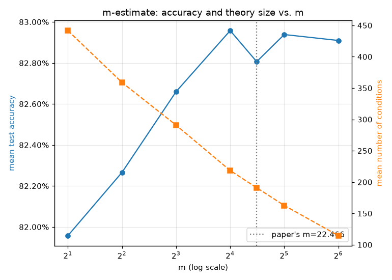

# Rule learning heuristics in separate-and-conquer (after Janssen & Fürnkranz)

## Setup

**Full run** (69 datasets, 10-fold). Quick sanity check instead: `python demos/heuristic_comparison.py` with no arguments.

Rule learning heuristics compared inside one plain separate-and-conquer
learner, after Janssen & Fürnkranz (Machine Learning, 2010). The learner
follows the paper's Algorithms 1 and 2: greedy top-down search that
refines until no refinement is left and returns the best rule
encountered (`BeamSearch(beam_width=1)`), no stopping criterion and no
pruning; covering stops once a new rule covers no more positives than
negatives; multi-class problems use ordered class binarization (least
frequent class first, the largest class as the default rule).

Heuristics: the paper's standard ones (Precision, Laplace, Accuracy,
WRA, Correlation), its tuned parametrized ones (cost c=0.437, relative
cost c_r=0.342, F-measure beta=0.5, m-estimate m=22.466), and an
m-estimate sweep over m in {2, 4, 8, 16, 32, 64}.
Benchmarks: Weka's JRip and pyrulearn's Pypper, both with their own
pruning, and both also use ordered class binarization. What each
heuristic prefers is visualized by its coverage-space isometrics in the
companion demo, [heuristic_isometrics](heuristic_isometrics_report.md).

Datasets: 69 datasets of the catalog (44 binary, 25 multi-class), those of the [separate-and-conquer comparison](seco_learners_comparison_report.md), not the paper's. Numeric attributes are discretized per
training fold (`build_dataspec(discretizer=TreeDiscretizer(max_intervals=8))`) instead
of the paper's tests at every midpoint. Each fit is capped at 600s (3600s for `letter`); a timeout counts as a failure.

A fold that times out fails the whole cross-validation of that learner on that dataset (`run_cv`'s `stop_on_timeout`): its remaining folds are not run, and all its folds count as failures, so no mean rests on just the folds that finished.

Measures: test accuracy, number of rules and conditions, fit time.

Every learner runs single-threaded; fits run 20 at a time (`run_cv`'s `n_jobs`), each in its own process and timed there, with the numerical libraries limited to one thread (`OMP_NUM_THREADS=1` and its relatives). A check of the `dense_vs_modular` learners on 11 datasets found the fit times of 5 concurrent fits as close to a sequential run as a second sequential run (per-learner ratios and rankings alike); time ratios between learners are reproducible to about +-10% either way.

The summary and the per-dataset results below are for the heuristics as
in the paper; the [last section](#the-inverted-m-estimate-for-refinement)
adds the inverted m-estimate for refinement, with the m-estimate
selecting.

## Summary by learner (mean across every dataset and fold)

| learner | accuracy | n_rules | n_conditions | conds/rule | fit_time (s) | wins | mean rank | failures |
|---|--:|--:|--:|--:|--:|--:|--:|--:|
| Pypper | 83.29% | 13.1 | 56.1 | 3.0 | 0.32 | 5.2 | 6.06 | 0 |
| Weka:JRip | 83.08% | 14.9 | 65.4 | 3.0 | 3.73 | 18.7 | 5.96 | 0 |
| m-estimate (m=16) | 82.96% | 42.6 | 218.4 | 4.1 | 0.43 | 9.3 | 7.58 | 0 |
| m-estimate (m=32) | 82.94% | 29.4 | 162.6 | 4.7 | 0.37 | 3.3 | 6.94 | 0 |
| m-estimate (m=64) | 82.91% | 19.8 | 114.5 | 5.1 | 0.30 | 6.1 | 7.57 | 0 |
| m-estimate (m=22.466) | 82.81% | 35.8 | 190.9 | 4.4 | 0.40 | 2.3 | 7.54 | 0 |
| m-estimate (m=8) | 82.66% | 60.4 | 290.8 | 3.8 | 0.46 | 0.6 | 8.52 | 0 |
| m-estimate (m=4) | 82.27% | 78.5 | 358.9 | 3.5 | 0.50 | 3.2 | 9.14 | 0 |
| Correlation | 82.09% | 23.8 | 135.3 | 4.2 | 0.23 | 4.1 | 8.74 | 0 |
| m-estimate (m=2) | 81.96% | 99.3 | 441.7 | 3.4 | 0.58 | 1.7 | 9.58 | 0 |
| F-measure (beta=0.5) | 81.75% | 35.9 | 162.9 | 4.0 | 0.32 | 2.1 | 9.46 | 0 |
| relative cost (c_r=0.342) | 81.34% | 14.4 | 64.4 | 3.9 | 0.17 | 2.5 | 9.70 | 0 |
| Laplace | 81.21% | 126.1 | 533.9 | 3.1 | 0.70 | 0.7 | 11.04 | 0 |
| Precision | 80.90% | 212.2 | 878.7 | 3.1 | 1.17 | 1.3 | 11.72 | 0 |
| Accuracy | 80.29% | 139.3 | 568.8 | 3.0 | 0.85 | 0.1 | 11.33 | 0 |
| cost (c=0.437) | 80.18% | 157.5 | 637.2 | 3.0 | 0.91 | 2.1 | 11.53 | 0 |
| WRA | 79.52% | 4.3 | 20.6 | 4.4 | 0.09 | 6.0 | 10.57 | 0 |

`wins` -- datasets where a learner's mean accuracy was (tied-for-)best, a tie split evenly; `mean rank` -- average accuracy rank across datasets, failures tied for last.

## Per-dataset results, per learner (mean across folds)

| dataset | learner | accuracy | n_rules | conds_per_rule | n_conditions | fit_time |
|---|---|---|---|---|---|---|
| SPECT | Accuracy | 76.78% | 2.4 | 5.5 | 12.9 | 0.012 |
| SPECT | Correlation | 77.59% | 4.1 | 7.2 | 28.6 | 0.016 |
| SPECT | F-measure (beta=0.5) | 75.24% | 4.9 | 7.3 | 33.2 | 0.027 |
| SPECT | Laplace | 77.49% | 8.5 | 5.2 | 44.4 | 0.020 |
| SPECT | Precision | 76.34% | 13.1 | 5.7 | 74.4 | 0.029 |
| SPECT | Pypper | 80.11% | 1.0 | 5.7 | 5.7 | 0.049 |
| SPECT | WRA | 81.72% | 0.9 | 6.4 | 5.8 | 0.006 |
| SPECT | Weka:JRip | 80.87% | 1.0 | 5.5 | 5.5 | 0.319 |
| SPECT | cost (c=0.437) | 76.81% | 1.7 | 4.1 | 7.3 | 0.009 |
| SPECT | m-estimate (m=16) | 80.94% | 2.2 | 8.3 | 17.9 | 0.017 |
| SPECT | m-estimate (m=2) | 77.89% | 7.3 | 5.8 | 42.0 | 0.027 |
| SPECT | m-estimate (m=22.466) | 81.67% | 1.7 | 8.5 | 14.5 | 0.016 |
| SPECT | m-estimate (m=32) | 80.56% | 1.4 | 8.2 | 11.6 | 0.012 |
| SPECT | m-estimate (m=4) | 76.79% | 5.0 | 6.4 | 31.3 | 0.023 |
| SPECT | m-estimate (m=64) | 79.40% | 1.3 | 7.5 | 9.6 | 0.012 |
| SPECT | m-estimate (m=8) | 79.79% | 3.1 | 7.3 | 22.2 | 0.020 |
| SPECT | relative cost (c_r=0.342) | 78.30% | 1.5 | 7.7 | 11.3 | 0.010 |
| Titanic | Accuracy | 79.68% | 4.1 | 2.2 | 9.0 | 0.015 |
| Titanic | Correlation | 79.37% | 2.3 | 2.7 | 6.1 | 0.016 |
| Titanic | F-measure (beta=0.5) | 79.45% | 2.5 | 2.7 | 6.6 | 0.017 |
| Titanic | Laplace | 79.30% | 28.6 | 3.4 | 98.4 | 0.064 |
| Titanic | Precision | 79.07% | 52.0 | 3.5 | 180.1 | 0.110 |
| Titanic | Pypper | 79.76% | 2.6 | 2.3 | 6.0 | 0.069 |
| Titanic | WRA | 78.53% | 1.0 | 3.1 | 3.1 | 0.008 |
| Titanic | Weka:JRip | 78.91% | 2.9 | 2.2 | 6.4 | 0.475 |
| Titanic | cost (c=0.437) | 79.60% | 4.3 | 1.8 | 8.0 | 0.013 |
| Titanic | m-estimate (m=16) | 78.38% | 7.4 | 3.8 | 28.2 | 0.037 |
| Titanic | m-estimate (m=2) | 77.85% | 29.4 | 3.8 | 112.0 | 0.085 |
| Titanic | m-estimate (m=22.466) | 78.61% | 5.9 | 4.1 | 24.4 | 0.032 |
| Titanic | m-estimate (m=32) | 79.53% | 4.2 | 3.0 | 12.6 | 0.023 |
| Titanic | m-estimate (m=4) | 77.54% | 21.9 | 3.9 | 86.2 | 0.075 |
| Titanic | m-estimate (m=64) | 79.07% | 3.0 | 2.4 | 7.3 | 0.019 |
| Titanic | m-estimate (m=8) | 77.85% | 14.4 | 3.9 | 57.2 | 0.058 |
| Titanic | relative cost (c_r=0.342) | 79.98% | 2.9 | 2.6 | 7.4 | 0.017 |
| anneal | Accuracy | 94.76% | 16.5 | 1.8 | 30.6 | 0.052 |
| anneal | Correlation | 93.99% | 11.0 | 2.0 | 22.2 | 0.045 |
| anneal | F-measure (beta=0.5) | 96.43% | 17.3 | 2.1 | 36.2 | 0.064 |
| anneal | Laplace | 96.32% | 22.1 | 2.5 | 55.6 | 0.061 |
| anneal | Precision | 96.32% | 26.8 | 2.7 | 73.0 | 0.071 |
| anneal | Pypper | 94.32% | 8.9 | 2.5 | 22.5 | 0.147 |
| anneal | WRA | 91.64% | 6.1 | 2.5 | 15.5 | 0.030 |
| anneal | Weka:JRip | 89.98% | 6.7 | 1.6 | 10.9 | 0.706 |
| anneal | cost (c=0.437) | 94.20% | 16.9 | 1.8 | 30.6 | 0.044 |
| anneal | m-estimate (m=16) | 96.55% | 15.3 | 2.1 | 32.1 | 0.063 |
| anneal | m-estimate (m=2) | 96.99% | 21.8 | 2.3 | 50.9 | 0.078 |
| anneal | m-estimate (m=22.466) | 95.99% | 13.0 | 2.0 | 26.0 | 0.056 |
| anneal | m-estimate (m=32) | 94.65% | 11.8 | 1.7 | 20.1 | 0.052 |
| anneal | m-estimate (m=4) | 97.66% | 20.3 | 2.3 | 46.1 | 0.070 |
| anneal | m-estimate (m=64) | 93.20% | 10.3 | 1.7 | 17.8 | 0.031 |
| anneal | m-estimate (m=8) | 96.66% | 18.1 | 2.1 | 37.7 | 0.066 |
| anneal | relative cost (c_r=0.342) | 93.09% | 8.0 | 2.1 | 16.5 | 0.034 |
| audiology | Accuracy | 80.99% | 40.4 | 2.1 | 85.1 | 0.067 |
| audiology | Correlation | 84.05% | 34.0 | 2.1 | 72.5 | 0.064 |
| audiology | F-measure (beta=0.5) | 77.49% | 42.3 | 2.0 | 85.5 | 0.060 |
| audiology | Laplace | 74.33% | 55.0 | 1.9 | 105.2 | 0.061 |
| audiology | Precision | 75.22% | 67.0 | 1.9 | 130.3 | 0.077 |
| audiology | Pypper | 75.71% | 11.1 | 1.6 | 17.3 | 0.125 |
| audiology | WRA | 82.77% | 23.2 | 2.5 | 59.1 | 0.085 |
| audiology | Weka:JRip | 74.84% | 14.7 | 1.8 | 26.2 | 0.453 |
| audiology | cost (c=0.437) | 79.17% | 44.0 | 2.1 | 93.3 | 0.052 |
| audiology | m-estimate (m=16) | 83.18% | 31.8 | 2.2 | 70.0 | 0.057 |
| audiology | m-estimate (m=2) | 77.94% | 44.6 | 2.0 | 88.2 | 0.053 |
| audiology | m-estimate (m=22.466) | 83.62% | 29.1 | 2.3 | 68.0 | 0.060 |
| audiology | m-estimate (m=32) | 84.98% | 27.7 | 2.3 | 63.9 | 0.077 |
| audiology | m-estimate (m=4) | 79.66% | 39.0 | 2.1 | 82.7 | 0.052 |
| audiology | m-estimate (m=64) | 84.55% | 25.9 | 2.4 | 61.6 | 0.128 |
| audiology | m-estimate (m=8) | 80.55% | 34.9 | 2.2 | 75.4 | 0.053 |
| audiology | relative cost (c_r=0.342) | 82.75% | 24.3 | 2.6 | 62.1 | 0.088 |
| balance-scale | Accuracy | 77.61% | 65.6 | 3.7 | 240.8 | 0.106 |
| balance-scale | Correlation | 78.72% | 13.3 | 3.2 | 41.7 | 0.030 |
| balance-scale | F-measure (beta=0.5) | 80.63% | 16.2 | 2.9 | 47.5 | 0.039 |
| balance-scale | Laplace | 78.88% | 92.7 | 3.5 | 326.9 | 0.128 |
| balance-scale | Precision | 77.27% | 125.4 | 3.4 | 425.5 | 0.174 |
| balance-scale | Pypper | 78.38% | 7.9 | 3.0 | 23.8 | 0.079 |
| balance-scale | WRA | 72.65% | 2.5 | 2.5 | 6.5 | 0.011 |
| balance-scale | Weka:JRip | 80.31% | 8.1 | 3.1 | 25.2 | 0.422 |
| balance-scale | cost (c=0.437) | 80.63% | 70.1 | 3.6 | 255.3 | 0.098 |
| balance-scale | m-estimate (m=16) | 82.70% | 13.0 | 3.0 | 39.2 | 0.038 |
| balance-scale | m-estimate (m=2) | 73.10% | 78.0 | 4.3 | 335.2 | 0.131 |
| balance-scale | m-estimate (m=22.466) | 79.83% | 11.1 | 3.0 | 33.1 | 0.031 |
| balance-scale | m-estimate (m=32) | 80.94% | 8.4 | 2.9 | 25.1 | 0.030 |
| balance-scale | m-estimate (m=4) | 77.26% | 27.8 | 3.2 | 89.8 | 0.056 |
| balance-scale | m-estimate (m=64) | 77.26% | 5.8 | 2.6 | 15.3 | 0.016 |
| balance-scale | m-estimate (m=8) | 76.64% | 21.8 | 3.3 | 71.1 | 0.051 |
| balance-scale | relative cost (c_r=0.342) | 76.62% | 4.9 | 2.5 | 12.2 | 0.014 |
| banknote-authentication | Accuracy | 96.14% | 6.8 | 2.1 | 15.6 | 0.023 |
| banknote-authentication | Correlation | 97.45% | 5.4 | 2.3 | 12.6 | 0.032 |
| banknote-authentication | F-measure (beta=0.5) | 97.52% | 8.7 | 2.7 | 23.3 | 0.041 |
| banknote-authentication | Laplace | 98.62% | 15.4 | 2.6 | 40.8 | 0.040 |
| banknote-authentication | Precision | 98.18% | 38.4 | 2.5 | 97.7 | 0.083 |
| banknote-authentication | Pypper | 98.47% | 5.2 | 2.3 | 12.2 | 0.079 |
| banknote-authentication | WRA | 90.52% | 3.1 | 2.2 | 7.0 | 0.021 |
| banknote-authentication | Weka:JRip | 98.91% | 5.3 | 2.3 | 12.0 | 0.582 |
| banknote-authentication | cost (c=0.437) | 96.35% | 8.2 | 2.3 | 19.9 | 0.028 |
| banknote-authentication | m-estimate (m=16) | 98.69% | 9.2 | 2.6 | 23.8 | 0.037 |
| banknote-authentication | m-estimate (m=2) | 98.76% | 14.1 | 2.6 | 37.4 | 0.044 |
| banknote-authentication | m-estimate (m=22.466) | 98.62% | 8.8 | 2.5 | 22.2 | 0.038 |
| banknote-authentication | m-estimate (m=32) | 98.32% | 8.0 | 2.4 | 19.2 | 0.043 |
| banknote-authentication | m-estimate (m=4) | 98.69% | 13.9 | 2.6 | 36.8 | 0.040 |
| banknote-authentication | m-estimate (m=64) | 98.03% | 7.1 | 2.4 | 16.9 | 0.028 |
| banknote-authentication | m-estimate (m=8) | 98.83% | 11.5 | 2.6 | 29.9 | 0.040 |
| banknote-authentication | relative cost (c_r=0.342) | 93.66% | 3.5 | 2.4 | 8.5 | 0.025 |
| blood-transfusion-service-center | Accuracy | 76.34% | 2.0 | 2.3 | 4.6 | 0.014 |
| blood-transfusion-service-center | Correlation | 78.33% | 1.7 | 3.0 | 4.8 | 0.019 |
| blood-transfusion-service-center | F-measure (beta=0.5) | 78.47% | 1.6 | 3.1 | 4.8 | 0.018 |
| blood-transfusion-service-center | Laplace | 77.01% | 4.5 | 2.3 | 11.5 | 0.019 |
| blood-transfusion-service-center | Precision | 77.14% | 6.8 | 2.3 | 17.0 | 0.024 |
| blood-transfusion-service-center | Pypper | 78.33% | 2.0 | 2.8 | 5.6 | 0.062 |
| blood-transfusion-service-center | WRA | 76.21% | 0.0 | n/a | 0.0 | 0.008 |
| blood-transfusion-service-center | Weka:JRip | 79.14% | 2.0 | 2.5 | 5.1 | 0.532 |
| blood-transfusion-service-center | cost (c=0.437) | 76.47% | 2.9 | 2.2 | 6.5 | 0.016 |
| blood-transfusion-service-center | m-estimate (m=16) | 77.93% | 2.2 | 2.9 | 6.4 | 0.021 |
| blood-transfusion-service-center | m-estimate (m=2) | 78.34% | 5.5 | 3.2 | 17.8 | 0.032 |
| blood-transfusion-service-center | m-estimate (m=22.466) | 78.07% | 2.1 | 3.0 | 6.4 | 0.019 |
| blood-transfusion-service-center | m-estimate (m=32) | 77.80% | 2.0 | 2.8 | 5.5 | 0.018 |
| blood-transfusion-service-center | m-estimate (m=4) | 78.21% | 4.4 | 3.2 | 14.2 | 0.030 |
| blood-transfusion-service-center | m-estimate (m=64) | 77.40% | 1.5 | 3.1 | 4.5 | 0.010 |
| blood-transfusion-service-center | m-estimate (m=8) | 78.21% | 3.3 | 3.3 | 10.9 | 0.026 |
| blood-transfusion-service-center | relative cost (c_r=0.342) | 76.60% | 2.0 | 2.3 | 4.7 | 0.015 |
| breast-cancer | Accuracy | 72.38% | 10.9 | 2.4 | 27.2 | 0.026 |
| breast-cancer | Correlation | 67.49% | 3.3 | 8.1 | 35.9 | 0.032 |
| breast-cancer | F-measure (beta=0.5) | 67.54% | 8.4 | 4.6 | 38.3 | 0.061 |
| breast-cancer | Laplace | 70.58% | 22.7 | 2.5 | 58.4 | 0.037 |
| breast-cancer | Precision | 68.84% | 36.3 | 2.6 | 95.1 | 0.059 |
| breast-cancer | Pypper | 74.84% | 1.0 | 2.0 | 2.0 | 0.057 |
| breast-cancer | WRA | 68.46% | 1.2 | 5.0 | 6.1 | 0.017 |
| breast-cancer | Weka:JRip | 71.37% | 1.3 | 1.9 | 2.5 | 0.491 |
| breast-cancer | cost (c=0.437) | 71.32% | 14.8 | 2.2 | 34.9 | 0.027 |
| breast-cancer | m-estimate (m=16) | 63.26% | 8.9 | 4.8 | 41.3 | 0.055 |
| breast-cancer | m-estimate (m=2) | 70.23% | 24.4 | 2.8 | 69.8 | 0.050 |
| breast-cancer | m-estimate (m=22.466) | 63.24% | 8.9 | 4.9 | 43.1 | 0.059 |
| breast-cancer | m-estimate (m=32) | 66.48% | 6.5 | 5.6 | 35.6 | 0.049 |
| breast-cancer | m-estimate (m=4) | 67.84% | 21.9 | 3.2 | 70.0 | 0.057 |
| breast-cancer | m-estimate (m=64) | 65.02% | 3.8 | 5.8 | 21.6 | 0.024 |
| breast-cancer | m-estimate (m=8) | 67.78% | 15.8 | 4.3 | 68.2 | 0.072 |
| breast-cancer | relative cost (c_r=0.342) | 66.79% | 10.7 | 3.8 | 38.7 | 0.049 |
| breast-w | Accuracy | 95.71% | 8.9 | 1.7 | 14.9 | 0.020 |
| breast-w | Correlation | 94.56% | 6.1 | 1.9 | 11.8 | 0.018 |
| breast-w | F-measure (beta=0.5) | 95.57% | 11.0 | 2.1 | 23.5 | 0.028 |
| breast-w | Laplace | 94.99% | 21.0 | 1.6 | 34.1 | 0.032 |
| breast-w | Precision | 94.57% | 42.9 | 1.6 | 69.2 | 0.060 |
| breast-w | Pypper | 95.57% | 3.9 | 2.1 | 8.1 | 0.040 |
| breast-w | WRA | 94.56% | 2.9 | 2.5 | 7.1 | 0.019 |
| breast-w | Weka:JRip | 95.42% | 4.5 | 1.9 | 8.5 | 0.555 |
| breast-w | cost (c=0.437) | 96.00% | 10.0 | 1.7 | 17.0 | 0.020 |
| breast-w | m-estimate (m=16) | 95.28% | 6.7 | 3.7 | 24.8 | 0.025 |
| breast-w | m-estimate (m=2) | 95.28% | 16.8 | 1.8 | 29.8 | 0.029 |
| breast-w | m-estimate (m=22.466) | 96.00% | 6.0 | 3.7 | 22.3 | 0.031 |
| breast-w | m-estimate (m=32) | 96.28% | 5.5 | 3.9 | 21.5 | 0.035 |
| breast-w | m-estimate (m=4) | 94.85% | 13.0 | 2.1 | 26.7 | 0.023 |
| breast-w | m-estimate (m=64) | 95.28% | 4.6 | 4.8 | 22.0 | 0.038 |
| breast-w | m-estimate (m=8) | 94.99% | 9.2 | 2.8 | 25.5 | 0.024 |
| breast-w | relative cost (c_r=0.342) | 94.13% | 3.0 | 2.0 | 5.9 | 0.021 |
| car | Accuracy | 88.94% | 48.3 | 5.0 | 240.4 | 0.129 |
| car | Correlation | 82.87% | 5.4 | 4.5 | 24.4 | 0.022 |
| car | F-measure (beta=0.5) | 91.26% | 28.6 | 5.0 | 141.5 | 0.082 |
| car | Laplace | 92.19% | 80.5 | 4.8 | 386.8 | 0.187 |
| car | Precision | 86.57% | 152.8 | 4.9 | 746.8 | 0.331 |
| car | Pypper | 94.56% | 23.2 | 5.1 | 118.9 | 0.344 |
| car | WRA | 82.00% | 4.0 | 4.2 | 17.0 | 0.018 |
| car | Weka:JRip | 94.33% | 18.2 | 4.9 | 90.1 | 0.717 |
| car | cost (c=0.437) | 89.35% | 60.8 | 5.1 | 308.2 | 0.139 |
| car | m-estimate (m=16) | 93.29% | 24.1 | 4.9 | 117.3 | 0.084 |
| car | m-estimate (m=2) | 94.21% | 67.6 | 4.8 | 327.5 | 0.164 |
| car | m-estimate (m=22.466) | 93.34% | 19.9 | 4.8 | 94.9 | 0.061 |
| car | m-estimate (m=32) | 92.88% | 16.0 | 4.7 | 75.8 | 0.047 |
| car | m-estimate (m=4) | 94.68% | 52.8 | 4.8 | 256.0 | 0.136 |
| car | m-estimate (m=64) | 92.36% | 11.0 | 4.7 | 51.4 | 0.059 |
| car | m-estimate (m=8) | 94.68% | 38.9 | 4.7 | 184.7 | 0.110 |
| car | relative cost (c_r=0.342) | 82.00% | 5.0 | 3.8 | 19.0 | 0.020 |
| churn | Accuracy | 88.56% | 217.2 | 4.1 | 894.2 | 1.013 |
| churn | Correlation | 92.88% | 31.9 | 9.3 | 369.5 | 0.375 |
| churn | F-measure (beta=0.5) | 92.96% | 9.9 | 4.3 | 44.4 | 0.155 |
| churn | Laplace | 88.54% | 231.5 | 4.2 | 972.4 | 1.047 |
| churn | Precision | 89.04% | 292.0 | 4.1 | 1201.7 | 1.245 |
| churn | Pypper | 93.92% | 10.6 | 2.9 | 30.8 | 0.228 |
| churn | WRA | 85.58% | 0.5 | 6.6 | 3.3 | 0.039 |
| churn | Weka:JRip | 93.96% | 11.1 | 3.0 | 33.0 | 2.689 |
| churn | cost (c=0.437) | 87.72% | 260.5 | 4.0 | 1045.9 | 1.149 |
| churn | m-estimate (m=16) | 92.24% | 44.7 | 5.3 | 244.2 | 0.449 |
| churn | m-estimate (m=2) | 89.44% | 173.3 | 4.6 | 799.8 | 0.848 |
| churn | m-estimate (m=22.466) | 93.64% | 19.1 | 4.9 | 94.7 | 0.256 |
| churn | m-estimate (m=32) | 93.40% | 18.0 | 5.3 | 97.1 | 0.230 |
| churn | m-estimate (m=4) | 90.98% | 116.1 | 4.6 | 553.9 | 0.651 |
| churn | m-estimate (m=64) | 93.04% | 8.6 | 4.3 | 37.7 | 0.142 |
| churn | m-estimate (m=8) | 91.48% | 91.8 | 5.2 | 486.5 | 0.664 |
| churn | relative cost (c_r=0.342) | 88.40% | 1.0 | 6.1 | 6.1 | 0.050 |
| climate-model-simulation-crashes | Accuracy | 87.04% | 31.0 | 2.4 | 74.9 | 0.060 |
| climate-model-simulation-crashes | Correlation | 91.67% | 11.3 | 3.2 | 36.4 | 0.041 |
| climate-model-simulation-crashes | F-measure (beta=0.5) | 87.96% | 16.4 | 2.7 | 43.9 | 0.046 |
| climate-model-simulation-crashes | Laplace | 87.78% | 27.3 | 2.4 | 65.8 | 0.057 |
| climate-model-simulation-crashes | Precision | 87.41% | 31.5 | 2.4 | 75.6 | 0.065 |
| climate-model-simulation-crashes | Pypper | 94.07% | 2.9 | 3.1 | 9.2 | 0.044 |
| climate-model-simulation-crashes | WRA | 90.19% | 0.1 | 12.0 | 1.2 | 0.016 |
| climate-model-simulation-crashes | Weka:JRip | 94.81% | 2.7 | 3.0 | 8.1 | 0.571 |
| climate-model-simulation-crashes | cost (c=0.437) | 86.48% | 32.4 | 2.4 | 78.1 | 0.060 |
| climate-model-simulation-crashes | m-estimate (m=16) | 89.44% | 11.2 | 3.3 | 36.6 | 0.045 |
| climate-model-simulation-crashes | m-estimate (m=2) | 89.07% | 23.2 | 2.4 | 55.9 | 0.050 |
| climate-model-simulation-crashes | m-estimate (m=22.466) | 90.19% | 9.6 | 3.7 | 35.5 | 0.049 |
| climate-model-simulation-crashes | m-estimate (m=32) | 91.30% | 8.8 | 3.9 | 34.5 | 0.043 |
| climate-model-simulation-crashes | m-estimate (m=4) | 88.52% | 19.3 | 2.6 | 49.9 | 0.043 |
| climate-model-simulation-crashes | m-estimate (m=64) | 90.56% | 5.7 | 4.5 | 25.4 | 0.058 |
| climate-model-simulation-crashes | m-estimate (m=8) | 90.00% | 14.8 | 2.9 | 42.7 | 0.037 |
| climate-model-simulation-crashes | relative cost (c_r=0.342) | 91.11% | 3.2 | 5.4 | 16.6 | 0.039 |
| cmc | Accuracy | 51.40% | 24.8 | 3.2 | 81.0 | 0.065 |
| cmc | Correlation | 52.00% | 7.3 | 5.8 | 44.7 | 0.042 |
| cmc | F-measure (beta=0.5) | 53.91% | 8.1 | 5.3 | 41.7 | 0.054 |
| cmc | Laplace | 48.68% | 78.3 | 4.8 | 389.7 | 0.202 |
| cmc | Precision | 48.41% | 126.0 | 4.9 | 638.8 | 0.301 |
| cmc | Pypper | 54.52% | 4.2 | 3.2 | 13.5 | 0.139 |
| cmc | WRA | 50.52% | 1.6 | 4.2 | 6.7 | 0.021 |
| cmc | Weka:JRip | 51.94% | 3.6 | 3.9 | 14.5 | 0.596 |
| cmc | cost (c=0.437) | 42.84% | 29.0 | 3.2 | 99.5 | 0.068 |
| cmc | m-estimate (m=16) | 51.81% | 28.7 | 6.3 | 181.3 | 0.143 |
| cmc | m-estimate (m=2) | 51.13% | 99.6 | 5.5 | 549.0 | 0.338 |
| cmc | m-estimate (m=22.466) | 51.47% | 20.2 | 6.2 | 124.9 | 0.122 |
| cmc | m-estimate (m=32) | 52.35% | 15.4 | 6.3 | 97.0 | 0.099 |
| cmc | m-estimate (m=4) | 50.25% | 82.8 | 5.8 | 483.3 | 0.334 |
| cmc | m-estimate (m=64) | 55.61% | 7.8 | 6.7 | 51.3 | 0.050 |
| cmc | m-estimate (m=8) | 50.45% | 50.6 | 6.2 | 314.6 | 0.226 |
| cmc | relative cost (c_r=0.342) | 48.89% | 32.1 | 3.5 | 120.5 | 0.086 |
| colic | Accuracy | 80.18% | 24.7 | 2.5 | 61.0 | 0.034 |
| colic | Correlation | 83.73% | 13.7 | 3.1 | 42.0 | 0.030 |
| colic | F-measure (beta=0.5) | 82.35% | 15.9 | 2.8 | 44.2 | 0.038 |
| colic | Laplace | 76.39% | 37.8 | 2.6 | 98.3 | 0.050 |
| colic | Precision | 76.91% | 61.7 | 2.6 | 158.2 | 0.079 |
| colic | Pypper | 83.72% | 3.0 | 2.3 | 7.0 | 0.035 |
| colic | WRA | 83.72% | 1.4 | 2.3 | 3.5 | 0.009 |
| colic | Weka:JRip | 84.50% | 3.4 | 2.5 | 8.4 | 0.383 |
| colic | cost (c=0.437) | 79.08% | 26.8 | 2.4 | 64.2 | 0.035 |
| colic | m-estimate (m=16) | 79.08% | 10.6 | 4.0 | 39.3 | 0.034 |
| colic | m-estimate (m=2) | 76.12% | 28.4 | 3.0 | 84.5 | 0.051 |
| colic | m-estimate (m=22.466) | 80.46% | 8.5 | 4.2 | 35.3 | 0.035 |
| colic | m-estimate (m=32) | 81.55% | 7.0 | 4.4 | 30.2 | 0.038 |
| colic | m-estimate (m=4) | 77.21% | 22.8 | 3.2 | 72.7 | 0.041 |
| colic | m-estimate (m=64) | 82.64% | 4.5 | 4.8 | 21.2 | 0.025 |
| colic | m-estimate (m=8) | 74.47% | 13.8 | 3.7 | 50.4 | 0.042 |
| colic | relative cost (c_r=0.342) | 83.18% | 5.4 | 3.9 | 21.4 | 0.024 |
| compas-two-years | Accuracy | 65.97% | 13.1 | 3.0 | 40.1 | 0.090 |
| compas-two-years | Correlation | 65.10% | 2.3 | 3.9 | 8.9 | 0.041 |
| compas-two-years | F-measure (beta=0.5) | 65.73% | 2.0 | 3.6 | 7.2 | 0.038 |
| compas-two-years | Laplace | 64.53% | 125.0 | 4.8 | 607.1 | 0.631 |
| compas-two-years | Precision | 64.55% | 229.4 | 4.4 | 1012.3 | 1.109 |
| compas-two-years | Pypper | 67.03% | 4.8 | 3.1 | 15.5 | 0.230 |
| compas-two-years | WRA | 63.49% | 1.7 | 3.0 | 5.1 | 0.030 |
| compas-two-years | Weka:JRip | 68.00% | 6.0 | 2.8 | 16.6 | 1.706 |
| compas-two-years | cost (c=0.437) | 64.36% | 13.1 | 2.9 | 37.3 | 0.081 |
| compas-two-years | m-estimate (m=16) | 66.52% | 37.3 | 5.9 | 219.3 | 0.303 |
| compas-two-years | m-estimate (m=2) | 65.84% | 126.4 | 5.2 | 660.0 | 0.718 |
| compas-two-years | m-estimate (m=22.466) | 66.75% | 29.9 | 6.0 | 179.6 | 0.259 |
| compas-two-years | m-estimate (m=32) | 66.79% | 21.8 | 5.9 | 129.7 | 0.203 |
| compas-two-years | m-estimate (m=4) | 65.23% | 94.9 | 5.5 | 522.7 | 0.610 |
| compas-two-years | m-estimate (m=64) | 67.11% | 13.9 | 5.8 | 80.1 | 0.142 |
| compas-two-years | m-estimate (m=8) | 65.69% | 57.8 | 5.5 | 321.3 | 0.426 |
| compas-two-years | relative cost (c_r=0.342) | 64.15% | 12.8 | 3.1 | 40.2 | 0.088 |
| credit-approval | Accuracy | 82.32% | 17.7 | 2.3 | 44.3 | 0.037 |
| credit-approval | Correlation | 81.88% | 14.1 | 3.0 | 43.4 | 0.041 |
| credit-approval | F-measure (beta=0.5) | 81.74% | 22.8 | 3.6 | 82.4 | 0.084 |
| credit-approval | Laplace | 80.14% | 49.7 | 2.8 | 144.3 | 0.072 |
| credit-approval | Precision | 80.29% | 97.1 | 2.8 | 273.0 | 0.141 |
| credit-approval | Pypper | 85.36% | 2.7 | 2.0 | 6.3 | 0.046 |
| credit-approval | WRA | 83.62% | 1.0 | 3.4 | 3.4 | 0.013 |
| credit-approval | Weka:JRip | 84.78% | 4.2 | 2.2 | 10.1 | 0.433 |
| credit-approval | cost (c=0.437) | 83.04% | 21.2 | 2.4 | 54.1 | 0.037 |
| credit-approval | m-estimate (m=16) | 83.48% | 14.7 | 5.5 | 81.6 | 0.080 |
| credit-approval | m-estimate (m=2) | 82.46% | 41.8 | 3.1 | 131.5 | 0.075 |
| credit-approval | m-estimate (m=22.466) | 83.33% | 9.1 | 5.5 | 49.5 | 0.071 |
| credit-approval | m-estimate (m=32) | 83.62% | 7.6 | 5.2 | 39.5 | 0.060 |
| credit-approval | m-estimate (m=4) | 82.46% | 37.2 | 3.5 | 130.5 | 0.083 |
| credit-approval | m-estimate (m=64) | 83.91% | 3.9 | 6.3 | 24.5 | 0.037 |
| credit-approval | m-estimate (m=8) | 81.59% | 24.8 | 4.1 | 101.0 | 0.091 |
| credit-approval | relative cost (c_r=0.342) | 85.36% | 2.4 | 4.2 | 9.8 | 0.024 |
| credit-g | Accuracy | 68.00% | 139.8 | 3.3 | 458.2 | 0.327 |
| credit-g | Correlation | 67.40% | 29.1 | 6.1 | 176.5 | 0.120 |
| credit-g | F-measure (beta=0.5) | 67.40% | 34.0 | 5.3 | 182.0 | 0.168 |
| credit-g | Laplace | 68.10% | 134.0 | 3.2 | 431.3 | 0.269 |
| credit-g | Precision | 69.40% | 193.0 | 3.2 | 619.1 | 0.391 |
| credit-g | Pypper | 70.40% | 3.4 | 3.7 | 13.0 | 0.080 |
| credit-g | WRA | 69.00% | 1.2 | 7.8 | 9.1 | 0.023 |
| credit-g | Weka:JRip | 71.20% | 3.6 | 3.5 | 12.9 | 0.621 |
| credit-g | cost (c=0.437) | 68.10% | 159.5 | 3.2 | 513.3 | 0.318 |
| credit-g | m-estimate (m=16) | 66.20% | 45.0 | 5.4 | 244.4 | 0.219 |
| credit-g | m-estimate (m=2) | 70.90% | 100.6 | 3.4 | 338.7 | 0.239 |
| credit-g | m-estimate (m=22.466) | 67.00% | 37.0 | 6.1 | 225.8 | 0.232 |
| credit-g | m-estimate (m=32) | 68.10% | 29.9 | 7.0 | 208.7 | 0.248 |
| credit-g | m-estimate (m=4) | 68.30% | 78.9 | 3.7 | 288.7 | 0.194 |
| credit-g | m-estimate (m=64) | 68.80% | 15.9 | 8.7 | 136.1 | 0.135 |
| credit-g | m-estimate (m=8) | 67.00% | 61.4 | 4.3 | 263.0 | 0.194 |
| credit-g | relative cost (c_r=0.342) | 67.70% | 19.8 | 6.5 | 129.7 | 0.161 |
| cylinder-bands | Accuracy | 74.44% | 65.1 | 2.2 | 142.0 | 0.265 |
| cylinder-bands | Correlation | 72.22% | 28.9 | 4.5 | 126.4 | 0.216 |
| cylinder-bands | F-measure (beta=0.5) | 72.59% | 29.7 | 3.4 | 100.5 | 0.325 |
| cylinder-bands | Laplace | 75.00% | 83.5 | 1.9 | 157.6 | 0.175 |
| cylinder-bands | Precision | 74.81% | 120.7 | 1.9 | 226.3 | 0.265 |
| cylinder-bands | Pypper | 66.48% | 3.7 | 3.1 | 11.4 | 0.092 |
| cylinder-bands | WRA | 64.81% | 3.7 | 16.9 | 64.7 | 0.255 |
| cylinder-bands | Weka:JRip | 65.00% | 6.1 | 2.7 | 16.8 | 0.765 |
| cylinder-bands | cost (c=0.437) | 74.26% | 81.6 | 2.4 | 192.8 | 0.207 |
| cylinder-bands | m-estimate (m=16) | 73.33% | 36.3 | 2.8 | 101.5 | 0.277 |
| cylinder-bands | m-estimate (m=2) | 75.74% | 70.6 | 1.9 | 135.9 | 0.165 |
| cylinder-bands | m-estimate (m=22.466) | 73.52% | 31.1 | 3.5 | 108.8 | 0.362 |
| cylinder-bands | m-estimate (m=32) | 74.44% | 25.8 | 4.3 | 111.9 | 0.442 |
| cylinder-bands | m-estimate (m=4) | 77.04% | 61.1 | 2.0 | 123.9 | 0.141 |
| cylinder-bands | m-estimate (m=64) | 72.96% | 17.6 | 6.3 | 112.7 | 0.417 |
| cylinder-bands | m-estimate (m=8) | 75.37% | 50.0 | 2.2 | 111.5 | 0.143 |
| cylinder-bands | relative cost (c_r=0.342) | 74.81% | 27.6 | 5.0 | 132.8 | 0.414 |
| diabetes | Accuracy | 74.48% | 23.1 | 2.7 | 64.4 | 0.056 |
| diabetes | Correlation | 74.48% | 6.1 | 5.7 | 35.6 | 0.035 |
| diabetes | F-measure (beta=0.5) | 73.05% | 7.0 | 4.6 | 34.1 | 0.042 |
| diabetes | Laplace | 72.53% | 59.7 | 3.6 | 219.4 | 0.113 |
| diabetes | Precision | 72.14% | 101.7 | 3.6 | 375.0 | 0.223 |
| diabetes | Pypper | 74.22% | 3.8 | 3.2 | 12.6 | 0.073 |
| diabetes | WRA | 73.29% | 1.1 | 2.2 | 2.6 | 0.013 |
| diabetes | Weka:JRip | 72.53% | 3.9 | 3.1 | 12.4 | 0.562 |
| diabetes | cost (c=0.437) | 74.62% | 29.5 | 2.9 | 85.7 | 0.057 |
| diabetes | m-estimate (m=16) | 75.26% | 15.1 | 5.3 | 79.7 | 0.080 |
| diabetes | m-estimate (m=2) | 71.48% | 53.8 | 4.3 | 232.3 | 0.143 |
| diabetes | m-estimate (m=22.466) | 72.79% | 10.3 | 5.0 | 52.4 | 0.062 |
| diabetes | m-estimate (m=32) | 73.56% | 8.6 | 5.1 | 44.4 | 0.051 |
| diabetes | m-estimate (m=4) | 71.22% | 38.4 | 4.4 | 172.1 | 0.118 |
| diabetes | m-estimate (m=64) | 72.26% | 3.9 | 4.2 | 16.4 | 0.039 |
| diabetes | m-estimate (m=8) | 73.70% | 24.5 | 4.7 | 115.7 | 0.104 |
| diabetes | relative cost (c_r=0.342) | 73.84% | 6.7 | 3.5 | 23.4 | 0.034 |
| dna | Accuracy | 80.92% | 98.3 | 4.4 | 436.2 | 0.380 |
| dna | Correlation | 89.99% | 15.7 | 5.6 | 88.1 | 0.091 |
| dna | F-measure (beta=0.5) | 90.99% | 30.0 | 5.5 | 166.2 | 0.175 |
| dna | Laplace | 82.52% | 112.4 | 4.9 | 546.7 | 0.486 |
| dna | Precision | 82.39% | 273.0 | 5.0 | 1359.5 | 1.151 |
| dna | Pypper | 92.12% | 15.8 | 5.2 | 82.6 | 0.336 |
| dna | WRA | 88.42% | 4.7 | 6.6 | 31.3 | 0.048 |
| dna | Weka:JRip | 91.96% | 17.3 | 5.6 | 97.4 | 2.863 |
| dna | cost (c=0.437) | 77.30% | 152.1 | 4.4 | 675.8 | 0.561 |
| dna | m-estimate (m=16) | 90.71% | 37.7 | 6.8 | 256.5 | 0.241 |
| dna | m-estimate (m=2) | 84.53% | 92.4 | 5.1 | 470.5 | 0.438 |
| dna | m-estimate (m=22.466) | 91.05% | 32.3 | 7.2 | 233.4 | 0.227 |
| dna | m-estimate (m=32) | 91.62% | 26.8 | 7.4 | 198.2 | 0.212 |
| dna | m-estimate (m=4) | 86.12% | 72.0 | 5.4 | 388.3 | 0.354 |
| dna | m-estimate (m=64) | 93.09% | 21.1 | 7.4 | 156.8 | 0.175 |
| dna | m-estimate (m=8) | 88.29% | 51.6 | 6.0 | 312.0 | 0.275 |
| dna | relative cost (c_r=0.342) | 89.55% | 5.3 | 6.4 | 33.9 | 0.051 |
| dresses-sales | Accuracy | 58.40% | 64.1 | 2.2 | 144.2 | 0.156 |
| dresses-sales | Correlation | 55.80% | 28.3 | 8.4 | 200.9 | 0.193 |
| dresses-sales | F-measure (beta=0.5) | 57.80% | 12.1 | 14.8 | 96.6 | 0.155 |
| dresses-sales | Laplace | 58.00% | 95.1 | 2.1 | 202.6 | 0.150 |
| dresses-sales | Precision | 57.00% | 130.1 | 2.2 | 285.9 | 0.239 |
| dresses-sales | Pypper | 61.00% | 0.9 | 1.1 | 1.0 | 0.028 |
| dresses-sales | WRA | 55.60% | 2.5 | 21.7 | 50.1 | 0.078 |
| dresses-sales | Weka:JRip | 61.00% | 1.9 | 1.4 | 3.1 | 0.580 |
| dresses-sales | cost (c=0.437) | 57.40% | 76.5 | 2.1 | 164.5 | 0.139 |
| dresses-sales | m-estimate (m=16) | 52.60% | 37.6 | 3.9 | 146.7 | 0.289 |
| dresses-sales | m-estimate (m=2) | 54.60% | 82.0 | 2.3 | 191.4 | 0.181 |
| dresses-sales | m-estimate (m=22.466) | 52.60% | 31.9 | 5.3 | 170.2 | 0.349 |
| dresses-sales | m-estimate (m=32) | 55.40% | 18.6 | 5.9 | 109.0 | 0.281 |
| dresses-sales | m-estimate (m=4) | 55.40% | 69.9 | 2.6 | 179.4 | 0.191 |
| dresses-sales | m-estimate (m=64) | 57.40% | 11.4 | 8.7 | 98.5 | 0.241 |
| dresses-sales | m-estimate (m=8) | 53.60% | 54.9 | 3.1 | 171.2 | 0.236 |
| dresses-sales | relative cost (c_r=0.342) | 55.80% | 53.8 | 2.9 | 155.6 | 0.252 |
| ecoli | Accuracy | 80.99% | 23.6 | 2.6 | 61.4 | 0.075 |
| ecoli | Correlation | 80.10% | 20.0 | 2.9 | 57.5 | 0.068 |
| ecoli | F-measure (beta=0.5) | 80.09% | 24.3 | 2.8 | 68.8 | 0.093 |
| ecoli | Laplace | 81.29% | 29.1 | 2.7 | 78.4 | 0.075 |
| ecoli | Precision | 81.00% | 41.1 | 2.5 | 104.2 | 0.088 |
| ecoli | Pypper | 81.01% | 7.6 | 2.0 | 15.2 | 0.078 |
| ecoli | WRA | 79.83% | 6.9 | 2.7 | 18.7 | 0.049 |
| ecoli | Weka:JRip | 83.39% | 7.2 | 2.3 | 16.2 | 0.566 |
| ecoli | cost (c=0.437) | 80.99% | 25.9 | 2.7 | 68.8 | 0.066 |
| ecoli | m-estimate (m=16) | 78.32% | 16.2 | 2.9 | 46.3 | 0.067 |
| ecoli | m-estimate (m=2) | 80.38% | 26.5 | 2.8 | 75.5 | 0.092 |
| ecoli | m-estimate (m=22.466) | 79.51% | 14.2 | 2.8 | 40.1 | 0.076 |
| ecoli | m-estimate (m=32) | 81.31% | 12.7 | 2.9 | 36.8 | 0.074 |
| ecoli | m-estimate (m=4) | 79.21% | 22.7 | 2.7 | 62.2 | 0.079 |
| ecoli | m-estimate (m=64) | 81.92% | 10.8 | 3.1 | 33.0 | 0.045 |
| ecoli | m-estimate (m=8) | 79.80% | 18.9 | 2.9 | 55.6 | 0.085 |
| ecoli | relative cost (c_r=0.342) | 80.72% | 9.9 | 2.8 | 28.2 | 0.062 |
| glass | Accuracy | 64.05% | 27.0 | 2.7 | 73.2 | 0.063 |
| glass | Correlation | 63.55% | 20.7 | 3.0 | 62.9 | 0.066 |
| glass | F-measure (beta=0.5) | 65.91% | 28.0 | 2.9 | 81.0 | 0.081 |
| glass | Laplace | 65.04% | 33.7 | 2.7 | 91.9 | 0.056 |
| glass | Precision | 66.97% | 50.0 | 2.8 | 139.7 | 0.095 |
| glass | Pypper | 67.38% | 6.2 | 2.3 | 14.3 | 0.085 |
| glass | WRA | 69.70% | 4.7 | 4.3 | 20.0 | 0.047 |
| glass | Weka:JRip | 66.84% | 6.6 | 2.4 | 16.1 | 0.495 |
| glass | cost (c=0.437) | 62.19% | 30.2 | 2.7 | 81.3 | 0.062 |
| glass | m-estimate (m=16) | 72.03% | 17.9 | 3.2 | 58.0 | 0.071 |
| glass | m-estimate (m=2) | 66.95% | 30.2 | 2.8 | 85.7 | 0.063 |
| glass | m-estimate (m=22.466) | 65.04% | 14.9 | 3.4 | 51.0 | 0.074 |
| glass | m-estimate (m=32) | 64.52% | 12.3 | 3.6 | 44.2 | 0.074 |
| glass | m-estimate (m=4) | 67.40% | 25.4 | 2.9 | 74.7 | 0.068 |
| glass | m-estimate (m=64) | 65.54% | 10.0 | 4.1 | 40.6 | 0.047 |
| glass | m-estimate (m=8) | 70.13% | 22.6 | 3.1 | 70.9 | 0.070 |
| glass | relative cost (c_r=0.342) | 68.27% | 13.6 | 3.5 | 47.3 | 0.070 |
| hayes-roth | Accuracy | 76.25% | 6.6 | 1.5 | 10.1 | 0.012 |
| hayes-roth | Correlation | 84.38% | 6.2 | 1.5 | 9.4 | 0.014 |
| hayes-roth | F-measure (beta=0.5) | 82.50% | 7.5 | 1.7 | 12.7 | 0.016 |
| hayes-roth | Laplace | 83.75% | 9.4 | 2.0 | 18.9 | 0.014 |
| hayes-roth | Precision | 83.75% | 11.8 | 2.1 | 24.8 | 0.018 |
| hayes-roth | Pypper | 84.38% | 6.1 | 1.6 | 9.6 | 0.045 |
| hayes-roth | WRA | 75.00% | 5.0 | 1.2 | 6.1 | 0.010 |
| hayes-roth | Weka:JRip | 83.12% | 5.8 | 1.5 | 8.5 | 0.465 |
| hayes-roth | cost (c=0.437) | 84.38% | 8.2 | 1.8 | 15.1 | 0.014 |
| hayes-roth | m-estimate (m=16) | 84.38% | 7.1 | 1.6 | 11.5 | 0.015 |
| hayes-roth | m-estimate (m=2) | 85.00% | 8.9 | 1.9 | 17.0 | 0.016 |
| hayes-roth | m-estimate (m=22.466) | 83.75% | 6.8 | 1.6 | 10.9 | 0.014 |
| hayes-roth | m-estimate (m=32) | 83.75% | 6.6 | 1.6 | 10.3 | 0.014 |
| hayes-roth | m-estimate (m=4) | 85.62% | 7.9 | 1.8 | 14.0 | 0.016 |
| hayes-roth | m-estimate (m=64) | 86.88% | 6.5 | 1.6 | 10.3 | 0.010 |
| hayes-roth | m-estimate (m=8) | 86.25% | 7.6 | 1.7 | 12.8 | 0.014 |
| hayes-roth | relative cost (c_r=0.342) | 84.38% | 6.8 | 1.6 | 10.6 | 0.014 |
| heart-c | Accuracy | 71.63% | 22.4 | 2.9 | 65.9 | 0.050 |
| heart-c | Correlation | 73.27% | 10.6 | 4.2 | 45.0 | 0.035 |
| heart-c | F-measure (beta=0.5) | 74.28% | 15.7 | 3.4 | 53.4 | 0.051 |
| heart-c | Laplace | 75.97% | 33.9 | 2.8 | 96.0 | 0.051 |
| heart-c | Precision | 74.96% | 59.5 | 2.6 | 154.2 | 0.094 |
| heart-c | Pypper | 79.23% | 3.4 | 2.6 | 9.0 | 0.066 |
| heart-c | WRA | 73.96% | 2.4 | 3.6 | 9.7 | 0.021 |
| heart-c | Weka:JRip | 81.23% | 3.4 | 2.2 | 7.6 | 0.431 |
| heart-c | cost (c=0.437) | 76.26% | 28.2 | 2.9 | 80.6 | 0.050 |
| heart-c | m-estimate (m=16) | 75.61% | 13.3 | 4.2 | 55.9 | 0.058 |
| heart-c | m-estimate (m=2) | 78.56% | 25.8 | 3.1 | 78.7 | 0.056 |
| heart-c | m-estimate (m=22.466) | 76.32% | 9.6 | 4.1 | 40.7 | 0.047 |
| heart-c | m-estimate (m=32) | 76.97% | 8.8 | 4.3 | 38.1 | 0.042 |
| heart-c | m-estimate (m=4) | 78.24% | 21.3 | 3.3 | 69.2 | 0.054 |
| heart-c | m-estimate (m=64) | 75.63% | 4.4 | 4.3 | 19.0 | 0.021 |
| heart-c | m-estimate (m=8) | 76.29% | 16.6 | 3.8 | 63.3 | 0.055 |
| heart-c | relative cost (c_r=0.342) | 74.92% | 6.6 | 3.6 | 23.5 | 0.038 |
| heart-h | Accuracy | 76.53% | 20.1 | 2.8 | 58.2 | 0.040 |
| heart-h | Correlation | 73.13% | 10.0 | 4.2 | 39.3 | 0.033 |
| heart-h | F-measure (beta=0.5) | 76.85% | 13.3 | 3.9 | 51.6 | 0.051 |
| heart-h | Laplace | 77.90% | 30.0 | 2.7 | 82.4 | 0.045 |
| heart-h | Precision | 75.83% | 46.7 | 2.5 | 119.2 | 0.065 |
| heart-h | Pypper | 76.82% | 1.8 | 2.2 | 4.0 | 0.023 |
| heart-h | WRA | 75.53% | 1.7 | 3.7 | 6.4 | 0.016 |
| heart-h | Weka:JRip | 77.89% | 2.2 | 1.8 | 4.3 | 0.368 |
| heart-h | cost (c=0.437) | 75.54% | 22.8 | 2.8 | 65.7 | 0.037 |
| heart-h | m-estimate (m=16) | 77.87% | 10.2 | 3.8 | 37.9 | 0.045 |
| heart-h | m-estimate (m=2) | 78.61% | 22.7 | 3.0 | 68.1 | 0.044 |
| heart-h | m-estimate (m=22.466) | 75.48% | 7.2 | 4.2 | 28.7 | 0.036 |
| heart-h | m-estimate (m=32) | 77.89% | 5.3 | 5.5 | 28.3 | 0.036 |
| heart-h | m-estimate (m=4) | 74.46% | 18.4 | 3.2 | 59.8 | 0.049 |
| heart-h | m-estimate (m=64) | 74.51% | 2.7 | 4.4 | 13.1 | 0.020 |
| heart-h | m-estimate (m=8) | 76.86% | 13.3 | 3.8 | 50.3 | 0.051 |
| heart-h | relative cost (c_r=0.342) | 77.90% | 4.3 | 4.0 | 16.1 | 0.025 |
| heart-statlog | Accuracy | 73.33% | 18.2 | 2.8 | 50.0 | 0.027 |
| heart-statlog | Correlation | 76.67% | 10.7 | 3.7 | 39.1 | 0.025 |
| heart-statlog | F-measure (beta=0.5) | 75.56% | 14.3 | 3.2 | 45.3 | 0.037 |
| heart-statlog | Laplace | 74.07% | 29.6 | 2.8 | 81.6 | 0.035 |
| heart-statlog | Precision | 72.22% | 54.2 | 2.6 | 139.2 | 0.061 |
| heart-statlog | Pypper | 81.48% | 2.9 | 2.4 | 6.9 | 0.029 |
| heart-statlog | WRA | 75.93% | 2.3 | 3.8 | 9.0 | 0.015 |
| heart-statlog | Weka:JRip | 79.26% | 3.4 | 2.2 | 7.6 | 0.350 |
| heart-statlog | cost (c=0.437) | 73.70% | 23.5 | 2.7 | 63.9 | 0.030 |
| heart-statlog | m-estimate (m=16) | 77.04% | 11.3 | 3.7 | 41.9 | 0.032 |
| heart-statlog | m-estimate (m=2) | 74.44% | 24.1 | 2.9 | 69.2 | 0.032 |
| heart-statlog | m-estimate (m=22.466) | 74.81% | 8.8 | 3.9 | 34.5 | 0.031 |
| heart-statlog | m-estimate (m=32) | 78.89% | 7.5 | 4.2 | 32.1 | 0.031 |
| heart-statlog | m-estimate (m=4) | 77.41% | 19.5 | 3.2 | 61.8 | 0.033 |
| heart-statlog | m-estimate (m=64) | 76.67% | 5.2 | 4.1 | 21.4 | 0.019 |
| heart-statlog | m-estimate (m=8) | 80.00% | 15.3 | 3.5 | 53.5 | 0.036 |
| heart-statlog | relative cost (c_r=0.342) | 75.56% | 8.3 | 3.7 | 31.1 | 0.028 |
| heloc | Accuracy | 66.59% | 792.8 | 4.1 | 3243.1 | 5.941 |
| heloc | Correlation | 69.24% | 1.2 | 4.8 | 7.9 | 0.143 |
| heloc | F-measure (beta=0.5) | 70.07% | 2.1 | 7.7 | 16.0 | 0.199 |
| heloc | Laplace | 65.34% | 1330.6 | 5.3 | 7112.9 | 10.877 |
| heloc | Precision | 65.14% | 2250.1 | 5.3 | 11847.4 | 18.572 |
| heloc | Pypper | 70.13% | 8.5 | 4.2 | 36.0 | 0.723 |
| heloc | WRA | 69.13% | 1.4 | 3.9 | 5.9 | 0.138 |
| heloc | Weka:JRip | 70.61% | 8.6 | 3.8 | 33.6 | 7.110 |
| heloc | cost (c=0.437) | 66.98% | 1059.9 | 4.1 | 4307.4 | 7.399 |
| heloc | m-estimate (m=16) | 64.03% | 298.7 | 8.4 | 2526.2 | 5.788 |
| heloc | m-estimate (m=2) | 64.30% | 1006.6 | 5.5 | 5572.7 | 8.348 |
| heloc | m-estimate (m=22.466) | 65.44% | 211.1 | 9.8 | 2080.0 | 5.127 |
| heloc | m-estimate (m=32) | 65.70% | 143.0 | 11.7 | 1674.2 | 3.851 |
| heloc | m-estimate (m=4) | 64.64% | 751.6 | 5.9 | 4424.7 | 6.778 |
| heloc | m-estimate (m=64) | 68.11% | 61.1 | 15.3 | 936.4 | 2.157 |
| heloc | m-estimate (m=8) | 63.78% | 536.8 | 6.6 | 3550.1 | 6.282 |
| heloc | relative cost (c_r=0.342) | 68.42% | 274.6 | 4.5 | 1241.9 | 2.766 |
| hepatitis | Accuracy | 75.75% | 11.7 | 2.4 | 28.7 | 0.022 |
| hepatitis | Correlation | 73.79% | 6.7 | 3.0 | 20.0 | 0.019 |
| hepatitis | F-measure (beta=0.5) | 73.21% | 8.5 | 2.7 | 22.9 | 0.023 |
| hepatitis | Laplace | 73.83% | 12.6 | 2.2 | 27.5 | 0.020 |
| hepatitis | Precision | 73.21% | 18.2 | 2.2 | 39.6 | 0.030 |
| hepatitis | Pypper | 80.75% | 2.1 | 2.1 | 4.5 | 0.027 |
| hepatitis | WRA | 76.75% | 1.2 | 4.2 | 4.9 | 0.010 |
| hepatitis | Weka:JRip | 78.75% | 2.1 | 1.8 | 4.0 | 0.412 |
| hepatitis | cost (c=0.437) | 75.75% | 11.9 | 2.3 | 27.0 | 0.022 |
| hepatitis | m-estimate (m=16) | 77.75% | 5.6 | 3.0 | 16.5 | 0.022 |
| hepatitis | m-estimate (m=2) | 77.58% | 9.8 | 2.5 | 24.5 | 0.019 |
| hepatitis | m-estimate (m=22.466) | 78.38% | 5.4 | 3.1 | 16.8 | 0.019 |
| hepatitis | m-estimate (m=32) | 78.25% | 4.4 | 3.1 | 13.9 | 0.017 |
| hepatitis | m-estimate (m=4) | 76.42% | 8.1 | 2.7 | 21.6 | 0.018 |
| hepatitis | m-estimate (m=64) | 77.67% | 3.3 | 3.7 | 12.0 | 0.009 |
| hepatitis | m-estimate (m=8) | 78.33% | 6.2 | 2.8 | 17.7 | 0.020 |
| hepatitis | relative cost (c_r=0.342) | 78.33% | 3.6 | 3.2 | 11.8 | 0.014 |
| ilpd | Accuracy | 68.43% | 61.9 | 3.7 | 232.3 | 0.131 |
| ilpd | Correlation | 71.36% | 0.0 | n/a | 0.0 | 0.013 |
| ilpd | F-measure (beta=0.5) | 63.80% | 16.9 | 5.4 | 89.6 | 0.093 |
| ilpd | Laplace | 69.97% | 66.0 | 4.0 | 267.2 | 0.132 |
| ilpd | Precision | 66.38% | 91.1 | 4.2 | 382.3 | 0.191 |
| ilpd | Pypper | 68.45% | 1.2 | 3.3 | 3.9 | 0.031 |
| ilpd | WRA | 71.02% | 0.1 | 6.0 | 0.6 | 0.012 |
| ilpd | Weka:JRip | 72.39% | 1.8 | 3.1 | 5.7 | 0.484 |
| ilpd | cost (c=0.437) | 69.98% | 75.1 | 3.6 | 278.1 | 0.141 |
| ilpd | m-estimate (m=16) | 70.81% | 17.6 | 5.5 | 98.8 | 0.108 |
| ilpd | m-estimate (m=2) | 68.78% | 53.3 | 4.5 | 238.8 | 0.148 |
| ilpd | m-estimate (m=22.466) | 70.32% | 11.2 | 5.5 | 63.8 | 0.085 |
| ilpd | m-estimate (m=32) | 68.28% | 9.9 | 6.5 | 61.9 | 0.079 |
| ilpd | m-estimate (m=4) | 65.85% | 40.2 | 4.6 | 187.4 | 0.140 |
| ilpd | m-estimate (m=64) | 68.09% | 3.5 | 7.8 | 27.7 | 0.035 |
| ilpd | m-estimate (m=8) | 66.01% | 27.5 | 5.1 | 139.2 | 0.133 |
| ilpd | relative cost (c_r=0.342) | 67.76% | 10.8 | 4.5 | 48.0 | 0.057 |
| ionosphere | Accuracy | 86.33% | 14.1 | 1.7 | 24.4 | 0.035 |
| ionosphere | Correlation | 87.47% | 10.2 | 1.8 | 18.8 | 0.031 |
| ionosphere | F-measure (beta=0.5) | 90.90% | 13.0 | 1.8 | 24.0 | 0.058 |
| ionosphere | Laplace | 91.47% | 15.7 | 1.7 | 25.9 | 0.028 |
| ionosphere | Precision | 92.32% | 19.4 | 1.7 | 33.0 | 0.038 |
| ionosphere | Pypper | 89.17% | 4.4 | 1.5 | 7.0 | 0.040 |
| ionosphere | WRA | 89.17% | 2.0 | 1.1 | 2.3 | 0.052 |
| ionosphere | Weka:JRip | 86.88% | 5.8 | 1.6 | 10.0 | 0.494 |
| ionosphere | cost (c=0.437) | 88.90% | 14.6 | 1.7 | 25.4 | 0.033 |
| ionosphere | m-estimate (m=16) | 90.59% | 9.8 | 2.1 | 20.2 | 0.056 |
| ionosphere | m-estimate (m=2) | 92.02% | 14.5 | 1.7 | 24.3 | 0.024 |
| ionosphere | m-estimate (m=22.466) | 90.31% | 9.2 | 2.2 | 20.7 | 0.057 |
| ionosphere | m-estimate (m=32) | 89.17% | 7.6 | 3.5 | 24.6 | 0.071 |
| ionosphere | m-estimate (m=4) | 92.02% | 12.8 | 1.8 | 22.6 | 0.027 |
| ionosphere | m-estimate (m=64) | 87.47% | 5.5 | 2.8 | 17.2 | 0.063 |
| ionosphere | m-estimate (m=8) | 92.30% | 11.2 | 1.9 | 20.9 | 0.025 |
| ionosphere | relative cost (c_r=0.342) | 87.18% | 4.6 | 2.3 | 11.8 | 0.069 |
| iris | Accuracy | 92.00% | 4.4 | 2.1 | 9.1 | 0.005 |
| iris | Correlation | 93.33% | 3.7 | 2.4 | 8.9 | 0.006 |
| iris | F-measure (beta=0.5) | 92.00% | 4.8 | 2.2 | 10.3 | 0.007 |
| iris | Laplace | 92.00% | 7.1 | 1.9 | 13.6 | 0.006 |
| iris | Precision | 92.00% | 10.9 | 1.7 | 18.8 | 0.010 |
| iris | Pypper | 93.33% | 2.0 | 1.4 | 2.8 | 0.013 |
| iris | WRA | 93.33% | 2.3 | 1.6 | 3.9 | 0.006 |
| iris | Weka:JRip | 95.33% | 2.5 | 1.6 | 3.9 | 0.313 |
| iris | cost (c=0.437) | 92.00% | 4.6 | 2.1 | 9.6 | 0.005 |
| iris | m-estimate (m=16) | 92.67% | 3.8 | 2.1 | 8.1 | 0.007 |
| iris | m-estimate (m=2) | 92.67% | 5.6 | 2.0 | 11.1 | 0.006 |
| iris | m-estimate (m=22.466) | 92.67% | 3.7 | 2.2 | 8.0 | 0.008 |
| iris | m-estimate (m=32) | 92.67% | 3.7 | 2.1 | 7.9 | 0.009 |
| iris | m-estimate (m=4) | 92.67% | 5.1 | 2.2 | 11.1 | 0.006 |
| iris | m-estimate (m=64) | 93.33% | 3.3 | 2.0 | 6.8 | 0.008 |
| iris | m-estimate (m=8) | 92.00% | 3.8 | 2.0 | 7.7 | 0.008 |
| iris | relative cost (c_r=0.342) | 92.67% | 3.7 | 2.2 | 8.0 | 0.007 |
| kc1 | Accuracy | 85.02% | 25.0 | 2.8 | 70.3 | 0.124 |
| kc1 | Correlation | 84.54% | 0.0 | n/a | 0.0 | 0.034 |
| kc1 | F-measure (beta=0.5) | 85.11% | 1.2 | 9.3 | 10.5 | 0.070 |
| kc1 | Laplace | 84.12% | 51.7 | 2.8 | 147.4 | 0.140 |
| kc1 | Precision | 84.12% | 79.7 | 2.9 | 231.9 | 0.209 |
| kc1 | Pypper | 84.07% | 2.6 | 3.7 | 9.9 | 0.055 |
| kc1 | WRA | 84.54% | 0.0 | n/a | 0.0 | 0.033 |
| kc1 | Weka:JRip | 85.25% | 3.0 | 3.6 | 11.3 | 1.013 |
| kc1 | cost (c=0.437) | 85.63% | 35.1 | 2.8 | 99.2 | 0.139 |
| kc1 | m-estimate (m=16) | 83.74% | 12.5 | 8.7 | 107.3 | 0.290 |
| kc1 | m-estimate (m=2) | 83.59% | 44.9 | 3.3 | 148.2 | 0.184 |
| kc1 | m-estimate (m=22.466) | 84.83% | 8.1 | 10.2 | 83.5 | 0.207 |
| kc1 | m-estimate (m=32) | 84.49% | 4.0 | 9.8 | 43.2 | 0.132 |
| kc1 | m-estimate (m=4) | 84.12% | 36.5 | 4.3 | 155.8 | 0.232 |
| kc1 | m-estimate (m=64) | 84.12% | 2.0 | 9.4 | 19.0 | 0.086 |
| kc1 | m-estimate (m=8) | 84.54% | 23.5 | 5.5 | 125.5 | 0.327 |
| kc1 | relative cost (c_r=0.342) | 84.54% | 0.0 | n/a | 0.0 | 0.030 |
| kc2 | Accuracy | 82.35% | 15.7 | 2.6 | 43.1 | 0.084 |
| kc2 | Correlation | 80.25% | 9.1 | 6.2 | 52.2 | 0.088 |
| kc2 | F-measure (beta=0.5) | 81.96% | 12.5 | 5.6 | 68.3 | 0.168 |
| kc2 | Laplace | 81.22% | 25.7 | 2.5 | 63.7 | 0.073 |
| kc2 | Precision | 82.35% | 42.1 | 2.3 | 98.4 | 0.112 |
| kc2 | Pypper | 83.50% | 2.2 | 2.4 | 5.6 | 0.035 |
| kc2 | WRA | 80.06% | 1.1 | 3.7 | 4.3 | 0.040 |
| kc2 | Weka:JRip | 84.46% | 3.0 | 2.5 | 8.0 | 0.581 |
| kc2 | cost (c=0.437) | 81.97% | 20.8 | 2.5 | 53.9 | 0.094 |
| kc2 | m-estimate (m=16) | 80.45% | 9.9 | 6.0 | 58.2 | 0.165 |
| kc2 | m-estimate (m=2) | 81.02% | 22.3 | 2.8 | 63.2 | 0.083 |
| kc2 | m-estimate (m=22.466) | 79.69% | 7.4 | 7.8 | 46.9 | 0.152 |
| kc2 | m-estimate (m=32) | 78.14% | 6.8 | 8.4 | 54.0 | 0.133 |
| kc2 | m-estimate (m=4) | 82.35% | 17.7 | 3.6 | 65.8 | 0.104 |
| kc2 | m-estimate (m=64) | 81.79% | 1.8 | 13.2 | 18.8 | 0.058 |
| kc2 | m-estimate (m=8) | 82.74% | 13.7 | 4.0 | 52.5 | 0.127 |
| kc2 | relative cost (c_r=0.342) | 82.54% | 1.6 | 6.0 | 10.7 | 0.054 |
| kr-vs-kp | Accuracy | 96.93% | 41.2 | 4.7 | 192.3 | 0.149 |
| kr-vs-kp | Correlation | 98.25% | 9.7 | 2.8 | 27.0 | 0.043 |
| kr-vs-kp | F-measure (beta=0.5) | 98.12% | 13.4 | 3.2 | 43.7 | 0.059 |
| kr-vs-kp | Laplace | 99.28% | 40.7 | 3.4 | 139.6 | 0.119 |
| kr-vs-kp | Precision | 99.22% | 67.8 | 3.3 | 224.9 | 0.200 |
| kr-vs-kp | Pypper | 99.12% | 14.3 | 3.2 | 45.4 | 0.159 |
| kr-vs-kp | WRA | 94.34% | 3.0 | 2.7 | 8.1 | 0.024 |
| kr-vs-kp | Weka:JRip | 99.31% | 14.6 | 3.2 | 46.2 | 0.890 |
| kr-vs-kp | cost (c=0.437) | 96.75% | 51.1 | 4.6 | 235.4 | 0.163 |
| kr-vs-kp | m-estimate (m=16) | 99.50% | 21.5 | 3.1 | 67.3 | 0.079 |
| kr-vs-kp | m-estimate (m=2) | 99.28% | 32.1 | 3.4 | 108.5 | 0.101 |
| kr-vs-kp | m-estimate (m=22.466) | 99.44% | 20.0 | 3.2 | 64.6 | 0.075 |
| kr-vs-kp | m-estimate (m=32) | 99.47% | 17.6 | 3.8 | 67.6 | 0.079 |
| kr-vs-kp | m-estimate (m=4) | 99.31% | 29.5 | 3.3 | 98.8 | 0.093 |
| kr-vs-kp | m-estimate (m=64) | 98.94% | 11.7 | 3.0 | 35.6 | 0.065 |
| kr-vs-kp | m-estimate (m=8) | 99.34% | 26.7 | 3.6 | 95.9 | 0.093 |
| kr-vs-kp | relative cost (c_r=0.342) | 95.21% | 6.0 | 3.3 | 20.0 | 0.033 |
| led24 | Accuracy | 48.09% | 532.6 | 7.1 | 3792.0 | 1.723 |
| led24 | Correlation | 68.91% | 73.1 | 6.7 | 501.8 | 0.315 |
| led24 | F-measure (beta=0.5) | 69.44% | 86.5 | 5.7 | 494.1 | 0.377 |
| led24 | Laplace | 56.12% | 479.8 | 6.9 | 3303.9 | 1.343 |
| led24 | Precision | 57.66% | 715.3 | 6.9 | 4925.3 | 2.248 |
| led24 | Pypper | 70.88% | 30.9 | 4.0 | 125.4 | 0.590 |
| led24 | WRA | 59.97% | 9.2 | 1.7 | 16.0 | 0.056 |
| led24 | Weka:JRip | 69.81% | 29.9 | 4.5 | 134.0 | 1.250 |
| led24 | cost (c=0.437) | 46.59% | 636.4 | 7.0 | 4465.4 | 2.054 |
| led24 | m-estimate (m=16) | 69.53% | 66.3 | 5.5 | 361.9 | 0.344 |
| led24 | m-estimate (m=2) | 57.88% | 374.4 | 7.2 | 2690.4 | 1.332 |
| led24 | m-estimate (m=22.466) | 70.75% | 43.3 | 4.9 | 212.8 | 0.219 |
| led24 | m-estimate (m=32) | 71.09% | 32.6 | 4.2 | 138.7 | 0.173 |
| led24 | m-estimate (m=4) | 60.28% | 273.9 | 7.2 | 1976.5 | 1.151 |
| led24 | m-estimate (m=64) | 71.47% | 23.0 | 3.8 | 87.6 | 0.089 |
| led24 | m-estimate (m=8) | 64.47% | 179.7 | 7.0 | 1254.3 | 0.751 |
| led24 | relative cost (c_r=0.342) | 67.62% | 12.7 | 2.5 | 31.9 | 0.074 |
| letter | Accuracy | 75.75% | 3970.2 | 4.5 | 17899.8 | 33.521 |
| letter | Correlation | 80.79% | 533.2 | 7.4 | 3931.8 | 6.816 |
| letter | F-measure (beta=0.5) | 83.52% | 927.2 | 5.5 | 5118.0 | 10.555 |
| letter | Laplace | 81.23% | 2657.9 | 4.6 | 12128.5 | 22.158 |
| letter | Precision | 81.17% | 4259.0 | 4.5 | 19110.6 | 34.731 |
| letter | Pypper | 83.72% | 308.2 | 5.8 | 1796.0 | 11.087 |
| letter | WRA | 47.59% | 24.9 | 8.4 | 209.6 | 1.297 |
| letter | Weka:JRip | 84.64% | 382.0 | 6.0 | 2302.6 | 148.217 |
| letter | cost (c=0.437) | 75.70% | 4241.7 | 4.5 | 18931.8 | 35.169 |
| letter | m-estimate (m=16) | 85.58% | 1037.1 | 5.4 | 5636.3 | 11.364 |
| letter | m-estimate (m=2) | 83.59% | 2002.6 | 4.8 | 9580.8 | 17.355 |
| letter | m-estimate (m=22.466) | 85.55% | 916.5 | 5.6 | 5172.8 | 10.718 |
| letter | m-estimate (m=32) | 85.41% | 762.4 | 5.7 | 4365.0 | 9.853 |
| letter | m-estimate (m=4) | 84.09% | 1649.9 | 4.9 | 8073.5 | 14.887 |
| letter | m-estimate (m=64) | 84.06% | 480.8 | 6.2 | 2989.8 | 7.393 |
| letter | m-estimate (m=8) | 84.86% | 1336.6 | 5.1 | 6833.4 | 13.035 |
| letter | relative cost (c_r=0.342) | 63.33% | 52.7 | 7.7 | 404.3 | 1.607 |
| lymph | Accuracy | 80.24% | 12.7 | 2.1 | 27.1 | 0.023 |
| lymph | Correlation | 86.52% | 8.5 | 2.5 | 21.3 | 0.024 |
| lymph | F-measure (beta=0.5) | 83.86% | 11.2 | 2.4 | 26.4 | 0.023 |
| lymph | Laplace | 76.33% | 19.6 | 2.1 | 42.0 | 0.029 |
| lymph | Precision | 77.81% | 29.3 | 2.1 | 62.4 | 0.043 |
| lymph | Pypper | 77.05% | 3.1 | 2.2 | 6.8 | 0.041 |
| lymph | WRA | 85.00% | 5.6 | 3.2 | 17.7 | 0.022 |
| lymph | Weka:JRip | 79.86% | 4.6 | 2.0 | 9.2 | 0.462 |
| lymph | cost (c=0.437) | 83.67% | 14.9 | 2.3 | 34.4 | 0.023 |
| lymph | m-estimate (m=16) | 79.14% | 9.2 | 2.7 | 25.2 | 0.026 |
| lymph | m-estimate (m=2) | 79.00% | 15.4 | 2.1 | 32.6 | 0.026 |
| lymph | m-estimate (m=22.466) | 78.48% | 8.5 | 2.7 | 22.5 | 0.026 |
| lymph | m-estimate (m=32) | 79.81% | 7.7 | 2.9 | 22.2 | 0.028 |
| lymph | m-estimate (m=4) | 80.48% | 13.0 | 2.2 | 29.2 | 0.023 |
| lymph | m-estimate (m=64) | 81.71% | 5.9 | 3.2 | 19.1 | 0.025 |
| lymph | m-estimate (m=8) | 78.43% | 10.1 | 2.5 | 25.2 | 0.021 |
| lymph | relative cost (c_r=0.342) | 83.05% | 6.5 | 2.9 | 18.8 | 0.023 |
| mofn-3-7-10 | Accuracy | 91.92% | 12.1 | 4.6 | 55.4 | 0.025 |
| mofn-3-7-10 | Correlation | 82.10% | 2.0 | 3.0 | 6.1 | 0.007 |
| mofn-3-7-10 | F-measure (beta=0.5) | 88.52% | 10.0 | 4.3 | 42.9 | 0.027 |
| mofn-3-7-10 | Laplace | 100.00% | 21.0 | 5.0 | 105.0 | 0.039 |
| mofn-3-7-10 | Precision | 100.00% | 21.0 | 5.0 | 105.0 | 0.040 |
| mofn-3-7-10 | Pypper | 95.16% | 14.6 | 4.8 | 69.7 | 0.149 |
| mofn-3-7-10 | WRA | 75.15% | 0.9 | 2.0 | 1.8 | 0.005 |
| mofn-3-7-10 | Weka:JRip | 96.97% | 15.6 | 4.8 | 75.2 | 0.488 |
| mofn-3-7-10 | cost (c=0.437) | 94.86% | 13.0 | 4.7 | 60.9 | 0.024 |
| mofn-3-7-10 | m-estimate (m=16) | 91.31% | 9.3 | 4.2 | 39.2 | 0.022 |
| mofn-3-7-10 | m-estimate (m=2) | 100.00% | 21.0 | 5.0 | 105.0 | 0.043 |
| mofn-3-7-10 | m-estimate (m=22.466) | 91.54% | 8.9 | 4.1 | 36.9 | 0.021 |
| mofn-3-7-10 | m-estimate (m=32) | 91.92% | 8.8 | 4.1 | 36.3 | 0.023 |
| mofn-3-7-10 | m-estimate (m=4) | 100.00% | 21.0 | 5.0 | 105.0 | 0.045 |
| mofn-3-7-10 | m-estimate (m=64) | 88.59% | 5.6 | 4.0 | 22.6 | 0.027 |
| mofn-3-7-10 | m-estimate (m=8) | 95.55% | 13.2 | 4.7 | 62.1 | 0.028 |
| mofn-3-7-10 | relative cost (c_r=0.342) | 83.46% | 2.0 | 3.0 | 6.0 | 0.006 |
| molecular-biology_promoters | Accuracy | 83.36% | 4.1 | 2.4 | 9.7 | 0.010 |
| molecular-biology_promoters | Correlation | 81.27% | 3.2 | 3.3 | 9.7 | 0.009 |
| molecular-biology_promoters | F-measure (beta=0.5) | 78.64% | 5.4 | 2.3 | 12.0 | 0.011 |
| molecular-biology_promoters | Laplace | 73.45% | 6.7 | 1.9 | 13.0 | 0.012 |
| molecular-biology_promoters | Precision | 77.36% | 13.9 | 2.0 | 27.5 | 0.023 |
| molecular-biology_promoters | Pypper | 83.18% | 2.1 | 1.8 | 3.8 | 0.018 |
| molecular-biology_promoters | WRA | 80.45% | 2.3 | 4.0 | 9.0 | 0.008 |
| molecular-biology_promoters | Weka:JRip | 77.45% | 2.5 | 2.1 | 5.4 | 0.368 |
| molecular-biology_promoters | cost (c=0.437) | 78.36% | 5.2 | 2.5 | 12.3 | 0.010 |
| molecular-biology_promoters | m-estimate (m=16) | 85.00% | 4.1 | 2.6 | 10.4 | 0.009 |
| molecular-biology_promoters | m-estimate (m=2) | 72.64% | 6.2 | 2.0 | 12.3 | 0.011 |
| molecular-biology_promoters | m-estimate (m=22.466) | 82.27% | 3.7 | 3.0 | 10.6 | 0.009 |
| molecular-biology_promoters | m-estimate (m=32) | 84.09% | 3.6 | 3.1 | 10.6 | 0.009 |
| molecular-biology_promoters | m-estimate (m=4) | 83.09% | 5.3 | 2.2 | 11.5 | 0.011 |
| molecular-biology_promoters | m-estimate (m=64) | 81.18% | 2.9 | 3.4 | 9.3 | 0.013 |
| molecular-biology_promoters | m-estimate (m=8) | 79.27% | 4.6 | 2.4 | 10.7 | 0.010 |
| molecular-biology_promoters | relative cost (c_r=0.342) | 80.18% | 3.0 | 3.3 | 9.5 | 0.011 |
| monks-problems-1 | Accuracy | 80.45% | 1.6 | 1.1 | 2.2 | 0.004 |
| monks-problems-1 | Correlation | 77.00% | 1.4 | 1.1 | 1.8 | 0.005 |
| monks-problems-1 | F-measure (beta=0.5) | 80.78% | 2.4 | 2.0 | 5.3 | 0.008 |
| monks-problems-1 | Laplace | 100.00% | 10.6 | 3.0 | 33.0 | 0.018 |
| monks-problems-1 | Precision | 99.82% | 17.3 | 2.9 | 53.3 | 0.030 |
| monks-problems-1 | Pypper | 95.30% | 3.6 | 2.8 | 10.3 | 0.035 |
| monks-problems-1 | WRA | 77.00% | 1.4 | 1.1 | 1.8 | 0.005 |
| monks-problems-1 | Weka:JRip | 93.04% | 3.7 | 2.5 | 10.4 | 0.416 |
| monks-problems-1 | cost (c=0.437) | 84.60% | 3.3 | 1.6 | 7.8 | 0.007 |
| monks-problems-1 | m-estimate (m=16) | 92.79% | 6.9 | 3.1 | 22.0 | 0.016 |
| monks-problems-1 | m-estimate (m=2) | 100.00% | 11.2 | 3.1 | 36.6 | 0.023 |
| monks-problems-1 | m-estimate (m=22.466) | 92.48% | 5.4 | 3.6 | 19.0 | 0.015 |
| monks-problems-1 | m-estimate (m=32) | 88.17% | 3.8 | 3.0 | 11.6 | 0.011 |
| monks-problems-1 | m-estimate (m=4) | 100.00% | 11.0 | 3.1 | 36.0 | 0.024 |
| monks-problems-1 | m-estimate (m=64) | 89.76% | 3.6 | 2.8 | 9.9 | 0.007 |
| monks-problems-1 | m-estimate (m=8) | 98.75% | 10.2 | 3.1 | 34.4 | 0.024 |
| monks-problems-1 | relative cost (c_r=0.342) | 88.87% | 5.0 | 2.8 | 14.8 | 0.012 |
| monks-problems-2 | Accuracy | 65.89% | 90.3 | 5.7 | 513.5 | 0.154 |
| monks-problems-2 | Correlation | 87.19% | 8.5 | 6.5 | 54.8 | 0.020 |
| monks-problems-2 | F-measure (beta=0.5) | 67.24% | 0.9 | 4.2 | 3.9 | 0.005 |
| monks-problems-2 | Laplace | 67.23% | 84.6 | 5.8 | 491.3 | 0.136 |
| monks-problems-2 | Precision | 63.07% | 127.3 | 5.8 | 741.5 | 0.216 |
| monks-problems-2 | Pypper | 72.22% | 4.4 | 5.9 | 24.2 | 0.054 |
| monks-problems-2 | WRA | 65.74% | 0.9 | 3.8 | 3.6 | 0.005 |
| monks-problems-2 | Weka:JRip | 80.57% | 7.6 | 5.8 | 44.6 | 0.368 |
| monks-problems-2 | cost (c=0.437) | 68.39% | 105.2 | 5.9 | 615.8 | 0.165 |
| monks-problems-2 | m-estimate (m=16) | 82.87% | 14.3 | 6.0 | 84.9 | 0.033 |
| monks-problems-2 | m-estimate (m=2) | 74.22% | 58.6 | 6.1 | 357.5 | 0.117 |
| monks-problems-2 | m-estimate (m=22.466) | 77.05% | 11.8 | 5.9 | 69.8 | 0.028 |
| monks-problems-2 | m-estimate (m=32) | 80.37% | 9.3 | 6.0 | 55.6 | 0.026 |
| monks-problems-2 | m-estimate (m=4) | 74.88% | 34.6 | 6.0 | 207.4 | 0.073 |
| monks-problems-2 | m-estimate (m=64) | 75.40% | 6.8 | 5.9 | 40.2 | 0.017 |
| monks-problems-2 | m-estimate (m=8) | 81.21% | 21.8 | 6.1 | 132.1 | 0.050 |
| monks-problems-2 | relative cost (c_r=0.342) | 64.58% | 18.0 | 5.4 | 97.1 | 0.038 |
| monks-problems-3 | Accuracy | 95.86% | 2.3 | 1.4 | 3.6 | 0.005 |
| monks-problems-3 | Correlation | 95.68% | 2.4 | 1.9 | 5.4 | 0.006 |
| monks-problems-3 | F-measure (beta=0.5) | 96.40% | 2.8 | 1.7 | 5.7 | 0.007 |
| monks-problems-3 | Laplace | 95.67% | 6.5 | 2.2 | 13.9 | 0.009 |
| monks-problems-3 | Precision | 97.10% | 9.3 | 2.0 | 18.9 | 0.012 |
| monks-problems-3 | Pypper | 98.92% | 3.0 | 1.7 | 5.0 | 0.018 |
| monks-problems-3 | WRA | 96.40% | 2.0 | 1.0 | 2.0 | 0.005 |
| monks-problems-3 | Weka:JRip | 98.92% | 3.0 | 1.7 | 5.0 | 0.331 |
| monks-problems-3 | cost (c=0.437) | 96.04% | 2.2 | 1.3 | 3.2 | 0.004 |
| monks-problems-3 | m-estimate (m=16) | 98.92% | 3.0 | 1.7 | 5.0 | 0.006 |
| monks-problems-3 | m-estimate (m=2) | 97.48% | 5.9 | 2.2 | 13.3 | 0.010 |
| monks-problems-3 | m-estimate (m=22.466) | 98.92% | 3.0 | 1.7 | 5.0 | 0.006 |
| monks-problems-3 | m-estimate (m=32) | 98.92% | 3.0 | 1.7 | 5.0 | 0.006 |
| monks-problems-3 | m-estimate (m=4) | 98.38% | 4.5 | 2.0 | 9.3 | 0.008 |
| monks-problems-3 | m-estimate (m=64) | 97.83% | 2.7 | 1.5 | 4.1 | 0.007 |
| monks-problems-3 | m-estimate (m=8) | 98.56% | 3.2 | 1.8 | 6.0 | 0.006 |
| monks-problems-3 | relative cost (c_r=0.342) | 96.40% | 2.0 | 1.0 | 2.0 | 0.004 |
| mushroom | Accuracy | 100.00% | 7.8 | 1.7 | 13.6 | 0.076 |
| mushroom | Correlation | 100.00% | 6.9 | 1.6 | 10.9 | 0.063 |
| mushroom | F-measure (beta=0.5) | 100.00% | 10.9 | 1.2 | 12.9 | 0.096 |
| mushroom | Laplace | 100.00% | 10.9 | 1.2 | 12.9 | 0.089 |
| mushroom | Precision | 100.00% | 15.0 | 1.2 | 18.0 | 0.123 |
| mushroom | Pypper | 99.96% | 5.2 | 2.1 | 10.6 | 0.121 |
| mushroom | WRA | 99.96% | 3.0 | 3.7 | 11.1 | 0.051 |
| mushroom | Weka:JRip | 99.98% | 6.0 | 1.7 | 10.1 | 1.942 |
| mushroom | cost (c=0.437) | 100.00% | 7.8 | 1.7 | 13.6 | 0.071 |
| mushroom | m-estimate (m=16) | 100.00% | 10.9 | 1.2 | 12.9 | 0.099 |
| mushroom | m-estimate (m=2) | 100.00% | 10.9 | 1.2 | 12.9 | 0.092 |
| mushroom | m-estimate (m=22.466) | 100.00% | 10.9 | 1.2 | 12.9 | 0.095 |
| mushroom | m-estimate (m=32) | 100.00% | 10.9 | 1.2 | 12.9 | 0.098 |
| mushroom | m-estimate (m=4) | 100.00% | 10.9 | 1.2 | 12.9 | 0.090 |
| mushroom | m-estimate (m=64) | 100.00% | 10.9 | 1.2 | 12.9 | 0.055 |
| mushroom | m-estimate (m=8) | 100.00% | 10.9 | 1.2 | 12.9 | 0.090 |
| mushroom | relative cost (c_r=0.342) | 99.89% | 4.0 | 3.0 | 12.1 | 0.072 |
| optdigits | Accuracy | 78.52% | 885.0 | 3.2 | 2825.4 | 5.246 |
| optdigits | Correlation | 91.14% | 104.3 | 4.5 | 470.3 | 1.346 |
| optdigits | F-measure (beta=0.5) | 88.74% | 177.3 | 3.7 | 659.4 | 1.672 |
| optdigits | Laplace | 83.84% | 463.5 | 3.1 | 1427.2 | 2.660 |
| optdigits | Precision | 83.29% | 1120.7 | 3.0 | 3321.1 | 6.152 |
| optdigits | Pypper | 91.09% | 61.2 | 4.2 | 256.4 | 1.361 |
| optdigits | WRA | 83.81% | 21.7 | 7.4 | 160.3 | 1.029 |
| optdigits | Weka:JRip | 91.19% | 67.8 | 4.2 | 285.0 | 25.161 |
| optdigits | cost (c=0.437) | 78.22% | 1004.5 | 3.1 | 3157.9 | 5.589 |
| optdigits | m-estimate (m=16) | 89.18% | 169.8 | 3.8 | 643.1 | 1.117 |
| optdigits | m-estimate (m=2) | 86.53% | 315.1 | 3.2 | 1007.4 | 1.891 |
| optdigits | m-estimate (m=22.466) | 89.32% | 155.1 | 3.9 | 605.9 | 1.165 |
| optdigits | m-estimate (m=32) | 89.63% | 138.5 | 4.1 | 570.7 | 1.244 |
| optdigits | m-estimate (m=4) | 86.73% | 260.6 | 3.3 | 865.6 | 1.531 |
| optdigits | m-estimate (m=64) | 91.03% | 108.1 | 4.6 | 500.0 | 1.406 |
| optdigits | m-estimate (m=8) | 88.08% | 211.2 | 3.5 | 740.3 | 1.353 |
| optdigits | relative cost (c_r=0.342) | 87.99% | 44.5 | 7.8 | 344.8 | 1.488 |
| ozone-level-8hr | Accuracy | 89.42% | 112.0 | 2.8 | 314.6 | 0.526 |
| ozone-level-8hr | Correlation | 90.61% | 28.8 | 7.3 | 207.2 | 0.638 |
| ozone-level-8hr | F-measure (beta=0.5) | 90.57% | 40.9 | 4.6 | 185.0 | 0.632 |
| ozone-level-8hr | Laplace | 89.70% | 104.1 | 2.8 | 288.0 | 0.496 |
| ozone-level-8hr | Precision | 88.91% | 125.5 | 2.7 | 338.5 | 0.644 |
| ozone-level-8hr | Pypper | 93.02% | 4.0 | 4.5 | 17.8 | 0.114 |
| ozone-level-8hr | WRA | 93.69% | 0.0 | n/a | 0.0 | 0.126 |
| ozone-level-8hr | Weka:JRip | 92.86% | 5.8 | 4.5 | 25.8 | 3.218 |
| ozone-level-8hr | cost (c=0.437) | 89.34% | 117.1 | 2.8 | 323.1 | 0.580 |
| ozone-level-8hr | m-estimate (m=16) | 91.63% | 37.4 | 4.0 | 148.1 | 0.472 |
| ozone-level-8hr | m-estimate (m=2) | 89.98% | 75.9 | 2.9 | 223.3 | 0.417 |
| ozone-level-8hr | m-estimate (m=22.466) | 92.42% | 33.1 | 4.3 | 142.3 | 0.525 |
| ozone-level-8hr | m-estimate (m=32) | 91.91% | 28.2 | 6.0 | 168.3 | 0.723 |
| ozone-level-8hr | m-estimate (m=4) | 90.77% | 62.1 | 3.1 | 192.8 | 0.366 |
| ozone-level-8hr | m-estimate (m=64) | 91.28% | 21.1 | 8.4 | 176.4 | 1.168 |
| ozone-level-8hr | m-estimate (m=8) | 91.12% | 46.6 | 3.5 | 160.7 | 0.306 |
| ozone-level-8hr | relative cost (c_r=0.342) | 93.69% | 0.0 | n/a | 0.0 | 0.142 |
| pc1 | Accuracy | 91.70% | 14.1 | 2.6 | 38.1 | 0.061 |
| pc1 | Correlation | 92.97% | 2.7 | 5.4 | 15.8 | 0.066 |
| pc1 | F-measure (beta=0.5) | 92.79% | 4.3 | 3.5 | 16.8 | 0.091 |
| pc1 | Laplace | 92.69% | 12.9 | 2.4 | 33.1 | 0.038 |
| pc1 | Precision | 92.42% | 18.2 | 2.4 | 46.7 | 0.060 |
| pc1 | Pypper | 92.88% | 1.8 | 2.9 | 5.4 | 0.031 |
| pc1 | WRA | 93.06% | 0.0 | n/a | 0.0 | 0.027 |
| pc1 | Weka:JRip | 92.97% | 2.6 | 2.7 | 7.4 | 0.679 |
| pc1 | cost (c=0.437) | 91.97% | 16.2 | 2.6 | 42.2 | 0.052 |
| pc1 | m-estimate (m=16) | 93.60% | 3.5 | 3.9 | 16.3 | 0.073 |
| pc1 | m-estimate (m=2) | 92.60% | 8.5 | 2.8 | 24.9 | 0.041 |
| pc1 | m-estimate (m=22.466) | 93.42% | 2.7 | 3.1 | 8.6 | 0.068 |
| pc1 | m-estimate (m=32) | 93.15% | 2.5 | 4.9 | 11.4 | 0.063 |
| pc1 | m-estimate (m=4) | 92.97% | 7.9 | 3.2 | 26.5 | 0.050 |
| pc1 | m-estimate (m=64) | 92.79% | 1.5 | 3.1 | 4.8 | 0.058 |
| pc1 | m-estimate (m=8) | 92.88% | 5.3 | 3.5 | 19.1 | 0.065 |
| pc1 | relative cost (c_r=0.342) | 92.97% | 0.1 | 7.0 | 0.7 | 0.031 |
| pc3 | Accuracy | 88.36% | 54.1 | 3.0 | 162.0 | 0.179 |
| pc3 | Correlation | 89.19% | 1.8 | 13.3 | 24.0 | 0.090 |
| pc3 | F-measure (beta=0.5) | 86.62% | 19.2 | 9.1 | 168.6 | 0.409 |
| pc3 | Laplace | 88.42% | 25.4 | 2.6 | 69.9 | 0.102 |
| pc3 | Precision | 87.91% | 41.3 | 2.7 | 116.4 | 0.149 |
| pc3 | Pypper | 88.74% | 2.1 | 4.0 | 8.6 | 0.049 |
| pc3 | WRA | 89.76% | 0.0 | n/a | 0.0 | 0.047 |
| pc3 | Weka:JRip | 88.54% | 2.7 | 4.4 | 11.9 | 1.007 |
| pc3 | cost (c=0.437) | 88.29% | 55.1 | 2.7 | 157.3 | 0.170 |
| pc3 | m-estimate (m=16) | 87.01% | 21.5 | 6.5 | 141.7 | 0.423 |
| pc3 | m-estimate (m=2) | 88.23% | 24.8 | 3.2 | 80.8 | 0.119 |
| pc3 | m-estimate (m=22.466) | 87.46% | 18.1 | 7.5 | 136.8 | 0.432 |
| pc3 | m-estimate (m=32) | 87.27% | 9.2 | 11.7 | 103.5 | 0.296 |
| pc3 | m-estimate (m=4) | 88.61% | 18.7 | 3.8 | 70.4 | 0.115 |
| pc3 | m-estimate (m=64) | 88.29% | 2.2 | 14.8 | 39.3 | 0.137 |
| pc3 | m-estimate (m=8) | 87.71% | 25.5 | 5.5 | 140.5 | 0.311 |
| pc3 | relative cost (c_r=0.342) | 89.76% | 0.0 | n/a | 0.0 | 0.056 |
| pc4 | Accuracy | 85.18% | 93.9 | 3.5 | 329.0 | 0.413 |
| pc4 | Correlation | 86.42% | 12.8 | 6.1 | 75.5 | 0.207 |
| pc4 | F-measure (beta=0.5) | 86.89% | 24.1 | 6.0 | 145.6 | 0.409 |
| pc4 | Laplace | 87.03% | 79.5 | 3.8 | 299.9 | 0.367 |
| pc4 | Precision | 86.35% | 111.8 | 3.8 | 423.2 | 0.454 |
| pc4 | Pypper | 88.00% | 4.1 | 4.3 | 17.8 | 0.091 |
| pc4 | WRA | 87.79% | 0.0 | n/a | 0.0 | 0.064 |
| pc4 | Weka:JRip | 88.34% | 4.6 | 4.7 | 21.7 | 1.292 |
| pc4 | cost (c=0.437) | 84.77% | 100.2 | 3.5 | 347.7 | 0.372 |
| pc4 | m-estimate (m=16) | 88.68% | 19.7 | 7.3 | 143.5 | 0.476 |
| pc4 | m-estimate (m=2) | 86.42% | 53.3 | 4.0 | 213.9 | 0.247 |
| pc4 | m-estimate (m=22.466) | 88.13% | 13.8 | 9.1 | 118.0 | 0.418 |
| pc4 | m-estimate (m=32) | 89.16% | 10.5 | 10.9 | 106.2 | 0.349 |
| pc4 | m-estimate (m=4) | 86.96% | 40.8 | 4.3 | 176.6 | 0.306 |
| pc4 | m-estimate (m=64) | 89.16% | 4.6 | 13.5 | 58.2 | 0.232 |
| pc4 | m-estimate (m=8) | 88.13% | 29.8 | 5.1 | 150.3 | 0.375 |
| pc4 | relative cost (c_r=0.342) | 87.10% | 0.3 | 11.0 | 3.3 | 0.085 |
| phoneme | Accuracy | 78.52% | 6.3 | 3.1 | 20.0 | 0.034 |
| phoneme | Correlation | 78.52% | 2.7 | 3.9 | 10.7 | 0.028 |
| phoneme | F-measure (beta=0.5) | 80.22% | 4.2 | 4.3 | 18.4 | 0.040 |
| phoneme | Laplace | 81.07% | 75.7 | 5.3 | 398.3 | 0.322 |
| phoneme | Precision | 81.22% | 143.3 | 5.3 | 752.1 | 0.591 |
| phoneme | Pypper | 83.18% | 15.9 | 5.4 | 86.6 | 0.540 |
| phoneme | WRA | 76.91% | 1.0 | 2.0 | 2.0 | 0.015 |
| phoneme | Weka:JRip | 83.81% | 16.7 | 5.2 | 86.5 | 1.832 |
| phoneme | cost (c=0.437) | 78.24% | 5.2 | 3.7 | 18.7 | 0.033 |
| phoneme | m-estimate (m=16) | 83.75% | 23.8 | 5.5 | 130.6 | 0.155 |
| phoneme | m-estimate (m=2) | 82.51% | 75.4 | 5.5 | 415.1 | 0.369 |
| phoneme | m-estimate (m=22.466) | 83.60% | 20.3 | 5.5 | 112.0 | 0.135 |
| phoneme | m-estimate (m=32) | 83.20% | 14.7 | 5.3 | 77.3 | 0.102 |
| phoneme | m-estimate (m=4) | 83.46% | 50.7 | 5.5 | 279.2 | 0.272 |
| phoneme | m-estimate (m=64) | 83.62% | 10.5 | 5.2 | 54.8 | 0.140 |
| phoneme | m-estimate (m=8) | 83.81% | 37.5 | 5.6 | 211.5 | 0.224 |
| phoneme | relative cost (c_r=0.342) | 78.96% | 2.1 | 3.6 | 7.5 | 0.023 |
| primary-tumor | Accuracy | 33.90% | 73.3 | 3.6 | 264.2 | 0.175 |
| primary-tumor | Correlation | 40.41% | 59.7 | 4.9 | 295.7 | 0.182 |
| primary-tumor | F-measure (beta=0.5) | 39.53% | 67.9 | 4.1 | 279.9 | 0.238 |
| primary-tumor | Laplace | 34.81% | 89.3 | 3.9 | 351.5 | 0.176 |
| primary-tumor | Precision | 35.98% | 117.2 | 3.9 | 455.9 | 0.214 |
| primary-tumor | Pypper | 38.66% | 8.6 | 2.9 | 24.8 | 0.134 |
| primary-tumor | WRA | 41.91% | 9.9 | 4.0 | 40.2 | 0.074 |
| primary-tumor | Weka:JRip | 36.00% | 6.4 | 3.4 | 21.9 | 0.458 |
| primary-tumor | cost (c=0.437) | 32.74% | 76.2 | 3.6 | 273.3 | 0.161 |
| primary-tumor | m-estimate (m=16) | 41.90% | 39.5 | 4.5 | 179.3 | 0.152 |
| primary-tumor | m-estimate (m=2) | 38.05% | 77.8 | 4.1 | 323.1 | 0.212 |
| primary-tumor | m-estimate (m=22.466) | 43.97% | 34.6 | 4.4 | 151.8 | 0.154 |
| primary-tumor | m-estimate (m=32) | 41.31% | 28.3 | 4.5 | 127.0 | 0.131 |
| primary-tumor | m-estimate (m=4) | 36.58% | 62.8 | 4.3 | 269.5 | 0.200 |
| primary-tumor | m-estimate (m=64) | 43.07% | 18.8 | 4.6 | 86.3 | 0.168 |
| primary-tumor | m-estimate (m=8) | 41.02% | 49.1 | 4.4 | 215.5 | 0.190 |
| primary-tumor | relative cost (c_r=0.342) | 43.09% | 20.3 | 4.2 | 84.8 | 0.104 |
| qsar-biodeg | Accuracy | 78.11% | 75.4 | 3.0 | 227.5 | 0.310 |
| qsar-biodeg | Correlation | 83.42% | 19.6 | 6.4 | 124.4 | 0.272 |
| qsar-biodeg | F-measure (beta=0.5) | 81.90% | 27.2 | 5.2 | 139.1 | 0.425 |
| qsar-biodeg | Laplace | 79.73% | 78.2 | 2.8 | 220.2 | 0.269 |
| qsar-biodeg | Precision | 78.20% | 139.8 | 2.7 | 384.6 | 0.430 |
| qsar-biodeg | Pypper | 83.22% | 5.2 | 4.2 | 21.8 | 0.096 |
| qsar-biodeg | WRA | 84.08% | 2.1 | 10.2 | 21.6 | 0.110 |
| qsar-biodeg | Weka:JRip | 82.56% | 6.8 | 3.9 | 26.4 | 1.166 |
| qsar-biodeg | cost (c=0.437) | 77.54% | 88.6 | 2.9 | 259.7 | 0.309 |
| qsar-biodeg | m-estimate (m=16) | 80.39% | 30.7 | 4.8 | 148.4 | 0.516 |
| qsar-biodeg | m-estimate (m=2) | 79.35% | 66.3 | 3.0 | 201.9 | 0.280 |
| qsar-biodeg | m-estimate (m=22.466) | 82.66% | 27.5 | 5.2 | 142.5 | 0.520 |
| qsar-biodeg | m-estimate (m=32) | 82.86% | 18.9 | 6.6 | 127.7 | 0.478 |
| qsar-biodeg | m-estimate (m=4) | 81.72% | 55.6 | 3.3 | 186.3 | 0.316 |
| qsar-biodeg | m-estimate (m=64) | 82.76% | 10.4 | 10.3 | 105.0 | 0.332 |
| qsar-biodeg | m-estimate (m=8) | 80.67% | 43.7 | 3.7 | 162.2 | 0.414 |
| qsar-biodeg | relative cost (c_r=0.342) | 83.04% | 10.2 | 6.7 | 62.9 | 0.274 |
| segment | Accuracy | 90.30% | 164.4 | 3.4 | 560.3 | 0.480 |
| segment | Correlation | 95.32% | 26.5 | 4.0 | 104.8 | 0.189 |
| segment | F-measure (beta=0.5) | 93.98% | 39.6 | 3.7 | 144.8 | 0.275 |
| segment | Laplace | 93.81% | 90.9 | 3.3 | 298.9 | 0.290 |
| segment | Precision | 93.16% | 170.1 | 3.2 | 536.4 | 0.481 |
| segment | Pypper | 94.81% | 16.1 | 3.2 | 51.3 | 0.228 |
| segment | WRA | 90.69% | 7.8 | 3.8 | 29.8 | 0.120 |
| segment | Weka:JRip | 94.59% | 21.5 | 3.0 | 65.0 | 1.556 |
| segment | cost (c=0.437) | 90.35% | 173.5 | 3.4 | 588.2 | 0.459 |
| segment | m-estimate (m=16) | 93.85% | 38.7 | 3.6 | 138.5 | 0.256 |
| segment | m-estimate (m=2) | 94.20% | 70.5 | 3.3 | 234.4 | 0.254 |
| segment | m-estimate (m=22.466) | 94.29% | 35.9 | 3.7 | 132.9 | 0.246 |
| segment | m-estimate (m=32) | 94.03% | 31.5 | 3.6 | 114.4 | 0.233 |
| segment | m-estimate (m=4) | 93.94% | 57.9 | 3.5 | 203.4 | 0.229 |
| segment | m-estimate (m=64) | 93.51% | 25.8 | 3.7 | 95.7 | 0.171 |
| segment | m-estimate (m=8) | 93.72% | 49.4 | 3.7 | 181.8 | 0.238 |
| segment | relative cost (c_r=0.342) | 91.65% | 17.9 | 3.5 | 63.7 | 0.207 |
| sick | Accuracy | 97.93% | 33.4 | 3.0 | 101.7 | 0.112 |
| sick | Correlation | 97.77% | 7.0 | 4.3 | 33.7 | 0.058 |
| sick | F-measure (beta=0.5) | 97.99% | 14.7 | 4.0 | 59.0 | 0.103 |
| sick | Laplace | 97.67% | 38.0 | 3.5 | 133.1 | 0.129 |
| sick | Precision | 97.83% | 67.4 | 3.7 | 248.6 | 0.218 |
| sick | Pypper | 98.20% | 4.2 | 3.3 | 14.2 | 0.069 |
| sick | WRA | 97.45% | 1.3 | 2.7 | 4.1 | 0.025 |
| sick | Weka:JRip | 98.22% | 5.3 | 3.4 | 18.1 | 0.803 |
| sick | cost (c=0.437) | 97.99% | 34.9 | 3.0 | 105.9 | 0.114 |
| sick | m-estimate (m=16) | 98.28% | 7.9 | 5.0 | 41.7 | 0.083 |
| sick | m-estimate (m=2) | 97.83% | 27.6 | 3.9 | 106.6 | 0.117 |
| sick | m-estimate (m=22.466) | 97.85% | 5.5 | 6.1 | 31.8 | 0.068 |
| sick | m-estimate (m=32) | 97.59% | 4.0 | 5.9 | 22.3 | 0.056 |
| sick | m-estimate (m=4) | 97.99% | 20.3 | 4.3 | 87.2 | 0.114 |
| sick | m-estimate (m=64) | 97.69% | 2.9 | 4.7 | 16.8 | 0.041 |
| sick | m-estimate (m=8) | 97.80% | 15.1 | 4.7 | 71.7 | 0.109 |
| sick | relative cost (c_r=0.342) | 97.45% | 1.3 | 2.7 | 4.1 | 0.025 |
| solar-flare | Accuracy | 74.20% | 20.2 | 2.3 | 47.9 | 0.075 |
| solar-flare | Correlation | 74.49% | 5.2 | 2.6 | 13.8 | 0.061 |
| solar-flare | F-measure (beta=0.5) | 71.58% | 12.0 | 4.0 | 48.9 | 0.109 |
| solar-flare | Laplace | 74.39% | 43.4 | 3.1 | 136.4 | 0.126 |
| solar-flare | Precision | 74.48% | 67.9 | 3.2 | 215.4 | 0.181 |
| solar-flare | Pypper | 74.39% | 5.5 | 1.9 | 10.7 | 0.112 |
| solar-flare | WRA | 73.46% | 3.0 | 1.4 | 4.2 | 0.043 |
| solar-flare | Weka:JRip | 71.21% | 6.5 | 2.6 | 16.9 | 0.697 |
| solar-flare | cost (c=0.437) | 73.83% | 20.7 | 2.3 | 48.7 | 0.067 |
| solar-flare | m-estimate (m=16) | 73.17% | 10.9 | 3.5 | 38.4 | 0.093 |
| solar-flare | m-estimate (m=2) | 73.45% | 38.3 | 3.7 | 141.3 | 0.157 |
| solar-flare | m-estimate (m=22.466) | 73.27% | 9.4 | 3.7 | 34.5 | 0.103 |
| solar-flare | m-estimate (m=32) | 73.64% | 7.3 | 4.0 | 29.8 | 0.083 |
| solar-flare | m-estimate (m=4) | 72.70% | 28.0 | 4.0 | 112.9 | 0.151 |
| solar-flare | m-estimate (m=64) | 72.61% | 6.0 | 4.0 | 25.3 | 0.048 |
| solar-flare | m-estimate (m=8) | 73.17% | 19.9 | 3.6 | 70.8 | 0.129 |
| solar-flare | relative cost (c_r=0.342) | 72.99% | 3.0 | 1.9 | 5.8 | 0.043 |
| sonar | Accuracy | 72.62% | 14.8 | 2.1 | 31.4 | 0.061 |
| sonar | Correlation | 72.64% | 8.3 | 2.8 | 22.6 | 0.049 |
| sonar | F-measure (beta=0.5) | 74.05% | 11.8 | 2.3 | 26.7 | 0.043 |
| sonar | Laplace | 64.93% | 25.3 | 1.7 | 42.7 | 0.055 |
| sonar | Precision | 61.02% | 49.4 | 1.8 | 87.3 | 0.109 |
| sonar | Pypper | 75.05% | 3.0 | 1.9 | 5.8 | 0.042 |
| sonar | WRA | 75.57% | 3.5 | 7.2 | 24.7 | 0.101 |
| sonar | Weka:JRip | 72.60% | 4.7 | 2.1 | 10.1 | 0.490 |
| sonar | cost (c=0.437) | 66.33% | 18.5 | 2.0 | 36.3 | 0.056 |
| sonar | m-estimate (m=16) | 74.50% | 8.6 | 2.6 | 22.6 | 0.028 |
| sonar | m-estimate (m=2) | 67.81% | 19.5 | 1.7 | 33.6 | 0.047 |
| sonar | m-estimate (m=22.466) | 73.00% | 7.8 | 2.8 | 21.7 | 0.028 |
| sonar | m-estimate (m=32) | 68.79% | 6.3 | 3.4 | 20.9 | 0.040 |
| sonar | m-estimate (m=4) | 65.31% | 14.0 | 1.9 | 26.4 | 0.038 |
| sonar | m-estimate (m=64) | 75.43% | 5.6 | 3.9 | 21.4 | 0.054 |
| sonar | m-estimate (m=8) | 75.00% | 11.4 | 2.2 | 24.5 | 0.035 |
| sonar | relative cost (c_r=0.342) | 74.57% | 5.8 | 5.1 | 29.5 | 0.046 |
| soybean | Accuracy | 90.05% | 55.0 | 2.3 | 124.3 | 0.103 |
| soybean | Correlation | 93.13% | 33.4 | 2.2 | 73.4 | 0.064 |
| soybean | F-measure (beta=0.5) | 91.38% | 46.6 | 2.2 | 101.3 | 0.099 |
| soybean | Laplace | 89.76% | 62.6 | 2.3 | 142.5 | 0.083 |
| soybean | Precision | 88.45% | 96.4 | 2.2 | 213.7 | 0.121 |
| soybean | Pypper | 91.07% | 25.8 | 1.9 | 49.2 | 0.172 |
| soybean | WRA | 93.86% | 20.5 | 2.6 | 52.7 | 0.068 |
| soybean | Weka:JRip | 77.77% | 25.5 | 1.8 | 46.0 | 0.578 |
| soybean | cost (c=0.437) | 89.77% | 60.1 | 2.3 | 139.1 | 0.101 |
| soybean | m-estimate (m=16) | 92.99% | 37.5 | 2.2 | 81.3 | 0.081 |
| soybean | m-estimate (m=2) | 90.78% | 52.7 | 2.3 | 119.7 | 0.087 |
| soybean | m-estimate (m=22.466) | 92.84% | 34.9 | 2.1 | 73.9 | 0.084 |
| soybean | m-estimate (m=32) | 92.11% | 32.9 | 2.2 | 71.4 | 0.086 |
| soybean | m-estimate (m=4) | 91.96% | 47.8 | 2.3 | 108.7 | 0.080 |
| soybean | m-estimate (m=64) | 92.11% | 29.8 | 2.4 | 70.5 | 0.085 |
| soybean | m-estimate (m=8) | 90.93% | 42.7 | 2.2 | 95.6 | 0.085 |
| soybean | relative cost (c_r=0.342) | 93.27% | 26.4 | 2.4 | 64.7 | 0.078 |
| spambase | Accuracy | 91.61% | 75.3 | 2.9 | 221.9 | 0.602 |
| spambase | Correlation | 93.33% | 19.8 | 10.2 | 197.6 | 0.533 |
| spambase | F-measure (beta=0.5) | 93.65% | 23.3 | 6.0 | 132.7 | 0.542 |
| spambase | Laplace | 91.52% | 128.1 | 2.6 | 327.7 | 0.725 |
| spambase | Precision | 91.20% | 295.0 | 2.5 | 744.9 | 1.579 |
| spambase | Pypper | 92.59% | 11.2 | 4.3 | 48.2 | 0.427 |
| spambase | WRA | 90.63% | 2.3 | 13.3 | 31.0 | 0.205 |
| spambase | Weka:JRip | 93.13% | 16.6 | 4.4 | 73.2 | 8.452 |
| spambase | cost (c=0.437) | 91.59% | 86.7 | 2.8 | 248.5 | 0.628 |
| spambase | m-estimate (m=16) | 92.87% | 52.7 | 4.8 | 253.3 | 0.816 |
| spambase | m-estimate (m=2) | 92.00% | 120.3 | 2.8 | 342.1 | 0.719 |
| spambase | m-estimate (m=22.466) | 93.09% | 46.7 | 5.3 | 245.6 | 0.882 |
| spambase | m-estimate (m=32) | 93.09% | 37.9 | 6.0 | 224.9 | 0.915 |
| spambase | m-estimate (m=4) | 92.33% | 100.9 | 3.2 | 328.3 | 0.717 |
| spambase | m-estimate (m=64) | 92.87% | 26.8 | 7.3 | 192.1 | 0.883 |
| spambase | m-estimate (m=8) | 92.63% | 74.6 | 3.8 | 286.3 | 0.729 |
| spambase | relative cost (c_r=0.342) | 91.76% | 15.6 | 8.9 | 118.6 | 0.432 |
| splice | Accuracy | 83.64% | 85.7 | 4.1 | 350.9 | 0.534 |
| splice | Correlation | 93.70% | 16.5 | 4.7 | 77.4 | 0.236 |
| splice | F-measure (beta=0.5) | 92.45% | 24.8 | 4.9 | 120.3 | 0.304 |
| splice | Laplace | 90.75% | 66.8 | 4.4 | 293.3 | 0.417 |
| splice | Precision | 90.44% | 161.0 | 4.6 | 744.1 | 0.954 |
| splice | Pypper | 93.10% | 12.1 | 4.2 | 51.7 | 0.304 |
| splice | WRA | 90.34% | 6.0 | 6.4 | 38.3 | 0.179 |
| splice | Weka:JRip | 94.80% | 9.7 | 4.0 | 39.4 | 3.855 |
| splice | cost (c=0.437) | 82.92% | 94.2 | 4.0 | 378.7 | 0.538 |
| splice | m-estimate (m=16) | 92.51% | 27.9 | 6.1 | 169.7 | 0.400 |
| splice | m-estimate (m=2) | 91.72% | 54.4 | 4.6 | 250.5 | 0.431 |
| splice | m-estimate (m=22.466) | 92.95% | 24.1 | 6.4 | 155.1 | 0.484 |
| splice | m-estimate (m=32) | 93.04% | 21.4 | 6.3 | 135.7 | 0.538 |
| splice | m-estimate (m=4) | 92.07% | 45.2 | 4.9 | 220.3 | 0.343 |
| splice | m-estimate (m=64) | 94.08% | 15.9 | 6.8 | 108.8 | 0.471 |
| splice | m-estimate (m=8) | 92.51% | 37.1 | 5.4 | 200.2 | 0.336 |
| splice | relative cost (c_r=0.342) | 92.01% | 7.6 | 5.9 | 44.4 | 0.207 |
| texture | Accuracy | 86.84% | 665.6 | 3.5 | 2309.5 | 3.580 |
| texture | Correlation | 91.29% | 81.3 | 5.4 | 437.3 | 1.554 |
| texture | F-measure (beta=0.5) | 91.55% | 130.3 | 4.2 | 540.4 | 2.077 |
| texture | Laplace | 90.29% | 332.0 | 3.4 | 1139.5 | 1.568 |
| texture | Precision | 88.85% | 749.7 | 3.2 | 2413.4 | 3.324 |
| texture | Pypper | 92.33% | 56.0 | 4.2 | 237.1 | 1.172 |
| texture | WRA | 80.15% | 14.9 | 6.3 | 93.9 | 0.903 |
| texture | Weka:JRip | 92.62% | 61.6 | 3.9 | 238.9 | 15.687 |
| texture | cost (c=0.437) | 86.25% | 734.4 | 3.4 | 2525.3 | 3.622 |
| texture | m-estimate (m=16) | 92.71% | 128.9 | 4.1 | 532.9 | 1.795 |
| texture | m-estimate (m=2) | 91.85% | 235.6 | 3.5 | 832.2 | 1.242 |
| texture | m-estimate (m=22.466) | 92.93% | 112.7 | 4.2 | 474.8 | 1.902 |
| texture | m-estimate (m=32) | 93.13% | 99.8 | 4.7 | 465.2 | 2.224 |
| texture | m-estimate (m=4) | 91.31% | 194.1 | 3.7 | 710.0 | 1.049 |
| texture | m-estimate (m=64) | 92.67% | 81.6 | 4.9 | 404.2 | 2.503 |
| texture | m-estimate (m=8) | 92.33% | 158.8 | 3.8 | 606.2 | 1.204 |
| texture | relative cost (c_r=0.342) | 84.80% | 22.3 | 6.3 | 141.2 | 1.185 |
| tic-tac-toe | Accuracy | 87.48% | 76.8 | 4.2 | 320.9 | 0.170 |
| tic-tac-toe | Correlation | 88.85% | 12.8 | 4.9 | 62.7 | 0.033 |
| tic-tac-toe | F-measure (beta=0.5) | 82.46% | 10.8 | 3.6 | 38.6 | 0.029 |
| tic-tac-toe | Laplace | 96.97% | 20.9 | 3.7 | 78.0 | 0.039 |
| tic-tac-toe | Precision | 97.39% | 25.5 | 3.7 | 95.3 | 0.053 |
| tic-tac-toe | Pypper | 98.02% | 8.6 | 3.2 | 27.5 | 0.075 |
| tic-tac-toe | WRA | 69.00% | 1.5 | 1.8 | 3.0 | 0.008 |
| tic-tac-toe | Weka:JRip | 98.12% | 8.4 | 3.1 | 26.6 | 0.578 |
| tic-tac-toe | cost (c=0.437) | 86.02% | 94.6 | 4.2 | 393.4 | 0.200 |
| tic-tac-toe | m-estimate (m=16) | 97.29% | 11.4 | 3.5 | 40.5 | 0.028 |
| tic-tac-toe | m-estimate (m=2) | 96.45% | 15.6 | 3.9 | 60.7 | 0.035 |
| tic-tac-toe | m-estimate (m=22.466) | 97.60% | 10.2 | 3.3 | 34.8 | 0.025 |
| tic-tac-toe | m-estimate (m=32) | 97.50% | 9.9 | 3.3 | 33.0 | 0.026 |
| tic-tac-toe | m-estimate (m=4) | 96.97% | 15.0 | 3.9 | 59.2 | 0.036 |
| tic-tac-toe | m-estimate (m=64) | 98.23% | 8.3 | 3.1 | 25.5 | 0.030 |
| tic-tac-toe | m-estimate (m=8) | 96.66% | 13.5 | 3.7 | 49.5 | 0.034 |
| tic-tac-toe | relative cost (c_r=0.342) | 92.48% | 8.1 | 3.1 | 25.2 | 0.021 |
| vehicle | Accuracy | 66.79% | 157.3 | 3.2 | 499.2 | 0.384 |
| vehicle | Correlation | 70.45% | 26.3 | 4.8 | 125.6 | 0.196 |
| vehicle | F-measure (beta=0.5) | 70.58% | 43.2 | 3.9 | 168.5 | 0.305 |
| vehicle | Laplace | 70.71% | 137.0 | 3.0 | 411.8 | 0.247 |
| vehicle | Precision | 72.36% | 219.6 | 2.9 | 633.1 | 0.410 |
| vehicle | Pypper | 67.74% | 14.0 | 2.8 | 39.3 | 0.166 |
| vehicle | WRA | 60.04% | 5.4 | 5.8 | 31.5 | 0.107 |
| vehicle | Weka:JRip | 68.45% | 13.9 | 2.8 | 38.4 | 0.791 |
| vehicle | cost (c=0.437) | 66.90% | 179.2 | 3.1 | 556.1 | 0.357 |
| vehicle | m-estimate (m=16) | 72.46% | 37.8 | 4.5 | 169.0 | 0.384 |
| vehicle | m-estimate (m=2) | 71.53% | 102.2 | 3.2 | 325.9 | 0.235 |
| vehicle | m-estimate (m=22.466) | 69.87% | 31.3 | 5.5 | 174.1 | 0.375 |
| vehicle | m-estimate (m=32) | 69.51% | 24.6 | 5.6 | 137.7 | 0.325 |
| vehicle | m-estimate (m=4) | 71.52% | 81.2 | 3.4 | 278.1 | 0.291 |
| vehicle | m-estimate (m=64) | 72.36% | 19.5 | 5.7 | 111.2 | 0.247 |
| vehicle | m-estimate (m=8) | 70.35% | 60.1 | 4.5 | 272.6 | 0.393 |
| vehicle | relative cost (c_r=0.342) | 70.70% | 16.8 | 5.5 | 93.5 | 0.241 |
| vote | Accuracy | 94.50% | 3.7 | 2.9 | 10.7 | 0.010 |
| vote | Correlation | 93.81% | 3.4 | 3.0 | 10.2 | 0.010 |
| vote | F-measure (beta=0.5) | 94.71% | 4.6 | 3.0 | 13.8 | 0.018 |
| vote | Laplace | 94.02% | 10.4 | 3.7 | 38.5 | 0.022 |
| vote | Precision | 94.25% | 17.6 | 3.6 | 63.0 | 0.040 |
| vote | Pypper | 95.18% | 1.8 | 1.6 | 3.5 | 0.027 |
| vote | WRA | 94.04% | 2.7 | 3.0 | 8.5 | 0.009 |
| vote | Weka:JRip | 95.42% | 3.1 | 2.2 | 7.6 | 0.481 |
| vote | cost (c=0.437) | 94.50% | 3.7 | 2.9 | 10.7 | 0.008 |
| vote | m-estimate (m=16) | 93.57% | 5.6 | 3.3 | 18.3 | 0.017 |
| vote | m-estimate (m=2) | 94.03% | 8.5 | 3.6 | 31.1 | 0.026 |
| vote | m-estimate (m=22.466) | 94.95% | 4.9 | 3.3 | 16.3 | 0.014 |
| vote | m-estimate (m=32) | 94.73% | 4.9 | 3.3 | 16.0 | 0.014 |
| vote | m-estimate (m=4) | 93.80% | 6.5 | 3.8 | 24.6 | 0.022 |
| vote | m-estimate (m=64) | 94.04% | 4.7 | 3.1 | 14.5 | 0.018 |
| vote | m-estimate (m=8) | 94.03% | 5.1 | 3.4 | 17.4 | 0.018 |
| vote | relative cost (c_r=0.342) | 93.81% | 2.9 | 3.2 | 9.2 | 0.010 |
| vowel | Accuracy | 80.10% | 181.8 | 2.8 | 508.3 | 0.294 |
| vowel | Correlation | 81.62% | 72.0 | 3.6 | 262.7 | 0.223 |
| vowel | F-measure (beta=0.5) | 82.32% | 108.7 | 3.1 | 333.8 | 0.251 |
| vowel | Laplace | 80.10% | 195.3 | 2.7 | 528.2 | 0.298 |
| vowel | Precision | 79.09% | 277.4 | 2.7 | 749.7 | 0.407 |
| vowel | Pypper | 74.85% | 48.1 | 3.6 | 173.6 | 0.441 |
| vowel | WRA | 62.12% | 23.3 | 5.7 | 132.3 | 0.170 |
| vowel | Weka:JRip | 76.06% | 49.4 | 3.3 | 162.8 | 1.045 |
| vowel | cost (c=0.437) | 79.90% | 212.7 | 2.8 | 585.4 | 0.319 |
| vowel | m-estimate (m=16) | 80.10% | 93.0 | 3.3 | 303.9 | 0.237 |
| vowel | m-estimate (m=2) | 81.11% | 165.4 | 2.8 | 458.1 | 0.275 |
| vowel | m-estimate (m=22.466) | 81.21% | 82.7 | 3.4 | 282.3 | 0.248 |
| vowel | m-estimate (m=32) | 79.80% | 72.4 | 3.6 | 261.8 | 0.247 |
| vowel | m-estimate (m=4) | 82.02% | 142.5 | 2.9 | 406.2 | 0.249 |
| vowel | m-estimate (m=64) | 79.19% | 60.1 | 4.2 | 250.4 | 0.371 |
| vowel | m-estimate (m=8) | 81.11% | 117.3 | 3.0 | 350.5 | 0.238 |
| vowel | relative cost (c_r=0.342) | 72.12% | 45.9 | 4.4 | 202.9 | 0.234 |
| wdbc | Accuracy | 92.09% | 13.9 | 2.3 | 31.1 | 0.047 |
| wdbc | Correlation | 93.32% | 8.3 | 2.6 | 21.7 | 0.052 |
| wdbc | F-measure (beta=0.5) | 94.21% | 11.0 | 2.3 | 25.4 | 0.036 |
| wdbc | Laplace | 92.80% | 15.9 | 2.1 | 32.9 | 0.026 |
| wdbc | Precision | 91.39% | 30.2 | 2.0 | 59.6 | 0.049 |
| wdbc | Pypper | 95.08% | 3.8 | 2.2 | 8.3 | 0.032 |
| wdbc | WRA | 88.40% | 2.7 | 4.2 | 11.7 | 0.030 |
| wdbc | Weka:JRip | 94.55% | 4.8 | 2.2 | 10.7 | 0.523 |
| wdbc | cost (c=0.437) | 92.44% | 16.5 | 2.2 | 35.8 | 0.048 |
| wdbc | m-estimate (m=16) | 94.73% | 7.7 | 2.7 | 20.7 | 0.036 |
| wdbc | m-estimate (m=2) | 94.56% | 13.1 | 2.2 | 28.5 | 0.025 |
| wdbc | m-estimate (m=22.466) | 95.43% | 7.0 | 3.0 | 20.9 | 0.050 |
| wdbc | m-estimate (m=32) | 94.73% | 6.5 | 3.2 | 21.0 | 0.061 |
| wdbc | m-estimate (m=4) | 94.73% | 10.9 | 2.3 | 25.2 | 0.023 |
| wdbc | m-estimate (m=64) | 94.02% | 5.5 | 3.7 | 20.0 | 0.058 |
| wdbc | m-estimate (m=8) | 94.55% | 9.2 | 2.5 | 22.8 | 0.021 |
| wdbc | relative cost (c_r=0.342) | 93.50% | 4.0 | 4.0 | 15.8 | 0.048 |
| wilt | Accuracy | 94.56% | 2.1 | 3.0 | 6.5 | 0.023 |
| wilt | Correlation | 97.02% | 1.0 | 3.9 | 3.9 | 0.022 |
| wilt | F-measure (beta=0.5) | 94.61% | 0.0 | n/a | 0.0 | 0.015 |
| wilt | Laplace | 94.59% | 2.0 | 3.1 | 6.4 | 0.021 |
| wilt | Precision | 94.59% | 2.2 | 3.1 | 7.1 | 0.025 |
| wilt | Pypper | 97.31% | 2.0 | 2.7 | 5.6 | 0.070 |
| wilt | WRA | 96.86% | 0.9 | 2.9 | 2.6 | 0.017 |
| wilt | Weka:JRip | 97.35% | 2.2 | 2.8 | 6.1 | 0.713 |
| wilt | cost (c=0.437) | 94.56% | 2.1 | 3.3 | 7.0 | 0.024 |
| wilt | m-estimate (m=16) | 94.59% | 0.4 | 2.5 | 1.0 | 0.017 |
| wilt | m-estimate (m=2) | 94.54% | 2.1 | 3.0 | 6.8 | 0.027 |
| wilt | m-estimate (m=22.466) | 94.59% | 0.2 | 2.5 | 0.5 | 0.014 |
| wilt | m-estimate (m=32) | 94.61% | 0.0 | n/a | 0.0 | 0.014 |
| wilt | m-estimate (m=4) | 94.54% | 1.6 | 2.8 | 4.9 | 0.023 |
| wilt | m-estimate (m=64) | 94.61% | 0.0 | n/a | 0.0 | 0.010 |
| wilt | m-estimate (m=8) | 94.59% | 0.7 | 2.3 | 1.6 | 0.018 |
| wilt | relative cost (c_r=0.342) | 96.16% | 0.9 | 2.3 | 2.1 | 0.021 |
| wine | Accuracy | 95.00% | 4.2 | 2.0 | 8.4 | 0.009 |
| wine | Correlation | 94.97% | 4.3 | 2.0 | 8.6 | 0.009 |
| wine | F-measure (beta=0.5) | 92.75% | 5.7 | 1.8 | 10.2 | 0.011 |
| wine | Laplace | 92.19% | 6.7 | 1.7 | 11.3 | 0.011 |
| wine | Precision | 92.19% | 11.1 | 1.7 | 19.1 | 0.017 |
| wine | Pypper | 92.09% | 2.8 | 1.6 | 4.3 | 0.028 |
| wine | WRA | 96.63% | 3.5 | 2.1 | 7.3 | 0.007 |
| wine | Weka:JRip | 94.41% | 2.7 | 1.9 | 5.1 | 0.480 |
| wine | cost (c=0.437) | 96.67% | 4.8 | 2.0 | 9.4 | 0.008 |
| wine | m-estimate (m=16) | 94.38% | 5.7 | 1.8 | 10.0 | 0.010 |
| wine | m-estimate (m=2) | 92.19% | 6.4 | 1.7 | 11.0 | 0.011 |
| wine | m-estimate (m=22.466) | 94.38% | 5.1 | 1.8 | 9.3 | 0.009 |
| wine | m-estimate (m=32) | 94.38% | 4.9 | 1.8 | 9.0 | 0.009 |
| wine | m-estimate (m=4) | 91.63% | 6.2 | 1.7 | 10.7 | 0.011 |
| wine | m-estimate (m=64) | 93.82% | 4.1 | 2.0 | 8.4 | 0.009 |
| wine | m-estimate (m=8) | 94.38% | 5.9 | 1.7 | 10.3 | 0.011 |
| wine | relative cost (c_r=0.342) | 94.97% | 4.0 | 2.0 | 8.2 | 0.009 |
| yeast | Accuracy | 57.48% | 89.7 | 3.4 | 309.1 | 0.258 |
| yeast | Correlation | 56.27% | 41.9 | 6.5 | 277.7 | 0.222 |
| yeast | F-measure (beta=0.5) | 57.34% | 50.8 | 4.7 | 238.3 | 0.262 |
| yeast | Laplace | 52.42% | 187.9 | 3.8 | 721.8 | 0.402 |
| yeast | Precision | 53.50% | 303.1 | 3.9 | 1178.4 | 0.614 |
| yeast | Pypper | 59.57% | 15.6 | 2.7 | 42.0 | 0.283 |
| yeast | WRA | 57.69% | 7.8 | 3.9 | 30.4 | 0.092 |
| yeast | Weka:JRip | 58.56% | 15.6 | 2.8 | 43.9 | 0.828 |
| yeast | cost (c=0.437) | 55.12% | 103.0 | 3.4 | 348.6 | 0.248 |
| yeast | m-estimate (m=16) | 56.13% | 53.6 | 5.0 | 271.8 | 0.334 |
| yeast | m-estimate (m=2) | 54.44% | 180.3 | 4.4 | 797.9 | 0.500 |
| yeast | m-estimate (m=22.466) | 57.61% | 41.0 | 5.2 | 212.3 | 0.265 |
| yeast | m-estimate (m=32) | 56.81% | 33.9 | 4.8 | 164.4 | 0.252 |
| yeast | m-estimate (m=4) | 55.93% | 124.8 | 4.6 | 574.3 | 0.463 |
| yeast | m-estimate (m=64) | 58.89% | 22.3 | 4.6 | 102.8 | 0.157 |
| yeast | m-estimate (m=8) | 56.26% | 85.5 | 4.9 | 423.2 | 0.375 |
| yeast | relative cost (c_r=0.342) | 58.16% | 31.4 | 3.5 | 110.2 | 0.140 |
| zoo | Accuracy | 92.00% | 9.8 | 2.3 | 22.8 | 0.017 |
| zoo | Correlation | 93.00% | 7.7 | 2.2 | 16.7 | 0.012 |
| zoo | F-measure (beta=0.5) | 93.00% | 8.8 | 2.2 | 19.5 | 0.018 |
| zoo | Laplace | 92.00% | 9.4 | 2.2 | 21.1 | 0.015 |
| zoo | Precision | 92.00% | 12.4 | 2.2 | 27.9 | 0.019 |
| zoo | Pypper | 89.09% | 5.4 | 1.5 | 8.1 | 0.044 |
| zoo | WRA | 96.00% | 6.2 | 2.1 | 13.2 | 0.011 |
| zoo | Weka:JRip | 89.00% | 6.6 | 1.7 | 11.1 | 0.435 |
| zoo | cost (c=0.437) | 92.00% | 9.8 | 2.3 | 22.8 | 0.015 |
| zoo | m-estimate (m=16) | 93.00% | 8.2 | 2.2 | 18.4 | 0.014 |
| zoo | m-estimate (m=2) | 93.00% | 8.7 | 2.2 | 19.4 | 0.016 |
| zoo | m-estimate (m=22.466) | 92.00% | 7.7 | 2.2 | 16.7 | 0.013 |
| zoo | m-estimate (m=32) | 93.00% | 7.5 | 2.2 | 16.2 | 0.013 |
| zoo | m-estimate (m=4) | 93.00% | 8.5 | 2.3 | 19.2 | 0.015 |
| zoo | m-estimate (m=64) | 93.00% | 7.4 | 2.2 | 16.0 | 0.008 |
| zoo | m-estimate (m=8) | 93.00% | 8.3 | 2.2 | 18.6 | 0.015 |
| zoo | relative cost (c_r=0.342) | 93.00% | 7.9 | 2.2 | 17.3 | 0.013 |

## The inverted m-estimate for refinement

`Adaptive(Inverted(MEstimate(16)))` refines, after Stecher, Janssen & Fürnkranz (ECML PKDD 2014): it judges a refinement from the rule it refines (covering P̂ positives and N̂ negatives) by the examples it excludes, h(N̂ - n, P̂ - p), and prefers the refinement whose excluded examples are the purest in negatives (see the [isometrics](heuristic_isometrics_report.md#inverted-heuristics)). The regular m-estimate selects the rule on the refinement path, with every m below. Every pair of m, and the other frames, are in [refinement_heuristics](refinement_heuristics_report.md).

| m for selection | accuracy | n_rules | conds/rule | n_conditions |
|--:|--:|--:|--:|--:|
| m=0.1 | 82.86% | 54.7 | 9.3 | 881.7 |
| m=0.2 | 82.87% | 54.5 | 9.3 | 878.9 |
| m=0.5 | 82.89% | 53.6 | 9.3 | 868.7 |
| m=1 | 82.89% | 52.2 | 9.3 | 846.1 |
| m=2 | 82.91% | 48.1 | 9.3 | 784.0 |
| m=4 | 83.16% | 38.7 | 9.1 | 630.0 |
| m=8 | 83.33% | 28.3 | 8.8 | 439.4 |
| m=16 | 83.32% | 18.9 | 8.2 | 272.9 |
| m=32 | 82.99% | 13.0 | 7.6 | 163.5 |

Failed folds: 0.

