# Rule learning heuristics: isometrics in coverage space

A rule learning heuristic scores a rule by the positives `p` and negatives `n` it covers, given the totals `P` and `N`. Its *isometrics* -- the lines of equal score in coverage space (x = negatives covered, y = positives covered) -- show its preference structure at a glance: how it trades off consistency against coverage (Fürnkranz & Flach, 2005). This demo plots them for every heuristic in `pyrulearn.heuristics`, each in raw coverage space (counts) and normalized ROC space (rates), for an abstract dataset with P = 100 and N = 160. The dashed gray diagonal is the random-guess line; brighter isometrics are better.

All plots come straight from the library, no plotting code of their own: `pyrulearn.evaluation.CoverageSpace` draws the space, and every heuristic can draw its own isometrics into it.

```python
from pyrulearn.evaluation import CoverageSpace
from pyrulearn.heuristics import MEstimate

space = CoverageSpace(normalized=False)          # or CoverageSpace.from_data(rep, target)
MEstimate(20).plot_isometrics(space=space, levels=8)
space.plot_rule_refinement(rule, rep)            # a rule's refinement path on top
```

How the heuristics actually perform as search heuristics -- accuracy and theory size inside one separate-and-conquer learner, after Janssen & Fürnkranz (Machine Learning, 2010) -- is tested in the heuristic comparison demo: see the [full results](heuristic_comparison_report.md).

Run: `python demos/heuristic_isometrics.py` (no data or extras needed beyond matplotlib).

## The heuristics at a glance

`p`/`n`: covered positives/negatives, `P`/`N`: all positives/negatives; `m`, `c`, `g`, `β`: the parameters in the heuristic's name. The inverted heuristic `Inverted(h)` (Stecher, Janssen & Fürnkranz, 2014) evaluates `h` on what a rule leaves out, with the classes exchanged: h(N - n, P - p), the excluded negatives counted as positives and the excluded positives as negatives. *unchanged*: the inverted heuristic ranks every rule the same way; *n.a.*: it can't be inverted (FOIL's gain needs the parent rule's statistics as well). The links lead to the inverted isometrics.

| heuristic | h(p, n) | inverted: h(N - n, P - p) |
|---|---|---|
| CoveredNegatives | -n | [-(P - p), ranks like Recall](#inverted-coverednegatives) |
| Recall | p/P | [(N - n)/N, ranks like CoveredNegatives](#inverted-recall) |
| Precision | p/(p + n) | [(N - n)/(N - n + P - p)](#inverted-precision) |
| FBeta(1) | (1 + β²) p/(β² P + p + n) | [(1 + β²)(N - n)/(β² N + N - n + P - p)](#inverted-fbeta1) |
| Laplace | (p + 1)/(p + n + 2) | [(N - n + 1)/(N - n + P - p + 2)](#inverted-laplace) |
| MEstimate(20) | (p + m P/(P + N))/(p + n + m) | [(N - n + m N/(P + N))/(N - n + P - p + m)](#inverted-mestimate20) |
| GeneralizedMEstimate(20, 0.9) | (p + m c)/(p + n + m) | [(N - n + m c)/(N - n + P - p + m)](#inverted-generalizedmestimate20-09) |
| GHeuristic(30) | p/(n + g) | [(N - n)/(P - p + g)](#inverted-gheuristic30) |
| WRAcc | (p + n)/(P + N) · (p/(p + n) - P/(P + N)) | unchanged |
| YoudenJ | p/P - n/N | unchanged |
| Accuracy | (p + N - n)/(P + N) | unchanged |
| CoverageDifference | p - n | unchanged |
| Support | (p + n)/(P + N) | [(P + N - p - n)/(P + N), the reverse ranking](#inverted-support) |
| Coverage | p + n | [P + N - p - n, the reverse ranking](#inverted-coverage) |
| LinearCost(2.0) | p - c n | [N - n - c (P - p), ranks like LinearCost(1/c)](#inverted-linearcost20) |
| LinearCostRates(2.0) | p/P - c n/N | [(N - n)/N - c (P - p)/P, ranks like LinearCostRates(1/c)](#inverted-linearcostrates20) |
| Correlation | (p N - n P)/√(P N (p + n)(P + N - p - n)) | unchanged |
| Entropy | π log₂ π + (1 - π) log₂ (1 - π), π = p/(p + n) | [the same with π = (N - n)/(N - n + P - p): the purity of the uncovered examples](#inverted-entropy) |
| LikelihoodRatio | 2 (p ln(p/e_p) + n ln(n/e_n)), e_p = (p + n) P/(P + N), e_n = (p + n) N/(P + N) | [the same for the uncovered examples: N - n and P - p against their expected shares of P + N - p - n](#inverted-likelihoodratio) |
| FoilGain (vs. universal rule) | p (log₂ p/(p + n) - log₂ P/(P + N)) | n.a. |

## Isometrics per heuristic

Left: coverage space (counts), right: ROC space (rates). `p`/`n`: covered positives/negatives, `P`/`N`: all positives/negatives. `LengthPenalized` is left out: it needs a rule length, which a point in coverage space doesn't have.

### CoveredNegatives

h = -n. Only consistency counts: vertical isometrics.

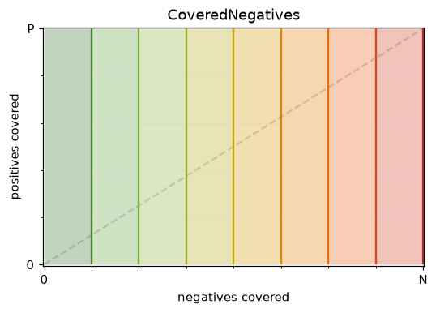 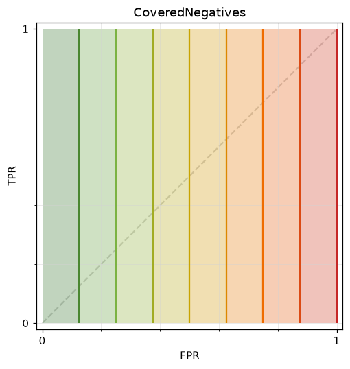

### Recall

h = p/P. Only positive coverage counts: horizontal isometrics.

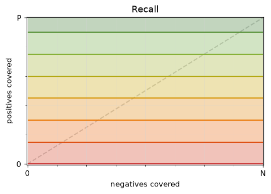 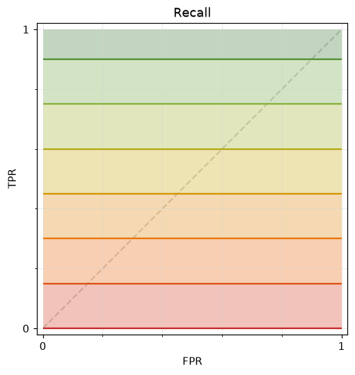

### Precision

h = p/(p+n). Lines through the origin: purity, regardless of coverage.

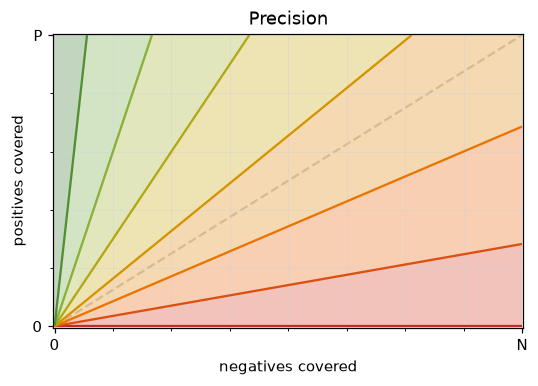 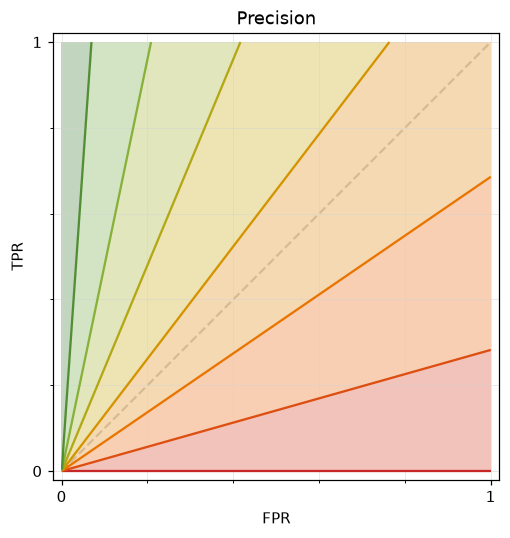

### FBeta(1)

Harmonic mean of precision and recall. Precision-like lines, but pivoting at (-beta^2 * P, 0) left of the origin, so coverage gains weight.

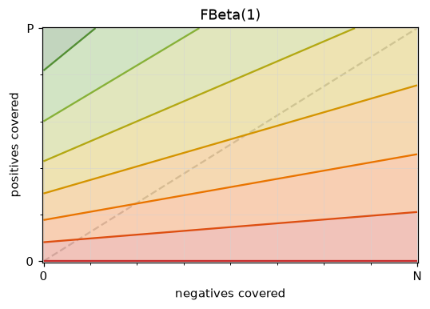 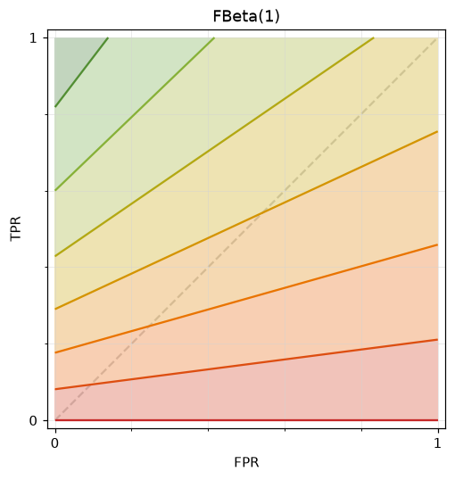

### Laplace

h = (p+1)/(p+n+2). Precision with its pivot moved to (-1, -1).

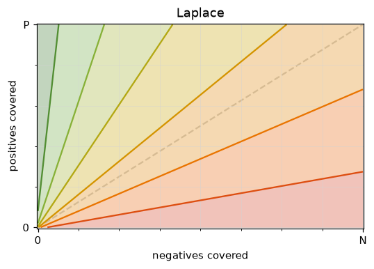 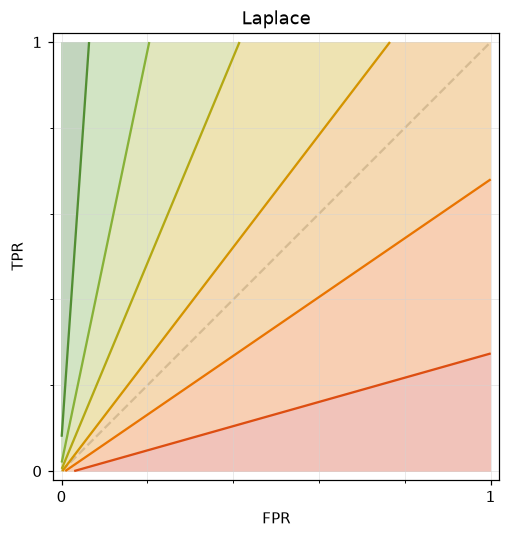

### MEstimate(20)

h = (p + m * P/(P+N))/(p+n+m). The pivot moves out along the negative diagonal as m grows; from precision (m = 0) towards WRAcc (m -> infinity).

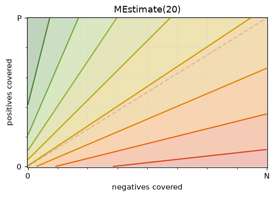 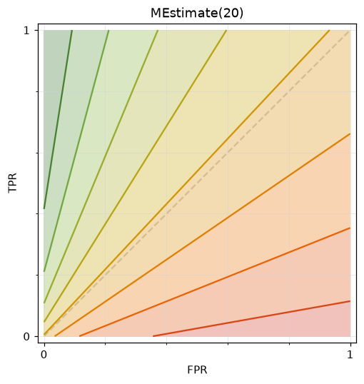

### GeneralizedMEstimate(20, 0.9)

h = (p + m * c)/(p+n+m): the m-estimate with a free prior c instead of P/(P+N).

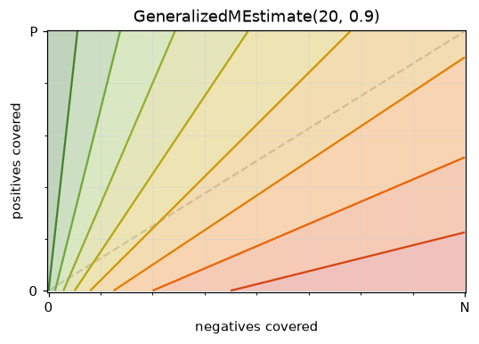 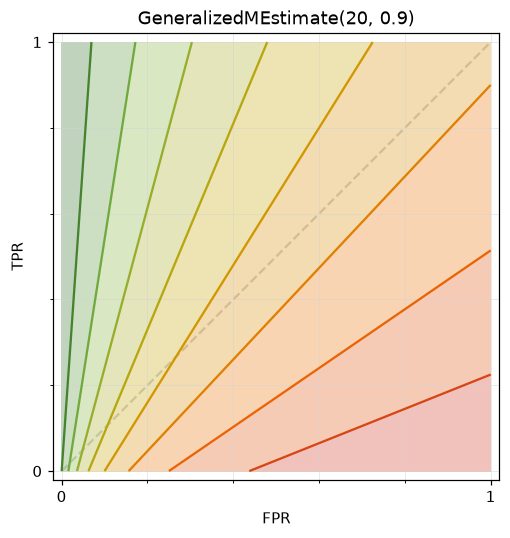

### GHeuristic(30)

h = p/(n+g) (Gamberger & Lavrac). Precision-like lines pivoting at (-g, 0).

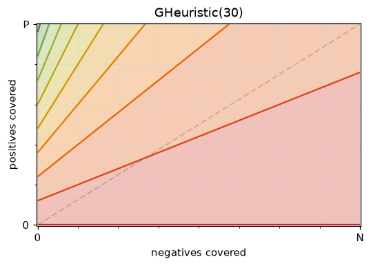 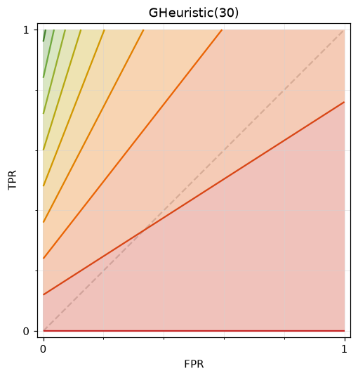

### WRAcc

Weighted relative accuracy, coverage times precision gain over P/(P+N). Lines parallel to the diagonal.

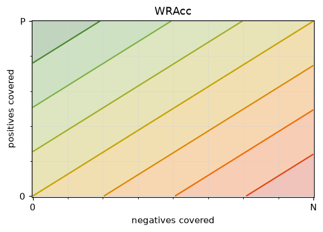 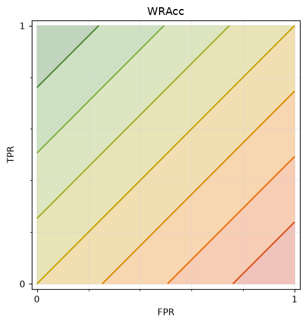

### YoudenJ

h = p/P - n/N. Lines parallel to the diagonal; ranks rules exactly like WRAcc.

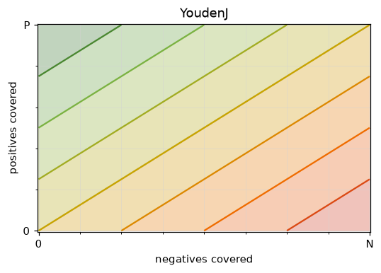 

### Accuracy

h = (p + N - n)/(P+N). Parallel lines of slope 1.

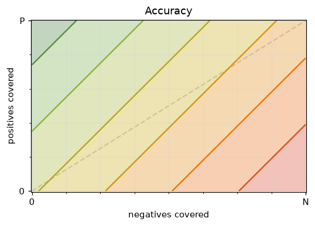 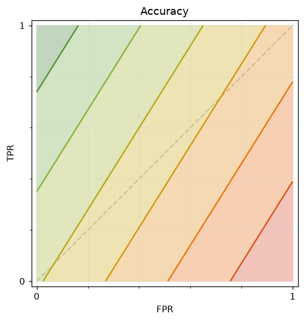

### CoverageDifference

h = p - n. Ranks rules exactly like Accuracy.

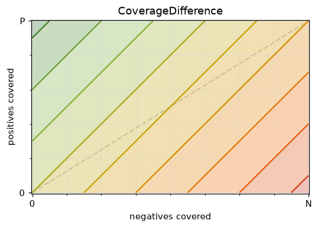 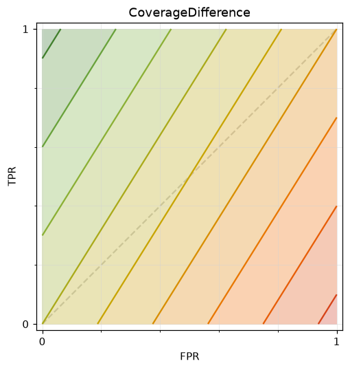

### Support

h = (p+n)/(P+N). Anti-diagonal lines: coverage regardless of class.

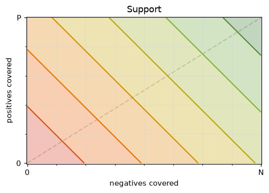 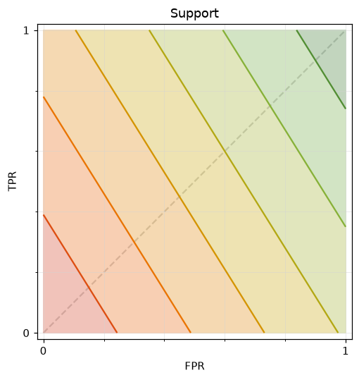

### Coverage

h = p + n. Ranks rules exactly like Support.

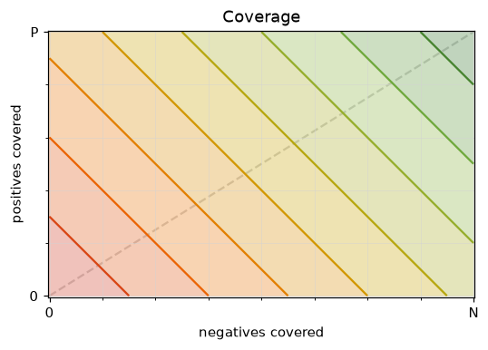 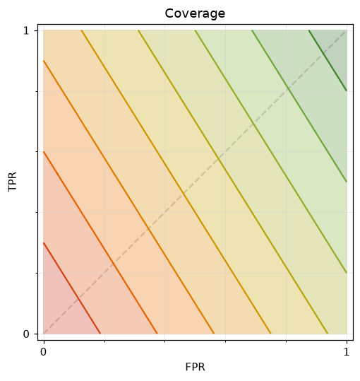

### LinearCost(2.0)

h = p - c * n (the paper's cost measure, up to scaling). Parallel lines of slope c.

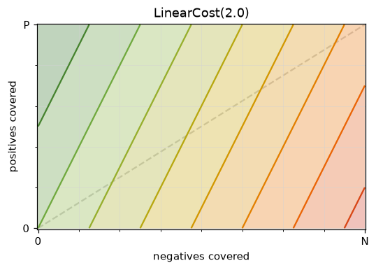 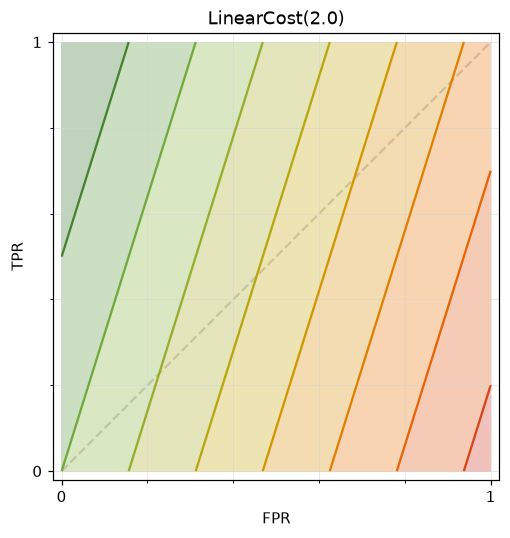

### LinearCostRates(2.0)

h = p/P - c * n/N (the relative cost measure, up to scaling). Parallel lines of slope c in ROC space.

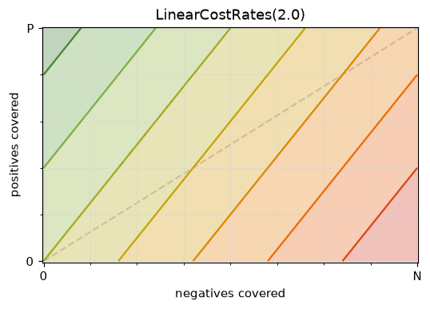 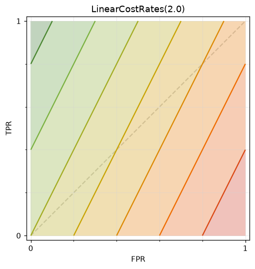

### Correlation

The phi coefficient between 'rule covers' and 'is positive' (FOSSIL). Curved isometrics, symmetric around the diagonal.

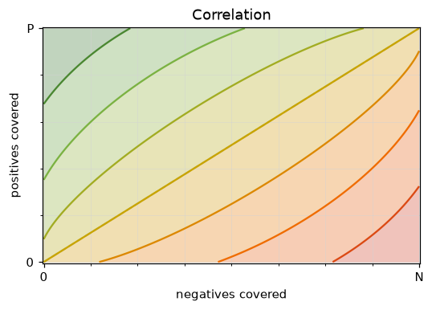 

### Entropy

Negated class entropy among covered examples (CN2's original heuristic). Symmetric: pure negative rules score as well as pure positive ones.

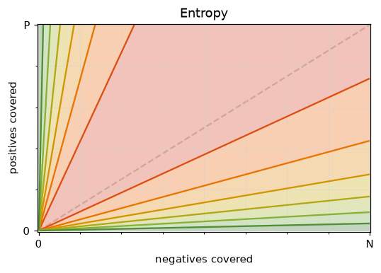 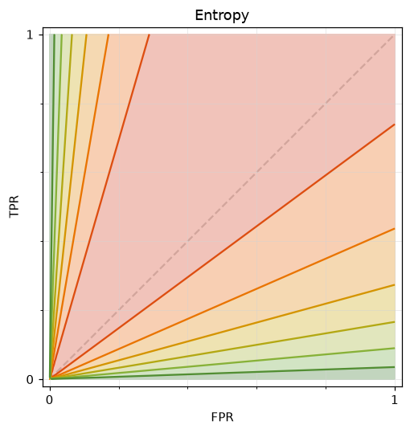

### LikelihoodRatio

CN2's significance statistic: how far the covered class distribution is from the prior. Grows with coverage, in both directions away from the diagonal.

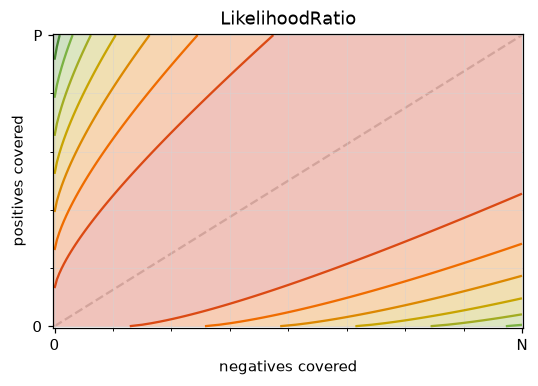 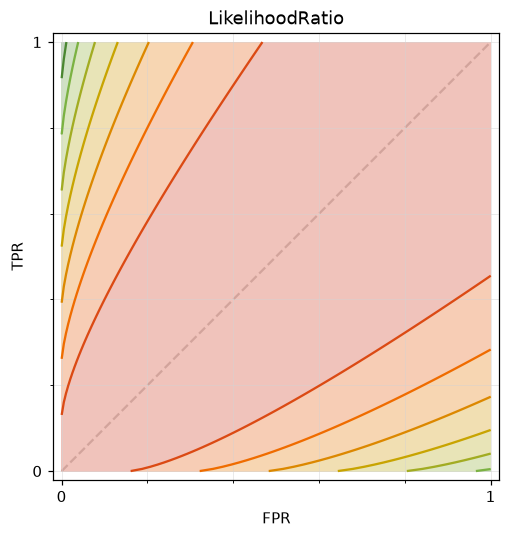

### FoilGain (vs. universal rule)

FOIL's information gain, here always relative to the universal rule (a gain heuristic needs a parent rule): p * (log2 precision - log2 P/(P+N)).

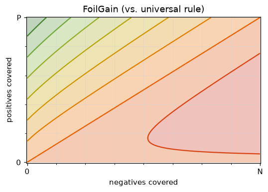 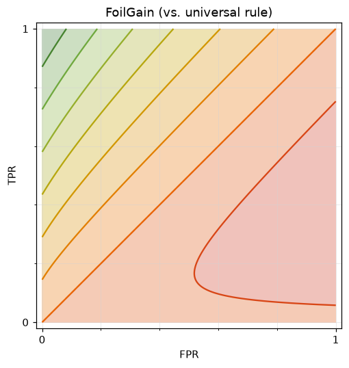

## A rule's refinement path over the isometrics

One rule on a small synthetic dataset, its conditions added in order of precision (`Rule.order_by_precision`), drawn as a path through coverage space (`CoverageSpace.plot_rule_refinement`) over Precision's (blue) and Accuracy's (green) isometrics. The path always moves to better Precision isometrics -- that is what the order optimizes -- but not necessarily to better Accuracy ones. The black line is the Precision isometric through the final rule (`plot_isometric_through_rule`): every point on it is exactly as precise.

 

## Where the precision family pivots

Precision, Laplace and the m-estimate all have isometrics that are lines through one pivot point: the origin for Precision, (-1, -1) for Laplace, and further out along the negative diagonal for the m-estimate as `m` grows. In a space of realistic size a shift of one or two examples is invisible, so this plot uses a small space (P = 10, N = 16).

 

## Inverted heuristics

A top-down search starts with the universal rule in the upper right corner of coverage space, (N, P), and moves towards the origin. A regular heuristic judges a rule from the origin: Precision's isometrics all go through it. The inverted heuristic judges it from the corner the search starts from: inverted Precision's isometrics all go through (N, P), and it prefers the rule whose excluded examples are the purest in negatives -- the refinement that removes negatives and keeps positives. Stecher, Janssen & Fürnkranz (2014) refine a rule by an inverted heuristic and choose the rule on the refinement path by a regular one (`SingleRuleLearner(Inverted(Precision()), selection=Laplace())`); the [heuristic comparison](heuristic_comparison_report.md#m-estimates-for-refinement-and-for-selection) tests this.

Left: the regular heuristic, right: the inverted one, both in coverage space (counts); ROC space only rescales the axes. Only the heuristics where inversion changes the ranking (see [the table](#the-heuristics-at-a-glance)).

### Inverted CoveredNegatives

h = -n becomes -(P - p), ranks like Recall.

 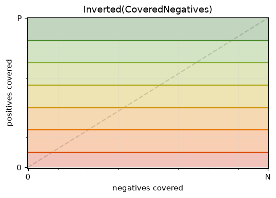

### Inverted Recall

h = p/P becomes (N - n)/N, ranks like CoveredNegatives.

 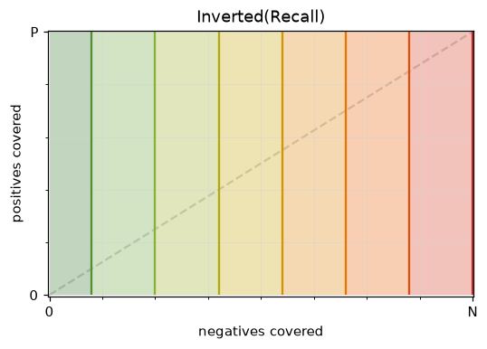

### Inverted Precision

h = p/(p + n) becomes (N - n)/(N - n + P - p).

 

### Inverted FBeta(1)

h = (1 + β²) p/(β² P + p + n) becomes (1 + β²)(N - n)/(β² N + N - n + P - p).

 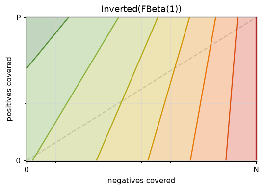

### Inverted Laplace

h = (p + 1)/(p + n + 2) becomes (N - n + 1)/(N - n + P - p + 2).

 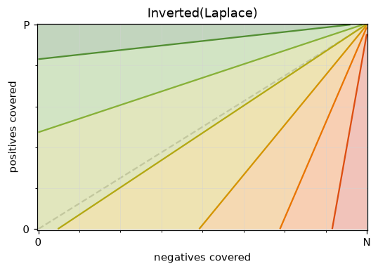

### Inverted MEstimate(20)

h = (p + m P/(P + N))/(p + n + m) becomes (N - n + m N/(P + N))/(N - n + P - p + m).

 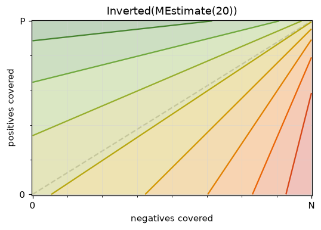

### Inverted GeneralizedMEstimate(20, 0.9)

h = (p + m c)/(p + n + m) becomes (N - n + m c)/(N - n + P - p + m).

 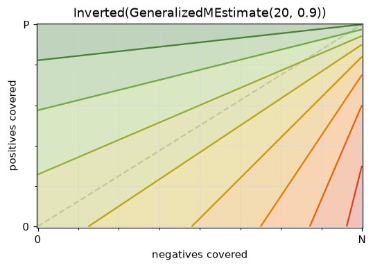

### Inverted GHeuristic(30)

h = p/(n + g) becomes (N - n)/(P - p + g).

 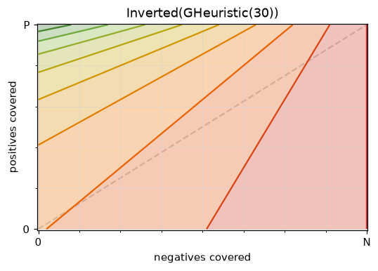

### Inverted Support

h = (p + n)/(P + N) becomes (P + N - p - n)/(P + N), the reverse ranking.

 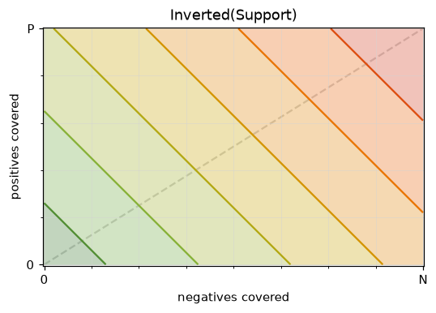

### Inverted Coverage

h = p + n becomes P + N - p - n, the reverse ranking.

 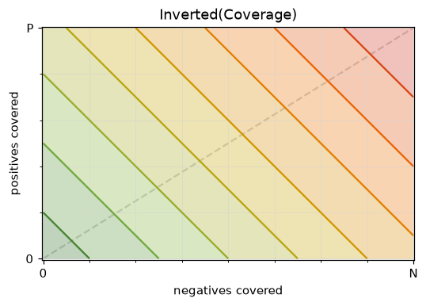

### Inverted LinearCost(2.0)

h = p - c n becomes N - n - c (P - p), ranks like LinearCost(1/c).

 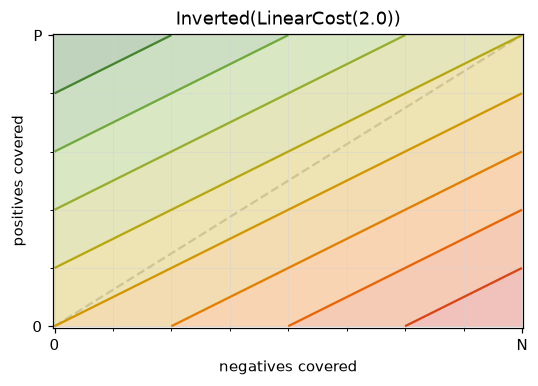

### Inverted LinearCostRates(2.0)

h = p/P - c n/N becomes (N - n)/N - c (P - p)/P, ranks like LinearCostRates(1/c).

 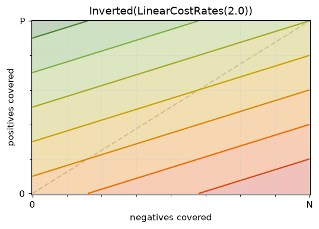

### Inverted Entropy

h = π log₂ π + (1 - π) log₂ (1 - π), π = p/(p + n) becomes the same with π = (N - n)/(N - n + P - p): the purity of the uncovered examples.

 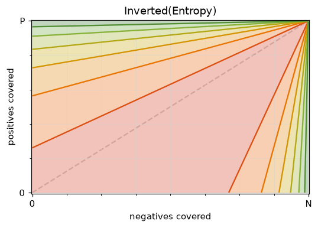

### Inverted LikelihoodRatio

h = 2 (p ln(p/e_p) + n ln(n/e_n)), e_p = (p + n) P/(P + N), e_n = (p + n) N/(P + N) becomes the same for the uncovered examples: N - n and P - p against their expected shares of P + N - p - n.

 

