# Rule learners under class noise

## Setup

**Full run.** Quick sanity check instead: `python demos/noise_robustness.py`.

Rule learners under class noise: in every training fold, a share of the
labels (0%, 5%, 10%, 20%, 30%) is replaced by the other
class; the test folds keep their labels, so the accuracy is that of the true
concept. Every learner of a fold sees the same noisy labels.

Separate-and-conquer:

- **CN2** -- beam search with the Laplace estimate, its significance test
  as a filter on the rules a search returns; rules for every class. **CN2 (no significance test)**:
  without the test.
- **PFoil** -- FOIL gain, greedy search, Quinlan's encoding-length
  restriction as the stopping criterion; rules for every class.
  **PFoil (no stopping)**: without the restriction, rules grow until they
  cover no negatives.
- **PFossil** -- correlation, rules below a correlation of 0.3 dropped.
- **Pypper** -- RIPPER: grow and prune (IREP*), then optimize the rule set.

Local rules: **PyLORD** -- one locally optimal rule per training example.

Boosted rules: **Slipper** (AdaBoost's reweighting after every rule),
**ENDER** (logistic loss), **ENDER (exponential loss)** (AdaBoost's loss,
which weights the misclassified examples exponentially) and **Boomer**
(logistic loss, regularized Newton steps), each with its default number of
rules.

Ensembles of concept sets: **Bagging:PFoil** and **AdaBoost:PFoil**, 10
PFoil concept sets each, from bootstrap samples or by SAMME (restarting from
a bootstrap sample where SAMME would stop); members abstain where their
rules don't cover an example.

Datasets, two-class, with concepts free or nearly free of noise: `tic-tac-toe`, `vote`, `kr-vs-kp`, `mushroom`.
Protocol: 10-fold stratified cross-validation, one `DataSpec` per
training fold (`TreeDiscretizer(max_intervals=8)`), each fit capped
at 1800s.

Means over the datasets. In the plots of the other groups, PFoil and Pypper are drawn as thin grey lines for reference.

## Separate-and-conquer

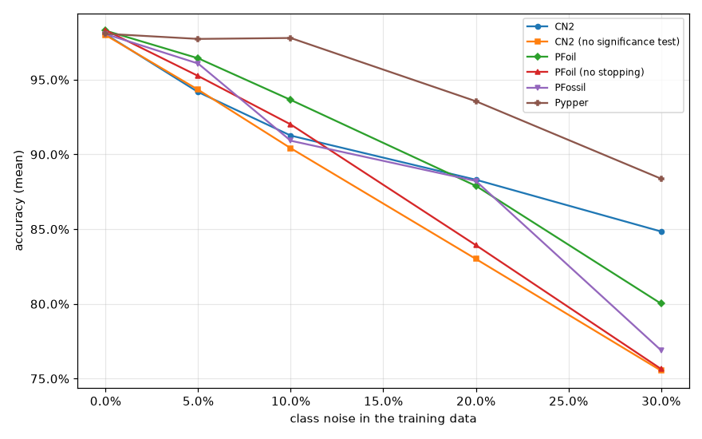

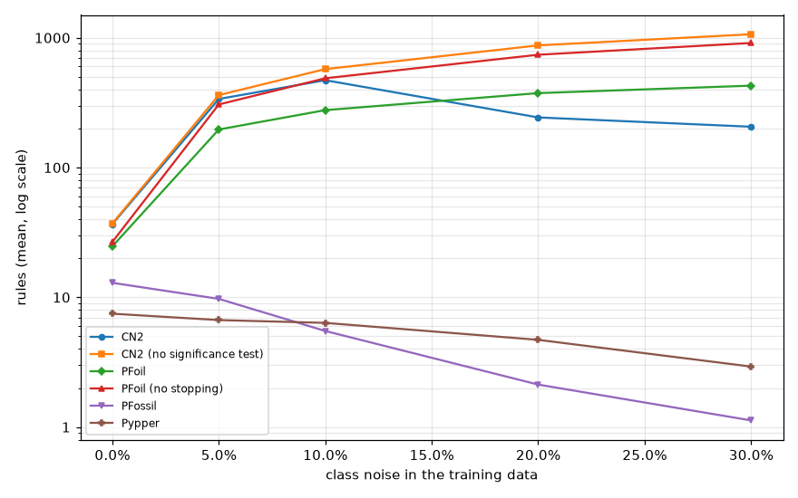

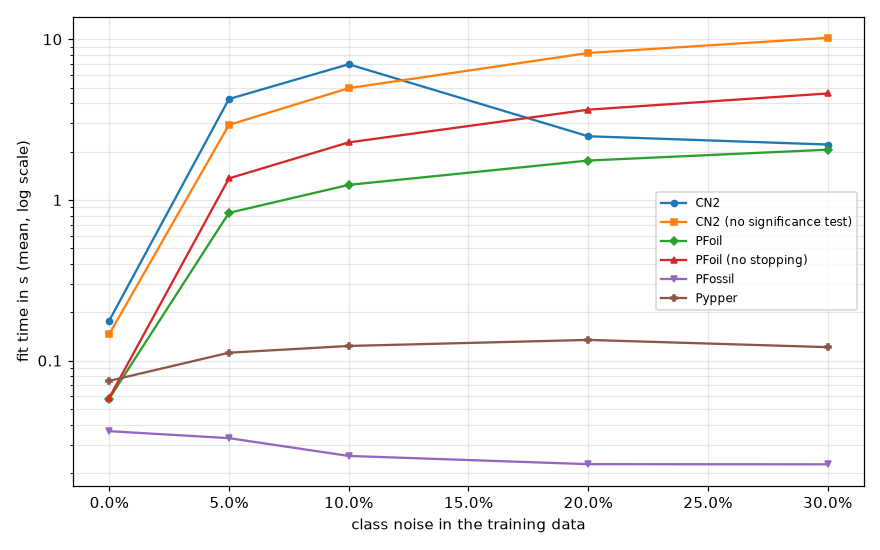

Accuracy:

| learner | 0% | 5% | 10% | 20% | 30% |
|---|--:|--:|--:|--:|--:|
| CN2 | 98.04% | 94.17% | 91.26% | 88.31% | 84.85% |
| CN2 (no significance test) | 97.98% | 94.33% | 90.42% | 83.01% | 75.54% |
| PFoil | 98.28% | 96.43% | 93.65% | 87.90% | 80.02% |
| PFoil (no stopping) | 98.31% | 95.25% | 92.00% | 83.93% | 75.65% |
| PFossil | 98.05% | 96.08% | 90.92% | 88.22% | 76.90% |
| Pypper | 98.07% | 97.73% | 97.79% | 93.56% | 88.38% |

Rules:

| learner | 0% | 5% | 10% | 20% | 30% |
|---|--:|--:|--:|--:|--:|
| CN2 | 36.6 | 337.4 | 470.7 | 243.2 | 206.2 |
| CN2 (no significance test) | 37.1 | 361.4 | 573.1 | 872.8 | 1063.8 |
| PFoil | 24.7 | 196.3 | 276.8 | 374.4 | 427.2 |
| PFoil (no stopping) | 26.7 | 306.1 | 487.1 | 739.6 | 911.0 |
| PFossil | 12.9 | 9.7 | 5.5 | 2.1 | 1.1 |
| Pypper | 7.5 | 6.7 | 6.3 | 4.7 | 2.9 |

Conditions:

| learner | 0% | 5% | 10% | 20% | 30% |
|---|--:|--:|--:|--:|--:|
| CN2 | 127.4 | 1802.1 | 2682.7 | 1131.4 | 932.0 |
| CN2 (no significance test) | 128.1 | 1944.8 | 3339.3 | 5430.1 | 6817.5 |
| PFoil | 88.8 | 1164.3 | 1816.5 | 2678.8 | 3157.4 |
| PFoil (no stopping) | 103.2 | 2203.6 | 3872.6 | 6397.6 | 8161.3 |
| PFossil | 40.4 | 33.8 | 18.6 | 5.6 | 3.2 |
| Pypper | 21.8 | 19.1 | 18.8 | 13.8 | 7.1 |

Fit time (seconds):

| learner | 0% | 5% | 10% | 20% | 30% |
|---|--:|--:|--:|--:|--:|
| CN2 | 0.18 | 4.25 | 6.99 | 2.49 | 2.21 |
| CN2 (no significance test) | 0.15 | 2.93 | 4.96 | 8.21 | 10.21 |
| PFoil | 0.06 | 0.83 | 1.24 | 1.76 | 2.05 |
| PFoil (no stopping) | 0.06 | 1.36 | 2.28 | 3.65 | 4.60 |
| PFossil | 0.04 | 0.03 | 0.03 | 0.02 | 0.02 |
| Pypper | 0.07 | 0.11 | 0.12 | 0.13 | 0.12 |

## Local rules

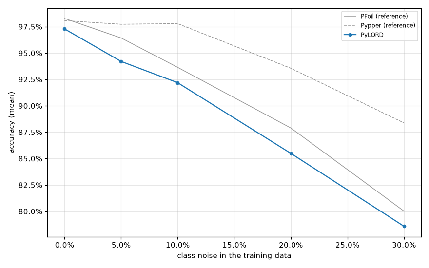

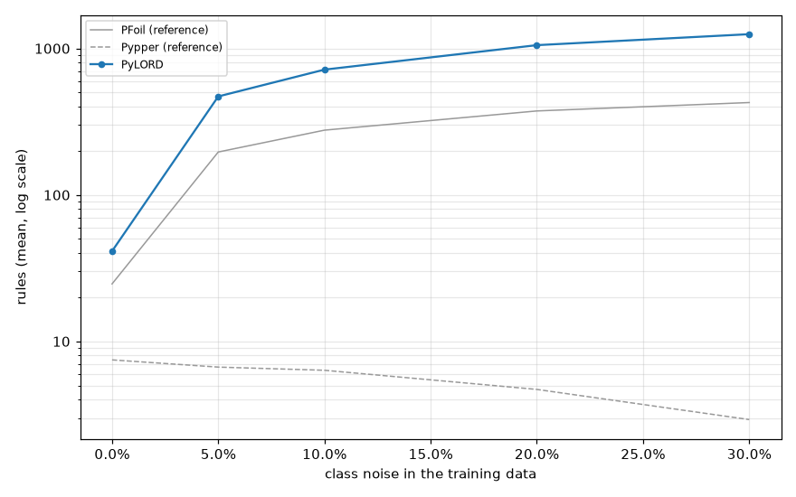

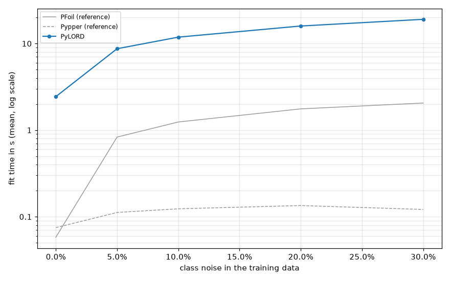

Accuracy:

| learner | 0% | 5% | 10% | 20% | 30% |
|---|--:|--:|--:|--:|--:|
| PyLORD | 97.29% | 94.21% | 92.19% | 85.49% | 78.58% |

Rules:

| learner | 0% | 5% | 10% | 20% | 30% |
|---|--:|--:|--:|--:|--:|
| PyLORD | 41.3 | 470.4 | 716.9 | 1053.3 | 1251.6 |

Conditions:

| learner | 0% | 5% | 10% | 20% | 30% |
|---|--:|--:|--:|--:|--:|
| PyLORD | 160.4 | 4817.2 | 8952.2 | 15063.2 | 18894.9 |

Fit time (seconds):

| learner | 0% | 5% | 10% | 20% | 30% |
|---|--:|--:|--:|--:|--:|
| PyLORD | 2.43 | 8.71 | 11.85 | 15.93 | 19.02 |

## Boosted rules

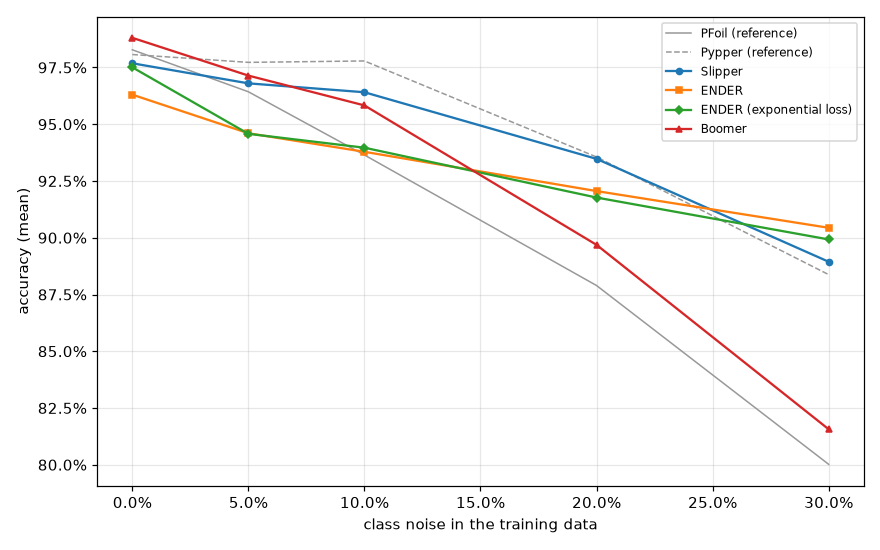

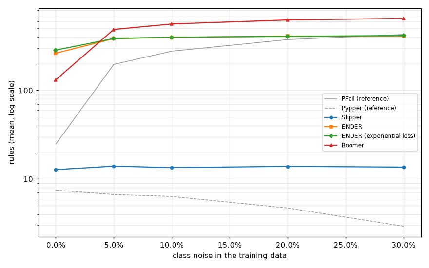

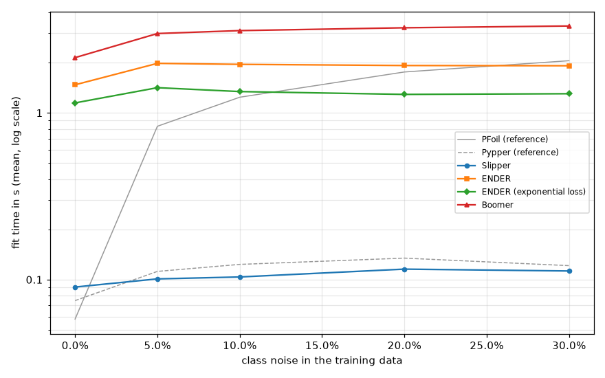

Accuracy:

| learner | 0% | 5% | 10% | 20% | 30% |
|---|--:|--:|--:|--:|--:|
| Slipper | 97.69% | 96.80% | 96.41% | 93.47% | 88.94% |
| ENDER | 96.30% | 94.60% | 93.79% | 92.06% | 90.44% |
| ENDER (exponential loss) | 97.51% | 94.58% | 93.97% | 91.77% | 89.93% |
| Boomer | 98.81% | 97.14% | 95.83% | 89.69% | 81.56% |

Rules:

| learner | 0% | 5% | 10% | 20% | 30% |
|---|--:|--:|--:|--:|--:|
| Slipper | 12.8 | 13.9 | 13.4 | 13.8 | 13.6 |
| ENDER | 262.6 | 383.8 | 396.6 | 408.2 | 411.0 |
| ENDER (exponential loss) | 284.6 | 385.1 | 397.4 | 407.5 | 414.7 |
| Boomer | 131.5 | 486.5 | 561.5 | 623.3 | 648.5 |

Conditions:

| learner | 0% | 5% | 10% | 20% | 30% |
|---|--:|--:|--:|--:|--:|
| Slipper | 31.7 | 33.5 | 29.4 | 31.8 | 27.8 |
| ENDER | 1068.9 | 1755.6 | 1756.7 | 1724.5 | 1730.2 |
| ENDER (exponential loss) | 1193.4 | 1582.7 | 1524.3 | 1475.4 | 1495.6 |
| Boomer | 571.0 | 2686.1 | 3175.6 | 3588.2 | 3807.6 |

Fit time (seconds):

| learner | 0% | 5% | 10% | 20% | 30% |
|---|--:|--:|--:|--:|--:|
| Slipper | 0.09 | 0.10 | 0.10 | 0.12 | 0.11 |
| ENDER | 1.47 | 1.98 | 1.95 | 1.92 | 1.92 |
| ENDER (exponential loss) | 1.15 | 1.42 | 1.34 | 1.29 | 1.30 |
| Boomer | 2.14 | 2.99 | 3.11 | 3.24 | 3.32 |

## Ensembles of concept sets

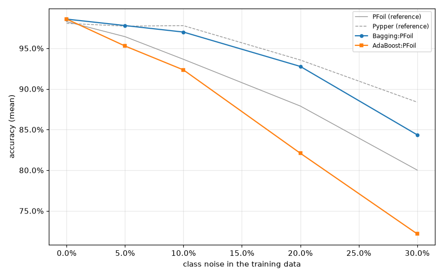

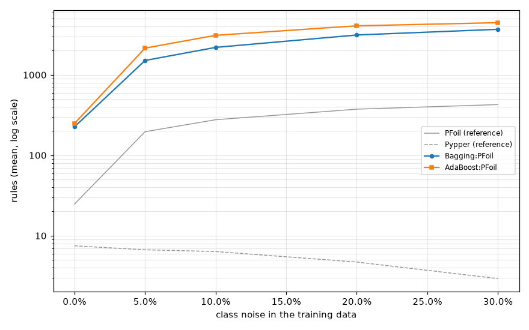

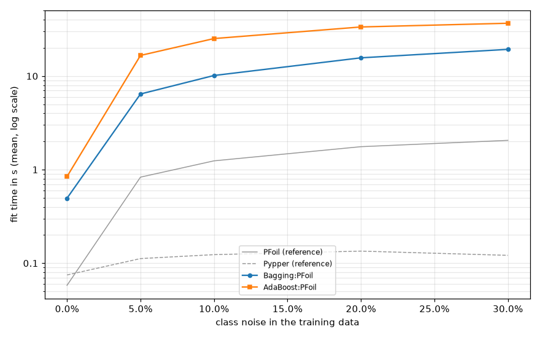

Accuracy:

| learner | 0% | 5% | 10% | 20% | 30% |
|---|--:|--:|--:|--:|--:|
| Bagging:PFoil | 98.59% | 97.80% | 97.00% | 92.77% | 84.35% |
| AdaBoost:PFoil | 98.60% | 95.28% | 92.34% | 82.09% | 72.17% |

Rules:

| learner | 0% | 5% | 10% | 20% | 30% |
|---|--:|--:|--:|--:|--:|
| Bagging:PFoil | 225.9 | 1510.3 | 2197.3 | 3134.3 | 3687.9 |
| AdaBoost:PFoil | 248.5 | 2152.6 | 3105.2 | 4076.3 | 4457.3 |

Conditions:

| learner | 0% | 5% | 10% | 20% | 30% |
|---|--:|--:|--:|--:|--:|
| Bagging:PFoil | 778.4 | 8689.2 | 13948.3 | 21796.5 | 26587.5 |
| AdaBoost:PFoil | 880.5 | 14716.5 | 22760.8 | 30970.6 | 33892.7 |

Fit time (seconds):

| learner | 0% | 5% | 10% | 20% | 30% |
|---|--:|--:|--:|--:|--:|
| Bagging:PFoil | 0.49 | 6.43 | 10.14 | 15.67 | 19.30 |
| AdaBoost:PFoil | 0.84 | 16.62 | 25.18 | 33.50 | 36.71 |

## Per dataset (mean across folds)

| dataset | learner | accuracy | n_rules | n_conditions | fit_time |
|---|---|---|---|---|---|
| kr-vs-kp | AdaBoost:PFoil@0% | 99.50% | 462.5 | 1952.8 | 1.767 |
| kr-vs-kp | AdaBoost:PFoil@10% | 91.58% | 3466.2 | 24541.9 | 14.630 |
| kr-vs-kp | AdaBoost:PFoil@20% | 80.69% | 4499.8 | 33390.7 | 19.491 |
| kr-vs-kp | AdaBoost:PFoil@30% | 72.18% | 4921.4 | 36824.6 | 21.561 |
| kr-vs-kp | AdaBoost:PFoil@5% | 95.31% | 2469.4 | 16404.0 | 10.292 |
| kr-vs-kp | Bagging:PFoil@0% | 99.47% | 367.5 | 1535.0 | 0.841 |
| kr-vs-kp | Bagging:PFoil@10% | 98.00% | 2409.2 | 15092.5 | 6.664 |
| kr-vs-kp | Bagging:PFoil@20% | 93.02% | 3324.2 | 22927.1 | 9.782 |
| kr-vs-kp | Bagging:PFoil@30% | 83.70% | 3844.4 | 27807.6 | 11.728 |
| kr-vs-kp | Bagging:PFoil@5% | 98.59% | 1713.7 | 9833.8 | 4.509 |
| kr-vs-kp | Boomer@0% | 99.59% | 130.9 | 739.2 | 1.857 |
| kr-vs-kp | Boomer@10% | 97.18% | 632.4 | 3946.4 | 2.806 |
| kr-vs-kp | Boomer@20% | 92.15% | 654.5 | 4064.5 | 2.852 |
| kr-vs-kp | Boomer@30% | 83.92% | 669.3 | 4208.6 | 2.890 |
| kr-vs-kp | Boomer@5% | 98.12% | 569.8 | 3573.4 | 2.705 |
| kr-vs-kp | CN2 (no significance test)@0% | 99.34% | 68.6 | 295.9 | 0.313 |
| kr-vs-kp | CN2 (no significance test)@10% | 92.65% | 614.2 | 3672.0 | 3.902 |
| kr-vs-kp | CN2 (no significance test)@20% | 83.89% | 924.8 | 6049.2 | 6.520 |
| kr-vs-kp | CN2 (no significance test)@30% | 74.37% | 1111.1 | 7556.0 | 8.149 |
| kr-vs-kp | CN2 (no significance test)@5% | 95.31% | 393.8 | 2189.1 | 2.404 |
| kr-vs-kp | CN2@0% | 99.34% | 68.6 | 295.9 | 0.382 |
| kr-vs-kp | CN2@10% | 91.68% | 410.2 | 2295.5 | 4.408 |
| kr-vs-kp | CN2@20% | 88.92% | 152.6 | 656.0 | 1.147 |
| kr-vs-kp | CN2@30% | 89.05% | 116.9 | 429.4 | 0.914 |
| kr-vs-kp | CN2@5% | 93.08% | 311.8 | 1688.1 | 2.884 |
| kr-vs-kp | ENDER (exponential loss)@0% | 99.09% | 356.4 | 2034.6 | 1.213 |
| kr-vs-kp | ENDER (exponential loss)@10% | 96.34% | 453.2 | 2088.6 | 1.310 |
| kr-vs-kp | ENDER (exponential loss)@20% | 95.75% | 461.0 | 2060.1 | 1.321 |
| kr-vs-kp | ENDER (exponential loss)@30% | 94.53% | 466.8 | 2095.3 | 1.353 |
| kr-vs-kp | ENDER (exponential loss)@5% | 96.47% | 435.4 | 2112.1 | 1.326 |
| kr-vs-kp | ENDER@0% | 99.06% | 327.9 | 1885.2 | 1.597 |
| kr-vs-kp | ENDER@10% | 96.56% | 456.7 | 2297.5 | 1.789 |
| kr-vs-kp | ENDER@20% | 96.31% | 467.6 | 2305.1 | 1.802 |
| kr-vs-kp | ENDER@30% | 94.74% | 469.9 | 2344.8 | 1.812 |
| kr-vs-kp | ENDER@5% | 97.40% | 441.4 | 2228.8 | 1.760 |
| kr-vs-kp | PFoil (no stopping)@0% | 99.44% | 42.3 | 196.9 | 0.109 |
| kr-vs-kp | PFoil (no stopping)@10% | 92.33% | 539.8 | 4344.9 | 1.670 |
| kr-vs-kp | PFoil (no stopping)@20% | 84.20% | 802.8 | 7092.6 | 2.627 |
| kr-vs-kp | PFoil (no stopping)@30% | 74.34% | 980.9 | 9097.0 | 3.300 |
| kr-vs-kp | PFoil (no stopping)@5% | 95.68% | 341.9 | 2486.0 | 1.010 |
| kr-vs-kp | PFoil@0% | 99.34% | 40.8 | 178.8 | 0.110 |
| kr-vs-kp | PFoil@10% | 94.49% | 296.2 | 1928.3 | 0.871 |
| kr-vs-kp | PFoil@20% | 88.95% | 390.7 | 2767.6 | 1.196 |
| kr-vs-kp | PFoil@30% | 79.54% | 446.6 | 3305.7 | 1.433 |
| kr-vs-kp | PFoil@5% | 97.56% | 215.7 | 1272.8 | 0.608 |
| kr-vs-kp | PFossil@0% | 99.37% | 14.5 | 56.7 | 0.042 |
| kr-vs-kp | PFossil@10% | 97.59% | 7.0 | 29.3 | 0.031 |
| kr-vs-kp | PFossil@20% | 93.62% | 3.0 | 8.6 | 0.025 |
| kr-vs-kp | PFossil@30% | 52.22% | 0.0 | 0.0 | 0.019 |
| kr-vs-kp | PFossil@5% | 97.97% | 7.3 | 30.5 | 0.031 |
| kr-vs-kp | PyLORD@0% | 99.44% | 49.7 | 259.4 | 2.919 |
| kr-vs-kp | PyLORD@10% | 93.99% | 744.1 | 7326.1 | 7.651 |
| kr-vs-kp | PyLORD@20% | 86.98% | 1073.2 | 12072.4 | 9.752 |
| kr-vs-kp | PyLORD@30% | 78.76% | 1261.6 | 14582.7 | 11.073 |
| kr-vs-kp | PyLORD@5% | 96.46% | 488.0 | 4243.7 | 6.176 |
| kr-vs-kp | Pypper@0% | 99.12% | 14.3 | 45.4 | 0.129 |
| kr-vs-kp | Pypper@10% | 98.15% | 10.5 | 35.2 | 0.192 |
| kr-vs-kp | Pypper@20% | 96.15% | 5.9 | 20.4 | 0.157 |
| kr-vs-kp | Pypper@30% | 94.78% | 3.9 | 9.6 | 0.140 |
| kr-vs-kp | Pypper@5% | 97.87% | 10.8 | 34.7 | 0.168 |
| kr-vs-kp | Slipper@0% | 97.69% | 14.6 | 39.7 | 0.086 |
| kr-vs-kp | Slipper@10% | 96.47% | 13.4 | 31.9 | 0.096 |
| kr-vs-kp | Slipper@20% | 94.74% | 13.7 | 35.5 | 0.104 |
| kr-vs-kp | Slipper@30% | 93.71% | 14.2 | 29.3 | 0.104 |
| kr-vs-kp | Slipper@5% | 96.93% | 14.6 | 41.4 | 0.094 |
| mushroom | AdaBoost:PFoil@0% | 100.00% | 121.2 | 249.8 | 0.988 |
| mushroom | AdaBoost:PFoil@10% | 92.84% | 7431.7 | 58971.8 | 83.138 |
| mushroom | AdaBoost:PFoil@20% | 82.40% | 9929.9 | 80548.2 | 110.795 |
| mushroom | AdaBoost:PFoil@30% | 71.31% | 10826.1 | 87490.9 | 121.091 |
| mushroom | AdaBoost:PFoil@5% | 96.86% | 4932.8 | 36866.5 | 53.888 |
| mushroom | Bagging:PFoil@0% | 100.00% | 121.6 | 250.1 | 0.653 |
| mushroom | Bagging:PFoil@10% | 99.61% | 5089.8 | 34816.5 | 32.145 |
| mushroom | Bagging:PFoil@20% | 97.64% | 7565.8 | 56096.2 | 50.504 |
| mushroom | Bagging:PFoil@30% | 90.57% | 9047.3 | 69018.8 | 62.715 |
| mushroom | Bagging:PFoil@5% | 99.95% | 3357.4 | 20896.2 | 19.960 |
| mushroom | Boomer@0% | 100.00% | 41.9 | 136.9 | 5.143 |
| mushroom | Boomer@10% | 99.37% | 668.5 | 3533.3 | 7.451 |
| mushroom | Boomer@20% | 97.66% | 725.8 | 3899.2 | 7.785 |
| mushroom | Boomer@30% | 92.73% | 748.2 | 4127.5 | 8.006 |
| mushroom | Boomer@5% | 99.72% | 586.7 | 3020.6 | 7.189 |
| mushroom | CN2 (no significance test)@0% | 100.00% | 23.0 | 30.0 | 0.122 |
| mushroom | CN2 (no significance test)@10% | 91.57% | 1428.7 | 8571.0 | 14.970 |
| mushroom | CN2 (no significance test)@20% | 82.88% | 2223.9 | 14079.3 | 24.945 |
| mushroom | CN2 (no significance test)@30% | 74.64% | 2739.4 | 17807.2 | 30.975 |
| mushroom | CN2 (no significance test)@5% | 95.08% | 875.9 | 4844.8 | 8.674 |
| mushroom | CN2@0% | 100.00% | 23.0 | 30.0 | 0.128 |
| mushroom | CN2@10% | 94.63% | 1252.3 | 7479.5 | 22.170 |
| mushroom | CN2@20% | 96.05% | 549.2 | 2662.1 | 6.867 |
| mushroom | CN2@30% | 95.85% | 417.6 | 2005.2 | 5.695 |
| mushroom | CN2@5% | 95.08% | 875.9 | 4844.8 | 13.152 |
| mushroom | ENDER (exponential loss)@0% | 100.00% | 183.9 | 1036.8 | 2.638 |
| mushroom | ENDER (exponential loss)@10% | 99.95% | 424.5 | 1995.3 | 3.268 |
| mushroom | ENDER (exponential loss)@20% | 99.89% | 417.7 | 1706.4 | 3.035 |
| mushroom | ENDER (exponential loss)@30% | 99.78% | 426.3 | 1675.4 | 3.037 |
| mushroom | ENDER (exponential loss)@5% | 99.94% | 438.7 | 2337.0 | 3.559 |
| mushroom | ENDER@0% | 100.00% | 144.5 | 816.3 | 3.387 |
| mushroom | ENDER@10% | 99.95% | 463.3 | 2943.4 | 5.089 |
| mushroom | ENDER@20% | 99.84% | 465.4 | 2732.0 | 4.941 |
| mushroom | ENDER@30% | 99.74% | 465.5 | 2658.7 | 4.884 |
| mushroom | ENDER@5% | 99.94% | 456.0 | 3092.3 | 5.226 |
| mushroom | PFoil (no stopping)@0% | 100.00% | 11.5 | 24.7 | 0.064 |
| mushroom | PFoil (no stopping)@10% | 92.92% | 1173.3 | 9830.7 | 7.104 |
| mushroom | PFoil (no stopping)@20% | 84.36% | 1843.8 | 16619.1 | 11.468 |
| mushroom | PFoil (no stopping)@30% | 75.52% | 2301.9 | 21273.0 | 14.514 |
| mushroom | PFoil (no stopping)@5% | 95.95% | 708.6 | 5445.3 | 4.192 |
| mushroom | PFoil@0% | 100.00% | 11.5 | 24.7 | 0.064 |
| mushroom | PFoil@10% | 96.44% | 649.1 | 4581.8 | 3.855 |
| mushroom | PFoil@20% | 93.57% | 902.2 | 6887.0 | 5.525 |
| mushroom | PFoil@30% | 84.59% | 1029.2 | 8051.3 | 6.417 |
| mushroom | PFoil@5% | 98.60% | 439.6 | 2821.4 | 2.537 |
| mushroom | PFossil@0% | 99.95% | 12.3 | 23.0 | 0.068 |
| mushroom | PFossil@10% | 99.34% | 4.4 | 12.1 | 0.049 |
| mushroom | PFossil@20% | 98.50% | 3.1 | 10.5 | 0.052 |
| mushroom | PFossil@30% | 98.52% | 2.0 | 8.0 | 0.055 |
| mushroom | PFossil@5% | 99.42% | 6.4 | 14.1 | 0.056 |
| mushroom | PyLORD@0% | 100.00% | 23.0 | 38.7 | 5.513 |
| mushroom | PyLORD@10% | 92.77% | 1778.2 | 26714.2 | 37.712 |
| mushroom | PyLORD@20% | 86.56% | 2682.4 | 45607.4 | 51.619 |
| mushroom | PyLORD@30% | 78.20% | 3239.8 | 58026.0 | 62.525 |
| mushroom | PyLORD@5% | 96.00% | 1127.0 | 13751.4 | 26.883 |
| mushroom | Pypper@0% | 99.96% | 5.2 | 10.6 | 0.084 |
| mushroom | Pypper@10% | 99.96% | 5.3 | 10.9 | 0.189 |
| mushroom | Pypper@20% | 99.78% | 5.5 | 12.0 | 0.265 |
| mushroom | Pypper@30% | 99.19% | 3.9 | 8.7 | 0.258 |
| mushroom | Pypper@5% | 99.96% | 5.7 | 11.7 | 0.175 |
| mushroom | Slipper@0% | 100.00% | 10.5 | 20.6 | 0.179 |
| mushroom | Slipper@10% | 99.82% | 12.9 | 20.3 | 0.212 |
| mushroom | Slipper@20% | 99.79% | 14.5 | 24.8 | 0.234 |
| mushroom | Slipper@30% | 99.45% | 14.7 | 27.3 | 0.244 |
| mushroom | Slipper@5% | 99.78% | 14.8 | 27.4 | 0.215 |
| tic-tac-toe | AdaBoost:PFoil@0% | 99.48% | 237.0 | 831.8 | 0.381 |
| tic-tac-toe | AdaBoost:PFoil@10% | 91.12% | 1084.8 | 5720.1 | 2.264 |
| tic-tac-toe | AdaBoost:PFoil@20% | 79.74% | 1344.8 | 7558.5 | 2.858 |
| tic-tac-toe | AdaBoost:PFoil@30% | 69.10% | 1485.6 | 8543.2 | 3.229 |
| tic-tac-toe | AdaBoost:PFoil@5% | 95.61% | 853.2 | 4258.0 | 1.777 |
| tic-tac-toe | Bagging:PFoil@0% | 99.48% | 238.4 | 834.1 | 0.323 |
| tic-tac-toe | Bagging:PFoil@10% | 95.20% | 816.3 | 3997.5 | 1.240 |
| tic-tac-toe | Bagging:PFoil@20% | 89.35% | 1073.7 | 5641.3 | 1.710 |
| tic-tac-toe | Bagging:PFoil@30% | 78.08% | 1203.8 | 6503.9 | 1.958 |
| tic-tac-toe | Bagging:PFoil@5% | 97.70% | 606.4 | 2735.5 | 0.892 |
| tic-tac-toe | Boomer@0% | 100.00% | 242.7 | 1021.2 | 0.998 |
| tic-tac-toe | Boomer@10% | 94.57% | 650.2 | 3764.4 | 1.421 |
| tic-tac-toe | Boomer@20% | 83.40% | 732.9 | 4436.0 | 1.485 |
| tic-tac-toe | Boomer@30% | 72.12% | 773.4 | 4763.6 | 1.533 |
| tic-tac-toe | Boomer@5% | 97.39% | 557.7 | 3078.3 | 1.340 |
| tic-tac-toe | CN2 (no significance test)@0% | 98.33% | 28.6 | 98.8 | 0.084 |
| tic-tac-toe | CN2 (no significance test)@10% | 87.79% | 165.8 | 736.4 | 0.550 |
| tic-tac-toe | CN2 (no significance test)@20% | 80.37% | 229.0 | 1040.4 | 0.756 |
| tic-tac-toe | CN2 (no significance test)@30% | 70.36% | 266.3 | 1217.3 | 0.894 |
| tic-tac-toe | CN2 (no significance test)@5% | 94.26% | 116.3 | 500.0 | 0.373 |
| tic-tac-toe | CN2@0% | 98.33% | 28.6 | 98.8 | 0.108 |
| tic-tac-toe | CN2@10% | 87.69% | 166.6 | 736.9 | 1.009 |
| tic-tac-toe | CN2@20% | 80.16% | 221.0 | 1000.5 | 1.601 |
| tic-tac-toe | CN2@30% | 70.78% | 240.5 | 1089.7 | 1.916 |
| tic-tac-toe | CN2@5% | 94.26% | 116.3 | 500.0 | 0.645 |
| tic-tac-toe | ENDER (exponential loss)@0% | 95.29% | 431.9 | 1285.0 | 0.505 |
| tic-tac-toe | ENDER (exponential loss)@10% | 83.92% | 446.4 | 1321.5 | 0.520 |
| tic-tac-toe | ENDER (exponential loss)@20% | 78.08% | 450.0 | 1358.8 | 0.525 |
| tic-tac-toe | ENDER (exponential loss)@30% | 74.84% | 449.2 | 1383.4 | 0.531 |
| tic-tac-toe | ENDER (exponential loss)@5% | 86.95% | 437.0 | 1271.0 | 0.522 |
| tic-tac-toe | ENDER@0% | 90.29% | 406.9 | 1148.2 | 0.614 |
| tic-tac-toe | ENDER@10% | 82.98% | 423.5 | 1182.9 | 0.627 |
| tic-tac-toe | ENDER@20% | 78.71% | 431.6 | 1204.9 | 0.627 |
| tic-tac-toe | ENDER@30% | 75.78% | 435.2 | 1244.9 | 0.639 |
| tic-tac-toe | ENDER@5% | 86.11% | 415.0 | 1149.8 | 0.631 |
| tic-tac-toe | PFoil (no stopping)@0% | 98.85% | 24.5 | 95.4 | 0.034 |
| tic-tac-toe | PFoil (no stopping)@10% | 89.88% | 142.1 | 819.8 | 0.233 |
| tic-tac-toe | PFoil (no stopping)@20% | 80.47% | 190.5 | 1171.7 | 0.322 |
| tic-tac-toe | PFoil (no stopping)@30% | 71.81% | 224.0 | 1429.8 | 0.388 |
| tic-tac-toe | PFoil (no stopping)@5% | 95.10% | 101.9 | 543.8 | 0.161 |
| tic-tac-toe | PFoil@0% | 99.06% | 23.2 | 83.9 | 0.034 |
| tic-tac-toe | PFoil@10% | 90.30% | 103.4 | 521.0 | 0.170 |
| tic-tac-toe | PFoil@20% | 78.91% | 137.3 | 756.0 | 0.230 |
| tic-tac-toe | PFoil@30% | 73.17% | 157.7 | 907.0 | 0.272 |
| tic-tac-toe | PFoil@5% | 94.16% | 79.7 | 373.6 | 0.123 |
| tic-tac-toe | PFossil@0% | 97.71% | 14.7 | 52.5 | 0.024 |
| tic-tac-toe | PFossil@10% | 72.01% | 4.0 | 15.0 | 0.011 |
| tic-tac-toe | PFossil@20% | 65.34% | 0.0 | 0.0 | 0.007 |
| tic-tac-toe | PFossil@30% | 65.34% | 0.0 | 0.0 | 0.009 |
| tic-tac-toe | PFossil@5% | 91.75% | 17.1 | 66.3 | 0.032 |
| tic-tac-toe | PyLORD@0% | 95.93% | 53.9 | 222.2 | 1.003 |
| tic-tac-toe | PyLORD@10% | 89.35% | 232.2 | 1259.7 | 1.353 |
| tic-tac-toe | PyLORD@20% | 80.37% | 310.4 | 1850.8 | 1.523 |
| tic-tac-toe | PyLORD@30% | 73.68% | 340.3 | 2092.2 | 1.614 |
| tic-tac-toe | PyLORD@5% | 91.02% | 179.7 | 915.2 | 1.223 |
| tic-tac-toe | Pypper@0% | 98.02% | 8.6 | 27.5 | 0.070 |
| tic-tac-toe | Pypper@10% | 97.39% | 8.3 | 27.0 | 0.094 |
| tic-tac-toe | Pypper@20% | 84.96% | 5.8 | 19.6 | 0.089 |
| tic-tac-toe | Pypper@30% | 68.26% | 2.1 | 5.6 | 0.057 |
| tic-tac-toe | Pypper@5% | 98.12% | 8.2 | 26.1 | 0.084 |
| tic-tac-toe | Slipper@0% | 98.33% | 15.0 | 43.9 | 0.060 |
| tic-tac-toe | Slipper@10% | 96.23% | 14.9 | 41.4 | 0.067 |
| tic-tac-toe | Slipper@20% | 89.23% | 15.0 | 42.3 | 0.084 |
| tic-tac-toe | Slipper@30% | 73.16% | 13.2 | 32.1 | 0.060 |
| tic-tac-toe | Slipper@5% | 97.39% | 14.9 | 41.6 | 0.055 |
| vote | AdaBoost:PFoil@0% | 95.41% | 173.3 | 487.7 | 0.234 |
| vote | AdaBoost:PFoil@10% | 93.82% | 438.3 | 1809.2 | 0.675 |
| vote | AdaBoost:PFoil@20% | 85.52% | 530.7 | 2385.0 | 0.846 |
| vote | AdaBoost:PFoil@30% | 76.09% | 596.0 | 2712.2 | 0.954 |
| vote | AdaBoost:PFoil@5% | 93.34% | 354.9 | 1337.3 | 0.525 |
| vote | Bagging:PFoil@0% | 95.41% | 176.1 | 494.2 | 0.160 |
| vote | Bagging:PFoil@10% | 95.18% | 474.0 | 1886.6 | 0.517 |
| vote | Bagging:PFoil@20% | 91.06% | 573.5 | 2521.5 | 0.683 |
| vote | Bagging:PFoil@30% | 85.07% | 656.0 | 3019.5 | 0.797 |
| vote | Bagging:PFoil@5% | 94.95% | 363.6 | 1291.4 | 0.373 |
| vote | Boomer@0% | 95.63% | 110.6 | 386.7 | 0.581 |
| vote | Boomer@10% | 92.19% | 295.1 | 1458.2 | 0.778 |
| vote | Boomer@20% | 85.54% | 380.0 | 1953.2 | 0.833 |
| vote | Boomer@30% | 77.49% | 403.3 | 2130.7 | 0.847 |
| vote | Boomer@5% | 93.35% | 231.9 | 1071.9 | 0.730 |
| vote | CN2 (no significance test)@0% | 94.25% | 28.1 | 87.6 | 0.066 |
| vote | CN2 (no significance test)@10% | 89.66% | 83.6 | 378.0 | 0.428 |
| vote | CN2 (no significance test)@20% | 84.89% | 113.6 | 551.3 | 0.637 |
| vote | CN2 (no significance test)@30% | 82.77% | 138.3 | 689.5 | 0.826 |
| vote | CN2 (no significance test)@5% | 92.67% | 59.4 | 245.5 | 0.276 |
| vote | CN2@0% | 94.49% | 26.3 | 84.9 | 0.090 |
| vote | CN2@10% | 91.04% | 53.8 | 218.7 | 0.373 |
| vote | CN2@20% | 88.09% | 50.0 | 207.0 | 0.350 |
| vote | CN2@30% | 83.70% | 49.6 | 203.5 | 0.325 |
| vote | CN2@5% | 94.27% | 45.6 | 175.6 | 0.307 |
| vote | ENDER (exponential loss)@0% | 95.64% | 166.4 | 417.3 | 0.234 |
| vote | ENDER (exponential loss)@10% | 95.66% | 265.3 | 691.8 | 0.270 |
| vote | ENDER (exponential loss)@20% | 93.37% | 301.4 | 776.4 | 0.281 |
| vote | ENDER (exponential loss)@30% | 90.56% | 316.5 | 828.2 | 0.289 |
| vote | ENDER (exponential loss)@5% | 94.96% | 229.2 | 610.6 | 0.257 |
| vote | ENDER@0% | 95.87% | 170.9 | 425.8 | 0.295 |
| vote | ENDER@10% | 95.66% | 243.0 | 603.1 | 0.311 |
| vote | ENDER@20% | 93.37% | 268.4 | 655.8 | 0.322 |
| vote | ENDER@30% | 91.49% | 273.5 | 672.4 | 0.331 |
| vote | ENDER@5% | 94.96% | 222.8 | 551.6 | 0.307 |
| vote | PFoil (no stopping)@0% | 94.95% | 28.5 | 95.6 | 0.028 |
| vote | PFoil (no stopping)@10% | 92.88% | 93.3 | 495.0 | 0.119 |
| vote | PFoil (no stopping)@20% | 86.69% | 121.3 | 707.0 | 0.167 |
| vote | PFoil (no stopping)@30% | 80.92% | 137.0 | 845.5 | 0.194 |
| vote | PFoil (no stopping)@5% | 94.26% | 72.0 | 339.1 | 0.084 |
| vote | PFoil@0% | 94.71% | 23.3 | 67.8 | 0.024 |
| vote | PFoil@10% | 93.35% | 58.3 | 234.7 | 0.067 |
| vote | PFoil@20% | 90.14% | 67.2 | 304.6 | 0.083 |
| vote | PFoil@30% | 82.78% | 75.5 | 365.5 | 0.097 |
| vote | PFoil@5% | 95.41% | 50.3 | 189.5 | 0.055 |
| vote | PFossil@0% | 95.18% | 10.2 | 29.2 | 0.012 |
| vote | PFossil@10% | 94.73% | 6.6 | 18.1 | 0.011 |
| vote | PFossil@20% | 95.42% | 2.4 | 3.2 | 0.007 |
| vote | PFossil@30% | 91.50% | 2.5 | 4.9 | 0.007 |
| vote | PFossil@5% | 95.17% | 8.1 | 24.2 | 0.013 |
| vote | PyLORD@0% | 93.79% | 38.7 | 121.4 | 0.304 |
| vote | PyLORD@10% | 92.65% | 113.1 | 508.7 | 0.668 |
| vote | PyLORD@20% | 88.06% | 147.1 | 722.1 | 0.807 |
| vote | PyLORD@30% | 83.69% | 164.7 | 878.7 | 0.888 |
| vote | PyLORD@5% | 93.34% | 86.7 | 358.4 | 0.541 |
| vote | Pypper@0% | 95.18% | 1.8 | 3.5 | 0.016 |
| vote | Pypper@10% | 95.64% | 1.3 | 1.9 | 0.018 |
| vote | Pypper@20% | 93.34% | 1.6 | 3.1 | 0.027 |
| vote | Pypper@30% | 91.28% | 1.8 | 4.4 | 0.029 |
| vote | Pypper@5% | 94.95% | 2.0 | 4.0 | 0.021 |
| vote | Slipper@0% | 94.73% | 10.9 | 22.6 | 0.036 |
| vote | Slipper@10% | 93.12% | 12.5 | 24.1 | 0.040 |
| vote | Slipper@20% | 90.13% | 12.2 | 24.5 | 0.040 |
| vote | Slipper@30% | 89.45% | 12.3 | 22.6 | 0.042 |
| vote | Slipper@5% | 93.10% | 11.4 | 23.8 | 0.040 |

