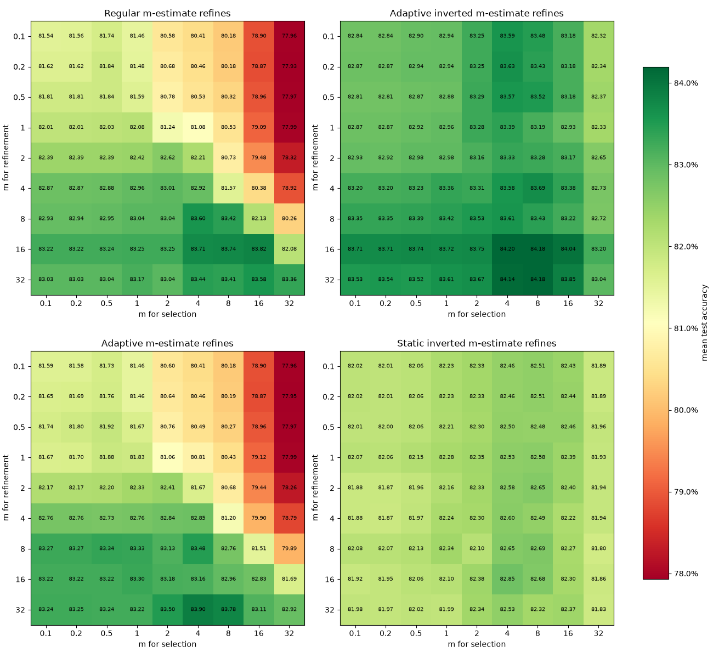
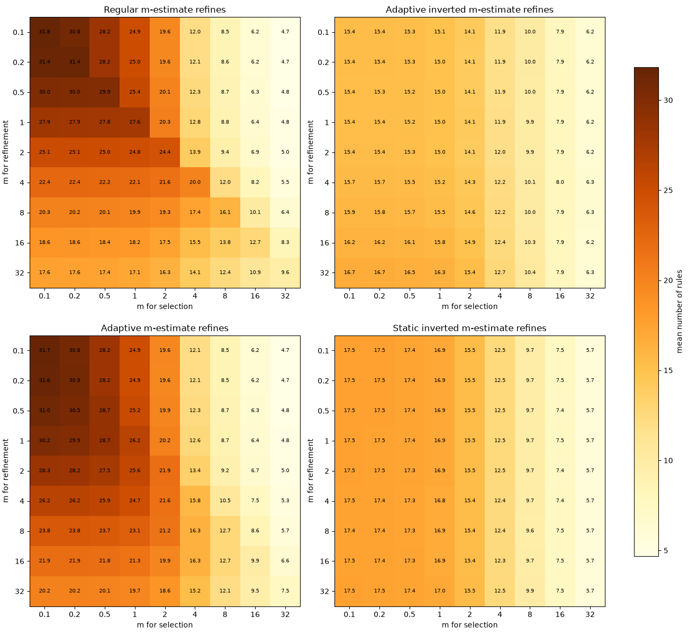
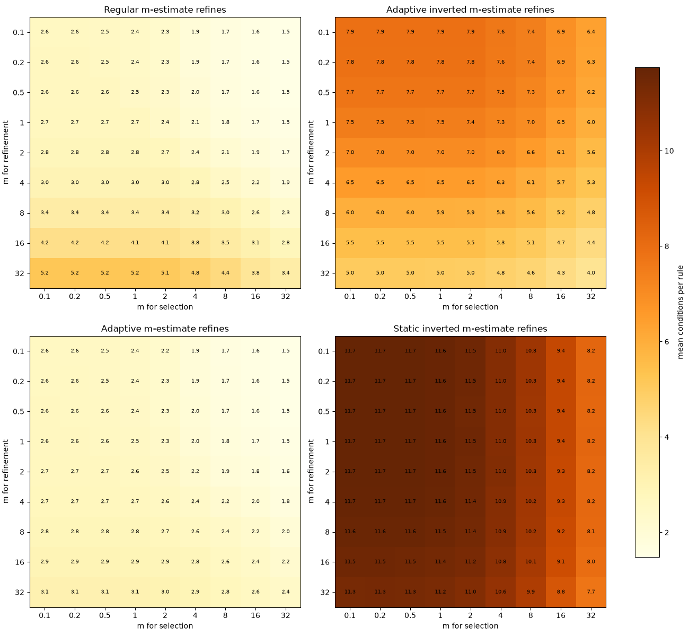
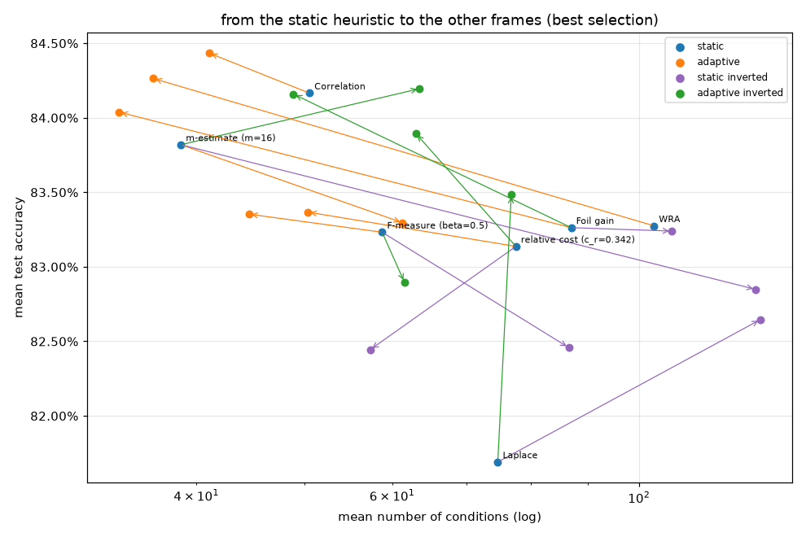
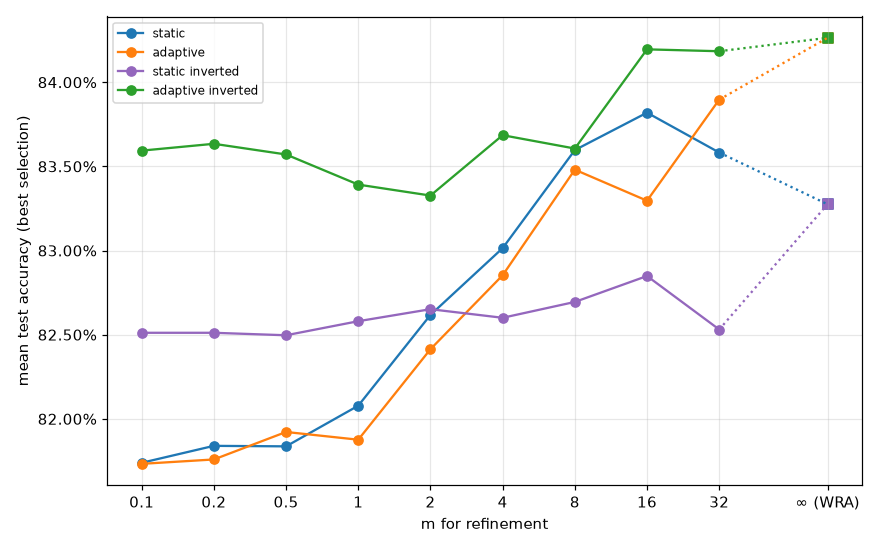

# Refinement heuristics: static and adaptive, regular and inverted

## Setup

**Full run** (36 datasets, 10-fold).

The covering learner of the
[heuristic comparison](heuristic_comparison_paper_report.md) (after Janssen &
Fürnkranz, 2010), on its datasets: 36 of the paper's datasets that are in `pyrulearn.experiments.catalog` (20 binary, 16 multi-class): greedy top-down refinement until no refinement is left
(`BeamSearch(beam_width=1)`, in section 4 also width 5), the
best rule on the refinement path by a separate selection heuristic, the
m-estimate (`SingleRuleLearner(h, selection=MEstimate(m_s))`), no
stopping criterion and no pruning; covering stops once a new rule covers
no more positives than negatives; ordered class binarization. Numeric
attributes are discretized per training fold
(`TreeDiscretizer(max_intervals=8)`). Each fit is capped at 600s, and a fold
that times out fails the learner's whole cross-validation on that dataset.

A heuristic `h` refines in one of four frames: **static** (`h`, judged
from the origin of the coverage space of the whole data), **adaptive**
(`Adaptive(h)`: among the examples of the rule being refined, its class
distribution as the prior), **static inverted** (`Inverted(h)`:
`h(N - n, P - p)`, judged by the examples a rule excludes, from the upper
right corner of the whole coverage space), and **adaptive inverted**
(`Adaptive(Inverted(h))`: `h(N' - n, P' - p)` among the parent's `P'`
positives and `N'` negatives -- the inverted heuristics of Stecher,
Janssen & Fürnkranz, ECML PKDD 2014). Scores relative to the parent have
no common scale across parents: the selection, always static, picks the
rule that is returned.

Measures: test accuracy, number of rules and conditions. Accuracy is the
mean across every dataset and fold; the rule-set sizes (rules, conditions,
conditions per rule) are the shifted geometric mean, exp(mean(log(x + 1))) - 1,
over the datasets of their mean over the folds, so that the large datasets
don't dominate.

## m-estimates for refinement and for selection

`MEstimate(m_r)` refines and `MEstimate(m_s)` selects the rule on the refinement path, for every pair of m in {0.1, 0.2, 0.5, 1, 2, 4, 8, 16, 32}, in each of the four frames; the diagonal of the regular (static) matrix is the plain m-estimate. Rows: m for refinement, columns: m for selection.

### Accuracy

Regular m-estimate for refinement:

| refine \ select | m=0.1 | m=0.2 | m=0.5 | m=1 | m=2 | m=4 | m=8 | m=16 | m=32 |
|---|--:|--:|--:|--:|--:|--:|--:|--:|--:|
| m=0.1 | 81.54% | 81.56% | 81.74% | 81.46% | 80.58% | 80.41% | 80.18% | 78.90% | 77.96% |
| m=0.2 | 81.62% | 81.62% | 81.84% | 81.48% | 80.68% | 80.46% | 80.18% | 78.87% | 77.93% |
| m=0.5 | 81.81% | 81.81% | 81.84% | 81.59% | 80.78% | 80.53% | 80.32% | 78.96% | 77.97% |
| m=1 | 82.01% | 82.01% | 82.03% | 82.08% | 81.24% | 81.08% | 80.53% | 79.09% | 77.99% |
| m=2 | 82.39% | 82.39% | 82.39% | 82.42% | 82.62% | 82.21% | 80.73% | 79.48% | 78.32% |
| m=4 | 82.87% | 82.87% | 82.88% | 82.96% | 83.01% | 82.92% | 81.57% | 80.38% | 78.92% |
| m=8 | 82.93% | 82.94% | 82.95% | 83.04% | 83.04% | 83.60% | 83.42% | 82.13% | 80.26% |
| m=16 | 83.22% | 83.22% | 83.24% | 83.25% | 83.25% | 83.71% | 83.74% | 83.82% | 82.08% |
| m=32 | 83.03% | 83.03% | 83.04% | 83.17% | 83.04% | 83.44% | 83.41% | 83.58% | 83.36% |

Adaptive inverted m-estimate for refinement:

| refine \ select | m=0.1 | m=0.2 | m=0.5 | m=1 | m=2 | m=4 | m=8 | m=16 | m=32 |
|---|--:|--:|--:|--:|--:|--:|--:|--:|--:|
| m=0.1 | 82.84% | 82.84% | 82.90% | 82.94% | 83.25% | 83.59% | 83.48% | 83.18% | 82.32% |
| m=0.2 | 82.87% | 82.87% | 82.94% | 82.94% | 83.25% | 83.63% | 83.43% | 83.18% | 82.34% |
| m=0.5 | 82.81% | 82.81% | 82.87% | 82.88% | 83.29% | 83.57% | 83.52% | 83.18% | 82.37% |
| m=1 | 82.87% | 82.87% | 82.92% | 82.96% | 83.28% | 83.39% | 83.19% | 82.93% | 82.33% |
| m=2 | 82.93% | 82.92% | 82.98% | 82.98% | 83.16% | 83.33% | 83.28% | 83.17% | 82.65% |
| m=4 | 83.20% | 83.20% | 83.23% | 83.36% | 83.31% | 83.58% | 83.69% | 83.38% | 82.73% |
| m=8 | 83.35% | 83.35% | 83.39% | 83.42% | 83.53% | 83.61% | 83.43% | 83.22% | 82.72% |
| m=16 | 83.71% | 83.71% | 83.74% | 83.72% | 83.75% | 84.20% | 84.18% | 84.04% | 83.20% |
| m=32 | 83.53% | 83.54% | 83.52% | 83.61% | 83.67% | 84.14% | 84.18% | 83.85% | 83.04% |

Adaptive m-estimate for refinement:

| refine \ select | m=0.1 | m=0.2 | m=0.5 | m=1 | m=2 | m=4 | m=8 | m=16 | m=32 |
|---|--:|--:|--:|--:|--:|--:|--:|--:|--:|
| m=0.1 | 81.59% | 81.58% | 81.73% | 81.46% | 80.60% | 80.41% | 80.18% | 78.90% | 77.96% |
| m=0.2 | 81.65% | 81.69% | 81.76% | 81.46% | 80.64% | 80.46% | 80.19% | 78.87% | 77.95% |
| m=0.5 | 81.74% | 81.80% | 81.92% | 81.67% | 80.76% | 80.49% | 80.27% | 78.96% | 77.97% |
| m=1 | 81.67% | 81.70% | 81.88% | 81.83% | 81.06% | 80.81% | 80.43% | 79.12% | 77.99% |
| m=2 | 82.17% | 82.17% | 82.20% | 82.33% | 82.41% | 81.67% | 80.68% | 79.44% | 78.26% |
| m=4 | 82.76% | 82.76% | 82.73% | 82.76% | 82.84% | 82.85% | 81.20% | 79.90% | 78.79% |
| m=8 | 83.27% | 83.27% | 83.34% | 83.33% | 83.13% | 83.48% | 82.76% | 81.51% | 79.89% |
| m=16 | 83.22% | 83.22% | 83.22% | 83.30% | 83.18% | 83.16% | 82.96% | 82.83% | 81.69% |
| m=32 | 83.24% | 83.25% | 83.24% | 83.22% | 83.50% | 83.90% | 83.78% | 83.11% | 82.92% |

Static inverted m-estimate for refinement:

| refine \ select | m=0.1 | m=0.2 | m=0.5 | m=1 | m=2 | m=4 | m=8 | m=16 | m=32 |
|---|--:|--:|--:|--:|--:|--:|--:|--:|--:|
| m=0.1 | 82.02% | 82.01% | 82.06% | 82.23% | 82.33% | 82.46% | 82.51% | 82.43% | 81.89% |
| m=0.2 | 82.02% | 82.01% | 82.06% | 82.23% | 82.33% | 82.46% | 82.51% | 82.44% | 81.89% |
| m=0.5 | 82.01% | 82.00% | 82.06% | 82.21% | 82.30% | 82.50% | 82.48% | 82.46% | 81.96% |
| m=1 | 82.07% | 82.06% | 82.15% | 82.28% | 82.35% | 82.53% | 82.58% | 82.39% | 81.93% |
| m=2 | 81.88% | 81.87% | 81.96% | 82.16% | 82.33% | 82.58% | 82.65% | 82.40% | 81.94% |
| m=4 | 81.88% | 81.87% | 81.97% | 82.24% | 82.30% | 82.60% | 82.49% | 82.22% | 81.94% |
| m=8 | 82.08% | 82.07% | 82.13% | 82.34% | 82.10% | 82.65% | 82.69% | 82.27% | 81.80% |
| m=16 | 81.92% | 81.95% | 82.06% | 82.10% | 82.38% | 82.85% | 82.68% | 82.30% | 81.86% |
| m=32 | 81.98% | 81.97% | 82.02% | 81.99% | 82.34% | 82.53% | 82.32% | 82.37% | 81.83% |

### Number of rules

Regular m-estimate for refinement:

| refine \ select | m=0.1 | m=0.2 | m=0.5 | m=1 | m=2 | m=4 | m=8 | m=16 | m=32 |
|---|--:|--:|--:|--:|--:|--:|--:|--:|--:|
| m=0.1 | 31.8 | 30.8 | 28.2 | 24.9 | 19.6 | 12.0 | 8.5 | 6.2 | 4.7 |
| m=0.2 | 31.4 | 31.4 | 28.2 | 25.0 | 19.6 | 12.1 | 8.6 | 6.2 | 4.7 |
| m=0.5 | 30.0 | 30.0 | 29.9 | 25.4 | 20.1 | 12.3 | 8.7 | 6.3 | 4.8 |
| m=1 | 27.9 | 27.9 | 27.8 | 27.6 | 20.3 | 12.8 | 8.8 | 6.4 | 4.8 |
| m=2 | 25.1 | 25.1 | 25.0 | 24.8 | 24.4 | 13.9 | 9.4 | 6.9 | 5.0 |
| m=4 | 22.4 | 22.4 | 22.2 | 22.1 | 21.6 | 20.0 | 12.0 | 8.2 | 5.5 |
| m=8 | 20.3 | 20.2 | 20.1 | 19.9 | 19.3 | 17.4 | 16.1 | 10.1 | 6.4 |
| m=16 | 18.6 | 18.6 | 18.4 | 18.2 | 17.5 | 15.5 | 13.8 | 12.7 | 8.3 |
| m=32 | 17.6 | 17.6 | 17.4 | 17.1 | 16.3 | 14.1 | 12.4 | 10.9 | 9.6 |

Adaptive inverted m-estimate for refinement:

| refine \ select | m=0.1 | m=0.2 | m=0.5 | m=1 | m=2 | m=4 | m=8 | m=16 | m=32 |
|---|--:|--:|--:|--:|--:|--:|--:|--:|--:|
| m=0.1 | 15.4 | 15.4 | 15.3 | 15.1 | 14.1 | 11.9 | 10.0 | 7.9 | 6.2 |
| m=0.2 | 15.4 | 15.4 | 15.3 | 15.0 | 14.1 | 11.9 | 10.0 | 7.9 | 6.2 |
| m=0.5 | 15.4 | 15.3 | 15.2 | 15.0 | 14.1 | 11.9 | 10.0 | 7.9 | 6.2 |
| m=1 | 15.4 | 15.4 | 15.2 | 15.0 | 14.1 | 11.9 | 9.9 | 7.9 | 6.2 |
| m=2 | 15.4 | 15.4 | 15.3 | 15.0 | 14.1 | 12.0 | 9.9 | 7.9 | 6.2 |
| m=4 | 15.7 | 15.7 | 15.5 | 15.2 | 14.3 | 12.2 | 10.1 | 8.0 | 6.3 |
| m=8 | 15.9 | 15.8 | 15.7 | 15.5 | 14.6 | 12.2 | 10.0 | 7.9 | 6.3 |
| m=16 | 16.2 | 16.2 | 16.1 | 15.8 | 14.9 | 12.4 | 10.3 | 7.9 | 6.2 |
| m=32 | 16.7 | 16.7 | 16.5 | 16.3 | 15.4 | 12.7 | 10.4 | 7.9 | 6.3 |

Adaptive m-estimate for refinement:

| refine \ select | m=0.1 | m=0.2 | m=0.5 | m=1 | m=2 | m=4 | m=8 | m=16 | m=32 |
|---|--:|--:|--:|--:|--:|--:|--:|--:|--:|
| m=0.1 | 31.7 | 30.8 | 28.2 | 24.9 | 19.6 | 12.1 | 8.5 | 6.2 | 4.7 |
| m=0.2 | 31.6 | 30.9 | 28.2 | 24.9 | 19.6 | 12.1 | 8.5 | 6.2 | 4.7 |
| m=0.5 | 31.0 | 30.5 | 28.7 | 25.2 | 19.9 | 12.3 | 8.7 | 6.3 | 4.8 |
| m=1 | 30.2 | 29.9 | 28.7 | 26.2 | 20.2 | 12.6 | 8.7 | 6.4 | 4.8 |
| m=2 | 28.3 | 28.2 | 27.5 | 25.6 | 21.9 | 13.4 | 9.2 | 6.7 | 5.0 |
| m=4 | 26.2 | 26.2 | 25.9 | 24.7 | 21.6 | 15.8 | 10.5 | 7.5 | 5.3 |
| m=8 | 23.8 | 23.8 | 23.7 | 23.1 | 21.2 | 16.3 | 12.7 | 8.6 | 5.7 |
| m=16 | 21.9 | 21.9 | 21.8 | 21.3 | 19.9 | 16.3 | 12.7 | 9.9 | 6.6 |
| m=32 | 20.2 | 20.2 | 20.1 | 19.7 | 18.6 | 15.2 | 12.1 | 9.5 | 7.5 |

Static inverted m-estimate for refinement:

| refine \ select | m=0.1 | m=0.2 | m=0.5 | m=1 | m=2 | m=4 | m=8 | m=16 | m=32 |
|---|--:|--:|--:|--:|--:|--:|--:|--:|--:|
| m=0.1 | 17.5 | 17.5 | 17.4 | 16.9 | 15.5 | 12.5 | 9.7 | 7.5 | 5.7 |
| m=0.2 | 17.5 | 17.5 | 17.4 | 16.9 | 15.5 | 12.5 | 9.7 | 7.5 | 5.7 |
| m=0.5 | 17.5 | 17.5 | 17.4 | 16.9 | 15.5 | 12.5 | 9.7 | 7.4 | 5.7 |
| m=1 | 17.5 | 17.5 | 17.4 | 16.9 | 15.5 | 12.5 | 9.7 | 7.5 | 5.7 |
| m=2 | 17.5 | 17.5 | 17.3 | 16.9 | 15.5 | 12.5 | 9.7 | 7.4 | 5.7 |
| m=4 | 17.5 | 17.4 | 17.3 | 16.8 | 15.4 | 12.4 | 9.7 | 7.4 | 5.7 |
| m=8 | 17.4 | 17.4 | 17.3 | 16.9 | 15.4 | 12.4 | 9.6 | 7.5 | 5.7 |
| m=16 | 17.5 | 17.4 | 17.3 | 16.9 | 15.4 | 12.3 | 9.7 | 7.5 | 5.7 |
| m=32 | 17.5 | 17.5 | 17.4 | 17.0 | 15.5 | 12.5 | 9.9 | 7.5 | 5.7 |

### Conditions per rule

Regular m-estimate for refinement:

| refine \ select | m=0.1 | m=0.2 | m=0.5 | m=1 | m=2 | m=4 | m=8 | m=16 | m=32 |
|---|--:|--:|--:|--:|--:|--:|--:|--:|--:|
| m=0.1 | 2.6 | 2.6 | 2.5 | 2.4 | 2.3 | 1.9 | 1.7 | 1.6 | 1.5 |
| m=0.2 | 2.6 | 2.6 | 2.5 | 2.4 | 2.3 | 1.9 | 1.7 | 1.6 | 1.5 |
| m=0.5 | 2.6 | 2.6 | 2.6 | 2.5 | 2.3 | 2.0 | 1.7 | 1.6 | 1.5 |
| m=1 | 2.7 | 2.7 | 2.7 | 2.7 | 2.4 | 2.1 | 1.8 | 1.7 | 1.5 |
| m=2 | 2.8 | 2.8 | 2.8 | 2.8 | 2.7 | 2.4 | 2.1 | 1.9 | 1.7 |
| m=4 | 3.0 | 3.0 | 3.0 | 3.0 | 3.0 | 2.8 | 2.5 | 2.2 | 1.9 |
| m=8 | 3.4 | 3.4 | 3.4 | 3.4 | 3.4 | 3.2 | 3.0 | 2.6 | 2.3 |
| m=16 | 4.2 | 4.2 | 4.2 | 4.1 | 4.1 | 3.8 | 3.5 | 3.1 | 2.8 |
| m=32 | 5.2 | 5.2 | 5.2 | 5.2 | 5.1 | 4.8 | 4.4 | 3.8 | 3.4 |

Adaptive inverted m-estimate for refinement:

| refine \ select | m=0.1 | m=0.2 | m=0.5 | m=1 | m=2 | m=4 | m=8 | m=16 | m=32 |
|---|--:|--:|--:|--:|--:|--:|--:|--:|--:|
| m=0.1 | 7.9 | 7.9 | 7.9 | 7.9 | 7.9 | 7.6 | 7.4 | 6.9 | 6.4 |
| m=0.2 | 7.8 | 7.8 | 7.8 | 7.8 | 7.8 | 7.6 | 7.4 | 6.9 | 6.3 |
| m=0.5 | 7.7 | 7.7 | 7.7 | 7.7 | 7.7 | 7.5 | 7.3 | 6.7 | 6.2 |
| m=1 | 7.5 | 7.5 | 7.5 | 7.5 | 7.4 | 7.3 | 7.0 | 6.5 | 6.0 |
| m=2 | 7.0 | 7.0 | 7.0 | 7.0 | 7.0 | 6.9 | 6.6 | 6.1 | 5.6 |
| m=4 | 6.5 | 6.5 | 6.5 | 6.5 | 6.5 | 6.3 | 6.1 | 5.7 | 5.3 |
| m=8 | 6.0 | 6.0 | 6.0 | 5.9 | 5.9 | 5.8 | 5.6 | 5.2 | 4.8 |
| m=16 | 5.5 | 5.5 | 5.5 | 5.5 | 5.5 | 5.3 | 5.1 | 4.7 | 4.4 |
| m=32 | 5.0 | 5.0 | 5.0 | 5.0 | 5.0 | 4.8 | 4.6 | 4.3 | 4.0 |

Adaptive m-estimate for refinement:

| refine \ select | m=0.1 | m=0.2 | m=0.5 | m=1 | m=2 | m=4 | m=8 | m=16 | m=32 |
|---|--:|--:|--:|--:|--:|--:|--:|--:|--:|
| m=0.1 | 2.6 | 2.6 | 2.5 | 2.4 | 2.2 | 1.9 | 1.7 | 1.6 | 1.5 |
| m=0.2 | 2.6 | 2.6 | 2.5 | 2.4 | 2.3 | 1.9 | 1.7 | 1.6 | 1.5 |
| m=0.5 | 2.6 | 2.6 | 2.6 | 2.4 | 2.3 | 2.0 | 1.7 | 1.6 | 1.5 |
| m=1 | 2.6 | 2.6 | 2.6 | 2.5 | 2.3 | 2.0 | 1.8 | 1.7 | 1.5 |
| m=2 | 2.7 | 2.7 | 2.7 | 2.6 | 2.5 | 2.2 | 1.9 | 1.8 | 1.6 |
| m=4 | 2.7 | 2.7 | 2.7 | 2.7 | 2.6 | 2.4 | 2.2 | 2.0 | 1.8 |
| m=8 | 2.8 | 2.8 | 2.8 | 2.8 | 2.7 | 2.6 | 2.4 | 2.2 | 2.0 |
| m=16 | 2.9 | 2.9 | 2.9 | 2.9 | 2.9 | 2.8 | 2.6 | 2.4 | 2.2 |
| m=32 | 3.1 | 3.1 | 3.1 | 3.1 | 3.0 | 2.9 | 2.8 | 2.6 | 2.4 |

Static inverted m-estimate for refinement:

| refine \ select | m=0.1 | m=0.2 | m=0.5 | m=1 | m=2 | m=4 | m=8 | m=16 | m=32 |
|---|--:|--:|--:|--:|--:|--:|--:|--:|--:|
| m=0.1 | 11.7 | 11.7 | 11.7 | 11.6 | 11.5 | 11.0 | 10.3 | 9.4 | 8.2 |
| m=0.2 | 11.7 | 11.7 | 11.7 | 11.6 | 11.5 | 11.0 | 10.3 | 9.4 | 8.2 |
| m=0.5 | 11.7 | 11.7 | 11.7 | 11.6 | 11.5 | 11.0 | 10.3 | 9.4 | 8.2 |
| m=1 | 11.7 | 11.7 | 11.7 | 11.6 | 11.5 | 11.0 | 10.3 | 9.4 | 8.2 |
| m=2 | 11.7 | 11.7 | 11.7 | 11.6 | 11.5 | 11.0 | 10.3 | 9.3 | 8.2 |
| m=4 | 11.7 | 11.7 | 11.7 | 11.6 | 11.4 | 10.9 | 10.2 | 9.3 | 8.2 |
| m=8 | 11.6 | 11.6 | 11.6 | 11.5 | 11.4 | 10.9 | 10.2 | 9.2 | 8.1 |
| m=16 | 11.5 | 11.5 | 11.5 | 11.4 | 11.2 | 10.8 | 10.1 | 9.1 | 8.0 |
| m=32 | 11.3 | 11.3 | 11.3 | 11.2 | 11.0 | 10.6 | 9.9 | 8.8 | 7.7 |

### Conditions in the rule set

Regular m-estimate for refinement:

| refine \ select | m=0.1 | m=0.2 | m=0.5 | m=1 | m=2 | m=4 | m=8 | m=16 | m=32 |
|---|--:|--:|--:|--:|--:|--:|--:|--:|--:|
| m=0.1 | 81.6 | 78.2 | 70.2 | 59.8 | 44.2 | 23.1 | 14.4 | 9.8 | 7.0 |
| m=0.2 | 80.8 | 80.8 | 70.3 | 60.0 | 44.1 | 23.3 | 14.6 | 9.8 | 7.0 |
| m=0.5 | 78.0 | 77.9 | 77.5 | 62.4 | 46.5 | 24.6 | 15.2 | 10.2 | 7.3 |
| m=1 | 73.3 | 73.3 | 72.8 | 72.1 | 48.7 | 26.8 | 15.9 | 10.7 | 7.5 |
| m=2 | 68.8 | 68.8 | 68.3 | 67.5 | 65.9 | 33.1 | 19.4 | 12.7 | 8.4 |
| m=4 | 65.7 | 65.7 | 65.3 | 64.6 | 62.9 | 56.0 | 29.5 | 17.9 | 10.4 |
| m=8 | 67.7 | 67.7 | 66.9 | 65.9 | 63.8 | 54.4 | 47.3 | 26.3 | 14.6 |
| m=16 | 75.0 | 75.0 | 74.4 | 72.9 | 69.6 | 57.7 | 47.0 | 38.7 | 23.1 |
| m=32 | 87.9 | 87.8 | 87.2 | 84.8 | 79.7 | 65.1 | 52.5 | 40.3 | 31.3 |

Adaptive inverted m-estimate for refinement:

| refine \ select | m=0.1 | m=0.2 | m=0.5 | m=1 | m=2 | m=4 | m=8 | m=16 | m=32 |
|---|--:|--:|--:|--:|--:|--:|--:|--:|--:|
| m=0.1 | 116.5 | 116.4 | 115.3 | 113.3 | 106.3 | 87.1 | 71.3 | 52.1 | 38.1 |
| m=0.2 | 115.8 | 115.8 | 114.7 | 112.7 | 105.8 | 86.8 | 71.0 | 51.9 | 38.0 |
| m=0.5 | 113.6 | 113.5 | 112.6 | 110.8 | 103.9 | 85.9 | 69.8 | 51.3 | 37.1 |
| m=1 | 110.2 | 110.1 | 109.0 | 107.2 | 101.0 | 83.3 | 67.0 | 49.6 | 35.6 |
| m=2 | 104.0 | 104.0 | 103.1 | 101.0 | 95.1 | 79.1 | 63.1 | 46.8 | 33.6 |
| m=4 | 98.5 | 98.4 | 97.6 | 95.6 | 89.8 | 74.3 | 58.9 | 44.3 | 32.2 |
| m=8 | 91.3 | 91.2 | 90.6 | 88.8 | 83.6 | 68.6 | 54.3 | 39.5 | 29.4 |
| m=16 | 86.0 | 85.9 | 85.3 | 83.8 | 78.7 | 63.5 | 51.0 | 36.2 | 26.4 |
| m=32 | 81.3 | 81.3 | 80.7 | 79.2 | 74.0 | 59.1 | 47.0 | 33.2 | 24.2 |

Adaptive m-estimate for refinement:

| refine \ select | m=0.1 | m=0.2 | m=0.5 | m=1 | m=2 | m=4 | m=8 | m=16 | m=32 |
|---|--:|--:|--:|--:|--:|--:|--:|--:|--:|
| m=0.1 | 80.8 | 77.7 | 69.9 | 59.5 | 44.1 | 23.2 | 14.4 | 9.8 | 7.0 |
| m=0.2 | 80.8 | 78.4 | 70.1 | 59.6 | 44.1 | 23.3 | 14.5 | 9.8 | 7.0 |
| m=0.5 | 79.8 | 78.0 | 72.5 | 60.8 | 45.4 | 24.3 | 15.0 | 10.2 | 7.2 |
| m=1 | 78.6 | 77.4 | 73.5 | 65.1 | 47.1 | 25.6 | 15.4 | 10.6 | 7.5 |
| m=2 | 74.6 | 74.3 | 71.9 | 65.3 | 53.6 | 29.4 | 17.6 | 11.8 | 8.1 |
| m=4 | 70.6 | 70.6 | 69.2 | 65.3 | 55.2 | 37.8 | 22.6 | 14.6 | 9.4 |
| m=8 | 66.5 | 66.4 | 65.8 | 63.7 | 57.4 | 42.1 | 30.5 | 19.0 | 11.2 |
| m=16 | 63.4 | 63.3 | 62.9 | 61.3 | 56.4 | 44.7 | 32.7 | 23.8 | 14.2 |
| m=32 | 61.3 | 61.3 | 60.9 | 59.6 | 55.7 | 43.8 | 32.9 | 24.4 | 17.8 |

Static inverted m-estimate for refinement:

| refine \ select | m=0.1 | m=0.2 | m=0.5 | m=1 | m=2 | m=4 | m=8 | m=16 | m=32 |
|---|--:|--:|--:|--:|--:|--:|--:|--:|--:|
| m=0.1 | 197.2 | 197.0 | 195.0 | 188.6 | 170.1 | 131.8 | 96.4 | 67.1 | 44.9 |
| m=0.2 | 197.2 | 197.0 | 195.0 | 188.6 | 170.1 | 131.9 | 96.4 | 67.1 | 44.8 |
| m=0.5 | 197.1 | 196.9 | 195.0 | 188.5 | 169.9 | 132.0 | 96.3 | 66.8 | 44.8 |
| m=1 | 196.9 | 196.7 | 194.9 | 188.4 | 169.9 | 131.6 | 96.4 | 67.1 | 45.1 |
| m=2 | 196.5 | 196.3 | 194.5 | 188.1 | 169.8 | 131.7 | 96.3 | 66.7 | 44.8 |
| m=4 | 195.4 | 195.2 | 193.6 | 187.1 | 168.8 | 130.6 | 95.7 | 66.7 | 44.7 |
| m=8 | 193.6 | 193.5 | 191.9 | 186.0 | 167.8 | 129.2 | 94.5 | 66.3 | 44.3 |
| m=16 | 191.7 | 191.6 | 190.2 | 183.8 | 166.1 | 127.3 | 93.9 | 65.6 | 43.7 |
| m=32 | 189.6 | 189.5 | 188.1 | 182.3 | 164.1 | 126.6 | 94.5 | 63.5 | 41.9 |

## Static vs. adaptive, regular vs. inverted

Each heuristic refines in every frame where it differs, with the m-estimate selecting (m_s in {0.1, 0.2, 0.5, 1, 2, 4, 8, 16, 32}); shown is the best selection, with its m_s. Inverting a symmetric heuristic (WRA, correlation) changes nothing, and adapting one that doesn't depend on the frame (Laplace) neither -- unless it is inverted, as the inverted Laplace estimate depends on it. The static Foil gain is the gain over the universal rule (`WeightedGain(CoveredPositives(), InformationContent())`), the adaptive one Foil's own (`FoilGain()`). The m-estimate (m_r = 16) is from section 1.

| heuristic | static | adaptive | static inverted | adaptive inverted |
|---|--:|--:|--:|--:|
| m-estimate (m=16) | 83.82% (38.7; m_s=16) | 83.30% (61.3; m_s=1) | 82.85% (127.3; m_s=4) | 84.20% (63.5; m_s=4) |
| WRA | 83.28% (103.2; m_s=4) | 84.26% (36.6; m_s=8) | -- | -- |
| relative cost (c_r=0.342) | 83.14% (77.5; m_s=4) | 83.37% (50.4; m_s=2) | 82.44% (57.3; m_s=16) | 83.90% (63.0; m_s=8) |
| F-measure (beta=0.5) | 83.23% (58.8; m_s=4) | 83.35% (44.6; m_s=4) | 82.46% (86.5; m_s=2) | 82.90% (61.5; m_s=2) |
| Correlation | 84.17% (50.5; m_s=8) | 84.43% (41.0; m_s=4) | -- | -- |
| Foil gain | 83.26% (86.9; m_s=4) | 84.04% (34.1; m_s=8) | 83.24% (107.0; m_s=4) | 84.16% (48.9; m_s=4) |
| Laplace | 81.69% (74.7; m_s=0.5) | -- | 82.65% (128.6; m_s=4) | 83.48% (76.8; m_s=4) |

Cells: accuracy (conditions in the rule set; the best m for selection). --: the same as the frame to its left.

### Fixed selection (m_s = 8)

As above, with the m-estimate selecting with m_s = 8 for every heuristic and frame, so that only the refinement heuristics differ.

| heuristic | static | adaptive | static inverted | adaptive inverted |
|---|--:|--:|--:|--:|
| m-estimate (m=16) | 83.74% (47.0) | 82.96% (32.7) | 82.68% (93.9) | 84.18% (51.0) |
| WRA | 83.10% (78.6) | 84.26% (36.6) | -- | -- |
| relative cost (c_r=0.342) | 82.80% (60.9) | 83.24% (24.5) | 82.37% (87.7) | 83.90% (63.0) |
| F-measure (beta=0.5) | 83.23% (43.2) | 83.25% (32.3) | 82.34% (50.7) | 82.65% (32.5) |
| Correlation | 84.17% (50.5) | 84.15% (30.9) | -- | -- |
| Foil gain | 83.06% (66.7) | 84.04% (34.1) | 83.21% (79.9) | 83.80% (38.0) |
| Laplace | 80.35% (15.1) | -- | 82.50% (93.6) | 83.18% (64.3) |

Cells: accuracy (conditions in the rule set). --: the same as the frame to its left.

Foil's own search, climbing while the gain is positive and returning the rule it ends at (`GainAscentHillClimbing`, no selection): Foil gain: 83.69% with 62.8 conditions; Foil gain over the root: 81.68% with 13.8 conditions.

## Adaptive heuristics and m

The best selection for each m for refinement, in each frame; m -> infinity is WRA (static: WRA, adaptive: adaptive WRA; inverting it changes nothing).

| m for refinement | static | adaptive | static inverted | adaptive inverted |
|---|--:|--:|--:|--:|
| 0.1 | 81.74% (70.2) | 81.73% (69.9) | 82.51% (96.4) | 83.59% (87.1) |
| 0.2 | 81.84% (70.3) | 81.76% (70.1) | 82.51% (96.4) | 83.63% (86.8) |
| 0.5 | 81.84% (77.5) | 81.92% (72.5) | 82.50% (132.0) | 83.57% (85.9) |
| 1 | 82.08% (72.1) | 81.88% (73.5) | 82.58% (96.4) | 83.39% (83.3) |
| 2 | 82.62% (65.9) | 82.41% (53.6) | 82.65% (96.3) | 83.33% (79.1) |
| 4 | 83.01% (62.9) | 82.85% (37.8) | 82.60% (130.6) | 83.69% (58.9) |
| 8 | 83.60% (54.4) | 83.48% (42.1) | 82.69% (94.5) | 83.61% (68.6) |
| 16 | 83.82% (38.7) | 83.30% (61.3) | 82.85% (127.3) | 84.20% (63.5) |
| 32 | 83.58% (40.3) | 83.90% (43.8) | 82.53% (126.6) | 84.18% (47.0) |
| inf | 83.28% (103.2) | 84.26% (36.6) | 83.28% (103.2) | 84.26% (36.6) |

## Beam search

Beam width 1 vs. 5, the m-estimate selecting (m_s in {4, 8, 16}). A beam ranks the refinements of all its rules together: scores relative to different parents are compared, which have no common scale. `Gain(...)` ranks by the improvement over the parent instead of the level; with width 1 the two rank the refinements of a rule alike.

| refinement | m_s | width 1 | width 5 |
|---|--:|--:|--:|
| m=16 | 4 | 83.71% (57.7) | 83.71% (52.1) |
| m=16 | 8 | 83.74% (47.0) | 83.87% (42.7) |
| m=16 | 16 | 83.82% (38.7) | 84.08% (34.9) |
| Adaptive(m=16) | 4 | 83.16% (44.7) | 83.60% (37.5) |
| Adaptive(m=16) | 8 | 82.96% (32.7) | 83.50% (27.2) |
| Adaptive(m=16) | 16 | 82.83% (23.8) | 83.01% (19.5) |
| Adaptive(Inverted(m=16)) | 4 | 84.20% (63.5) | 83.64% (69.6) |
| Adaptive(Inverted(m=16)) | 8 | 84.18% (51.0) | 83.66% (55.7) |
| Adaptive(Inverted(m=16)) | 16 | 84.04% (36.2) | 83.63% (40.5) |
| Adaptive(Gain(m=16)) | 4 | 83.16% (44.7) | 83.68% (43.8) |
| Adaptive(Gain(m=16)) | 8 | 82.96% (32.7) | 83.88% (35.4) |
| Adaptive(Gain(m=16)) | 16 | 82.83% (23.8) | 84.03% (26.2) |
| Adaptive(Gain(Inverted(m=16))) | 4 | 84.20% (63.5) | 83.70% (57.5) |
| Adaptive(Gain(Inverted(m=16))) | 8 | 84.18% (51.0) | 84.02% (47.8) |
| Adaptive(Gain(Inverted(m=16))) | 16 | 84.04% (36.2) | 83.83% (35.6) |
| WRA | 4 | 83.28% (103.2) | 83.62% (101.3) |
| WRA | 8 | 83.10% (78.6) | 83.47% (78.7) |
| WRA | 16 | 82.76% (52.4) | 82.99% (54.3) |
| Adaptive(WRA) | 4 | 84.06% (47.3) | 84.08% (44.3) |
| Adaptive(WRA) | 8 | 84.26% (36.6) | 84.20% (35.9) |
| Adaptive(WRA) | 16 | 83.65% (25.8) | 84.51% (26.6) |

## Weighted gains

`WeightedGain(weight, base)`: ``weight(r) * (base(r) - base(r0))``, the gain over the universal rule ``r0`` of the frame -- over the root (static) or over the parent (adaptive). The weights are Klösgen's family ``c^a``, with ``c`` the covered examples (`p + n`) or positives (`p`); the base is linear (precision) or logarithmic (information content). `p + n` and precision is WRA, `p` and information content Foil gain, `sqrt(p + n)` and precision Klösgen's quality function, weight 1 ranks as the base itself. Best selection (m_s in {4, 8, 16}).

| weight | base | static | adaptive |
|---|---|--:|--:|
| 1 | precision | 80.26% (22.8; m_s=4) | 80.26% (22.8; m_s=4) |
| 1 | information content | 80.26% (22.8; m_s=4) | 80.26% (22.8; m_s=4) |
| sqrt(p) | precision | 83.71% (42.3; m_s=4) | 83.34% (31.0; m_s=4) |
| sqrt(p) | information content | 84.00% (51.7; m_s=8) | 83.92% (35.1; m_s=4) |
| p | precision | 83.88% (49.9; m_s=8) | 84.16% (40.0; m_s=4) |
| p | information content | 83.26% (86.9; m_s=4) | 84.04% (34.1; m_s=8) |
| p^2 | precision | 83.33% (92.3; m_s=4) | 84.25% (40.7; m_s=8) |
| p^2 | information content | 83.00% (110.8; m_s=4) | 83.91% (43.0; m_s=8) |
| sqrt(p + n) | precision | 83.87% (58.8; m_s=4) | 83.80% (34.3; m_s=4) |
| sqrt(p + n) | information content | 83.42% (139.5; m_s=4) | 83.84% (40.7; m_s=4) |
| p + n | precision | 83.23% (103.1; m_s=4) | 84.24% (36.6; m_s=8) |
| p + n | information content | 82.30% (182.0; m_s=4) | 84.24% (54.2; m_s=4) |
| (p + n)^2 | precision | 82.03% (195.9; m_s=4) | 83.82% (39.8; m_s=16) |
| (p + n)^2 | information content | 81.91% (197.4; m_s=4) | 83.51% (74.7; m_s=4) |

Cells: accuracy (conditions in the rule set; the best m for selection).

### Fixed selection (m_s = 8)

As above, with the m-estimate selecting with m_s = 8 for every gain.

| weight | base | static | adaptive |
|---|---|--:|--:|
| 1 | precision | 80.18% (14.1) | 80.18% (14.1) |
| 1 | information content | 80.18% (14.1) | 80.18% (14.1) |
| sqrt(p) | precision | 83.56% (30.3) | 82.85% (21.7) |
| sqrt(p) | information content | 84.00% (51.7) | 83.31% (25.8) |
| p | precision | 83.88% (49.9) | 83.95% (29.2) |
| p | information content | 83.06% (66.7) | 84.04% (34.1) |
| p^2 | precision | 83.01% (71.0) | 84.25% (40.7) |
| p^2 | information content | 82.57% (81.7) | 83.91% (43.0) |
| sqrt(p + n) | precision | 83.79% (44.4) | 83.28% (24.8) |
| sqrt(p + n) | information content | 83.24% (104.0) | 83.76% (29.7) |
| p + n | precision | 83.10% (78.5) | 84.24% (36.6) |
| p + n | information content | 82.16% (128.2) | 83.55% (43.1) |
| (p + n)^2 | precision | 81.76% (136.0) | 83.78% (55.1) |
| (p + n)^2 | information content | 81.14% (128.7) | 83.26% (59.7) |

### Paired comparisons

Each gain with its best selection (as above); per dataset the mean accuracy across folds; wins/losses of the second over the first, the mean difference, and the two-sided Wilcoxon signed-rank test (p) and sign test (sign p) across datasets (not corrected for the 20 tests).

| comparison | first | second | datasets | wins/losses | difference | p | sign p |
|---|---|---|--:|--:|--:|--:|--:|
| WRA vs. a weaker weight | refine gain of precision weighted by p + n, select m=4 | refine gain of precision weighted by sqrt(p + n), select m=4 | 36 | 20/12 | +0.63 | 0.217 | 0.215 |
| WRA vs. weight p | refine gain of precision weighted by p + n, select m=4 | refine gain of precision weighted by p, select m=8 | 36 | 21/13 | +0.65 | 0.130 | 0.229 |
| WRA vs. adaptive WRA | refine gain of precision weighted by p + n, select m=4 | refine Adaptive(gain of precision weighted by p + n), select m=8 | 36 | 25/10 | +1.01 | 0.023 | 0.017 |
| adaptive WRA vs. weight p^2 | refine Adaptive(gain of precision weighted by p + n), select m=8 | refine Adaptive(gain of precision weighted by p^2), select m=8 | 36 | 16/18 | +0.01 | 0.713 | 0.864 |
| Foil gain vs. weight p + n | refine Adaptive(gain of information content weighted by p), select m=8 | refine Adaptive(gain of information content weighted by p + n), select m=4 | 36 | 13/21 | +0.20 | 0.898 | 0.229 |
| Foil gain vs. adaptive WRA | refine Adaptive(gain of information content weighted by p), select m=8 | refine Adaptive(gain of precision weighted by p + n), select m=8 | 36 | 18/11 | +0.20 | 0.239 | 0.265 |
| static Foil gain vs. weight sqrt(p) | refine gain of information content weighted by p, select m=4 | refine gain of information content weighted by sqrt(p), select m=8 | 36 | 23/11 | +0.73 | 0.026 | 0.058 |
| static vs. adaptive Foil gain | refine gain of information content weighted by p, select m=4 | refine Adaptive(gain of information content weighted by p), select m=8 | 36 | 22/10 | +0.78 | 0.096 | 0.050 |
| static sqrt(p): precision vs. information content | refine gain of precision weighted by sqrt(p), select m=4 | refine gain of information content weighted by sqrt(p), select m=8 | 36 | 14/18 | +0.29 | 0.955 | 0.597 |
| static p: precision vs. information content | refine gain of precision weighted by p, select m=8 | refine gain of information content weighted by p, select m=4 | 36 | 12/22 | -0.62 | 0.028 | 0.121 |
| static p^2: precision vs. information content | refine gain of precision weighted by p^2, select m=4 | refine gain of information content weighted by p^2, select m=4 | 36 | 16/14 | -0.33 | 0.688 | 0.856 |
| static sqrt(p + n): precision vs. information content | refine gain of precision weighted by sqrt(p + n), select m=4 | refine gain of information content weighted by sqrt(p + n), select m=4 | 36 | 12/22 | -0.44 | 0.191 | 0.121 |
| static p + n: precision vs. information content | refine gain of precision weighted by p + n, select m=4 | refine gain of information content weighted by p + n, select m=4 | 36 | 13/21 | -0.93 | 0.185 | 0.229 |
| static (p + n)^2: precision vs. information content | refine gain of precision weighted by (p + n)^2, select m=4 | refine gain of information content weighted by (p + n)^2, select m=4 | 36 | 12/18 | -0.12 | 0.491 | 0.362 |
| adaptive sqrt(p): precision vs. information content | refine Adaptive(gain of precision weighted by sqrt(p)), select m=4 | refine Adaptive(gain of information content weighted by sqrt(p)), select m=4 | 36 | 19/12 | +0.59 | 0.196 | 0.281 |
| adaptive p: precision vs. information content | refine Adaptive(gain of precision weighted by p), select m=4 | refine Adaptive(gain of information content weighted by p), select m=8 | 36 | 16/17 | -0.12 | 0.662 | 1.000 |
| adaptive p^2: precision vs. information content | refine Adaptive(gain of precision weighted by p^2), select m=8 | refine Adaptive(gain of information content weighted by p^2), select m=8 | 36 | 12/20 | -0.34 | 0.079 | 0.215 |
| adaptive sqrt(p + n): precision vs. information content | refine Adaptive(gain of precision weighted by sqrt(p + n)), select m=4 | refine Adaptive(gain of information content weighted by sqrt(p + n)), select m=4 | 36 | 18/13 | +0.04 | 0.969 | 0.473 |
| adaptive p + n: precision vs. information content | refine Adaptive(gain of precision weighted by p + n), select m=8 | refine Adaptive(gain of information content weighted by p + n), select m=4 | 36 | 12/23 | -0.01 | 0.350 | 0.090 |
| adaptive (p + n)^2: precision vs. information content | refine Adaptive(gain of precision weighted by (p + n)^2), select m=16 | refine Adaptive(gain of information content weighted by (p + n)^2), select m=4 | 36 | 17/15 | -0.31 | 0.751 | 0.860 |

### Paired comparisons, fixed selection (m_s = 8)

Each gain with the selection m_s = 8; per dataset the mean accuracy across folds; wins/losses of the second over the first, the mean difference, and the two-sided Wilcoxon signed-rank test (p) and sign test (sign p) across datasets (not corrected for the 20 tests).

| comparison | first | second | datasets | wins/losses | difference | p | sign p |
|---|---|---|--:|--:|--:|--:|--:|
| WRA vs. a weaker weight | refine gain of precision weighted by p + n, select m=8 | refine gain of precision weighted by sqrt(p + n), select m=8 | 36 | 19/15 | +0.69 | 0.407 | 0.608 |
| WRA vs. weight p | refine gain of precision weighted by p + n, select m=8 | refine gain of precision weighted by p, select m=8 | 36 | 20/14 | +0.79 | 0.096 | 0.392 |
| WRA vs. adaptive WRA | refine gain of precision weighted by p + n, select m=8 | refine Adaptive(gain of precision weighted by p + n), select m=8 | 36 | 23/10 | +1.15 | 0.033 | 0.035 |
| adaptive WRA vs. weight p^2 | refine Adaptive(gain of precision weighted by p + n), select m=8 | refine Adaptive(gain of precision weighted by p^2), select m=8 | 36 | 16/18 | +0.01 | 0.713 | 0.864 |
| Foil gain vs. weight p + n | refine Adaptive(gain of information content weighted by p), select m=8 | refine Adaptive(gain of information content weighted by p + n), select m=8 | 36 | 10/23 | -0.48 | 0.081 | 0.035 |
| Foil gain vs. adaptive WRA | refine Adaptive(gain of information content weighted by p), select m=8 | refine Adaptive(gain of precision weighted by p + n), select m=8 | 36 | 18/11 | +0.20 | 0.239 | 0.265 |
| static Foil gain vs. weight sqrt(p) | refine gain of information content weighted by p, select m=8 | refine gain of information content weighted by sqrt(p), select m=8 | 36 | 27/7 | +0.93 | 0.001 | 0.001 |
| static vs. adaptive Foil gain | refine gain of information content weighted by p, select m=8 | refine Adaptive(gain of information content weighted by p), select m=8 | 36 | 24/8 | +0.98 | 0.011 | 0.007 |
| static sqrt(p): precision vs. information content | refine gain of precision weighted by sqrt(p), select m=8 | refine gain of information content weighted by sqrt(p), select m=8 | 36 | 19/13 | +0.44 | 0.550 | 0.377 |
| static p: precision vs. information content | refine gain of precision weighted by p, select m=8 | refine gain of information content weighted by p, select m=8 | 36 | 7/26 | -0.82 | 0.003 | 0.001 |
| static p^2: precision vs. information content | refine gain of precision weighted by p^2, select m=8 | refine gain of information content weighted by p^2, select m=8 | 36 | 14/17 | -0.44 | 0.290 | 0.720 |
| static sqrt(p + n): precision vs. information content | refine gain of precision weighted by sqrt(p + n), select m=8 | refine gain of information content weighted by sqrt(p + n), select m=8 | 36 | 14/19 | -0.55 | 0.098 | 0.487 |
| static p + n: precision vs. information content | refine gain of precision weighted by p + n, select m=8 | refine gain of information content weighted by p + n, select m=8 | 36 | 13/22 | -0.94 | 0.049 | 0.175 |
| static (p + n)^2: precision vs. information content | refine gain of precision weighted by (p + n)^2, select m=8 | refine gain of information content weighted by (p + n)^2, select m=8 | 36 | 12/20 | -0.62 | 0.112 | 0.215 |
| adaptive sqrt(p): precision vs. information content | refine Adaptive(gain of precision weighted by sqrt(p)), select m=8 | refine Adaptive(gain of information content weighted by sqrt(p)), select m=8 | 36 | 18/12 | +0.46 | 0.465 | 0.362 |
| adaptive p: precision vs. information content | refine Adaptive(gain of precision weighted by p), select m=8 | refine Adaptive(gain of information content weighted by p), select m=8 | 36 | 17/16 | +0.09 | 0.837 | 1.000 |
| adaptive p^2: precision vs. information content | refine Adaptive(gain of precision weighted by p^2), select m=8 | refine Adaptive(gain of information content weighted by p^2), select m=8 | 36 | 12/20 | -0.34 | 0.079 | 0.215 |
| adaptive sqrt(p + n): precision vs. information content | refine Adaptive(gain of precision weighted by sqrt(p + n)), select m=8 | refine Adaptive(gain of information content weighted by sqrt(p + n)), select m=8 | 36 | 17/16 | +0.48 | 0.503 | 1.000 |
| adaptive p + n: precision vs. information content | refine Adaptive(gain of precision weighted by p + n), select m=8 | refine Adaptive(gain of information content weighted by p + n), select m=8 | 36 | 12/22 | -0.69 | 0.029 | 0.121 |
| adaptive (p + n)^2: precision vs. information content | refine Adaptive(gain of precision weighted by (p + n)^2), select m=8 | refine Adaptive(gain of information content weighted by (p + n)^2), select m=8 | 36 | 11/18 | -0.52 | 0.074 | 0.265 |

## Ranks

Win counts and mean accuracy ranks across datasets among the best selection of each frame of section 2 and of the m-estimate.

| learner | accuracy | wins | mean rank |
|---|--:|--:|--:|
| refine Adaptive(WRA), select m=8 | 84.26% | 3.0 | 8.67 |
| refine Adaptive(Correlation), select m=4 | 84.43% | 3.0 | 9.06 |
| m-estimate (m=16) | 83.82% | 3.5 | 9.49 |
| refine Adaptive(Foil gain), select m=8 | 84.04% | 3.5 | 9.61 |
| refine Adaptive(Inverted(Foil gain)), select m=4 | 84.16% | 2.1 | 10.04 |
| refine Correlation, select m=8 | 84.17% | 1.1 | 10.12 |
| refine Adaptive(Inverted(relative cost (c_r=0.342))), select m=8 | 83.90% | 1.5 | 10.19 |
| refine Adaptive(Inverted(m=16)), select m=4 | 84.20% | 1.6 | 10.21 |
| refine Adaptive(relative cost (c_r=0.342)), select m=2 | 83.37% | 2.1 | 10.38 |
| refine Adaptive(Inverted(Laplace)), select m=4 | 83.48% | 1.3 | 12.17 |
| refine Adaptive(m=16), select m=1 | 83.30% | 2.0 | 12.53 |
| refine Inverted(relative cost (c_r=0.342)), select m=16 | 82.44% | 2.0 | 12.56 |
| refine Adaptive(F-measure (beta=0.5)), select m=4 | 83.35% | 2.1 | 12.61 |
| refine relative cost (c_r=0.342), select m=4 | 83.14% | 0.1 | 12.90 |
| refine WRA, select m=4 | 83.28% | 1.8 | 12.97 |
| refine F-measure (beta=0.5), select m=4 | 83.23% | 0.0 | 12.99 |
| refine Foil gain, select m=4 | 83.26% | 0.1 | 13.04 |
| refine Inverted(Foil gain), select m=4 | 83.24% | 0.8 | 13.06 |
| refine Inverted(m=16), select m=4 | 82.85% | 0.8 | 13.67 |
| refine Inverted(Laplace), select m=4 | 82.65% | 0.8 | 13.93 |
| refine Adaptive(Inverted(F-measure (beta=0.5))), select m=2 | 82.90% | 0.0 | 14.15 |
| refine Laplace, select m=0.5 | 81.69% | 1.1 | 15.28 |
| refine Inverted(F-measure (beta=0.5)), select m=2 | 82.46% | 1.1 | 16.39 |

Failed folds: 0.
