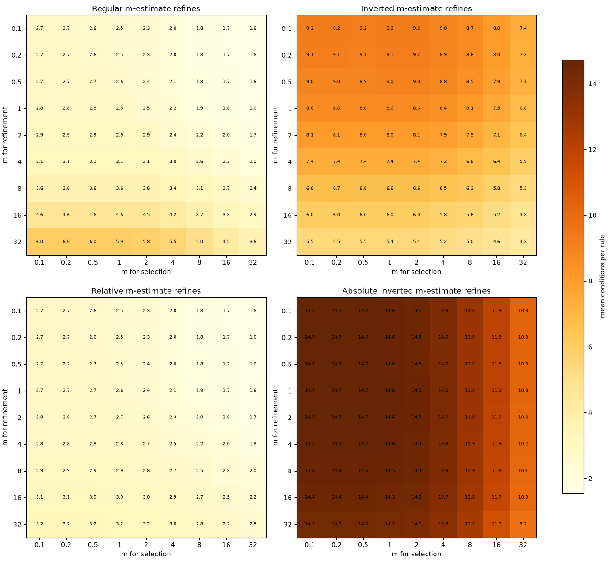
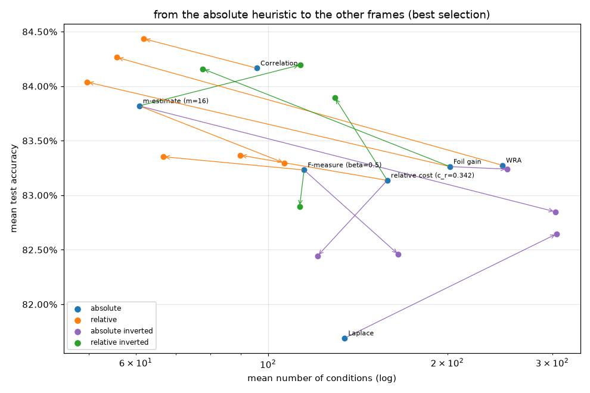
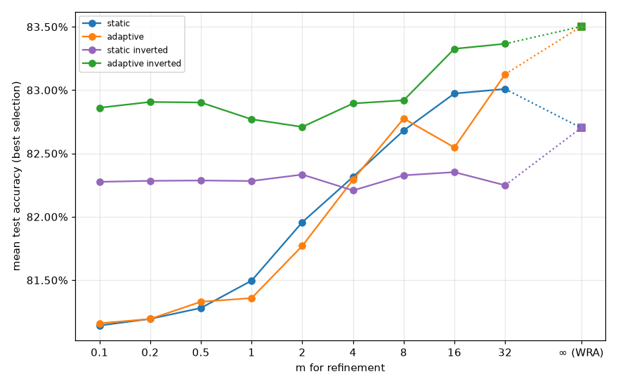

# Refinement heuristics: absolute and relative, regular and inverted

## Setup

**Full run** (36 datasets, 10-fold).

The covering learner and the datasets of the
[heuristic comparison](heuristic_comparison_report.md) (after Janssen &
Fürnkranz, 2010): greedy top-down refinement until no refinement is left
(`BeamSearch(beam_width=1)`, in section 4 also width 5), the
best rule on the refinement path by a separate selection heuristic, the
m-estimate (`SingleRuleLearner(h, selection=MEstimate(m_s))`), no
stopping criterion and no pruning; covering stops once a new rule covers
no more positives than negatives; ordered class binarization. Numeric
attributes are discretized per training fold
(`TreeDiscretizer(max_intervals=8)`); each fit is capped at
600s, and a fold that times out fails the learner's whole
cross-validation on that dataset.

A heuristic `h` refines in one of four frames: **absolute** (`h`, judged
from the origin of the coverage space of the whole data), **relative**
(`Relative(h)`: among the examples of the rule being refined, its class
distribution as the prior), **absolute inverted** (`Inverted(h)`:
`h(N - n, P - p)`, judged by the examples a rule excludes, from the upper
right corner of the whole coverage space), and **relative inverted**
(`Relative(Inverted(h))`: `h(N' - n, P' - p)` among the parent's `P'`
positives and `N'` negatives -- the inverted heuristics of Stecher,
Janssen & Fürnkranz, ECML PKDD 2014). Scores relative to the parent have
no common scale across parents: the selection, always absolute, picks the
rule that is returned.

Measures: test accuracy, number of rules and conditions; means across
every dataset and fold.

## m-estimates for refinement and for selection

`MEstimate(m_r)` refines and `MEstimate(m_s)` selects the rule on the refinement path, for every pair of m in {0.1, 0.2, 0.5, 1, 2, 4, 8, 16, 32}, in each of the four frames; the diagonal of the regular (absolute) matrix is the plain m-estimate. Rows: m for refinement, columns: m for selection.

### Accuracy

Regular m-estimate for refinement:

| refine \ select | m=0.1 | m=0.2 | m=0.5 | m=1 | m=2 | m=4 | m=8 | m=16 | m=32 |
|---|--:|--:|--:|--:|--:|--:|--:|--:|--:|
| m=0.1 | 81.54% | 81.56% | 81.74% | 81.46% | 80.58% | 80.41% | 80.18% | 78.90% | 77.96% |
| m=0.2 | 81.62% | 81.62% | 81.84% | 81.48% | 80.68% | 80.46% | 80.18% | 78.87% | 77.93% |
| m=0.5 | 81.81% | 81.81% | 81.84% | 81.59% | 80.78% | 80.53% | 80.32% | 78.96% | 77.97% |
| m=1 | 82.01% | 82.01% | 82.03% | 82.08% | 81.24% | 81.08% | 80.53% | 79.09% | 77.99% |
| m=2 | 82.39% | 82.39% | 82.39% | 82.42% | 82.62% | 82.21% | 80.73% | 79.48% | 78.32% |
| m=4 | 82.87% | 82.87% | 82.88% | 82.96% | 83.01% | 82.92% | 81.57% | 80.38% | 78.92% |
| m=8 | 82.93% | 82.94% | 82.95% | 83.04% | 83.04% | 83.60% | 83.42% | 82.13% | 80.26% |
| m=16 | 83.22% | 83.22% | 83.24% | 83.25% | 83.25% | 83.71% | 83.74% | 83.82% | 82.08% |
| m=32 | 83.03% | 83.03% | 83.04% | 83.17% | 83.04% | 83.44% | 83.41% | 83.58% | 83.36% |

Inverted m-estimate for refinement:

| refine \ select | m=0.1 | m=0.2 | m=0.5 | m=1 | m=2 | m=4 | m=8 | m=16 | m=32 |
|---|--:|--:|--:|--:|--:|--:|--:|--:|--:|
| m=0.1 | 82.84% | 82.84% | 82.90% | 82.94% | 83.25% | 83.59% | 83.48% | 83.18% | 82.32% |
| m=0.2 | 82.87% | 82.87% | 82.94% | 82.94% | 83.25% | 83.63% | 83.43% | 83.18% | 82.34% |
| m=0.5 | 82.81% | 82.81% | 82.87% | 82.88% | 83.29% | 83.57% | 83.52% | 83.18% | 82.37% |
| m=1 | 82.87% | 82.87% | 82.92% | 82.96% | 83.28% | 83.39% | 83.19% | 82.93% | 82.33% |
| m=2 | 82.93% | 82.92% | 82.98% | 82.98% | 83.16% | 83.33% | 83.28% | 83.17% | 82.65% |
| m=4 | 83.20% | 83.20% | 83.23% | 83.36% | 83.31% | 83.58% | 83.69% | 83.38% | 82.73% |
| m=8 | 83.35% | 83.35% | 83.39% | 83.42% | 83.53% | 83.61% | 83.43% | 83.22% | 82.72% |
| m=16 | 83.71% | 83.71% | 83.74% | 83.72% | 83.75% | 84.20% | 84.18% | 84.04% | 83.20% |
| m=32 | 83.53% | 83.54% | 83.52% | 83.61% | 83.67% | 84.14% | 84.18% | 83.85% | 83.04% |

Relative m-estimate for refinement:

| refine \ select | m=0.1 | m=0.2 | m=0.5 | m=1 | m=2 | m=4 | m=8 | m=16 | m=32 |
|---|--:|--:|--:|--:|--:|--:|--:|--:|--:|
| m=0.1 | 81.59% | 81.58% | 81.73% | 81.46% | 80.60% | 80.41% | 80.18% | 78.90% | 77.96% |
| m=0.2 | 81.65% | 81.69% | 81.76% | 81.46% | 80.64% | 80.46% | 80.19% | 78.87% | 77.95% |
| m=0.5 | 81.74% | 81.80% | 81.92% | 81.67% | 80.76% | 80.49% | 80.27% | 78.96% | 77.97% |
| m=1 | 81.67% | 81.70% | 81.88% | 81.83% | 81.06% | 80.81% | 80.43% | 79.12% | 77.99% |
| m=2 | 82.17% | 82.17% | 82.20% | 82.33% | 82.41% | 81.67% | 80.68% | 79.44% | 78.26% |
| m=4 | 82.76% | 82.76% | 82.73% | 82.76% | 82.84% | 82.85% | 81.20% | 79.90% | 78.79% |
| m=8 | 83.27% | 83.27% | 83.34% | 83.33% | 83.13% | 83.48% | 82.76% | 81.51% | 79.89% |
| m=16 | 83.22% | 83.22% | 83.22% | 83.30% | 83.18% | 83.16% | 82.96% | 82.83% | 81.69% |
| m=32 | 83.24% | 83.25% | 83.24% | 83.22% | 83.50% | 83.90% | 83.78% | 83.11% | 82.92% |

Absolute inverted m-estimate for refinement:

| refine \ select | m=0.1 | m=0.2 | m=0.5 | m=1 | m=2 | m=4 | m=8 | m=16 | m=32 |
|---|--:|--:|--:|--:|--:|--:|--:|--:|--:|
| m=0.1 | 82.02% | 82.01% | 82.06% | 82.23% | 82.33% | 82.46% | 82.51% | 82.43% | 81.89% |
| m=0.2 | 82.02% | 82.01% | 82.06% | 82.23% | 82.33% | 82.46% | 82.51% | 82.44% | 81.89% |
| m=0.5 | 82.01% | 82.00% | 82.06% | 82.21% | 82.30% | 82.50% | 82.48% | 82.46% | 81.96% |
| m=1 | 82.07% | 82.06% | 82.15% | 82.28% | 82.35% | 82.53% | 82.58% | 82.39% | 81.93% |
| m=2 | 81.88% | 81.87% | 81.96% | 82.16% | 82.33% | 82.58% | 82.65% | 82.40% | 81.94% |
| m=4 | 81.88% | 81.87% | 81.97% | 82.24% | 82.30% | 82.60% | 82.49% | 82.22% | 81.94% |
| m=8 | 82.08% | 82.07% | 82.13% | 82.34% | 82.10% | 82.65% | 82.69% | 82.27% | 81.80% |
| m=16 | 81.92% | 81.95% | 82.06% | 82.10% | 82.38% | 82.85% | 82.68% | 82.30% | 81.86% |
| m=32 | 81.98% | 81.97% | 82.02% | 81.99% | 82.34% | 82.53% | 82.32% | 82.37% | 81.83% |

### Number of rules

Regular m-estimate for refinement:

| refine \ select | m=0.1 | m=0.2 | m=0.5 | m=1 | m=2 | m=4 | m=8 | m=16 | m=32 |
|---|--:|--:|--:|--:|--:|--:|--:|--:|--:|
| m=0.1 | 47.7 | 46.3 | 42.6 | 37.7 | 28.2 | 16.5 | 11.7 | 8.4 | 6.2 |
| m=0.2 | 47.1 | 47.0 | 42.6 | 37.7 | 28.1 | 16.6 | 11.8 | 8.4 | 6.2 |
| m=0.5 | 45.0 | 44.9 | 44.7 | 38.3 | 28.9 | 16.9 | 11.9 | 8.4 | 6.3 |
| m=1 | 41.5 | 41.4 | 41.2 | 40.9 | 29.1 | 17.4 | 12.1 | 8.6 | 6.4 |
| m=2 | 36.9 | 36.8 | 36.5 | 36.2 | 35.6 | 19.2 | 12.9 | 9.2 | 6.6 |
| m=4 | 32.3 | 32.2 | 31.9 | 31.6 | 30.7 | 28.2 | 16.4 | 10.8 | 7.1 |
| m=8 | 28.8 | 28.7 | 28.4 | 28.0 | 27.0 | 24.0 | 22.4 | 13.3 | 8.4 |
| m=16 | 26.1 | 26.1 | 25.8 | 25.3 | 24.0 | 20.8 | 18.6 | 17.2 | 11.0 |
| m=32 | 24.7 | 24.6 | 24.4 | 23.7 | 22.3 | 18.6 | 16.2 | 14.3 | 12.9 |

Inverted m-estimate for refinement:

| refine \ select | m=0.1 | m=0.2 | m=0.5 | m=1 | m=2 | m=4 | m=8 | m=16 | m=32 |
|---|--:|--:|--:|--:|--:|--:|--:|--:|--:|
| m=0.1 | 22.7 | 22.6 | 22.3 | 21.7 | 19.9 | 15.8 | 12.9 | 9.9 | 7.8 |
| m=0.2 | 22.7 | 22.6 | 22.3 | 21.7 | 19.9 | 15.8 | 12.9 | 9.9 | 7.8 |
| m=0.5 | 22.6 | 22.6 | 22.3 | 21.7 | 19.8 | 15.8 | 12.9 | 10.0 | 7.8 |
| m=1 | 22.6 | 22.6 | 22.2 | 21.7 | 19.9 | 15.9 | 12.8 | 10.0 | 7.8 |
| m=2 | 22.5 | 22.5 | 22.2 | 21.5 | 19.8 | 15.9 | 12.8 | 10.0 | 7.8 |
| m=4 | 22.8 | 22.7 | 22.4 | 21.8 | 20.1 | 16.1 | 12.9 | 10.1 | 7.9 |
| m=8 | 22.9 | 22.8 | 22.5 | 21.9 | 20.3 | 16.1 | 12.8 | 10.0 | 7.9 |
| m=16 | 23.3 | 23.2 | 22.9 | 22.4 | 20.7 | 16.4 | 13.1 | 10.0 | 7.9 |
| m=32 | 23.8 | 23.7 | 23.4 | 22.9 | 21.2 | 16.7 | 13.2 | 10.0 | 7.9 |

Relative m-estimate for refinement:

| refine \ select | m=0.1 | m=0.2 | m=0.5 | m=1 | m=2 | m=4 | m=8 | m=16 | m=32 |
|---|--:|--:|--:|--:|--:|--:|--:|--:|--:|
| m=0.1 | 47.5 | 46.3 | 42.6 | 37.7 | 28.2 | 16.6 | 11.7 | 8.4 | 6.2 |
| m=0.2 | 47.4 | 46.4 | 42.6 | 37.7 | 28.1 | 16.6 | 11.7 | 8.4 | 6.2 |
| m=0.5 | 46.7 | 46.0 | 43.4 | 37.9 | 28.4 | 16.9 | 11.9 | 8.4 | 6.3 |
| m=1 | 45.3 | 44.9 | 43.1 | 39.3 | 29.1 | 17.1 | 12.0 | 8.6 | 6.4 |
| m=2 | 42.0 | 41.8 | 41.0 | 38.5 | 31.1 | 18.3 | 12.7 | 9.0 | 6.5 |
| m=4 | 38.6 | 38.6 | 38.1 | 36.6 | 31.4 | 21.3 | 14.0 | 9.7 | 6.9 |
| m=8 | 35.0 | 34.9 | 34.5 | 33.8 | 30.8 | 22.8 | 16.8 | 11.1 | 7.5 |
| m=16 | 32.0 | 31.9 | 31.6 | 30.9 | 28.6 | 22.8 | 17.5 | 12.9 | 8.6 |
| m=32 | 29.4 | 29.4 | 29.1 | 28.4 | 26.4 | 21.0 | 16.4 | 12.7 | 10.0 |

Absolute inverted m-estimate for refinement:

| refine \ select | m=0.1 | m=0.2 | m=0.5 | m=1 | m=2 | m=4 | m=8 | m=16 | m=32 |
|---|--:|--:|--:|--:|--:|--:|--:|--:|--:|
| m=0.1 | 25.9 | 25.8 | 25.5 | 24.6 | 22.0 | 16.8 | 12.7 | 9.5 | 7.4 |
| m=0.2 | 25.9 | 25.8 | 25.5 | 24.6 | 22.0 | 16.8 | 12.7 | 9.5 | 7.3 |
| m=0.5 | 25.9 | 25.8 | 25.5 | 24.6 | 22.0 | 16.8 | 12.7 | 9.5 | 7.3 |
| m=1 | 25.9 | 25.8 | 25.5 | 24.6 | 22.0 | 16.7 | 12.7 | 9.5 | 7.4 |
| m=2 | 25.9 | 25.8 | 25.5 | 24.6 | 22.0 | 16.7 | 12.7 | 9.5 | 7.4 |
| m=4 | 25.8 | 25.7 | 25.4 | 24.5 | 22.0 | 16.7 | 12.6 | 9.5 | 7.3 |
| m=8 | 25.8 | 25.7 | 25.3 | 24.5 | 21.9 | 16.6 | 12.5 | 9.5 | 7.3 |
| m=16 | 25.7 | 25.7 | 25.4 | 24.5 | 22.0 | 16.6 | 12.7 | 9.5 | 7.3 |
| m=32 | 25.7 | 25.6 | 25.3 | 24.5 | 21.9 | 16.8 | 12.8 | 9.5 | 7.3 |

### Conditions per rule

Regular m-estimate for refinement:

| refine \ select | m=0.1 | m=0.2 | m=0.5 | m=1 | m=2 | m=4 | m=8 | m=16 | m=32 |
|---|--:|--:|--:|--:|--:|--:|--:|--:|--:|
| m=0.1 | 2.7 | 2.7 | 2.6 | 2.5 | 2.3 | 2.0 | 1.8 | 1.7 | 1.6 |
| m=0.2 | 2.7 | 2.7 | 2.6 | 2.5 | 2.3 | 2.0 | 1.8 | 1.7 | 1.6 |
| m=0.5 | 2.7 | 2.7 | 2.7 | 2.6 | 2.4 | 2.1 | 1.8 | 1.7 | 1.6 |
| m=1 | 2.8 | 2.8 | 2.8 | 2.8 | 2.5 | 2.2 | 1.9 | 1.8 | 1.6 |
| m=2 | 2.9 | 2.9 | 2.9 | 2.9 | 2.9 | 2.4 | 2.2 | 2.0 | 1.7 |
| m=4 | 3.1 | 3.1 | 3.1 | 3.1 | 3.1 | 3.0 | 2.6 | 2.3 | 2.0 |
| m=8 | 3.6 | 3.6 | 3.6 | 3.6 | 3.6 | 3.4 | 3.1 | 2.7 | 2.4 |
| m=16 | 4.6 | 4.6 | 4.6 | 4.6 | 4.5 | 4.2 | 3.7 | 3.3 | 2.9 |
| m=32 | 6.0 | 6.0 | 6.0 | 5.9 | 5.8 | 5.5 | 5.0 | 4.2 | 3.6 |

Inverted m-estimate for refinement:

| refine \ select | m=0.1 | m=0.2 | m=0.5 | m=1 | m=2 | m=4 | m=8 | m=16 | m=32 |
|---|--:|--:|--:|--:|--:|--:|--:|--:|--:|
| m=0.1 | 9.2 | 9.2 | 9.2 | 9.2 | 9.2 | 9.0 | 8.7 | 8.0 | 7.4 |
| m=0.2 | 9.1 | 9.1 | 9.1 | 9.1 | 9.2 | 8.9 | 8.6 | 8.0 | 7.3 |
| m=0.5 | 9.0 | 9.0 | 8.9 | 9.0 | 9.0 | 8.8 | 8.5 | 7.9 | 7.1 |
| m=1 | 8.6 | 8.6 | 8.6 | 8.6 | 8.6 | 8.4 | 8.1 | 7.5 | 6.8 |
| m=2 | 8.1 | 8.1 | 8.0 | 8.0 | 8.1 | 7.9 | 7.5 | 7.1 | 6.4 |
| m=4 | 7.4 | 7.4 | 7.4 | 7.4 | 7.4 | 7.2 | 6.8 | 6.4 | 5.9 |
| m=8 | 6.6 | 6.7 | 6.6 | 6.6 | 6.6 | 6.5 | 6.2 | 5.8 | 5.3 |
| m=16 | 6.0 | 6.0 | 6.0 | 6.0 | 6.0 | 5.8 | 5.6 | 5.2 | 4.8 |
| m=32 | 5.5 | 5.5 | 5.5 | 5.4 | 5.4 | 5.2 | 5.0 | 4.6 | 4.3 |

Relative m-estimate for refinement:

| refine \ select | m=0.1 | m=0.2 | m=0.5 | m=1 | m=2 | m=4 | m=8 | m=16 | m=32 |
|---|--:|--:|--:|--:|--:|--:|--:|--:|--:|
| m=0.1 | 2.7 | 2.7 | 2.6 | 2.5 | 2.3 | 2.0 | 1.8 | 1.7 | 1.6 |
| m=0.2 | 2.7 | 2.7 | 2.6 | 2.5 | 2.3 | 2.0 | 1.8 | 1.7 | 1.6 |
| m=0.5 | 2.7 | 2.7 | 2.7 | 2.5 | 2.4 | 2.0 | 1.8 | 1.7 | 1.6 |
| m=1 | 2.7 | 2.7 | 2.7 | 2.6 | 2.4 | 2.1 | 1.9 | 1.7 | 1.6 |
| m=2 | 2.8 | 2.8 | 2.7 | 2.7 | 2.6 | 2.3 | 2.0 | 1.8 | 1.7 |
| m=4 | 2.8 | 2.8 | 2.8 | 2.8 | 2.7 | 2.5 | 2.2 | 2.0 | 1.8 |
| m=8 | 2.9 | 2.9 | 2.9 | 2.9 | 2.8 | 2.7 | 2.5 | 2.3 | 2.0 |
| m=16 | 3.1 | 3.1 | 3.0 | 3.0 | 3.0 | 2.9 | 2.7 | 2.5 | 2.2 |
| m=32 | 3.2 | 3.2 | 3.2 | 3.2 | 3.2 | 3.0 | 2.8 | 2.7 | 2.5 |

Absolute inverted m-estimate for refinement:

| refine \ select | m=0.1 | m=0.2 | m=0.5 | m=1 | m=2 | m=4 | m=8 | m=16 | m=32 |
|---|--:|--:|--:|--:|--:|--:|--:|--:|--:|
| m=0.1 | 14.7 | 14.7 | 14.7 | 14.6 | 14.5 | 13.9 | 13.0 | 11.9 | 10.3 |
| m=0.2 | 14.7 | 14.7 | 14.7 | 14.6 | 14.5 | 14.0 | 13.0 | 11.9 | 10.3 |
| m=0.5 | 14.7 | 14.7 | 14.7 | 14.6 | 14.5 | 14.0 | 13.0 | 11.9 | 10.3 |
| m=1 | 14.7 | 14.7 | 14.7 | 14.6 | 14.5 | 14.0 | 13.0 | 11.9 | 10.3 |
| m=2 | 14.7 | 14.7 | 14.7 | 14.6 | 14.5 | 14.0 | 13.0 | 11.9 | 10.2 |
| m=4 | 14.7 | 14.7 | 14.7 | 14.6 | 14.4 | 13.9 | 12.9 | 11.9 | 10.2 |
| m=8 | 14.6 | 14.6 | 14.6 | 14.5 | 14.4 | 13.9 | 12.9 | 11.8 | 10.1 |
| m=16 | 14.4 | 14.4 | 14.4 | 14.3 | 14.2 | 13.7 | 12.8 | 11.7 | 10.0 |
| m=32 | 14.3 | 14.3 | 14.2 | 14.2 | 14.0 | 13.5 | 12.6 | 11.3 | 9.7 |

### Conditions in the rule set

Regular m-estimate for refinement:

| refine \ select | m=0.1 | m=0.2 | m=0.5 | m=1 | m=2 | m=4 | m=8 | m=16 | m=32 |
|---|--:|--:|--:|--:|--:|--:|--:|--:|--:|
| m=0.1 | 146.9 | 141.9 | 129.2 | 111.1 | 78.9 | 39.3 | 24.7 | 16.2 | 11.0 |
| m=0.2 | 145.6 | 145.3 | 129.0 | 111.3 | 78.5 | 39.7 | 25.0 | 16.4 | 11.0 |
| m=0.5 | 140.5 | 140.2 | 139.2 | 114.6 | 82.4 | 41.2 | 25.5 | 16.7 | 11.2 |
| m=1 | 131.4 | 131.1 | 130.1 | 128.3 | 85.0 | 43.6 | 26.7 | 17.3 | 11.6 |
| m=2 | 123.1 | 122.9 | 121.5 | 119.6 | 115.3 | 53.2 | 31.5 | 20.5 | 12.8 |
| m=4 | 117.5 | 117.3 | 115.8 | 113.5 | 107.9 | 91.9 | 46.9 | 27.1 | 15.4 |
| m=8 | 123.8 | 123.6 | 121.0 | 118.1 | 111.5 | 89.9 | 77.3 | 38.6 | 21.1 |
| m=16 | 144.5 | 144.5 | 142.7 | 138.1 | 129.4 | 99.2 | 76.7 | 60.8 | 34.3 |
| m=32 | 182.3 | 182.1 | 180.7 | 173.3 | 160.1 | 123.3 | 93.0 | 65.5 | 48.4 |

Inverted m-estimate for refinement:

| refine \ select | m=0.1 | m=0.2 | m=0.5 | m=1 | m=2 | m=4 | m=8 | m=16 | m=32 |
|---|--:|--:|--:|--:|--:|--:|--:|--:|--:|
| m=0.1 | 256.4 | 255.9 | 252.2 | 245.7 | 225.8 | 173.0 | 134.7 | 92.9 | 63.6 |
| m=0.2 | 255.1 | 254.7 | 251.0 | 244.7 | 225.0 | 172.2 | 134.3 | 92.9 | 63.1 |
| m=0.5 | 249.9 | 249.4 | 246.1 | 240.5 | 220.7 | 170.4 | 130.7 | 91.7 | 61.3 |
| m=1 | 241.9 | 241.5 | 237.8 | 232.0 | 214.8 | 164.8 | 125.3 | 88.5 | 59.0 |
| m=2 | 226.2 | 225.9 | 222.8 | 216.6 | 200.5 | 154.6 | 117.0 | 82.2 | 54.7 |
| m=4 | 211.3 | 211.0 | 208.7 | 202.8 | 187.1 | 142.6 | 106.6 | 75.8 | 51.4 |
| m=8 | 189.6 | 189.3 | 187.2 | 182.4 | 168.9 | 127.1 | 95.8 | 66.4 | 45.7 |
| m=16 | 173.9 | 173.7 | 171.2 | 167.7 | 154.3 | 113.3 | 85.5 | 57.9 | 39.5 |
| m=32 | 160.5 | 160.2 | 158.4 | 154.5 | 141.1 | 102.2 | 76.2 | 51.6 | 35.3 |

Relative m-estimate for refinement:

| refine \ select | m=0.1 | m=0.2 | m=0.5 | m=1 | m=2 | m=4 | m=8 | m=16 | m=32 |
|---|--:|--:|--:|--:|--:|--:|--:|--:|--:|
| m=0.1 | 145.5 | 141.1 | 128.5 | 110.5 | 78.4 | 39.7 | 24.7 | 16.2 | 11.0 |
| m=0.2 | 145.5 | 141.7 | 128.9 | 110.6 | 78.1 | 39.7 | 24.7 | 16.3 | 11.0 |
| m=0.5 | 144.6 | 141.9 | 131.8 | 111.9 | 79.4 | 40.7 | 25.4 | 16.6 | 11.2 |
| m=1 | 142.0 | 140.2 | 133.3 | 118.2 | 83.0 | 41.8 | 26.1 | 17.1 | 11.5 |
| m=2 | 133.7 | 133.0 | 129.1 | 118.7 | 91.0 | 46.6 | 28.6 | 18.7 | 12.1 |
| m=4 | 125.7 | 125.4 | 123.0 | 116.3 | 96.0 | 57.7 | 34.0 | 21.4 | 13.6 |
| m=8 | 118.3 | 117.9 | 116.2 | 112.4 | 99.5 | 66.9 | 44.7 | 26.5 | 15.8 |
| m=16 | 111.9 | 111.7 | 110.5 | 106.5 | 96.3 | 71.8 | 50.5 | 33.4 | 19.9 |
| m=32 | 108.5 | 108.2 | 106.9 | 103.7 | 94.1 | 70.0 | 50.4 | 35.6 | 25.3 |

Absolute inverted m-estimate for refinement:

| refine \ select | m=0.1 | m=0.2 | m=0.5 | m=1 | m=2 | m=4 | m=8 | m=16 | m=32 |
|---|--:|--:|--:|--:|--:|--:|--:|--:|--:|
| m=0.1 | 493.4 | 492.3 | 485.5 | 467.1 | 415.1 | 311.8 | 214.2 | 142.0 | 90.7 |
| m=0.2 | 493.4 | 492.3 | 485.5 | 467.1 | 415.1 | 312.1 | 214.2 | 141.8 | 90.7 |
| m=0.5 | 493.5 | 492.4 | 485.9 | 467.0 | 414.8 | 312.5 | 214.2 | 140.7 | 90.7 |
| m=1 | 492.9 | 491.9 | 485.2 | 466.6 | 414.6 | 311.5 | 215.1 | 141.5 | 91.2 |
| m=2 | 492.3 | 491.2 | 484.5 | 466.1 | 414.7 | 312.2 | 213.8 | 141.5 | 91.2 |
| m=4 | 488.9 | 487.7 | 482.1 | 463.8 | 412.4 | 309.3 | 212.5 | 141.1 | 90.3 |
| m=8 | 487.7 | 487.4 | 481.2 | 463.8 | 411.6 | 307.6 | 211.6 | 140.7 | 87.4 |
| m=16 | 482.7 | 482.1 | 476.7 | 458.1 | 410.1 | 303.4 | 213.9 | 138.7 | 87.2 |
| m=32 | 480.2 | 479.6 | 474.4 | 457.5 | 403.6 | 303.6 | 211.9 | 135.5 | 83.7 |

## Absolute vs. relative, regular vs. inverted

Each heuristic refines in every frame where it differs, with the m-estimate selecting (m_s in {0.1, 0.2, 0.5, 1, 2, 4, 8, 16, 32}); shown is the best selection, with its m_s. Inverting a symmetric heuristic (WRA, correlation) changes nothing, and relativizing one that doesn't depend on the frame (Laplace) neither. The absolute Foil gain is the gain over the universal rule (`WeightedGain(CoveredPositives(), InformationContent())`), the relative one Foil's own (`FoilGain()`). The m-estimate (m_r = 16) is from section 1.

| heuristic | absolute | relative | absolute inverted | relative inverted |
|---|--:|--:|--:|--:|
| m-estimate (m=16) | 83.82% (60.8; m_s=16) | 83.30% (106.5; m_s=1) | 82.85% (303.4; m_s=4) | 84.20% (113.3; m_s=4) |
| WRA | 83.28% (247.4; m_s=4) | 84.26% (55.8; m_s=8) | -- | -- |
| relative cost (c_r=0.342) | 83.14% (158.6; m_s=4) | 83.37% (89.8; m_s=2) | 82.44% (121.1; m_s=16) | 83.90% (129.5; m_s=8) |
| F-measure (beta=0.5) | 83.23% (115.0; m_s=4) | 83.35% (66.7; m_s=4) | 82.46% (165.5; m_s=2) | 82.90% (113.0; m_s=2) |
| Correlation | 84.17% (95.8; m_s=8) | 84.43% (61.9; m_s=4) | -- | -- |
| Foil gain | 83.26% (201.9; m_s=4) | 84.04% (49.7; m_s=8) | 83.24% (252.2; m_s=4) | 84.16% (77.8; m_s=4) |
| Laplace | 81.69% (134.5; m_s=0.5) | -- | 82.65% (305.1; m_s=4) | -- |

Cells: accuracy (conditions in the rule set; the best m for selection). --: the same as the frame to its left.

Foil's own search, climbing while the gain is positive and returning the rule it ends at (`GainAscentHillClimbing`, no selection): Foil gain: 83.69% with 107.7 conditions; Foil gain over the root: 81.68% with 22.7 conditions.

## Relative heuristics and m

The best selection for each m for refinement, in each frame; m -> infinity is WRA (absolute: WRA, relative: relative WRA; inverting it changes nothing).

| m for refinement | absolute | relative | absolute inverted | relative inverted |
|---|--:|--:|--:|--:|
| 0.1 | 81.74% (129.2) | 81.73% (128.5) | 82.51% (214.2) | 83.59% (173.0) |
| 0.2 | 81.84% (129.0) | 81.76% (128.9) | 82.51% (214.2) | 83.63% (172.2) |
| 0.5 | 81.84% (139.2) | 81.92% (131.8) | 82.50% (312.5) | 83.57% (170.4) |
| 1 | 82.08% (128.3) | 81.88% (133.3) | 82.58% (215.1) | 83.39% (164.8) |
| 2 | 82.62% (115.3) | 82.41% (91.0) | 82.65% (213.8) | 83.33% (154.6) |
| 4 | 83.01% (107.9) | 82.85% (57.7) | 82.60% (309.3) | 83.69% (106.6) |
| 8 | 83.60% (89.9) | 83.48% (66.9) | 82.69% (211.6) | 83.61% (127.1) |
| 16 | 83.82% (60.8) | 83.30% (106.5) | 82.85% (303.4) | 84.20% (113.3) |
| 32 | 83.58% (65.5) | 83.90% (70.0) | 82.53% (303.6) | 84.18% (76.2) |
| inf | 83.28% (247.4) | 84.26% (55.8) | 83.28% (247.4) | 84.26% (55.8) |

## Beam search

Beam width 1 vs. 5, the m-estimate selecting (m_s in {4, 8, 16}). A beam ranks the refinements of all its rules together: scores relative to different parents are compared, which have no common scale. `Gain(...)` ranks by the improvement over the parent instead of the level; with width 1 the two rank the refinements of a rule alike.

| refinement | m_s | width 1 | width 5 |
|---|--:|--:|--:|
| m=16 | 4 | 83.71% (99.2) | 83.71% (91.8) |
| m=16 | 8 | 83.74% (76.7) | 83.87% (71.1) |
| m=16 | 16 | 83.82% (60.8) | 84.08% (55.5) |
| Relative(m=16) | 4 | 83.16% (71.8) | 83.60% (60.2) |
| Relative(m=16) | 8 | 82.96% (50.5) | 83.50% (42.0) |
| Relative(m=16) | 16 | 82.83% (33.4) | 83.01% (28.4) |
| Inverted(m=16) | 4 | 84.20% (113.3) | 83.64% (133.7) |
| Inverted(m=16) | 8 | 84.18% (85.5) | 83.66% (101.5) |
| Inverted(m=16) | 16 | 84.04% (57.9) | 83.63% (70.9) |
| Relative(Gain(m=16)) | 4 | 83.16% (71.8) | 83.68% (71.1) |
| Relative(Gain(m=16)) | 8 | 82.96% (50.5) | 83.88% (54.8) |
| Relative(Gain(m=16)) | 16 | 82.83% (33.4) | 84.03% (38.0) |
| Relative(Gain(absolute Inverted(m=16))) | 4 | 84.20% (113.3) | 83.70% (104.0) |
| Relative(Gain(absolute Inverted(m=16))) | 8 | 84.18% (85.5) | 84.02% (82.4) |
| Relative(Gain(absolute Inverted(m=16))) | 16 | 84.04% (57.9) | 83.83% (58.3) |
| WRA | 4 | 83.28% (247.4) | 83.62% (261.0) |
| WRA | 8 | 83.10% (172.7) | 83.47% (186.8) |
| WRA | 16 | 82.76% (107.3) | 82.99% (118.0) |
| Relative(WRA) | 4 | 84.06% (75.9) | 84.08% (70.1) |
| Relative(WRA) | 8 | 84.26% (55.8) | 84.20% (55.2) |
| Relative(WRA) | 16 | 83.65% (37.3) | 84.51% (39.9) |

## Weighted gains

`WeightedGain(weight, base)`: ``weight(r) * (base(r) - base(r0))``, the gain over the universal rule ``r0`` of the frame -- over the root (absolute) or over the parent (relative). `p + n` and precision is WRA, `p` and information content Foil gain, `sqrt(p + n)` and precision Klösgen's quality function. Best selection (m_s in {4, 8, 16}).

| weight | base | absolute | relative |
|---|---|--:|--:|
| 1 | precision | 80.26% (41.7) | 80.26% (41.7) |
| 1 | information content | 80.26% (41.7) | 80.26% (41.7) |
| p | precision | 83.88% (94.8) | 84.16% (60.3) |
| p | information content | 83.26% (201.9) | 84.04% (49.7) |
| p + n | precision | 83.23% (247.7) | 84.24% (55.8) |
| p + n | information content | 82.30% (418.0) | 84.24% (85.8) |
| sqrt(p + n) | precision | 83.87% (105.1) | 83.80% (51.6) |
| sqrt(p + n) | information content | 83.42% (310.7) | 83.84% (62.2) |

## Ranks

Win counts and mean accuracy ranks across datasets among the best selection of each frame of section 2 and of the m-estimate.

| learner | accuracy | wins | mean rank |
|---|--:|--:|--:|
| refine Relative(WRA), select m=8 | 84.26% | 3.0 | 8.35 |
| refine Relative(Correlation), select m=4 | 84.43% | 3.0 | 8.64 |
| m-estimate (m=16) | 83.82% | 3.5 | 9.04 |
| refine Relative(Foil gain), select m=8 | 84.04% | 3.5 | 9.25 |
| refine Inverted(Foil gain), select m=4 | 84.16% | 3.1 | 9.65 |
| refine Inverted(relative cost (c_r=0.342)), select m=8 | 83.90% | 1.5 | 9.69 |
| refine Correlation, select m=8 | 84.17% | 1.1 | 9.74 |
| refine Inverted(m=16), select m=4 | 84.20% | 1.6 | 9.76 |
| refine Relative(relative cost (c_r=0.342)), select m=2 | 83.37% | 2.1 | 9.97 |
| refine Relative(m=16), select m=1 | 83.30% | 2.0 | 12.03 |
| refine absolute Inverted(relative cost (c_r=0.342)), select m=16 | 82.44% | 2.0 | 12.10 |
| refine Relative(F-measure (beta=0.5)), select m=4 | 83.35% | 2.1 | 12.10 |
| refine relative cost (c_r=0.342), select m=4 | 83.14% | 0.1 | 12.28 |
| refine F-measure (beta=0.5), select m=4 | 83.23% | 0.0 | 12.46 |
| refine Foil gain, select m=4 | 83.26% | 0.1 | 12.47 |
| refine WRA, select m=4 | 83.28% | 1.9 | 12.50 |
| refine absolute Inverted(Foil gain), select m=4 | 83.24% | 0.9 | 12.58 |
| refine absolute Inverted(m=16), select m=4 | 82.85% | 0.9 | 13.14 |
| refine absolute Inverted(Laplace), select m=4 | 82.65% | 0.9 | 13.36 |
| refine Inverted(F-measure (beta=0.5)), select m=2 | 82.90% | 0.0 | 13.53 |
| refine Laplace, select m=0.5 | 81.69% | 1.1 | 14.61 |
| refine absolute Inverted(F-measure (beta=0.5)), select m=2 | 82.46% | 1.1 | 15.75 |

Failed folds: 0.
