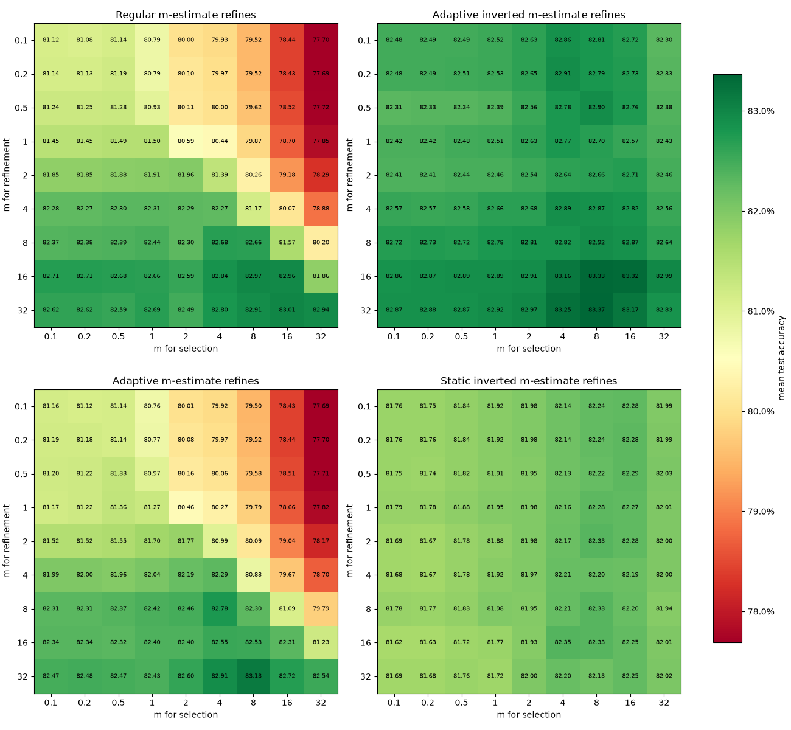
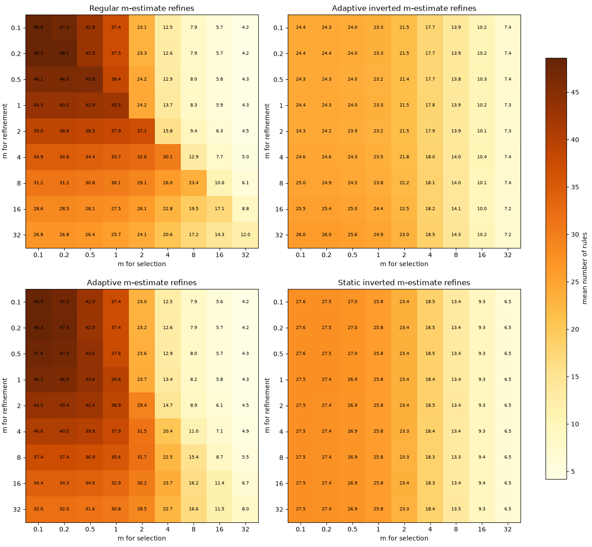

# Refinement heuristics: static and adaptive, regular and inverted

## Setup

**Full run** (69 datasets, 10-fold).

The covering learner of the
[heuristic comparison](heuristic_comparison_report.md) (after Janssen &
Fürnkranz, 2010), on its datasets: 69 datasets of the catalog (44 binary, 25 multi-class), those of the [separate-and-conquer comparison](seco_learners_comparison_report.md), not the paper's: greedy top-down refinement until no refinement is left
(`BeamSearch(beam_width=1)`, in section 4 also width 5), the
best rule on the refinement path by a separate selection heuristic, the
m-estimate (`SingleRuleLearner(h, selection=MEstimate(m_s))`), no
stopping criterion and no pruning; covering stops once a new rule covers
no more positives than negatives; ordered class binarization. Numeric
attributes are discretized per training fold
(`TreeDiscretizer(max_intervals=8)`). Each fit is capped at 600s (3600s for `letter`), and a fold
that times out fails the learner's whole cross-validation on that dataset.

A heuristic `h` refines in one of four frames: **static** (`h`, judged
from the origin of the coverage space of the whole data), **adaptive**
(`Adaptive(h)`: among the examples of the rule being refined, its class
distribution as the prior), **static inverted** (`Inverted(h)`:
`h(N - n, P - p)`, judged by the examples a rule excludes, from the upper
right corner of the whole coverage space), and **adaptive inverted**
(`Adaptive(Inverted(h))`: `h(N' - n, P' - p)` among the parent's `P'`
positives and `N'` negatives -- the inverted heuristics of Stecher,
Janssen & Fürnkranz, ECML PKDD 2014). Scores relative to the parent have
no common scale across parents: the selection, always static, picks the
rule that is returned.

Measures: test accuracy, number of rules and conditions. Accuracy is the
mean across every dataset and fold; the rule-set sizes (rules, conditions,
conditions per rule) are the shifted geometric mean, exp(mean(log(x + 1))) - 1,
over the datasets of their mean over the folds, so that the large datasets
don't dominate.

## m-estimates for refinement and for selection

`MEstimate(m_r)` refines and `MEstimate(m_s)` selects the rule on the refinement path, for every pair of m in {0.1, 0.2, 0.5, 1, 2, 4, 8, 16, 32}, in each of the four frames; the diagonal of the regular (static) matrix is the plain m-estimate. Rows: m for refinement, columns: m for selection.

### Accuracy

Regular m-estimate for refinement:

| refine \ select | m=0.1 | m=0.2 | m=0.5 | m=1 | m=2 | m=4 | m=8 | m=16 | m=32 |
|---|--:|--:|--:|--:|--:|--:|--:|--:|--:|
| m=0.1 | 81.12% | 81.08% | 81.14% | 80.79% | 80.00% | 79.93% | 79.52% | 78.44% | 77.70% |
| m=0.2 | 81.14% | 81.13% | 81.19% | 80.79% | 80.10% | 79.97% | 79.52% | 78.43% | 77.69% |
| m=0.5 | 81.24% | 81.25% | 81.28% | 80.93% | 80.11% | 80.00% | 79.62% | 78.52% | 77.72% |
| m=1 | 81.45% | 81.45% | 81.49% | 81.50% | 80.59% | 80.44% | 79.87% | 78.70% | 77.85% |
| m=2 | 81.85% | 81.85% | 81.88% | 81.91% | 81.96% | 81.39% | 80.26% | 79.18% | 78.29% |
| m=4 | 82.28% | 82.27% | 82.30% | 82.31% | 82.29% | 82.27% | 81.17% | 80.07% | 78.88% |
| m=8 | 82.37% | 82.38% | 82.39% | 82.44% | 82.30% | 82.68% | 82.66% | 81.57% | 80.20% |
| m=16 | 82.71% | 82.71% | 82.68% | 82.66% | 82.59% | 82.84% | 82.97% | 82.96% | 81.86% |
| m=32 | 82.62% | 82.62% | 82.59% | 82.69% | 82.49% | 82.80% | 82.91% | 83.01% | 82.94% |

Adaptive inverted m-estimate for refinement:

| refine \ select | m=0.1 | m=0.2 | m=0.5 | m=1 | m=2 | m=4 | m=8 | m=16 | m=32 |
|---|--:|--:|--:|--:|--:|--:|--:|--:|--:|
| m=0.1 | 82.48% | 82.49% | 82.49% | 82.52% | 82.63% | 82.86% | 82.81% | 82.72% | 82.30% |
| m=0.2 | 82.48% | 82.49% | 82.51% | 82.53% | 82.65% | 82.91% | 82.79% | 82.73% | 82.33% |
| m=0.5 | 82.31% | 82.33% | 82.34% | 82.39% | 82.56% | 82.78% | 82.90% | 82.76% | 82.38% |
| m=1 | 82.42% | 82.42% | 82.48% | 82.51% | 82.63% | 82.77% | 82.70% | 82.57% | 82.43% |
| m=2 | 82.41% | 82.41% | 82.44% | 82.46% | 82.54% | 82.64% | 82.66% | 82.71% | 82.46% |
| m=4 | 82.57% | 82.57% | 82.58% | 82.66% | 82.68% | 82.89% | 82.87% | 82.82% | 82.56% |
| m=8 | 82.72% | 82.73% | 82.72% | 82.78% | 82.81% | 82.82% | 82.92% | 82.87% | 82.64% |
| m=16 | 82.86% | 82.87% | 82.89% | 82.89% | 82.91% | 83.16% | 83.33% | 83.32% | 82.99% |
| m=32 | 82.87% | 82.88% | 82.87% | 82.92% | 82.97% | 83.25% | 83.37% | 83.17% | 82.83% |

Adaptive m-estimate for refinement:

| refine \ select | m=0.1 | m=0.2 | m=0.5 | m=1 | m=2 | m=4 | m=8 | m=16 | m=32 |
|---|--:|--:|--:|--:|--:|--:|--:|--:|--:|
| m=0.1 | 81.16% | 81.12% | 81.14% | 80.76% | 80.01% | 79.92% | 79.50% | 78.43% | 77.69% |
| m=0.2 | 81.19% | 81.18% | 81.14% | 80.77% | 80.08% | 79.97% | 79.52% | 78.44% | 77.70% |
| m=0.5 | 81.20% | 81.22% | 81.33% | 80.97% | 80.16% | 80.06% | 79.58% | 78.51% | 77.71% |
| m=1 | 81.17% | 81.22% | 81.36% | 81.27% | 80.46% | 80.27% | 79.79% | 78.66% | 77.82% |
| m=2 | 81.52% | 81.52% | 81.55% | 81.70% | 81.77% | 80.99% | 80.09% | 79.04% | 78.17% |
| m=4 | 81.99% | 82.00% | 81.96% | 82.04% | 82.19% | 82.29% | 80.83% | 79.67% | 78.70% |
| m=8 | 82.31% | 82.31% | 82.37% | 82.42% | 82.46% | 82.78% | 82.30% | 81.09% | 79.79% |
| m=16 | 82.34% | 82.34% | 82.32% | 82.40% | 82.40% | 82.55% | 82.53% | 82.31% | 81.23% |
| m=32 | 82.47% | 82.48% | 82.47% | 82.43% | 82.60% | 82.91% | 83.13% | 82.72% | 82.54% |

Static inverted m-estimate for refinement:

| refine \ select | m=0.1 | m=0.2 | m=0.5 | m=1 | m=2 | m=4 | m=8 | m=16 | m=32 |
|---|--:|--:|--:|--:|--:|--:|--:|--:|--:|
| m=0.1 | 81.76% | 81.75% | 81.84% | 81.92% | 81.98% | 82.14% | 82.24% | 82.28% | 81.99% |
| m=0.2 | 81.76% | 81.76% | 81.84% | 81.92% | 81.98% | 82.14% | 82.24% | 82.28% | 81.99% |
| m=0.5 | 81.75% | 81.74% | 81.82% | 81.91% | 81.95% | 82.13% | 82.22% | 82.29% | 82.03% |
| m=1 | 81.79% | 81.78% | 81.88% | 81.95% | 81.98% | 82.16% | 82.28% | 82.27% | 82.01% |
| m=2 | 81.69% | 81.67% | 81.78% | 81.88% | 81.98% | 82.17% | 82.33% | 82.28% | 82.00% |
| m=4 | 81.68% | 81.67% | 81.78% | 81.92% | 81.97% | 82.21% | 82.20% | 82.19% | 82.00% |
| m=8 | 81.78% | 81.77% | 81.83% | 81.98% | 81.95% | 82.21% | 82.33% | 82.20% | 81.94% |
| m=16 | 81.62% | 81.63% | 81.72% | 81.77% | 81.93% | 82.35% | 82.33% | 82.25% | 82.01% |
| m=32 | 81.69% | 81.68% | 81.76% | 81.72% | 82.00% | 82.20% | 82.13% | 82.25% | 82.02% |

### Number of rules

Regular m-estimate for refinement:

| refine \ select | m=0.1 | m=0.2 | m=0.5 | m=1 | m=2 | m=4 | m=8 | m=16 | m=32 |
|---|--:|--:|--:|--:|--:|--:|--:|--:|--:|
| m=0.1 | 48.6 | 47.3 | 42.8 | 37.4 | 23.1 | 12.5 | 7.9 | 5.7 | 4.2 |
| m=0.2 | 48.2 | 48.1 | 42.9 | 37.5 | 23.3 | 12.6 | 7.9 | 5.7 | 4.2 |
| m=0.5 | 46.1 | 46.0 | 45.8 | 38.4 | 24.2 | 12.9 | 8.0 | 5.8 | 4.3 |
| m=1 | 43.3 | 43.2 | 42.9 | 42.5 | 24.2 | 13.7 | 8.3 | 5.9 | 4.3 |
| m=2 | 39.0 | 38.9 | 38.5 | 37.9 | 37.1 | 15.8 | 9.4 | 6.3 | 4.5 |
| m=4 | 34.9 | 34.8 | 34.4 | 33.7 | 32.6 | 30.1 | 12.9 | 7.7 | 5.0 |
| m=8 | 31.2 | 31.2 | 30.8 | 30.1 | 29.1 | 26.0 | 23.4 | 10.6 | 6.1 |
| m=16 | 28.6 | 28.5 | 28.1 | 27.5 | 26.1 | 22.8 | 19.5 | 17.1 | 8.8 |
| m=32 | 26.8 | 26.8 | 26.4 | 25.7 | 24.1 | 20.6 | 17.2 | 14.3 | 12.0 |

Adaptive inverted m-estimate for refinement:

| refine \ select | m=0.1 | m=0.2 | m=0.5 | m=1 | m=2 | m=4 | m=8 | m=16 | m=32 |
|---|--:|--:|--:|--:|--:|--:|--:|--:|--:|
| m=0.1 | 24.4 | 24.3 | 24.0 | 23.3 | 21.5 | 17.7 | 13.9 | 10.2 | 7.4 |
| m=0.2 | 24.4 | 24.4 | 24.0 | 23.3 | 21.5 | 17.7 | 13.9 | 10.2 | 7.4 |
| m=0.5 | 24.3 | 24.3 | 24.0 | 23.2 | 21.4 | 17.7 | 13.8 | 10.3 | 7.4 |
| m=1 | 24.4 | 24.3 | 24.0 | 23.3 | 21.5 | 17.8 | 13.9 | 10.2 | 7.3 |
| m=2 | 24.3 | 24.2 | 23.9 | 23.2 | 21.5 | 17.9 | 13.9 | 10.1 | 7.3 |
| m=4 | 24.6 | 24.6 | 24.3 | 23.5 | 21.8 | 18.0 | 14.0 | 10.4 | 7.4 |
| m=8 | 25.0 | 24.9 | 24.5 | 23.8 | 22.2 | 18.1 | 14.0 | 10.1 | 7.4 |
| m=16 | 25.5 | 25.4 | 25.0 | 24.4 | 22.5 | 18.2 | 14.1 | 10.0 | 7.2 |
| m=32 | 26.0 | 26.0 | 25.6 | 24.9 | 23.0 | 18.5 | 14.3 | 10.2 | 7.2 |

Adaptive m-estimate for refinement:

| refine \ select | m=0.1 | m=0.2 | m=0.5 | m=1 | m=2 | m=4 | m=8 | m=16 | m=32 |
|---|--:|--:|--:|--:|--:|--:|--:|--:|--:|
| m=0.1 | 48.5 | 47.2 | 42.9 | 37.4 | 23.0 | 12.5 | 7.9 | 5.6 | 4.2 |
| m=0.2 | 48.3 | 47.5 | 42.9 | 37.4 | 23.2 | 12.6 | 7.9 | 5.7 | 4.2 |
| m=0.5 | 47.6 | 47.0 | 43.6 | 37.6 | 23.6 | 12.9 | 8.0 | 5.7 | 4.3 |
| m=1 | 46.2 | 46.0 | 43.6 | 39.6 | 23.7 | 13.4 | 8.2 | 5.8 | 4.3 |
| m=2 | 43.5 | 43.4 | 42.4 | 38.9 | 29.4 | 14.7 | 8.9 | 6.1 | 4.5 |
| m=4 | 40.6 | 40.5 | 39.9 | 37.9 | 31.5 | 20.4 | 11.0 | 7.1 | 4.9 |
| m=8 | 37.4 | 37.4 | 36.9 | 35.6 | 31.7 | 22.5 | 15.4 | 8.7 | 5.5 |
| m=16 | 34.4 | 34.3 | 34.0 | 32.9 | 30.2 | 23.7 | 16.2 | 11.4 | 6.7 |
| m=32 | 32.0 | 32.0 | 31.6 | 30.8 | 28.5 | 22.7 | 16.6 | 11.5 | 8.0 |

Static inverted m-estimate for refinement:

| refine \ select | m=0.1 | m=0.2 | m=0.5 | m=1 | m=2 | m=4 | m=8 | m=16 | m=32 |
|---|--:|--:|--:|--:|--:|--:|--:|--:|--:|
| m=0.1 | 27.6 | 27.5 | 27.0 | 25.8 | 23.4 | 18.5 | 13.4 | 9.3 | 6.5 |
| m=0.2 | 27.6 | 27.5 | 27.0 | 25.8 | 23.4 | 18.5 | 13.4 | 9.3 | 6.5 |
| m=0.5 | 27.6 | 27.5 | 27.0 | 25.8 | 23.4 | 18.5 | 13.4 | 9.3 | 6.5 |
| m=1 | 27.5 | 27.4 | 26.9 | 25.8 | 23.4 | 18.4 | 13.4 | 9.3 | 6.5 |
| m=2 | 27.5 | 27.4 | 26.9 | 25.8 | 23.4 | 18.5 | 13.4 | 9.3 | 6.5 |
| m=4 | 27.5 | 27.4 | 26.9 | 25.8 | 23.3 | 18.4 | 13.4 | 9.3 | 6.5 |
| m=8 | 27.5 | 27.4 | 26.9 | 25.8 | 23.3 | 18.3 | 13.3 | 9.4 | 6.5 |
| m=16 | 27.5 | 27.4 | 26.9 | 25.8 | 23.4 | 18.3 | 13.4 | 9.4 | 6.5 |
| m=32 | 27.5 | 27.4 | 26.9 | 25.8 | 23.3 | 18.4 | 13.5 | 9.3 | 6.5 |

### Conditions per rule

Regular m-estimate for refinement:

| refine \ select | m=0.1 | m=0.2 | m=0.5 | m=1 | m=2 | m=4 | m=8 | m=16 | m=32 |
|---|--:|--:|--:|--:|--:|--:|--:|--:|--:|
| m=0.1 | 3.0 | 3.0 | 2.9 | 2.8 | 2.4 | 2.0 | 1.7 | 1.6 | 1.5 |
| m=0.2 | 3.0 | 3.0 | 2.9 | 2.8 | 2.5 | 2.0 | 1.7 | 1.6 | 1.5 |
| m=0.5 | 3.1 | 3.1 | 3.0 | 2.9 | 2.5 | 2.1 | 1.8 | 1.7 | 1.5 |
| m=1 | 3.1 | 3.1 | 3.1 | 3.1 | 2.6 | 2.2 | 1.9 | 1.8 | 1.6 |
| m=2 | 3.3 | 3.3 | 3.2 | 3.2 | 3.2 | 2.6 | 2.2 | 2.0 | 1.8 |
| m=4 | 3.5 | 3.5 | 3.5 | 3.5 | 3.5 | 3.4 | 2.8 | 2.4 | 2.0 |
| m=8 | 4.2 | 4.2 | 4.2 | 4.2 | 4.1 | 3.9 | 3.6 | 3.1 | 2.5 |
| m=16 | 5.5 | 5.5 | 5.5 | 5.4 | 5.4 | 5.1 | 4.6 | 3.9 | 3.3 |
| m=32 | 7.4 | 7.4 | 7.4 | 7.4 | 7.3 | 7.0 | 6.4 | 5.4 | 4.3 |

Adaptive inverted m-estimate for refinement:

| refine \ select | m=0.1 | m=0.2 | m=0.5 | m=1 | m=2 | m=4 | m=8 | m=16 | m=32 |
|---|--:|--:|--:|--:|--:|--:|--:|--:|--:|
| m=0.1 | 12.1 | 12.1 | 12.0 | 12.0 | 12.0 | 11.8 | 11.5 | 10.8 | 10.0 |
| m=0.2 | 12.0 | 12.0 | 12.0 | 11.9 | 11.9 | 11.8 | 11.4 | 10.8 | 10.0 |
| m=0.5 | 11.8 | 11.8 | 11.8 | 11.8 | 11.7 | 11.6 | 11.2 | 10.6 | 9.8 |
| m=1 | 11.4 | 11.4 | 11.4 | 11.4 | 11.4 | 11.2 | 10.8 | 10.2 | 9.4 |
| m=2 | 10.7 | 10.7 | 10.7 | 10.7 | 10.6 | 10.5 | 10.2 | 9.6 | 8.8 |
| m=4 | 9.8 | 9.8 | 9.8 | 9.8 | 9.8 | 9.6 | 9.3 | 8.7 | 8.1 |
| m=8 | 8.8 | 8.8 | 8.8 | 8.8 | 8.7 | 8.6 | 8.3 | 7.8 | 7.2 |
| m=16 | 7.9 | 7.9 | 7.9 | 7.9 | 7.8 | 7.7 | 7.4 | 7.0 | 6.4 |
| m=32 | 7.1 | 7.1 | 7.1 | 7.1 | 7.0 | 6.8 | 6.6 | 6.2 | 5.7 |

Adaptive m-estimate for refinement:

| refine \ select | m=0.1 | m=0.2 | m=0.5 | m=1 | m=2 | m=4 | m=8 | m=16 | m=32 |
|---|--:|--:|--:|--:|--:|--:|--:|--:|--:|
| m=0.1 | 3.0 | 3.0 | 2.9 | 2.8 | 2.4 | 2.0 | 1.7 | 1.6 | 1.5 |
| m=0.2 | 3.0 | 3.0 | 2.9 | 2.8 | 2.4 | 2.0 | 1.7 | 1.6 | 1.5 |
| m=0.5 | 3.0 | 3.0 | 3.0 | 2.9 | 2.5 | 2.0 | 1.8 | 1.7 | 1.5 |
| m=1 | 3.1 | 3.0 | 3.0 | 2.9 | 2.5 | 2.1 | 1.9 | 1.7 | 1.6 |
| m=2 | 3.1 | 3.1 | 3.1 | 3.0 | 2.8 | 2.4 | 2.1 | 1.9 | 1.7 |
| m=4 | 3.2 | 3.2 | 3.2 | 3.1 | 3.0 | 2.7 | 2.3 | 2.1 | 1.9 |
| m=8 | 3.3 | 3.3 | 3.3 | 3.3 | 3.2 | 3.0 | 2.7 | 2.4 | 2.1 |
| m=16 | 3.5 | 3.5 | 3.5 | 3.4 | 3.4 | 3.2 | 3.0 | 2.7 | 2.4 |
| m=32 | 3.6 | 3.6 | 3.6 | 3.6 | 3.6 | 3.4 | 3.3 | 3.0 | 2.7 |

Static inverted m-estimate for refinement:

| refine \ select | m=0.1 | m=0.2 | m=0.5 | m=1 | m=2 | m=4 | m=8 | m=16 | m=32 |
|---|--:|--:|--:|--:|--:|--:|--:|--:|--:|
| m=0.1 | 19.2 | 19.2 | 19.2 | 19.1 | 19.0 | 18.6 | 17.7 | 16.1 | 14.5 |
| m=0.2 | 19.2 | 19.2 | 19.2 | 19.1 | 19.0 | 18.6 | 17.7 | 16.1 | 14.5 |
| m=0.5 | 19.2 | 19.2 | 19.2 | 19.1 | 19.0 | 18.6 | 17.7 | 16.1 | 14.5 |
| m=1 | 19.2 | 19.2 | 19.2 | 19.1 | 19.0 | 18.6 | 17.7 | 16.1 | 14.5 |
| m=2 | 19.2 | 19.2 | 19.2 | 19.1 | 18.9 | 18.6 | 17.6 | 16.1 | 14.4 |
| m=4 | 19.2 | 19.2 | 19.2 | 19.0 | 18.9 | 18.6 | 17.6 | 16.1 | 14.4 |
| m=8 | 19.1 | 19.1 | 19.1 | 19.0 | 18.8 | 18.5 | 17.6 | 16.0 | 14.3 |
| m=16 | 19.0 | 19.0 | 19.0 | 18.8 | 18.7 | 18.4 | 17.4 | 15.9 | 14.2 |
| m=32 | 18.8 | 18.8 | 18.8 | 18.6 | 18.5 | 18.1 | 17.2 | 15.5 | 13.9 |

### Conditions in the rule set

Regular m-estimate for refinement:

| refine \ select | m=0.1 | m=0.2 | m=0.5 | m=1 | m=2 | m=4 | m=8 | m=16 | m=32 |
|---|--:|--:|--:|--:|--:|--:|--:|--:|--:|
| m=0.1 | 143.2 | 138.8 | 123.2 | 104.5 | 56.5 | 25.2 | 13.5 | 9.0 | 6.3 |
| m=0.2 | 142.2 | 142.1 | 123.8 | 104.9 | 57.2 | 25.6 | 13.6 | 9.0 | 6.3 |
| m=0.5 | 137.7 | 137.6 | 136.6 | 109.4 | 61.5 | 27.1 | 14.2 | 9.4 | 6.5 |
| m=1 | 131.5 | 131.3 | 129.9 | 128.2 | 63.3 | 30.6 | 15.6 | 10.1 | 6.8 |
| m=2 | 123.7 | 123.6 | 122.3 | 119.5 | 115.9 | 41.5 | 20.8 | 12.2 | 7.8 |
| m=4 | 120.3 | 120.2 | 118.4 | 115.8 | 111.0 | 98.4 | 35.4 | 17.9 | 9.9 |
| m=8 | 127.2 | 127.1 | 125.1 | 121.9 | 116.6 | 98.4 | 81.0 | 31.5 | 14.7 |
| m=16 | 150.1 | 150.1 | 148.0 | 143.6 | 134.9 | 110.9 | 85.0 | 63.6 | 28.2 |
| m=32 | 189.7 | 189.6 | 187.5 | 181.2 | 168.6 | 137.1 | 104.3 | 72.1 | 48.1 |

Adaptive inverted m-estimate for refinement:

| refine \ select | m=0.1 | m=0.2 | m=0.5 | m=1 | m=2 | m=4 | m=8 | m=16 | m=32 |
|---|--:|--:|--:|--:|--:|--:|--:|--:|--:|
| m=0.1 | 281.9 | 280.9 | 276.6 | 267.1 | 245.8 | 200.0 | 152.0 | 104.8 | 69.6 |
| m=0.2 | 280.8 | 279.9 | 275.4 | 265.9 | 244.4 | 199.1 | 151.0 | 104.3 | 69.1 |
| m=0.5 | 275.3 | 274.6 | 270.2 | 261.3 | 240.3 | 196.1 | 147.5 | 103.0 | 67.7 |
| m=1 | 267.2 | 266.5 | 261.7 | 253.2 | 233.5 | 190.5 | 143.0 | 98.4 | 64.6 |
| m=2 | 249.4 | 248.8 | 244.8 | 236.3 | 219.0 | 180.1 | 134.4 | 91.9 | 60.3 |
| m=4 | 232.1 | 231.5 | 228.3 | 220.2 | 203.7 | 165.4 | 123.7 | 86.0 | 56.0 |
| m=8 | 211.5 | 210.9 | 207.7 | 201.4 | 186.1 | 150.0 | 111.5 | 75.0 | 50.5 |
| m=16 | 194.2 | 193.6 | 190.4 | 185.0 | 170.0 | 134.7 | 100.8 | 66.3 | 43.8 |
| m=32 | 177.9 | 177.4 | 174.7 | 169.6 | 155.4 | 122.4 | 91.1 | 60.1 | 39.0 |

Adaptive m-estimate for refinement:

| refine \ select | m=0.1 | m=0.2 | m=0.5 | m=1 | m=2 | m=4 | m=8 | m=16 | m=32 |
|---|--:|--:|--:|--:|--:|--:|--:|--:|--:|
| m=0.1 | 142.1 | 137.9 | 122.9 | 104.0 | 56.3 | 25.3 | 13.5 | 9.0 | 6.3 |
| m=0.2 | 142.1 | 139.3 | 123.4 | 104.2 | 56.8 | 25.4 | 13.5 | 9.0 | 6.3 |
| m=0.5 | 140.7 | 138.6 | 126.3 | 105.7 | 58.7 | 26.6 | 14.1 | 9.3 | 6.5 |
| m=1 | 138.1 | 137.3 | 128.5 | 113.3 | 60.2 | 28.8 | 15.0 | 9.8 | 6.8 |
| m=2 | 132.1 | 131.7 | 127.9 | 114.5 | 80.8 | 34.7 | 18.1 | 11.1 | 7.4 |
| m=4 | 126.3 | 126.1 | 123.8 | 115.6 | 92.3 | 54.0 | 25.4 | 14.4 | 8.9 |
| m=8 | 121.1 | 121.0 | 119.0 | 114.0 | 98.8 | 65.7 | 41.1 | 20.6 | 11.2 |
| m=16 | 116.1 | 116.1 | 114.6 | 110.2 | 99.5 | 74.8 | 47.4 | 30.3 | 15.7 |
| m=32 | 113.8 | 113.8 | 112.1 | 108.9 | 99.9 | 76.2 | 52.6 | 33.4 | 20.9 |

Static inverted m-estimate for refinement:

| refine \ select | m=0.1 | m=0.2 | m=0.5 | m=1 | m=2 | m=4 | m=8 | m=16 | m=32 |
|---|--:|--:|--:|--:|--:|--:|--:|--:|--:|
| m=0.1 | 507.5 | 505.7 | 495.6 | 471.5 | 423.6 | 327.3 | 225.7 | 142.6 | 87.9 |
| m=0.2 | 507.5 | 505.7 | 495.6 | 471.5 | 423.6 | 327.3 | 225.7 | 142.6 | 87.8 |
| m=0.5 | 507.3 | 505.6 | 495.5 | 471.3 | 423.2 | 327.7 | 225.4 | 142.3 | 87.9 |
| m=1 | 506.5 | 504.8 | 494.8 | 470.8 | 423.2 | 327.1 | 225.5 | 142.5 | 88.2 |
| m=2 | 505.3 | 503.7 | 494.1 | 470.2 | 422.9 | 327.8 | 225.5 | 141.9 | 87.9 |
| m=4 | 504.9 | 502.8 | 493.4 | 469.0 | 421.1 | 325.8 | 224.4 | 141.6 | 87.8 |
| m=8 | 502.4 | 500.6 | 491.3 | 467.7 | 419.0 | 323.0 | 223.2 | 141.9 | 87.3 |
| m=16 | 499.1 | 497.0 | 487.9 | 464.3 | 417.6 | 320.7 | 221.5 | 140.7 | 86.7 |
| m=32 | 494.1 | 491.5 | 481.9 | 460.4 | 410.9 | 317.1 | 221.0 | 136.7 | 83.7 |

## Static vs. adaptive, regular vs. inverted

Each heuristic refines in every frame where it differs, with the m-estimate selecting (m_s in {0.1, 0.2, 0.5, 1, 2, 4, 8, 16, 32}); shown is the best selection, with its m_s. Inverting a symmetric heuristic (WRA, correlation) changes nothing, and adapting one that doesn't depend on the frame (Laplace) neither -- unless it is inverted, as the inverted Laplace estimate depends on it. The static Foil gain is the gain over the universal rule (`WeightedGain(CoveredPositives(), InformationContent())`), the adaptive one Foil's own (`FoilGain()`). The m-estimate (m_r = 16) is from section 1.

| heuristic | static | adaptive | static inverted | adaptive inverted |
|---|--:|--:|--:|--:|
| m-estimate (m=16) | 82.97% (85.0; m_s=8) | 82.55% (74.8; m_s=4) | 82.35% (320.7; m_s=4) | 83.33% (100.8; m_s=8) |
| WRA | 82.70% (259.9; m_s=4) | 83.50% (62.7; m_s=8) | -- | -- |
| relative cost (c_r=0.342) | 82.68% (176.2; m_s=4) | 82.81% (46.4; m_s=4) | 82.25% (122.6; m_s=16) | 83.16% (134.9; m_s=8) |
| F-measure (beta=0.5) | 82.75% (60.8; m_s=16) | 82.80% (81.1; m_s=4) | 81.53% (59.0; m_s=16) | 81.76% (88.2; m_s=4) |
| Correlation | 83.44% (112.0; m_s=8) | 83.73% (67.4; m_s=4) | -- | -- |
| Foil gain | 82.83% (221.0; m_s=4) | 83.37% (57.1; m_s=8) | 82.81% (187.2; m_s=8) | 83.35% (89.8; m_s=4) |
| Laplace | 81.23% (129.4; m_s=0.5) | -- | 82.24% (321.0; m_s=4) | 82.89% (172.4; m_s=4) |

Cells: accuracy (conditions in the rule set; the best m for selection). --: the same as the frame to its left.

### Fixed selection (m_s = 8)

As above, with the m-estimate selecting with m_s = 8 for every heuristic and frame, so that only the refinement heuristics differ.

| heuristic | static | adaptive | static inverted | adaptive inverted |
|---|--:|--:|--:|--:|
| m-estimate (m=16) | 82.97% (85.0) | 82.53% (47.4) | 82.33% (221.5) | 83.33% (100.8) |
| WRA | 82.66% (185.3) | 83.50% (62.7) | -- | -- |
| relative cost (c_r=0.342) | 82.49% (127.3) | 82.61% (30.2) | 82.20% (201.5) | 83.16% (134.9) |
| F-measure (beta=0.5) | 82.75% (94.1) | 82.72% (55.4) | 81.30% (90.4) | 81.55% (44.4) |
| Correlation | 83.44% (112.0) | 83.64% (46.9) | -- | -- |
| Foil gain | 82.69% (157.6) | 83.37% (57.1) | 82.81% (187.2) | 83.23% (65.8) |
| Laplace | 79.49% (14.2) | -- | 82.19% (221.3) | 82.66% (132.5) |

Cells: accuracy (conditions in the rule set). --: the same as the frame to its left.

Foil's own search, climbing while the gain is positive and returning the rule it ends at (`GainAscentHillClimbing`, no selection): Foil gain: 82.95% with 126.4 conditions; Foil gain over the root: 81.18% with 12.9 conditions.

## Adaptive heuristics and m

The best selection for each m for refinement, in each frame; m -> infinity is WRA (static: WRA, adaptive: adaptive WRA; inverting it changes nothing).

| m for refinement | static | adaptive | static inverted | adaptive inverted |
|---|--:|--:|--:|--:|
| 0.1 | 81.14% (123.2) | 81.16% (142.1) | 82.28% (142.6) | 82.86% (200.0) |
| 0.2 | 81.19% (123.8) | 81.19% (142.1) | 82.28% (142.6) | 82.91% (199.1) |
| 0.5 | 81.28% (136.6) | 81.33% (126.3) | 82.29% (142.3) | 82.90% (147.5) |
| 1 | 81.50% (128.2) | 81.36% (128.5) | 82.28% (225.5) | 82.77% (190.5) |
| 2 | 81.96% (115.9) | 81.77% (80.8) | 82.33% (225.5) | 82.71% (91.9) |
| 4 | 82.31% (115.8) | 82.29% (54.0) | 82.21% (325.8) | 82.89% (165.4) |
| 8 | 82.68% (98.4) | 82.78% (65.7) | 82.33% (223.2) | 82.92% (111.5) |
| 16 | 82.97% (85.0) | 82.55% (74.8) | 82.35% (320.7) | 83.33% (100.8) |
| 32 | 83.01% (72.1) | 83.13% (52.6) | 82.25% (136.7) | 83.37% (91.1) |
| inf | 82.70% (259.9) | 83.50% (62.7) | 82.70% (259.9) | 83.50% (62.7) |

## Beam search

Beam width 1 vs. 5, the m-estimate selecting (m_s in {4, 8, 16}). A beam ranks the refinements of all its rules together: scores relative to different parents are compared, which have no common scale. `Gain(...)` ranks by the improvement over the parent instead of the level; with width 1 the two rank the refinements of a rule alike.

| refinement | m_s | width 1 | width 5 |
|---|--:|--:|--:|
| m=16 | 4 | 82.84% (110.9) | 82.90% (100.9) |
| m=16 | 8 | 82.97% (85.0) | 83.06% (79.1) |
| m=16 | 16 | 82.96% (63.6) | 83.12% (59.5) |
| Adaptive(m=16) | 4 | 82.55% (74.8) | 82.71% (62.3) |
| Adaptive(m=16) | 8 | 82.53% (47.4) | 82.83% (39.7) |
| Adaptive(m=16) | 16 | 82.31% (30.3) | 82.49% (25.4) |
| Adaptive(Inverted(m=16)) | 4 | 83.16% (134.7) | 82.90% (150.3) |
| Adaptive(Inverted(m=16)) | 8 | 83.33% (100.8) | 83.09% (113.0) |
| Adaptive(Inverted(m=16)) | 16 | 83.32% (66.3) | 83.14% (75.1) |
| Adaptive(Gain(m=16)) | 4 | 82.55% (74.8) | 82.75% (79.7) |
| Adaptive(Gain(m=16)) | 8 | 82.53% (47.4) | 83.00% (58.6) |
| Adaptive(Gain(m=16)) | 16 | 82.31% (30.3) | 83.20% (37.4) |
| Adaptive(Gain(Inverted(m=16))) | 4 | 83.16% (134.7) | 82.87% (123.9) |
| Adaptive(Gain(Inverted(m=16))) | 8 | 83.33% (100.8) | 83.06% (96.0) |
| Adaptive(Gain(Inverted(m=16))) | 16 | 83.32% (66.3) | 83.03% (65.3) |
| WRA | 4 | 82.70% (259.9) | 82.93% (266.8) |
| WRA | 8 | 82.66% (185.3) | 82.79% (192.9) |
| WRA | 16 | 82.59% (113.5) | 82.49% (121.0) |
| Adaptive(WRA) | 4 | 83.25% (86.4) | 83.15% (83.0) |
| Adaptive(WRA) | 8 | 83.50% (62.7) | 83.31% (62.5) |
| Adaptive(WRA) | 16 | 83.20% (40.6) | 83.80% (41.5) |

## Weighted gains

`WeightedGain(weight, base)`: ``weight(r) * (base(r) - base(r0))``, the gain over the universal rule ``r0`` of the frame -- over the root (static) or over the parent (adaptive). The weights are Klösgen's family ``c^a``, with ``c`` the covered examples (`p + n`) or positives (`p`); the base is linear (precision) or logarithmic (information content). `p + n` and precision is WRA, `p` and information content Foil gain, `sqrt(p + n)` and precision Klösgen's quality function, weight 1 ranks as the base itself. Best selection (m_s in {4, 8, 16}).

| weight | base | static | adaptive |
|---|---|--:|--:|
| 1 | precision | 79.84% (24.2; m_s=4) | 79.84% (24.2; m_s=4) |
| 1 | information content | 79.84% (24.2; m_s=4) | 79.84% (24.2; m_s=4) |
| sqrt(p) | precision | 83.13% (76.4; m_s=4) | 82.82% (41.8; m_s=4) |
| sqrt(p) | information content | 83.45% (75.5; m_s=16) | 83.34% (54.7; m_s=4) |
| p | precision | 83.37% (73.3; m_s=16) | 83.41% (68.4; m_s=4) |
| p | information content | 82.83% (221.0; m_s=4) | 83.37% (57.1; m_s=8) |
| p^2 | precision | 82.89% (226.3; m_s=4) | 83.43% (71.6; m_s=8) |
| p^2 | information content | 82.63% (114.6; m_s=16) | 83.21% (77.1; m_s=8) |
| sqrt(p + n) | precision | 83.37% (60.5; m_s=16) | 83.27% (51.6; m_s=4) |
| sqrt(p + n) | information content | 82.75% (141.1; m_s=16) | 83.28% (69.4; m_s=4) |
| p + n | precision | 82.68% (259.7; m_s=4) | 83.50% (62.7; m_s=8) |
| p + n | information content | 81.80% (390.5; m_s=4) | 83.24% (47.9; m_s=16) |
| (p + n)^2 | precision | 81.70% (270.6; m_s=8) | 83.12% (63.5; m_s=16) |
| (p + n)^2 | information content | 81.32% (427.0; m_s=4) | 82.78% (137.7; m_s=4) |

Cells: accuracy (conditions in the rule set; the best m for selection).

### Fixed selection (m_s = 8)

As above, with the m-estimate selecting with m_s = 8 for every gain.

| weight | base | static | adaptive |
|---|---|--:|--:|
| 1 | precision | 79.49% (13.2) | 79.49% (13.2) |
| 1 | information content | 79.49% (13.2) | 79.49% (13.2) |
| sqrt(p) | precision | 83.12% (52.4) | 82.50% (27.0) |
| sqrt(p) | information content | 83.38% (114.7) | 83.08% (35.9) |
| p | precision | 83.33% (112.8) | 83.41% (47.4) |
| p | information content | 82.69% (157.6) | 83.37% (57.1) |
| p^2 | precision | 82.73% (163.4) | 83.43% (71.6) |
| p^2 | information content | 82.44% (189.0) | 83.21% (77.1) |
| sqrt(p + n) | precision | 83.29% (94.1) | 83.04% (34.3) |
| sqrt(p + n) | information content | 82.62% (216.7) | 83.24% (46.4) |
| p + n | precision | 82.66% (185.1) | 83.50% (62.7) |
| p + n | information content | 81.71% (257.7) | 82.97% (73.2) |
| (p + n)^2 | precision | 81.70% (270.6) | 83.04% (96.2) |
| (p + n)^2 | information content | 80.92% (258.9) | 82.66% (102.9) |

### Paired comparisons

Each gain with its best selection (as above); per dataset the mean accuracy across folds; wins/losses of the second over the first, the mean difference, and the two-sided Wilcoxon signed-rank test (p) and sign test (sign p) across datasets (not corrected for the 20 tests).

| comparison | first | second | datasets | wins/losses | difference | p | sign p |
|---|---|---|--:|--:|--:|--:|--:|
| WRA vs. a weaker weight | refine gain of precision weighted by p + n, select m=4 | refine gain of precision weighted by sqrt(p + n), select m=16 | 69 | 39/28 | +0.69 | 0.051 | 0.222 |
| WRA vs. weight p | refine gain of precision weighted by p + n, select m=4 | refine gain of precision weighted by p, select m=16 | 69 | 39/27 | +0.69 | 0.018 | 0.175 |
| WRA vs. adaptive WRA | refine gain of precision weighted by p + n, select m=4 | refine Adaptive(gain of precision weighted by p + n), select m=8 | 69 | 49/19 | +0.82 | 0.001 | 0.000 |
| adaptive WRA vs. weight p^2 | refine Adaptive(gain of precision weighted by p + n), select m=8 | refine Adaptive(gain of precision weighted by p^2), select m=8 | 69 | 29/37 | -0.07 | 0.504 | 0.389 |
| Foil gain vs. weight p + n | refine Adaptive(gain of information content weighted by p), select m=8 | refine Adaptive(gain of information content weighted by p + n), select m=16 | 69 | 30/38 | -0.13 | 0.642 | 0.396 |
| Foil gain vs. adaptive WRA | refine Adaptive(gain of information content weighted by p), select m=8 | refine Adaptive(gain of precision weighted by p + n), select m=8 | 69 | 37/24 | +0.13 | 0.195 | 0.124 |
| static Foil gain vs. weight sqrt(p) | refine gain of information content weighted by p, select m=4 | refine gain of information content weighted by sqrt(p), select m=16 | 69 | 42/23 | +0.61 | 0.034 | 0.025 |
| static vs. adaptive Foil gain | refine gain of information content weighted by p, select m=4 | refine Adaptive(gain of information content weighted by p), select m=8 | 69 | 40/24 | +0.54 | 0.057 | 0.060 |
| static sqrt(p): precision vs. information content | refine gain of precision weighted by sqrt(p), select m=4 | refine gain of information content weighted by sqrt(p), select m=16 | 69 | 43/22 | +0.32 | 0.085 | 0.013 |
| static p: precision vs. information content | refine gain of precision weighted by p, select m=16 | refine gain of information content weighted by p, select m=4 | 69 | 29/38 | -0.54 | 0.024 | 0.328 |
| static p^2: precision vs. information content | refine gain of precision weighted by p^2, select m=4 | refine gain of information content weighted by p^2, select m=16 | 69 | 32/34 | -0.25 | 0.926 | 0.902 |
| static sqrt(p + n): precision vs. information content | refine gain of precision weighted by sqrt(p + n), select m=16 | refine gain of information content weighted by sqrt(p + n), select m=16 | 69 | 27/40 | -0.61 | 0.040 | 0.142 |
| static p + n: precision vs. information content | refine gain of precision weighted by p + n, select m=4 | refine gain of information content weighted by p + n, select m=4 | 69 | 25/42 | -0.88 | 0.021 | 0.050 |
| static (p + n)^2: precision vs. information content | refine gain of precision weighted by (p + n)^2, select m=8 | refine gain of information content weighted by (p + n)^2, select m=4 | 69 | 24/43 | -0.38 | 0.073 | 0.027 |
| adaptive sqrt(p): precision vs. information content | refine Adaptive(gain of precision weighted by sqrt(p)), select m=4 | refine Adaptive(gain of information content weighted by sqrt(p)), select m=4 | 69 | 38/25 | +0.52 | 0.096 | 0.130 |
| adaptive p: precision vs. information content | refine Adaptive(gain of precision weighted by p), select m=4 | refine Adaptive(gain of information content weighted by p), select m=8 | 69 | 34/31 | -0.04 | 0.766 | 0.804 |
| adaptive p^2: precision vs. information content | refine Adaptive(gain of precision weighted by p^2), select m=8 | refine Adaptive(gain of information content weighted by p^2), select m=8 | 69 | 27/38 | -0.22 | 0.055 | 0.215 |
| adaptive sqrt(p + n): precision vs. information content | refine Adaptive(gain of precision weighted by sqrt(p + n)), select m=4 | refine Adaptive(gain of information content weighted by sqrt(p + n)), select m=4 | 69 | 33/28 | +0.01 | 0.777 | 0.609 |
| adaptive p + n: precision vs. information content | refine Adaptive(gain of precision weighted by p + n), select m=8 | refine Adaptive(gain of information content weighted by p + n), select m=16 | 69 | 31/37 | -0.26 | 0.253 | 0.545 |
| adaptive (p + n)^2: precision vs. information content | refine Adaptive(gain of precision weighted by (p + n)^2), select m=16 | refine Adaptive(gain of information content weighted by (p + n)^2), select m=4 | 69 | 31/34 | -0.34 | 0.310 | 0.804 |

### Paired comparisons, fixed selection (m_s = 8)

Each gain with the selection m_s = 8; per dataset the mean accuracy across folds; wins/losses of the second over the first, the mean difference, and the two-sided Wilcoxon signed-rank test (p) and sign test (sign p) across datasets (not corrected for the 20 tests).

| comparison | first | second | datasets | wins/losses | difference | p | sign p |
|---|---|---|--:|--:|--:|--:|--:|
| WRA vs. a weaker weight | refine gain of precision weighted by p + n, select m=8 | refine gain of precision weighted by sqrt(p + n), select m=8 | 69 | 42/24 | +0.63 | 0.038 | 0.036 |
| WRA vs. weight p | refine gain of precision weighted by p + n, select m=8 | refine gain of precision weighted by p, select m=8 | 69 | 42/24 | +0.67 | 0.013 | 0.036 |
| WRA vs. adaptive WRA | refine gain of precision weighted by p + n, select m=8 | refine Adaptive(gain of precision weighted by p + n), select m=8 | 69 | 45/20 | +0.84 | 0.005 | 0.003 |
| adaptive WRA vs. weight p^2 | refine Adaptive(gain of precision weighted by p + n), select m=8 | refine Adaptive(gain of precision weighted by p^2), select m=8 | 69 | 29/37 | -0.07 | 0.504 | 0.389 |
| Foil gain vs. weight p + n | refine Adaptive(gain of information content weighted by p), select m=8 | refine Adaptive(gain of information content weighted by p + n), select m=8 | 69 | 24/41 | -0.40 | 0.030 | 0.046 |
| Foil gain vs. adaptive WRA | refine Adaptive(gain of information content weighted by p), select m=8 | refine Adaptive(gain of precision weighted by p + n), select m=8 | 69 | 37/24 | +0.13 | 0.195 | 0.124 |
| static Foil gain vs. weight sqrt(p) | refine gain of information content weighted by p, select m=8 | refine gain of information content weighted by sqrt(p), select m=8 | 69 | 47/19 | +0.69 | 0.000 | 0.001 |
| static vs. adaptive Foil gain | refine gain of information content weighted by p, select m=8 | refine Adaptive(gain of information content weighted by p), select m=8 | 69 | 44/20 | +0.68 | 0.003 | 0.004 |
| static sqrt(p): precision vs. information content | refine gain of precision weighted by sqrt(p), select m=8 | refine gain of information content weighted by sqrt(p), select m=8 | 69 | 35/28 | +0.26 | 0.701 | 0.450 |
| static p: precision vs. information content | refine gain of precision weighted by p, select m=8 | refine gain of information content weighted by p, select m=8 | 69 | 20/45 | -0.64 | 0.001 | 0.003 |
| static p^2: precision vs. information content | refine gain of precision weighted by p^2, select m=8 | refine gain of information content weighted by p^2, select m=8 | 69 | 29/34 | -0.29 | 0.314 | 0.615 |
| static sqrt(p + n): precision vs. information content | refine gain of precision weighted by sqrt(p + n), select m=8 | refine gain of information content weighted by sqrt(p + n), select m=8 | 69 | 20/45 | -0.66 | 0.001 | 0.003 |
| static p + n: precision vs. information content | refine gain of precision weighted by p + n, select m=8 | refine gain of information content weighted by p + n, select m=8 | 69 | 24/44 | -0.95 | 0.003 | 0.021 |
| static (p + n)^2: precision vs. information content | refine gain of precision weighted by (p + n)^2, select m=8 | refine gain of information content weighted by (p + n)^2, select m=8 | 69 | 22/42 | -0.78 | 0.009 | 0.017 |
| adaptive sqrt(p): precision vs. information content | refine Adaptive(gain of precision weighted by sqrt(p)), select m=8 | refine Adaptive(gain of information content weighted by sqrt(p)), select m=8 | 69 | 35/27 | +0.58 | 0.072 | 0.374 |
| adaptive p: precision vs. information content | refine Adaptive(gain of precision weighted by p), select m=8 | refine Adaptive(gain of information content weighted by p), select m=8 | 69 | 30/36 | -0.03 | 0.816 | 0.539 |
| adaptive p^2: precision vs. information content | refine Adaptive(gain of precision weighted by p^2), select m=8 | refine Adaptive(gain of information content weighted by p^2), select m=8 | 69 | 27/38 | -0.22 | 0.055 | 0.215 |
| adaptive sqrt(p + n): precision vs. information content | refine Adaptive(gain of precision weighted by sqrt(p + n)), select m=8 | refine Adaptive(gain of information content weighted by sqrt(p + n)), select m=8 | 69 | 29/37 | +0.20 | 0.742 | 0.389 |
| adaptive p + n: precision vs. information content | refine Adaptive(gain of precision weighted by p + n), select m=8 | refine Adaptive(gain of information content weighted by p + n), select m=8 | 69 | 23/43 | -0.53 | 0.004 | 0.019 |
| adaptive (p + n)^2: precision vs. information content | refine Adaptive(gain of precision weighted by (p + n)^2), select m=8 | refine Adaptive(gain of information content weighted by (p + n)^2), select m=8 | 69 | 23/37 | -0.38 | 0.030 | 0.092 |

## Ranks

Win counts and mean accuracy ranks across datasets among the best selection of each frame of section 2 and of the m-estimate.

| learner | accuracy | wins | mean rank |
|---|--:|--:|--:|
| refine Adaptive(Correlation), select m=4 | 83.73% | 7.0 | 8.93 |
| refine Adaptive(WRA), select m=8 | 83.50% | 4.7 | 9.23 |
| refine Adaptive(Foil gain), select m=8 | 83.37% | 2.7 | 9.91 |
| refine Correlation, select m=8 | 83.44% | 2.1 | 10.09 |
| refine Adaptive(relative cost (c_r=0.342)), select m=4 | 82.81% | 8.0 | 10.36 |
| refine Adaptive(Inverted(Foil gain)), select m=4 | 83.35% | 5.1 | 10.59 |
| refine Adaptive(Inverted(m=16)), select m=8 | 83.33% | 1.5 | 10.66 |
| refine Adaptive(Inverted(relative cost (c_r=0.342))), select m=8 | 83.16% | 1.5 | 10.67 |
| refine m=16, select m=8 | 82.97% | 3.4 | 11.44 |
| refine Inverted(Foil gain), select m=8 | 82.81% | 2.5 | 11.86 |
| refine Adaptive(Inverted(Laplace)), select m=4 | 82.89% | 4.4 | 11.92 |
| refine F-measure (beta=0.5), select m=16 | 82.75% | 4.1 | 12.38 |
| refine Adaptive(m=16), select m=4 | 82.55% | 1.4 | 12.51 |
| refine Adaptive(F-measure (beta=0.5)), select m=4 | 82.80% | 3.1 | 12.58 |
| refine Inverted(F-measure (beta=0.5)), select m=16 | 81.53% | 4.0 | 12.67 |
| refine Inverted(relative cost (c_r=0.342)), select m=16 | 82.25% | 6.4 | 12.84 |
| refine Foil gain, select m=4 | 82.83% | 1.2 | 12.84 |
| refine relative cost (c_r=0.342), select m=4 | 82.68% | 0.2 | 12.86 |
| refine WRA, select m=4 | 82.70% | 0.9 | 13.24 |
| refine Inverted(m=16), select m=4 | 82.35% | 1.0 | 13.97 |
| refine Adaptive(Inverted(F-measure (beta=0.5))), select m=4 | 81.76% | 2.2 | 14.20 |
| refine Inverted(Laplace), select m=4 | 82.24% | 1.0 | 14.30 |
| refine Laplace, select m=0.5 | 81.23% | 0.5 | 15.92 |

Failed folds: 0.
