# Data representations: same rules, different speed

**Full run.** Quick sanity check instead: `python demos/representations.py`.

pyrulearn's learners never look at the data directly. They ask it two things -- which examples a rule covers (`coverage(rule)`) and which features an example has (`features_of(row)`) -- so the data can be stored in any structure that answers these questions. Five such representations are implemented:

- **HBitmap** (horizontal bitmap) -- a bit matrix packed by example, one bit per example and feature. Covering a rule checks every example's row against the rule's features, whatever the density.
- **VBitmap** (vertical bitmap) -- the same bit matrix packed by feature: one bit-vector over the examples per feature. Covering a rule ANDs its features' bit-vectors, and counting is a popcount; same memory as HBitmap.
- **NList** -- LORD's vertical index (Huynh, Fürnkranz & Beck, 2023): examples are inserted into a prefix tree of their true features, and each feature keeps the list of tree nodes it occurs in (its N-list). Covering a rule intersects these lists; the work grows with how often the features are true, not with the number of examples. Each node keeps the bitmask of the features on its path, so that a refinement is one vectorized test.
- **PrePost** -- the same tree without these bitmasks, as in PrePost (Deng et al., 2012): a node is compared with another by their pre/post codes, and an example's features are read back by walking up the tree. Less memory, and binary searches instead of the bitmask test.
- **Sparse** -- `scipy` sparse matrices: per-feature example lists without the prefix tree.

All five must lead to exactly the same rules, so the only thing that differs is time. This demo measures that time for five learners -- CN2, PFossil, Pypper, PyLORD and ENDER, each with its default settings -- and checks the rules and the test-set predictions against HBitmap at every point. Each fit runs in a separate process and is capped at 300s, PyLORD's at 600s, CN2's at 1800s; after a time-out, the larger points of that curve are skipped. The learners ran side by side, one worker process each, every learner's fits one after another; building the representations, timing `coverage()` and measuring memory came first, with nothing else running. The numerical libraries were limited to one thread (`OMP_NUM_THREADS=1` and its relatives), so each fit used one core.

**Equality check:** at 148 points where HBitmap and at least one other representation finished, 148 gave identical rules and predictions for every representation.

## 1. Training-set size

Training sets of doubling size, drawn from one shuffled pool of the `adult` dataset (48,842 examples, 14 attributes, 8 of them nominal), each evaluated on the same 20% test set. Numeric attributes are discretized per training set (`TreeDiscretizer(max_intervals=8)`). Two encodings: **with negation** (pyrulearn's default -- every test comes with its negation, so exactly half the features are true in every example) and **without negation** (no `x != v` features; numeric attributes keep both `x >= t` and `x < t`, so it is sparser only in the nominal attributes). The first is the bitmaps' best case and the list-based representations' worst; the second is where those should gain.

At the largest training set: with negation 278 binary features, density 0.493; without negation 182 binary features, density 0.274 (density = share of features that are true).

One pair of plots per learner: left with a logarithmic time axis (ratios -- a constant factor between two representations is a constant gap), right with a linear one (absolute seconds saved).

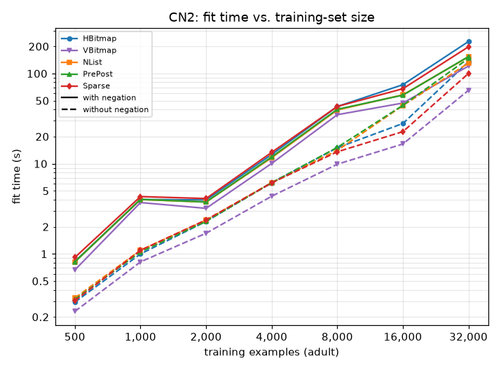 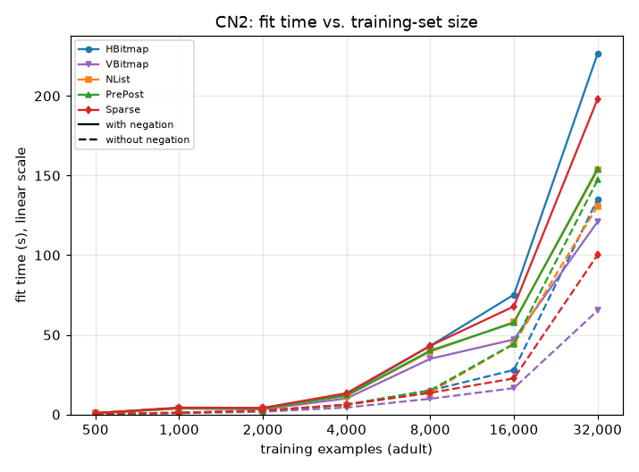

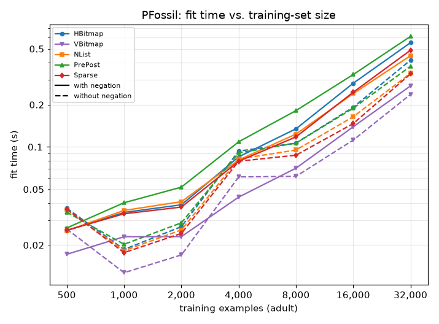 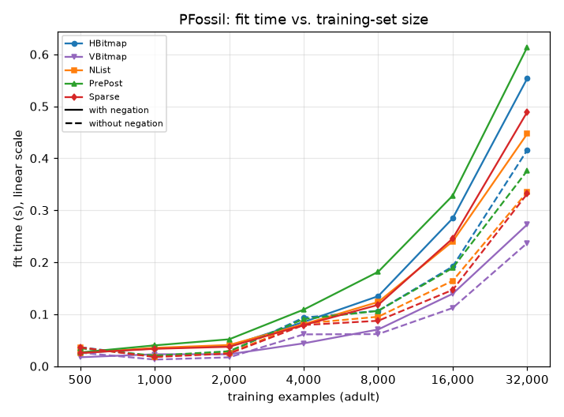

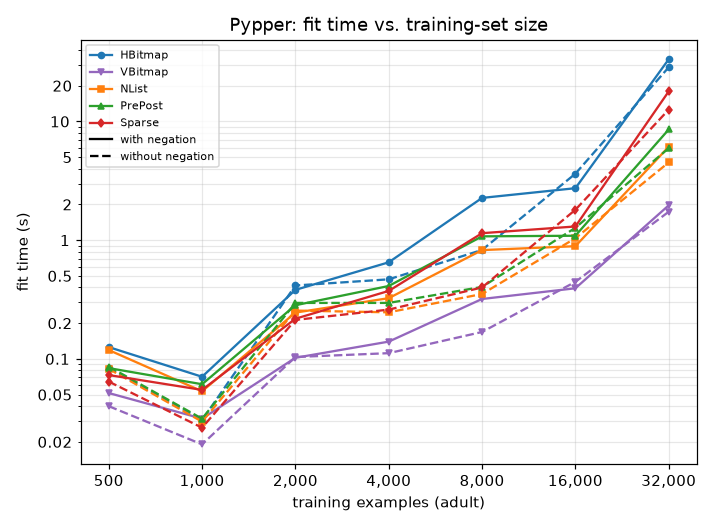 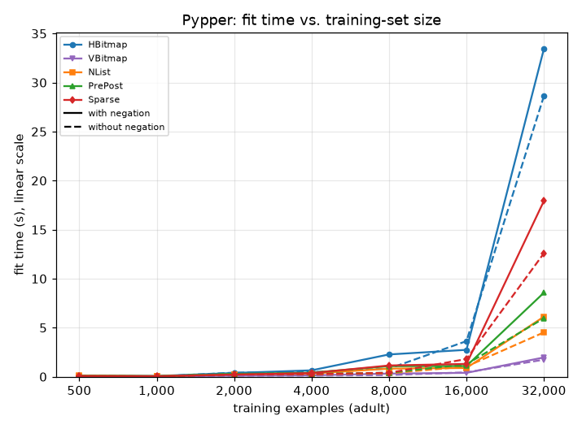

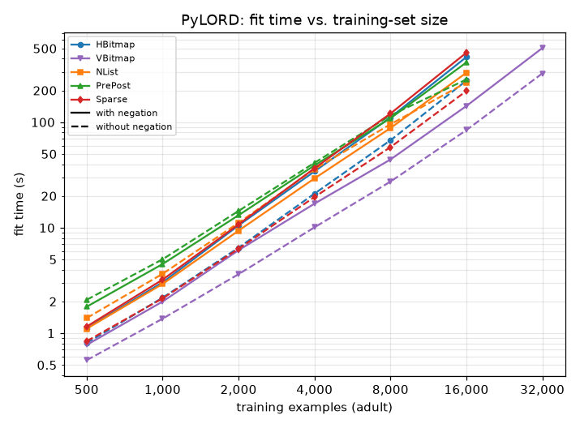 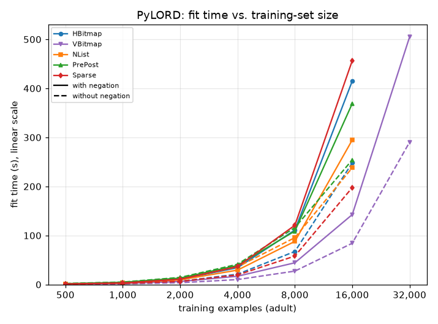

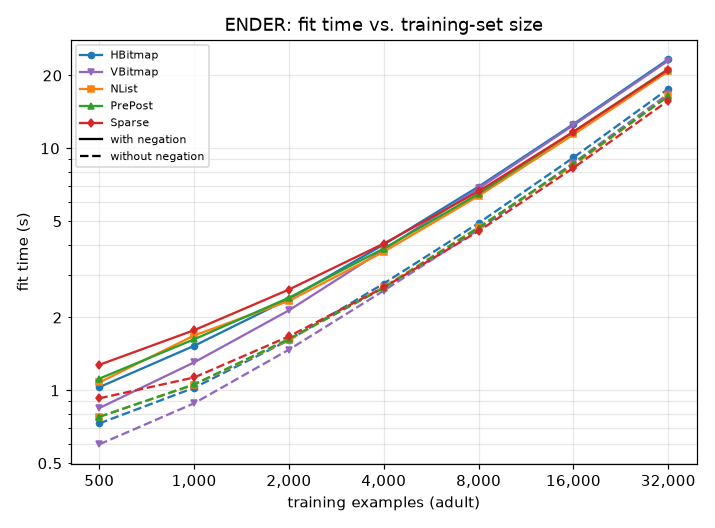 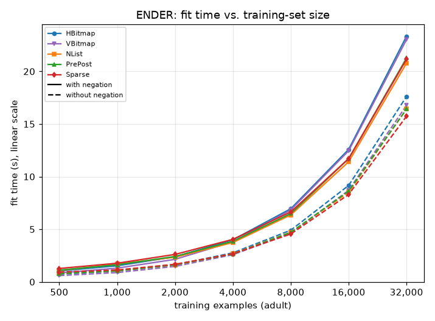

Fit time in seconds, with negation:

| learner | representation | n=500 | n=1000 | n=2000 | n=4000 | n=8000 | n=16000 | n=32000 |
|---|---|--:|--:|--:|--:|--:|--:|--:|
| CN2 | HBitmap | 0.83 | 4.01 | 3.97 | 12.66 | 43.08 | 75.21 | 226.49 |
| CN2 | VBitmap | 0.66 (80%) | 3.71 (92%) | 3.20 (81%) | 10.08 (80%) | 34.96 (81%) | 47.09 (63%) | 121.03 (53%) |
| CN2 | NList | 0.82 (99%) | 4.01 (100%) | 3.76 (95%) | 11.67 (92%) | 39.43 (92%) | 58.04 (77%) | 153.34 (68%) |
| CN2 | PrePost | 0.82 (99%) | 4.02 (100%) | 3.76 (95%) | 11.89 (94%) | 40.10 (93%) | 57.61 (77%) | 154.40 (68%) |
| CN2 | Sparse | 0.91 (111%) | 4.32 (108%) | 4.11 (104%) | 13.37 (106%) | 43.14 (100%) | 67.87 (90%) | 198.00 (87%) |
| PFossil | HBitmap | 0.03 | 0.03 | 0.04 | 0.09 | 0.13 | 0.28 | 0.55 |
| PFossil | VBitmap | 0.02 (68%) | 0.02 (67%) | 0.02 (59%) | 0.04 (52%) | 0.07 (52%) | 0.14 (49%) | 0.27 (49%) |
| PFossil | NList | 0.03 (100%) | 0.04 (103%) | 0.04 (105%) | 0.08 (95%) | 0.12 (92%) | 0.24 (84%) | 0.45 (81%) |
| PFossil | PrePost | 0.03 (104%) | 0.04 (117%) | 0.05 (134%) | 0.11 (128%) | 0.18 (135%) | 0.33 (115%) | 0.61 (111%) |
| PFossil | Sparse | 0.03 (101%) | 0.03 (98%) | 0.04 (96%) | 0.08 (93%) | 0.12 (88%) | 0.25 (86%) | 0.49 (88%) |
| Pypper | HBitmap | 0.13 | 0.07 | 0.38 | 0.65 | 2.27 | 2.74 | 33.44 |
| Pypper | VBitmap | 0.05 (41%) | 0.03 (44%) | 0.10 (27%) | 0.14 (21%) | 0.32 (14%) | 0.39 (14%) | 1.97 (6%) |
| Pypper | NList | 0.12 (94%) | 0.05 (75%) | 0.25 (64%) | 0.32 (50%) | 0.82 (36%) | 0.89 (32%) | 6.12 (18%) |
| Pypper | PrePost | 0.08 (67%) | 0.06 (87%) | 0.28 (74%) | 0.41 (63%) | 1.08 (47%) | 1.09 (40%) | 8.57 (26%) |
| Pypper | Sparse | 0.07 (58%) | 0.05 (77%) | 0.22 (57%) | 0.37 (57%) | 1.15 (50%) | 1.30 (48%) | 17.92 (54%) |
| PyLORD | HBitmap | 1.12 | 3.03 | 10.52 | 34.22 | 111.09 | 414.91 | time-out |
| PyLORD | VBitmap | 0.77 (69%) | 1.99 (66%) | 6.12 (58%) | 16.90 (49%) | 44.34 (40%) | 142.57 (34%) | 505.01 |
| PyLORD | NList | 1.10 (99%) | 2.93 (97%) | 9.38 (89%) | 29.33 (86%) | 88.00 (79%) | 294.74 (71%) | time-out |
| PyLORD | PrePost | 1.78 (160%) | 4.52 (149%) | 13.14 (125%) | 38.96 (114%) | 109.03 (98%) | 369.10 (89%) | time-out |
| PyLORD | Sparse | 1.16 (104%) | 3.22 (106%) | 10.75 (102%) | 36.61 (107%) | 120.82 (109%) | 456.45 (110%) | time-out |
| ENDER | HBitmap | 1.03 | 1.53 | 2.38 | 4.00 | 6.95 | 12.59 | 23.34 |
| ENDER | VBitmap | 0.84 (82%) | 1.30 (85%) | 2.14 (90%) | 3.81 (95%) | 6.83 (98%) | 12.46 (99%) | 23.03 (99%) |
| ENDER | NList | 1.08 (105%) | 1.69 (110%) | 2.34 (98%) | 3.74 (93%) | 6.36 (92%) | 11.41 (91%) | 20.78 (89%) |
| ENDER | PrePost | 1.12 (108%) | 1.63 (106%) | 2.41 (101%) | 3.85 (96%) | 6.49 (93%) | 11.70 (93%) | 21.27 (91%) |
| ENDER | Sparse | 1.27 (124%) | 1.77 (116%) | 2.61 (109%) | 4.04 (101%) | 6.64 (96%) | 11.71 (93%) | 21.16 (91%) |

Without negation:

| learner | representation | n=500 | n=1000 | n=2000 | n=4000 | n=8000 | n=16000 | n=32000 |
|---|---|--:|--:|--:|--:|--:|--:|--:|
| CN2 | HBitmap | 0.29 | 1.00 | 2.29 | 6.17 | 15.04 | 27.94 | 135.12 |
| CN2 | VBitmap | 0.23 (79%) | 0.82 (82%) | 1.70 (74%) | 4.36 (71%) | 9.88 (66%) | 16.55 (59%) | 65.24 (48%) |
| CN2 | NList | 0.32 (111%) | 1.10 (110%) | 2.37 (104%) | 6.18 (100%) | 14.06 (93%) | 44.21 (158%) | 130.83 (97%) |
| CN2 | PrePost | 0.31 (107%) | 1.05 (105%) | 2.30 (100%) | 6.15 (100%) | 15.18 (101%) | 44.41 (159%) | 147.19 (109%) |
| CN2 | Sparse | 0.30 (104%) | 1.10 (110%) | 2.38 (104%) | 6.13 (99%) | 13.57 (90%) | 22.68 (81%) | 100.20 (74%) |
| PFossil | HBitmap | 0.04 | 0.02 | 0.03 | 0.09 | 0.11 | 0.19 | 0.42 |
| PFossil | VBitmap | 0.03 (71%) | 0.01 (68%) | 0.02 (63%) | 0.06 (65%) | 0.06 (58%) | 0.11 (58%) | 0.24 (57%) |
| PFossil | NList | 0.04 (97%) | 0.02 (98%) | 0.03 (95%) | 0.08 (88%) | 0.10 (89%) | 0.16 (86%) | 0.34 (81%) |
| PFossil | PrePost | 0.03 (94%) | 0.02 (109%) | 0.03 (107%) | 0.09 (97%) | 0.11 (100%) | 0.19 (98%) | 0.38 (90%) |
| PFossil | Sparse | 0.04 (99%) | 0.02 (95%) | 0.02 (90%) | 0.08 (85%) | 0.09 (82%) | 0.15 (77%) | 0.33 (80%) |
| Pypper | HBitmap | 0.08 | 0.03 | 0.42 | 0.47 | 0.83 | 3.63 | 28.63 |
| Pypper | VBitmap | 0.04 (47%) | 0.02 (62%) | 0.10 (25%) | 0.11 (24%) | 0.17 (20%) | 0.45 (12%) | 1.74 (6%) |
| Pypper | NList | 0.08 (98%) | 0.03 (97%) | 0.26 (61%) | 0.25 (53%) | 0.35 (43%) | 1.04 (29%) | 4.52 (16%) |
| Pypper | PrePost | 0.09 (102%) | 0.03 (103%) | 0.30 (71%) | 0.30 (63%) | 0.40 (49%) | 1.27 (35%) | 5.96 (21%) |
| Pypper | Sparse | 0.06 (76%) | 0.03 (86%) | 0.21 (51%) | 0.26 (56%) | 0.40 (48%) | 1.80 (50%) | 12.59 (44%) |
| PyLORD | HBitmap | 0.81 | 2.17 | 6.46 | 21.05 | 67.40 | 248.04 | time-out |
| PyLORD | VBitmap | 0.55 (69%) | 1.37 (63%) | 3.63 (56%) | 10.09 (48%) | 27.36 (41%) | 84.18 (34%) | 290.39 |
| PyLORD | NList | 1.39 (172%) | 3.66 (168%) | 11.12 (172%) | 35.89 (171%) | 95.64 (142%) | 238.09 (96%) | time-out |
| PyLORD | PrePost | 2.07 (256%) | 5.02 (232%) | 14.42 (223%) | 41.22 (196%) | 116.09 (172%) | 254.15 (102%) | time-out |
| PyLORD | Sparse | 0.84 (104%) | 2.14 (99%) | 6.32 (98%) | 19.55 (93%) | 58.04 (86%) | 197.68 (80%) | time-out |
| ENDER | HBitmap | 0.73 | 1.02 | 1.61 | 2.76 | 4.91 | 9.16 | 17.62 |
| ENDER | VBitmap | 0.60 (82%) | 0.88 (86%) | 1.47 (91%) | 2.58 (93%) | 4.61 (94%) | 8.70 (95%) | 16.78 (95%) |
| ENDER | NList | 0.78 (107%) | 1.05 (103%) | 1.62 (100%) | 2.68 (97%) | 4.72 (96%) | 8.51 (93%) | 16.44 (93%) |
| ENDER | PrePost | 0.78 (106%) | 1.06 (103%) | 1.63 (101%) | 2.65 (96%) | 4.70 (96%) | 8.62 (94%) | 16.42 (93%) |
| ENDER | Sparse | 0.93 (127%) | 1.13 (110%) | 1.67 (104%) | 2.66 (96%) | 4.55 (93%) | 8.30 (91%) | 15.74 (89%) |

**Growth.** How fast each learner's fit time grows with the training-set size: the exponent *b* of time ~ n^*b*, fitted by least squares to log time over log n from n=2,000 on (below that, a fit's fixed costs still dominate). 1 is linear, 2 quadratic; a curve cut short by a time-out is fitted on the points that finished. This is what decides, for example, how much a learner gains from splitting a problem into smaller ones (`demos/multiclass_decomposition.py`):

| learner | representation | with negation | without negation |
|---|---|--:|--:|
| CN2 | HBitmap | 1.42 | 1.39 |
| CN2 | VBitmap | 1.27 | 1.25 |
| CN2 | NList | 1.30 | 1.44 |
| CN2 | PrePost | 1.30 | 1.49 |
| CN2 | Sparse | 1.35 | 1.27 |
| PFossil | HBitmap | 0.94 | 0.89 |
| PFossil | VBitmap | 0.88 | 0.85 |
| PFossil | NList | 0.85 | 0.84 |
| PFossil | PrePost | 0.87 | 0.85 |
| PFossil | Sparse | 0.91 | 0.84 |
| Pypper | HBitmap | 1.50 | 1.52 |
| Pypper | VBitmap | 1.00 | 1.01 |
| Pypper | NList | 1.07 | 1.04 |
| Pypper | PrePost | 1.12 | 1.08 |
| Pypper | Sparse | 1.45 | 1.46 |
| PyLORD | HBitmap | 1.76 (4 points) | 1.75 (4 points) |
| PyLORD | VBitmap | 1.58 | 1.57 |
| PyLORD | NList | 1.65 (4 points) | 1.47 (4 points) |
| PyLORD | PrePost | 1.59 (4 points) | 1.39 (4 points) |
| PyLORD | Sparse | 1.79 (4 points) | 1.65 (4 points) |
| ENDER | HBitmap | 0.82 | 0.86 |
| ENDER | VBitmap | 0.86 | 0.88 |
| ENDER | NList | 0.79 | 0.84 |
| ENDER | PrePost | 0.79 | 0.84 |
| ENDER | Sparse | 0.76 | 0.81 |

Building a vertical index is paid once per fit, on top of the fit itself:

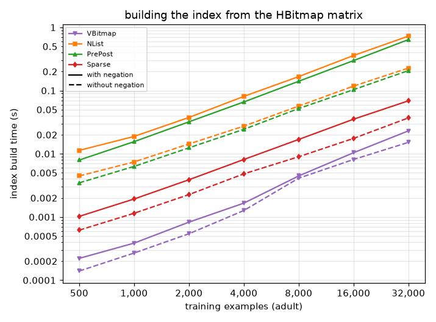

**Memory.** What each representation holds once built, measured with `tracemalloc` (the input matrix and the HBitmap matrix the others are built from don't count), and in parentheses its share of HBitmap's memory; the last row is the unpacked `n x k` bool matrix that `data.X` builds on demand, which any learner or external library working on a plain array pays on top.

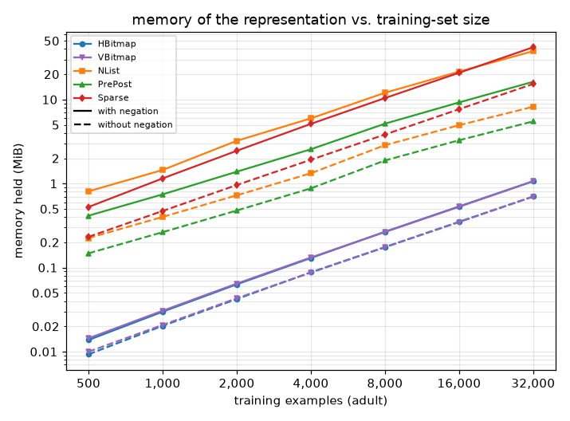

With negation:

| representation | n=500 | n=1000 | n=2000 | n=4000 | n=8000 | n=16000 | n=32000 |
|---|--:|--:|--:|--:|--:|--:|--:|
| HBitmap | 14 KiB | 31 KiB | 65 KiB | 133 KiB | 274 KiB | 547 KiB | 1.1 MiB |
| VBitmap | 15 KiB (105%) | 31 KiB (103%) | 66 KiB (102%) | 135 KiB (102%) | 271 KiB (99%) | 542 KiB (99%) | 1.1 MiB (100%) |
| NList | 828 KiB (5869%) | 1.5 MiB (4862%) | 3.2 MiB (5109%) | 6.0 MiB (4592%) | 12.0 MiB (4505%) | 21.5 MiB (4020%) | 37.7 MiB (3528%) |
| PrePost | 425 KiB (3011%) | 762 KiB (2493%) | 1.4 MiB (2191%) | 2.6 MiB (1971%) | 5.2 MiB (1932%) | 9.2 MiB (1729%) | 16.3 MiB (1524%) |
| Sparse | 539 KiB (3823%) | 1.2 MiB (3860%) | 2.5 MiB (3886%) | 5.1 MiB (3953%) | 10.4 MiB (3896%) | 20.8 MiB (3897%) | 41.9 MiB (3925%) |
| unpacked `X` | 108 KiB | 238 KiB | 508 KiB | 1.0 MiB | 2.1 MiB | 4.2 MiB | 8.5 MiB |

Without negation:

| representation | n=500 | n=1000 | n=2000 | n=4000 | n=8000 | n=16000 | n=32000 |
|---|--:|--:|--:|--:|--:|--:|--:|
| HBitmap | 10 KiB | 21 KiB | 43 KiB | 90 KiB | 180 KiB | 360 KiB | 719 KiB |
| VBitmap | 10 KiB (108%) | 21 KiB (103%) | 44 KiB (102%) | 89 KiB (99%) | 178 KiB (99%) | 356 KiB (99%) | 716 KiB (100%) |
| NList | 230 KiB (2417%) | 411 KiB (1980%) | 742 KiB (1718%) | 1.3 MiB (1509%) | 2.9 MiB (1629%) | 5.0 MiB (1410%) | 8.2 MiB (1169%) |
| PrePost | 152 KiB (1593%) | 270 KiB (1304%) | 489 KiB (1133%) | 898 KiB (997%) | 1.9 MiB (1072%) | 3.3 MiB (934%) | 5.5 MiB (783%) |
| Sparse | 238 KiB (2502%) | 483 KiB (2330%) | 984 KiB (2278%) | 1.9 MiB (2183%) | 3.8 MiB (2184%) | 7.7 MiB (2185%) | 15.3 MiB (2185%) |
| unpacked `X` | 74 KiB | 160 KiB | 338 KiB | 699 KiB | 1.4 MiB | 2.8 MiB | 5.6 MiB |

Memory a fit costs in total -- what the representation holds plus the peak the fit allocates on top of it, caches the representation builds during the fit included (`tracemalloc`, a separate untimed pass), with negation:

| learner | representation | n=500 | n=1000 | n=2000 | n=4000 | n=8000 | n=16000 | n=32000 |
|---|---|--:|--:|--:|--:|--:|--:|--:|
| CN2 | HBitmap | 572 KiB | 1.0 MiB | 1.3 MiB | 1.6 MiB | 2.0 MiB | 3.2 MiB | 6.2 MiB |
| CN2 | VBitmap | 393 KiB (69%) | 463 KiB (43%) | 586 KiB (43%) | 946 KiB (58%) | 1.5 MiB (75%) | 2.8 MiB (88%) | 5.5 MiB (88%) |
| CN2 | NList | 2.0 MiB (353%) | 3.8 MiB (369%) | 6.2 MiB (464%) | 10.8 MiB (681%) | 21.8 MiB (1097%) | 39.9 MiB (1236%) | 72.1 MiB (1159%) |
| CN2 | PrePost | 1.6 MiB (283%) | 3.1 MiB (301%) | 4.4 MiB (327%) | 7.4 MiB (466%) | 14.9 MiB (751%) | 27.6 MiB (857%) | 50.7 MiB (815%) |
| CN2 | Sparse | 1.3 MiB (237%) | 2.8 MiB (269%) | 5.8 MiB (435%) | 12.4 MiB (780%) | 24.5 MiB (1234%) | 49.1 MiB (1522%) | 98.7 MiB (1586%) |
| PFossil | HBitmap | 519 KiB | 1019 KiB | 1.2 MiB | 1.3 MiB | 1.6 MiB | 2.0 MiB | 3.8 MiB |
| PFossil | VBitmap | 136 KiB (26%) | 216 KiB (21%) | 384 KiB (31%) | 636 KiB (47%) | 1.1 MiB (71%) | 2.1 MiB (103%) | 4.0 MiB (106%) |
| PFossil | NList | 1.9 MiB (381%) | 3.8 MiB (382%) | 6.2 MiB (514%) | 10.8 MiB (815%) | 21.8 MiB (1407%) | 39.9 MiB (1987%) | 72.1 MiB (1900%) |
| PFossil | PrePost | 1.5 MiB (303%) | 3.1 MiB (311%) | 4.3 MiB (361%) | 7.4 MiB (558%) | 14.9 MiB (964%) | 27.6 MiB (1377%) | 50.7 MiB (1336%) |
| PFossil | Sparse | 1.3 MiB (251%) | 2.7 MiB (276%) | 5.8 MiB (482%) | 12.0 MiB (909%) | 24.4 MiB (1571%) | 48.7 MiB (2426%) | 98.0 MiB (2582%) |
| Pypper | HBitmap | 433 KiB | 749 KiB | 1.2 MiB | 1.3 MiB | 1.5 MiB | 2.2 MiB | 4.3 MiB |
| Pypper | VBitmap | 150 KiB (35%) | 214 KiB (29%) | 374 KiB (31%) | 630 KiB (48%) | 1.1 MiB (72%) | 2.1 MiB (97%) | 4.2 MiB (98%) |
| Pypper | NList | 1.7 MiB (401%) | 3.1 MiB (429%) | 6.2 MiB (526%) | 10.8 MiB (833%) | 21.8 MiB (1416%) | 39.7 MiB (1844%) | 71.9 MiB (1686%) |
| Pypper | PrePost | 1.3 MiB (307%) | 2.4 MiB (332%) | 4.3 MiB (367%) | 7.4 MiB (570%) | 14.9 MiB (969%) | 27.5 MiB (1276%) | 50.4 MiB (1184%) |
| Pypper | Sparse | 1.1 MiB (253%) | 2.2 MiB (306%) | 4.7 MiB (404%) | 9.8 MiB (758%) | 19.8 MiB (1290%) | 39.6 MiB (1836%) | 79.6 MiB (1869%) |
| PyLORD | HBitmap | 459 KiB | 1.1 MiB | 4.0 MiB | 13.8 MiB | 54.0 MiB |  |  |
| PyLORD | VBitmap | 353 KiB (77%) | 1.1 MiB (98%) | 3.7 MiB (93%) | 13.8 MiB (100%) | 54.0 MiB (100%) |  |  |
| PyLORD | NList | 2.0 MiB (446%) | 4.0 MiB (368%) | 7.4 MiB (184%) | 20.6 MiB (149%) | 67.7 MiB (125%) |  |  |
| PyLORD | PrePost | 1.6 MiB (358%) | 3.3 MiB (302%) | 5.7 MiB (141%) | 17.2 MiB (124%) | 60.8 MiB (113%) |  |  |
| PyLORD | Sparse | 1.4 MiB (305%) | 2.9 MiB (272%) | 6.2 MiB (155%) | 18.8 MiB (136%) |  |  |  |
| ENDER | HBitmap | 908 KiB | 1.0 MiB | 1.6 MiB | 3.2 MiB | 3.8 MiB | 5.0 MiB | 7.5 MiB |
| ENDER | VBitmap | 881 KiB (97%) | 1002 KiB (95%) | 1.5 MiB (92%) | 3.0 MiB (94%) | 6.1 MiB (159%) | 11.6 MiB (231%) | 14.1 MiB (188%) |
| ENDER | NList | 1.9 MiB (209%) | 2.8 MiB (267%) | 5.8 MiB (353%) | 11.1 MiB (345%) | 22.4 MiB (588%) | 41.1 MiB (816%) | 74.5 MiB (993%) |
| ENDER | PrePost | 1.5 MiB (164%) | 2.0 MiB (198%) | 3.9 MiB (240%) | 7.7 MiB (239%) | 15.5 MiB (407%) | 28.8 MiB (573%) | 53.1 MiB (708%) |
| ENDER | Sparse | 1.4 MiB (157%) | 2.1 MiB (207%) | 3.6 MiB (220%) | 7.4 MiB (230%) | 14.9 MiB (392%) | 29.8 MiB (592%) | 59.9 MiB (799%) |

Without negation:

| learner | representation | n=500 | n=1000 | n=2000 | n=4000 | n=8000 | n=16000 | n=32000 |
|---|---|--:|--:|--:|--:|--:|--:|--:|
| CN2 | HBitmap | 429 KiB | 759 KiB | 1.2 MiB | 1.5 MiB | 1.9 MiB | 2.5 MiB | 5.2 MiB |
| CN2 | VBitmap | 241 KiB (56%) | 335 KiB (44%) | 451 KiB (37%) | 734 KiB (47%) | 1.2 MiB (63%) | 2.1 MiB (85%) | 4.5 MiB (87%) |
| CN2 | NList | 1.0 MiB (250%) | 2.0 MiB (276%) | 3.6 MiB (299%) | 4.8 MiB (308%) | 7.4 MiB (393%) | 12.4 MiB (501%) | 22.1 MiB (428%) |
| CN2 | PrePost | 997 KiB (233%) | 1.9 MiB (258%) | 3.3 MiB (279%) | 4.3 MiB (279%) | 6.4 MiB (340%) | 10.7 MiB (433%) | 19.4 MiB (376%) |
| CN2 | Sparse | 653 KiB (152%) | 1.2 MiB (163%) | 2.4 MiB (203%) | 4.8 MiB (312%) | 9.5 MiB (503%) | 18.9 MiB (763%) | 37.6 MiB (727%) |
| PFossil | HBitmap | 387 KiB | 711 KiB | 1.1 MiB | 1.2 MiB | 1.4 MiB | 1.8 MiB | 2.7 MiB |
| PFossil | VBitmap | 108 KiB (28%) | 151 KiB (21%) | 270 KiB (23%) | 468 KiB (37%) | 812 KiB (55%) | 1.5 MiB (82%) | 2.9 MiB (106%) |
| PFossil | NList | 1.0 MiB (268%) | 2.0 MiB (289%) | 3.5 MiB (311%) | 4.6 MiB (370%) | 7.1 MiB (495%) | 12.4 MiB (689%) | 22.1 MiB (822%) |
| PFossil | PrePost | 960 KiB (248%) | 1.9 MiB (270%) | 3.3 MiB (289%) | 4.2 MiB (334%) | 6.1 MiB (426%) | 10.7 MiB (596%) | 19.4 MiB (721%) |
| PFossil | Sparse | 606 KiB (157%) | 1.2 MiB (167%) | 2.3 MiB (207%) | 4.7 MiB (374%) | 9.2 MiB (642%) | 18.4 MiB (1025%) | 36.8 MiB (1368%) |
| Pypper | HBitmap | 308 KiB | 531 KiB | 1017 KiB | 1.2 MiB | 1.4 MiB | 1.9 MiB | 3.8 MiB |
| Pypper | VBitmap | 106 KiB (34%) | 152 KiB (29%) | 276 KiB (27%) | 516 KiB (42%) | 994 KiB (68%) | 1.9 MiB (99%) | 3.8 MiB (100%) |
| Pypper | NList | 846 KiB (275%) | 1.6 MiB (300%) | 3.1 MiB (310%) | 4.5 MiB (373%) | 7.0 MiB (491%) | 12.3 MiB (638%) | 21.9 MiB (574%) |
| Pypper | PrePost | 768 KiB (249%) | 1.4 MiB (273%) | 2.8 MiB (286%) | 4.1 MiB (336%) | 6.0 MiB (422%) | 10.6 MiB (551%) | 19.2 MiB (503%) |
| Pypper | Sparse | 503 KiB (164%) | 974 KiB (183%) | 1.9 MiB (194%) | 3.8 MiB (313%) | 7.5 MiB (531%) | 15.0 MiB (780%) | 30.0 MiB (787%) |
| PyLORD | HBitmap | 362 KiB | 1.1 MiB | 4.0 MiB | 13.6 MiB | 52.2 MiB |  |  |
| PyLORD | VBitmap | 342 KiB (95%) | 1.1 MiB (98%) | 3.7 MiB (92%) | 13.5 MiB (100%) | 52.1 MiB (100%) |  |  |
| PyLORD | NList | 1.1 MiB (305%) | 2.2 MiB (202%) | 4.8 MiB (117%) | 15.4 MiB (114%) | 56.1 MiB (107%) |  |  |
| PyLORD | PrePost | 1023 KiB (282%) | 2.0 MiB (189%) | 4.7 MiB (116%) | 15.0 MiB (110%) | 55.4 MiB (106%) |  |  |
| PyLORD | Sparse | 695 KiB (192%) | 1.6 MiB (145%) | 4.7 MiB (116%) | 15.4 MiB (114%) | 55.8 MiB (107%) |  |  |
| ENDER | HBitmap | 771 KiB | 849 KiB | 1.2 MiB | 2.4 MiB | 3.7 MiB | 4.8 MiB | 7.1 MiB |
| ENDER | VBitmap | 755 KiB (98%) | 819 KiB (96%) | 1.1 MiB (92%) | 2.2 MiB (92%) | 4.3 MiB (117%) | 8.6 MiB (178%) | 13.8 MiB (193%) |
| ENDER | NList | 1.1 MiB (147%) | 1.4 MiB (170%) | 2.2 MiB (182%) | 4.1 MiB (173%) | 7.6 MiB (205%) | 13.6 MiB (281%) | 24.5 MiB (344%) |
| ENDER | PrePost | 1.0 MiB (138%) | 1.3 MiB (154%) | 1.9 MiB (161%) | 3.6 MiB (154%) | 6.6 MiB (179%) | 11.9 MiB (246%) | 21.8 MiB (306%) |
| ENDER | Sparse | 1.0 MiB (137%) | 1.3 MiB (153%) | 1.9 MiB (158%) | 3.1 MiB (132%) | 6.2 MiB (168%) | 12.4 MiB (256%) | 24.6 MiB (346%) |

Peak memory while building (with negation) -- the vertical indexes need more than they keep:

| representation | n=500 | n=1000 | n=2000 | n=4000 | n=8000 | n=16000 | n=32000 |
|---|--:|--:|--:|--:|--:|--:|--:|
| HBitmap | 19 KiB | 36 KiB | 70 KiB | 138 KiB | 279 KiB | 552 KiB | 1.1 MiB |
| VBitmap | 143 KiB (742%) | 306 KiB (857%) | 645 KiB (924%) | 1.3 MiB (970%) | 2.6 MiB (972%) | 5.2 MiB (972%) | 9.5 MiB (889%) |
| NList | 3.9 MiB (20885%) | 7.6 MiB (21910%) | 16.2 MiB (23703%) | 31.6 MiB (23410%) | 63.9 MiB (23465%) | 127.0 MiB (23545%) | 255.7 MiB (23823%) |
| PrePost | 3.4 MiB (18338%) | 7.1 MiB (20297%) | 15.0 MiB (22027%) | 31.4 MiB (23241%) | 63.5 MiB (23336%) | 127.0 MiB (23545%) | 255.7 MiB (23823%) |
| Sparse | 698 KiB (3625%) | 1.2 MiB (3305%) | 2.5 MiB (3601%) | 5.1 MiB (3806%) | 10.4 MiB (3825%) | 20.8 MiB (3860%) | 41.9 MiB (3907%) |
| unpacked `X` | 108 KiB | 238 KiB | 508 KiB | 1.0 MiB | 2.1 MiB | 4.2 MiB | 8.5 MiB |

## 2. Density

Synthetic data, 1000 training and 1000 test examples with 500 features: 4 of them carry a fixed learnable concept (true with probability 0.4, class = f0 and not f1, 5% label noise); every other feature is noise, true with the probability on the x-axis. Size and feature count stay fixed, so this isolates density.

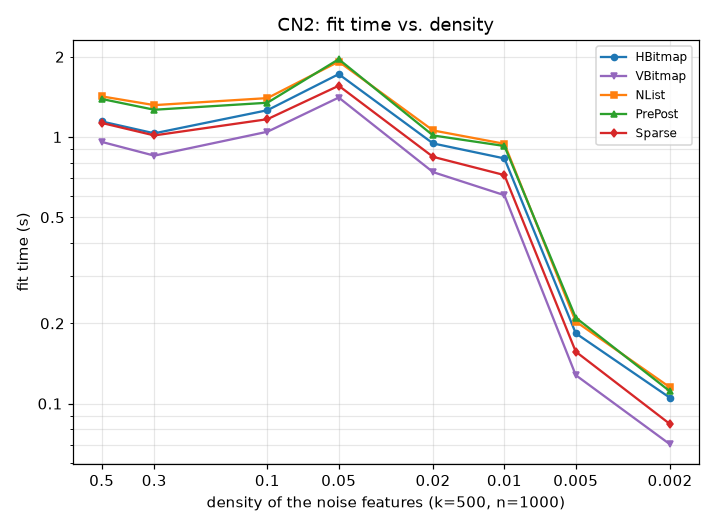

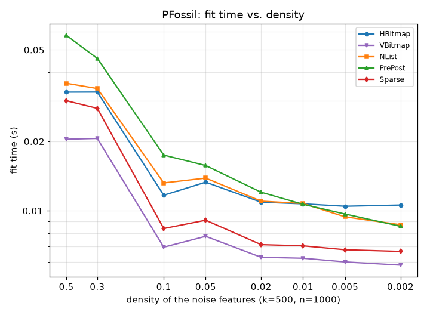

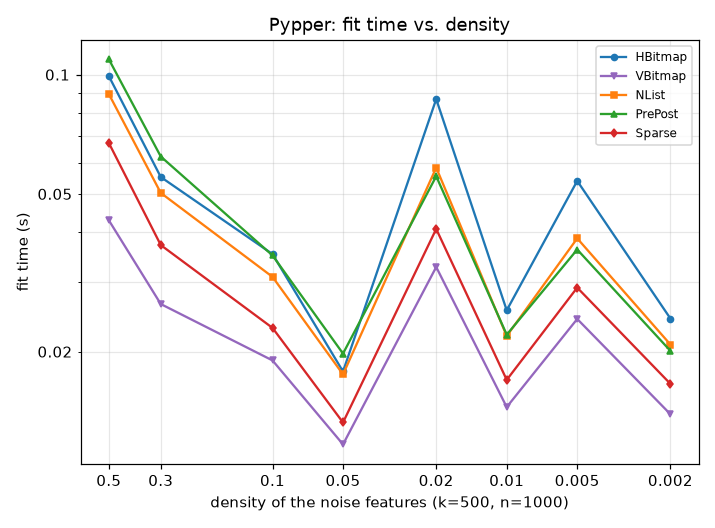

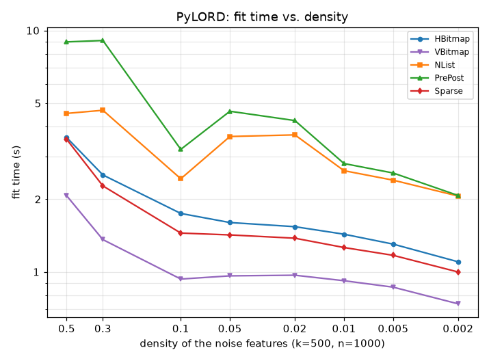

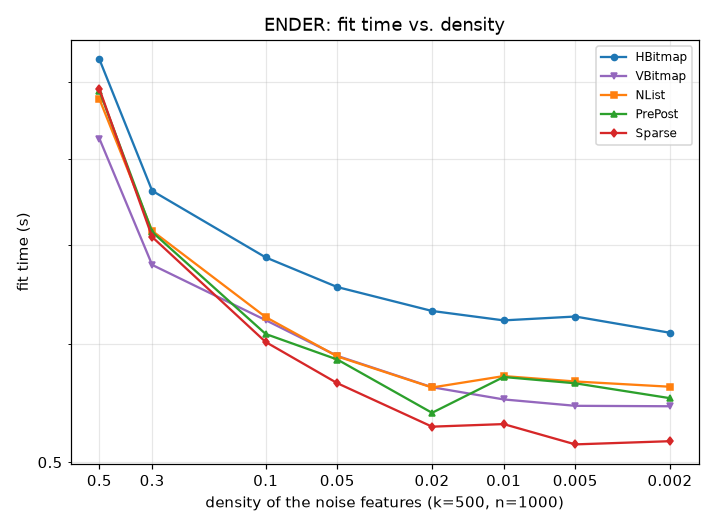

The pure data operation, 800 `coverage()` calls for random rules of 1-4 conditions, without any search around it:

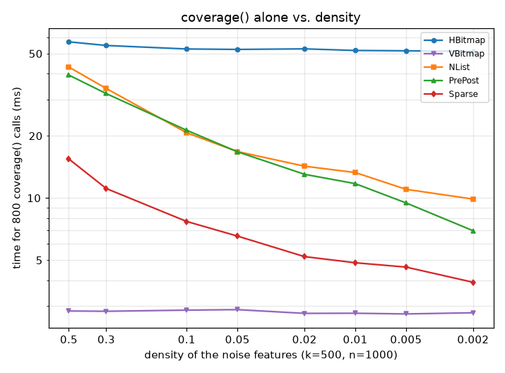

Fit time in seconds:

| learner | representation | p=0.5 | p=0.3 | p=0.1 | p=0.05 | p=0.02 | p=0.01 | p=0.005 | p=0.002 |
|---|---|--:|--:|--:|--:|--:|--:|--:|--:|
| CN2 | HBitmap | 1.14 | 1.03 | 1.26 | 1.72 | 0.95 | 0.83 | 0.18 | 0.11 |
| CN2 | VBitmap | 0.96 (84%) | 0.85 (82%) | 1.05 (83%) | 1.41 (82%) | 0.74 (78%) | 0.60 (73%) | 0.13 (70%) | 0.07 (67%) |
| CN2 | NList | 1.42 (124%) | 1.32 (128%) | 1.40 (111%) | 1.92 (111%) | 1.06 (112%) | 0.94 (113%) | 0.20 (111%) | 0.11 (109%) |
| CN2 | PrePost | 1.39 (121%) | 1.27 (123%) | 1.34 (107%) | 1.96 (114%) | 1.01 (107%) | 0.93 (111%) | 0.21 (114%) | 0.11 (106%) |
| CN2 | Sparse | 1.13 (99%) | 1.01 (98%) | 1.17 (93%) | 1.56 (90%) | 0.84 (89%) | 0.72 (87%) | 0.16 (85%) | 0.08 (80%) |
| PFossil | HBitmap | 0.03 | 0.03 | 0.01 | 0.01 | 0.01 | 0.01 | 0.01 | 0.01 |
| PFossil | VBitmap | 0.02 (62%) | 0.02 (63%) | 0.01 (59%) | 0.01 (58%) | 0.01 (58%) | 0.01 (58%) | 0.01 (57%) | 0.01 (55%) |
| PFossil | NList | 0.04 (109%) | 0.03 (104%) | 0.01 (113%) | 0.01 (104%) | 0.01 (101%) | 0.01 (100%) | 0.01 (90%) | 0.01 (82%) |
| PFossil | PrePost | 0.06 (176%) | 0.05 (140%) | 0.02 (149%) | 0.02 (118%) | 0.01 (110%) | 0.01 (100%) | 0.01 (93%) | 0.01 (81%) |
| PFossil | Sparse | 0.03 (92%) | 0.03 (85%) | 0.01 (72%) | 0.01 (68%) | 0.01 (65%) | 0.01 (66%) | 0.01 (65%) | 0.01 (63%) |
| Pypper | HBitmap | 0.10 | 0.06 | 0.04 | 0.02 | 0.09 | 0.03 | 0.05 | 0.02 |
| Pypper | VBitmap | 0.04 (43%) | 0.03 (48%) | 0.02 (54%) | 0.01 (65%) | 0.03 (38%) | 0.01 (57%) | 0.02 (45%) | 0.01 (57%) |
| Pypper | NList | 0.09 (90%) | 0.05 (91%) | 0.03 (88%) | 0.02 (98%) | 0.06 (67%) | 0.02 (86%) | 0.04 (72%) | 0.02 (86%) |
| Pypper | PrePost | 0.11 (110%) | 0.06 (113%) | 0.03 (99%) | 0.02 (111%) | 0.06 (64%) | 0.02 (87%) | 0.04 (67%) | 0.02 (83%) |
| Pypper | Sparse | 0.07 (68%) | 0.04 (67%) | 0.02 (65%) | 0.01 (74%) | 0.04 (47%) | 0.02 (67%) | 0.03 (54%) | 0.02 (68%) |
| PyLORD | HBitmap | 3.60 | 2.52 | 1.75 | 1.60 | 1.54 | 1.43 | 1.30 | 1.10 |
| PyLORD | VBitmap | 2.07 (57%) | 1.36 (54%) | 0.93 (53%) | 0.96 (60%) | 0.97 (63%) | 0.92 (64%) | 0.86 (66%) | 0.74 (67%) |
| PyLORD | NList | 4.53 (126%) | 4.67 (185%) | 2.43 (139%) | 3.64 (227%) | 3.69 (240%) | 2.62 (183%) | 2.40 (184%) | 2.06 (187%) |
| PyLORD | PrePost | 8.97 (249%) | 9.09 (361%) | 3.22 (184%) | 4.63 (289%) | 4.23 (275%) | 2.81 (196%) | 2.57 (197%) | 2.07 (188%) |
| PyLORD | Sparse | 3.54 (98%) | 2.27 (90%) | 1.45 (83%) | 1.42 (89%) | 1.38 (90%) | 1.26 (88%) | 1.17 (90%) | 1.00 (91%) |
| ENDER | HBitmap | 0.93 | 0.76 | 0.69 | 0.66 | 0.63 | 0.62 | 0.63 | 0.61 |
| ENDER | VBitmap | 0.83 (88%) | 0.68 (89%) | 0.62 (91%) | 0.59 (90%) | 0.56 (89%) | 0.55 (88%) | 0.55 (87%) | 0.55 (89%) |
| ENDER | NList | 0.88 (94%) | 0.72 (94%) | 0.63 (91%) | 0.59 (90%) | 0.56 (89%) | 0.57 (92%) | 0.57 (90%) | 0.56 (92%) |
| ENDER | PrePost | 0.89 (95%) | 0.71 (94%) | 0.61 (89%) | 0.59 (89%) | 0.54 (85%) | 0.57 (92%) | 0.56 (90%) | 0.55 (90%) |
| ENDER | Sparse | 0.89 (96%) | 0.71 (93%) | 0.60 (88%) | 0.57 (86%) | 0.53 (84%) | 0.53 (85%) | 0.51 (82%) | 0.52 (85%) |

Memory held by each representation (share of HBitmap in parentheses; the last row is the unpacked bool matrix):

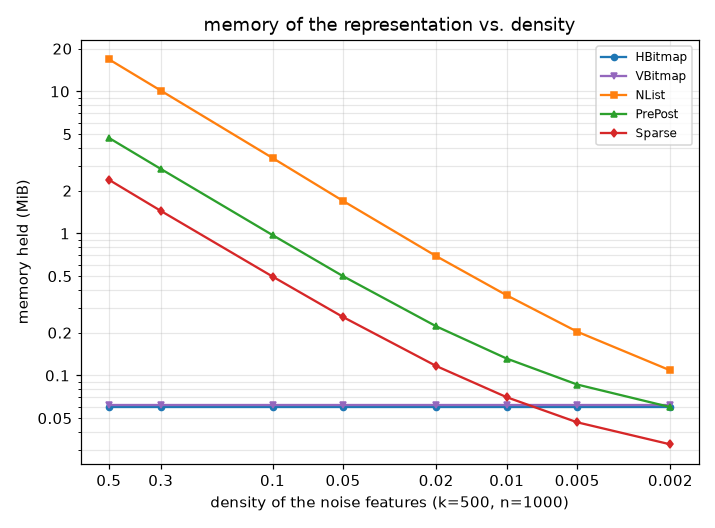

| representation | p=0.5 | p=0.3 | p=0.1 | p=0.05 | p=0.02 | p=0.01 | p=0.005 | p=0.002 |
|---|--:|--:|--:|--:|--:|--:|--:|--:|
| HBitmap | 62 KiB | 62 KiB | 62 KiB | 62 KiB | 62 KiB | 62 KiB | 62 KiB | 62 KiB |
| VBitmap | 63 KiB (102%) | 63 KiB (102%) | 63 KiB (102%) | 63 KiB (102%) | 63 KiB (102%) | 63 KiB (102%) | 63 KiB (102%) | 63 KiB (102%) |
| NList | 16.9 MiB (27943%) | 10.1 MiB (16815%) | 3.4 MiB (5637%) | 1.7 MiB (2809%) | 709 KiB (1147%) | 376 KiB (608%) | 208 KiB (337%) | 111 KiB (180%) |
| PrePost | 4.7 MiB (7811%) | 2.8 MiB (4720%) | 997 KiB (1615%) | 512 KiB (829%) | 227 KiB (368%) | 135 KiB (218%) | 88 KiB (143%) | 61 KiB (99%) |
| Sparse | 2.4 MiB (3962%) | 1.4 MiB (2390%) | 509 KiB (824%) | 264 KiB (428%) | 119 KiB (193%) | 72 KiB (116%) | 48 KiB (78%) | 33 KiB (54%) |
| unpacked `X` | 488 KiB | 488 KiB | 488 KiB | 488 KiB | 488 KiB | 488 KiB | 488 KiB | 488 KiB |

Memory a fit costs in total -- what the representation holds plus the peak the fit allocates on top of it, caches the representation builds during the fit included (`tracemalloc`, a separate untimed pass):

| learner | representation | p=0.5 | p=0.3 | p=0.1 | p=0.05 | p=0.02 | p=0.01 | p=0.005 | p=0.002 |
|---|---|--:|--:|--:|--:|--:|--:|--:|--:|
| CN2 | HBitmap | 1.6 MiB | 1.4 MiB | 1.4 MiB | 1.4 MiB | 1.3 MiB | 1.3 MiB | 1.2 MiB | 1.2 MiB |
| CN2 | VBitmap | 1.2 MiB (72%) | 1.2 MiB (87%) | 1.2 MiB (85%) | 1.1 MiB (79%) | 796 KiB (59%) | 753 KiB (56%) | 654 KiB (51%) | 471 KiB (38%) |
| CN2 | NList | 20.3 MiB (1234%) | 13.1 MiB (961%) | 6.4 MiB (470%) | 4.8 MiB (332%) | 3.7 MiB (276%) | 1.2 MiB (88%) | 865 KiB (68%) | 485 KiB (39%) |
| CN2 | PrePost | 8.1 MiB (495%) | 5.8 MiB (426%) | 4.0 MiB (293%) | 3.6 MiB (250%) | 3.2 MiB (242%) | 939 KiB (70%) | 743 KiB (58%) | 433 KiB (35%) |
| CN2 | Sparse | 5.7 MiB (345%) | 3.5 MiB (257%) | 1.6 MiB (120%) | 1.4 MiB (95%) | 858 KiB (63%) | 781 KiB (58%) | 644 KiB (51%) | 374 KiB (30%) |
| PFossil | HBitmap | 1.2 MiB | 1.2 MiB | 1.2 MiB | 1.2 MiB | 1.2 MiB | 1.2 MiB | 1.2 MiB | 1.2 MiB |
| PFossil | VBitmap | 405 KiB (32%) | 403 KiB (32%) | 402 KiB (33%) | 402 KiB (33%) | 402 KiB (33%) | 400 KiB (33%) | 395 KiB (32%) | 357 KiB (29%) |
| PFossil | NList | 19.7 MiB (1620%) | 13.0 MiB (1069%) | 6.3 MiB (526%) | 4.6 MiB (382%) | 3.6 MiB (299%) | 702 KiB (57%) | 482 KiB (39%) | 370 KiB (30%) |
| PFossil | PrePost | 7.6 MiB (623%) | 5.7 MiB (470%) | 3.9 MiB (323%) | 3.4 MiB (283%) | 3.1 MiB (260%) | 461 KiB (38%) | 359 KiB (29%) | 277 KiB (23%) |
| PFossil | Sparse | 5.6 MiB (459%) | 3.4 MiB (281%) | 1.2 MiB (104%) | 713 KiB (58%) | 380 KiB (31%) | 271 KiB (22%) | 243 KiB (20%) | 207 KiB (17%) |
| Pypper | HBitmap | 1.1 MiB | 1.1 MiB | 1.1 MiB | 1.1 MiB | 1.1 MiB | 1.1 MiB | 1.1 MiB | 1.1 MiB |
| Pypper | VBitmap | 414 KiB (36%) | 412 KiB (37%) | 411 KiB (37%) | 409 KiB (37%) | 409 KiB (35%) | 380 KiB (33%) | 355 KiB (31%) | 353 KiB (31%) |
| Pypper | NList | 19.7 MiB (1740%) | 13.0 MiB (1190%) | 6.3 MiB (571%) | 4.6 MiB (418%) | 3.6 MiB (312%) | 663 KiB (58%) | 476 KiB (41%) | 364 KiB (32%) |
| Pypper | PrePost | 7.6 MiB (669%) | 5.7 MiB (523%) | 3.8 MiB (350%) | 3.4 MiB (309%) | 3.1 MiB (271%) | 421 KiB (37%) | 326 KiB (28%) | 281 KiB (24%) |
| Pypper | Sparse | 4.6 MiB (403%) | 2.8 MiB (256%) | 1.0 MiB (94%) | 598 KiB (54%) | 336 KiB (29%) | 258 KiB (22%) | 215 KiB (19%) | 210 KiB (18%) |
| PyLORD | HBitmap | 1.1 MiB | 1.1 MiB | 1.3 MiB | 1.4 MiB | 1.6 MiB | 1.6 MiB | 1.5 MiB | 1.2 MiB |
| PyLORD | VBitmap | 1.1 MiB (99%) | 1.1 MiB (99%) | 1.1 MiB (86%) | 1.4 MiB (100%) | 1.6 MiB (99%) | 1.6 MiB (99%) | 1.5 MiB (99%) | 1.2 MiB (98%) |
| PyLORD | NList | 20.0 MiB (1793%) | 13.2 MiB (1184%) | 6.4 MiB (490%) | 4.8 MiB (340%) | 3.8 MiB (241%) | 2.0 MiB (128%) | 1.8 MiB (116%) | 1.3 MiB (108%) |
| PyLORD | PrePost | 7.9 MiB (705%) | 5.9 MiB (531%) | 4.0 MiB (305%) | 3.7 MiB (264%) | 3.3 MiB (211%) | 1.8 MiB (113%) | 1.6 MiB (108%) | 1.3 MiB (104%) |
| PyLORD | Sparse | 5.9 MiB (525%) | 3.6 MiB (325%) | 1.6 MiB (123%) | 1.7 MiB (118%) | 1.7 MiB (107%) | 1.6 MiB (104%) | 1.5 MiB (101%) | 1.2 MiB (99%) |
| ENDER | HBitmap | 1.5 MiB | 1.5 MiB | 1.5 MiB | 1.5 MiB | 1.5 MiB | 1.5 MiB | 1.5 MiB | 1.5 MiB |
| ENDER | VBitmap | 1.4 MiB (91%) | 1.4 MiB (91%) | 1.4 MiB (91%) | 1.4 MiB (91%) | 1.4 MiB (91%) | 1.4 MiB (91%) | 1.4 MiB (91%) | 1.4 MiB (91%) |
| ENDER | NList | 19.4 MiB (1307%) | 12.0 MiB (801%) | 5.3 MiB (352%) | 3.6 MiB (237%) | 2.6 MiB (171%) | 907 KiB (59%) | 705 KiB (46%) | 569 KiB (37%) |
| ENDER | PrePost | 7.3 MiB (490%) | 4.7 MiB (314%) | 2.8 MiB (190%) | 2.4 MiB (158%) | 2.1 MiB (139%) | 678 KiB (44%) | 589 KiB (38%) | 502 KiB (33%) |
| ENDER | Sparse | 3.4 MiB (230%) | 2.2 MiB (143%) | 1015 KiB (66%) | 702 KiB (46%) | 493 KiB (32%) | 410 KiB (27%) | 384 KiB (25%) | 363 KiB (24%) |

## 3. Width

Synthetic data again, 1000 training and 1000 test examples, the same concept on 4 signal features -- but now the number of *true* features per example stays fixed (on average 16 noise features, plus the signal ones) while the number of features grows. That is how sparse data usually looks: one-hot encodings of attributes with many values, or words in a text. The bitmaps grow with the number of features (one bit per cell); a sparse representation with the number of true cells, which stays the same. `Sparse` keeps two copies of a 4-byte index plus a 1-byte value per true cell, about 10 bytes against 1/8 byte per cell for the bitmaps, so it should take less memory below a density of about 1/80 -- here from about 1,408 features on.

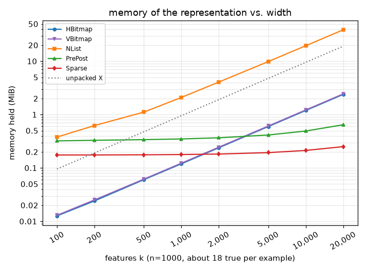

Memory held by each representation (share of HBitmap in parentheses; the last row is the unpacked bool matrix):

| representation | k=100 | k=200 | k=500 | k=1000 | k=2000 | k=5000 | k=10000 | k=20000 |
|---|--:|--:|--:|--:|--:|--:|--:|--:|
| HBitmap | 13 KiB | 25 KiB | 62 KiB | 122 KiB | 244 KiB | 611 KiB | 1.2 MiB | 2.4 MiB |
| VBitmap | 13 KiB (103%) | 26 KiB (105%) | 63 KiB (102%) | 126 KiB (103%) | 251 KiB (103%) | 626 KiB (102%) | 1.2 MiB (102%) | 2.4 MiB (102%) |
| NList | 387 KiB (2995%) | 637 KiB (2585%) | 1.1 MiB (1846%) | 2.1 MiB (1754%) | 4.1 MiB (1703%) | 9.9 MiB (1652%) | 19.5 MiB (1634%) | 38.7 MiB (1624%) |
| PrePost | 329 KiB (2544%) | 337 KiB (1369%) | 347 KiB (562%) | 358 KiB (293%) | 376 KiB (154%) | 424 KiB (69%) | 503 KiB (41%) | 660 KiB (27%) |
| Sparse | 179 KiB (1383%) | 179 KiB (727%) | 181 KiB (292%) | 183 KiB (149%) | 186 KiB (76%) | 198 KiB (32%) | 218 KiB (18%) | 257 KiB (11%) |
| unpacked `X` | 98 KiB | 195 KiB | 488 KiB | 977 KiB | 1.9 MiB | 4.8 MiB | 9.5 MiB | 19.1 MiB |

800 `coverage()` calls for random rules of 1-4 conditions:

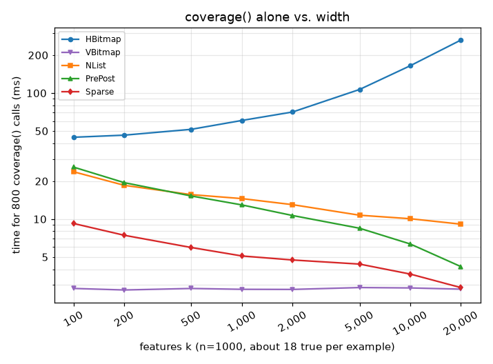

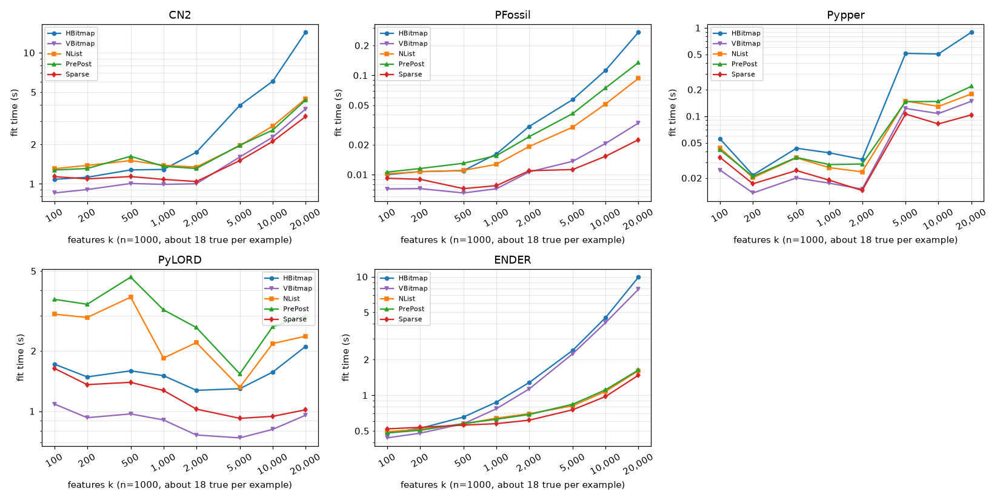

Fit time in seconds:

| learner | representation | k=100 | k=200 | k=500 | k=1000 | k=2000 | k=5000 | k=10000 | k=20000 |
|---|---|--:|--:|--:|--:|--:|--:|--:|--:|
| CN2 | HBitmap | 1.08 | 1.12 | 1.28 | 1.29 | 1.74 | 3.96 | 6.05 | 14.31 |
| CN2 | VBitmap | 0.85 (79%) | 0.90 (81%) | 1.01 (79%) | 0.99 (77%) | 1.00 (58%) | 1.60 (40%) | 2.27 (37%) | 3.72 (26%) |
| CN2 | NList | 1.30 (121%) | 1.38 (123%) | 1.50 (118%) | 1.39 (108%) | 1.34 (77%) | 1.95 (49%) | 2.75 (46%) | 4.45 (31%) |
| CN2 | PrePost | 1.28 (118%) | 1.31 (117%) | 1.62 (127%) | 1.36 (106%) | 1.31 (75%) | 1.97 (50%) | 2.57 (42%) | 4.35 (30%) |
| CN2 | Sparse | 1.14 (105%) | 1.09 (97%) | 1.14 (89%) | 1.08 (84%) | 1.04 (60%) | 1.50 (38%) | 2.11 (35%) | 3.25 (23%) |
| PFossil | HBitmap | 0.01 | 0.01 | 0.01 | 0.02 | 0.03 | 0.06 | 0.11 | 0.27 |
| PFossil | VBitmap | 0.01 (72%) | 0.01 (67%) | 0.01 (60%) | 0.01 (45%) | 0.01 (35%) | 0.01 (24%) | 0.02 (18%) | 0.03 (12%) |
| PFossil | NList | 0.01 (102%) | 0.01 (100%) | 0.01 (101%) | 0.01 (78%) | 0.02 (63%) | 0.03 (53%) | 0.05 (46%) | 0.09 (34%) |
| PFossil | PrePost | 0.01 (106%) | 0.01 (107%) | 0.01 (119%) | 0.02 (96%) | 0.02 (79%) | 0.04 (72%) | 0.07 (67%) | 0.13 (50%) |
| PFossil | Sparse | 0.01 (92%) | 0.01 (84%) | 0.01 (66%) | 0.01 (48%) | 0.01 (36%) | 0.01 (20%) | 0.02 (14%) | 0.02 (8%) |
| Pypper | HBitmap | 0.06 | 0.02 | 0.04 | 0.04 | 0.03 | 0.51 | 0.51 | 0.89 |
| Pypper | VBitmap | 0.02 (44%) | 0.01 (63%) | 0.02 (46%) | 0.02 (45%) | 0.01 (46%) | 0.12 (24%) | 0.11 (21%) | 0.15 (17%) |
| Pypper | NList | 0.04 (79%) | 0.02 (93%) | 0.03 (78%) | 0.03 (68%) | 0.02 (72%) | 0.15 (29%) | 0.13 (25%) | 0.18 (20%) |
| Pypper | PrePost | 0.04 (75%) | 0.02 (97%) | 0.03 (79%) | 0.03 (74%) | 0.03 (88%) | 0.15 (28%) | 0.15 (29%) | 0.22 (24%) |
| Pypper | Sparse | 0.03 (62%) | 0.02 (80%) | 0.02 (56%) | 0.02 (49%) | 0.01 (44%) | 0.11 (21%) | 0.08 (16%) | 0.10 (12%) |
| PyLORD | HBitmap | 1.72 | 1.48 | 1.59 | 1.50 | 1.27 | 1.30 | 1.57 | 2.10 |
| PyLORD | VBitmap | 1.09 (63%) | 0.93 (63%) | 0.97 (61%) | 0.90 (60%) | 0.76 (60%) | 0.74 (57%) | 0.81 (52%) | 0.96 (45%) |
| PyLORD | NList | 3.05 (177%) | 2.93 (198%) | 3.70 (233%) | 1.84 (122%) | 2.20 (173%) | 1.32 (102%) | 2.18 (139%) | 2.37 (112%) |
| PyLORD | PrePost | 3.61 (210%) | 3.41 (230%) | 4.66 (293%) | 3.20 (213%) | 2.61 (206%) | 1.54 (119%) | 2.64 (169%) | 2.98 (142%) |
| PyLORD | Sparse | 1.64 (95%) | 1.36 (92%) | 1.39 (88%) | 1.27 (84%) | 1.03 (81%) | 0.92 (71%) | 0.94 (60%) | 1.02 (48%) |
| ENDER | HBitmap | 0.48 | 0.53 | 0.65 | 0.87 | 1.28 | 2.39 | 4.52 | 9.93 |
| ENDER | VBitmap | 0.44 (91%) | 0.48 (91%) | 0.57 (88%) | 0.77 (88%) | 1.13 (88%) | 2.24 (94%) | 4.10 (91%) | 7.84 (79%) |
| ENDER | NList | 0.49 (103%) | 0.52 (98%) | 0.57 (87%) | 0.64 (73%) | 0.70 (55%) | 0.81 (34%) | 1.08 (24%) | 1.61 (16%) |
| ENDER | PrePost | 0.48 (101%) | 0.51 (96%) | 0.58 (88%) | 0.63 (72%) | 0.69 (54%) | 0.84 (35%) | 1.11 (25%) | 1.63 (16%) |
| ENDER | Sparse | 0.52 (109%) | 0.54 (102%) | 0.56 (85%) | 0.58 (66%) | 0.62 (48%) | 0.75 (31%) | 0.98 (22%) | 1.48 (15%) |

Memory a fit costs in total -- what the representation holds plus the peak the fit allocates on top of it, caches the representation builds during the fit included (`tracemalloc`, a separate untimed pass):

| learner | representation | k=100 | k=200 | k=500 | k=1000 | k=2000 | k=5000 | k=10000 | k=20000 |
|---|---|--:|--:|--:|--:|--:|--:|--:|--:|
| CN2 | HBitmap | 624 KiB | 994 KiB | 1.4 MiB | 1.8 MiB | 3.2 MiB | 7.3 MiB | 12.1 MiB | 23.9 MiB |
| CN2 | VBitmap | 404 KiB (65%) | 567 KiB (57%) | 986 KiB (69%) | 1.4 MiB (80%) | 3.2 MiB (100%) | 7.4 MiB (100%) | 12.1 MiB (100%) | 23.9 MiB (100%) |
| CN2 | NList | 1.6 MiB (263%) | 2.8 MiB (290%) | 4.2 MiB (299%) | 3.6 MiB (206%) | 7.2 MiB (228%) | 16.8 MiB (229%) | 30.6 MiB (253%) | 60.5 MiB (253%) |
| CN2 | PrePost | 1.5 MiB (254%) | 2.5 MiB (261%) | 3.4 MiB (244%) | 1.9 MiB (107%) | 3.5 MiB (111%) | 7.4 MiB (100%) | 11.6 MiB (96%) | 22.4 MiB (94%) |
| CN2 | Sparse | 642 KiB (103%) | 759 KiB (76%) | 1.1 MiB (80%) | 1.5 MiB (84%) | 3.1 MiB (98%) | 6.9 MiB (94%) | 11.1 MiB (92%) | 21.7 MiB (91%) |
| PFossil | HBitmap | 469 KiB | 823 KiB | 1.2 MiB | 1.4 MiB | 1.8 MiB | 3.2 MiB | 4.8 MiB | 8.9 MiB |
| PFossil | VBitmap | 129 KiB (28%) | 174 KiB (21%) | 402 KiB (33%) | 688 KiB (48%) | 1.3 MiB (73%) | 3.5 MiB (107%) | 5.7 MiB (120%) | 11.1 MiB (125%) |
| PFossil | NList | 1.4 MiB (316%) | 2.6 MiB (329%) | 4.0 MiB (335%) | 2.7 MiB (193%) | 5.0 MiB (276%) | 11.9 MiB (367%) | 22.7 MiB (478%) | 45.4 MiB (510%) |
| PFossil | PrePost | 1.4 MiB (304%) | 2.4 MiB (293%) | 3.2 MiB (270%) | 976 KiB (68%) | 1.3 MiB (72%) | 2.5 MiB (76%) | 3.8 MiB (79%) | 7.3 MiB (81%) |
| PFossil | Sparse | 475 KiB (101%) | 479 KiB (58%) | 521 KiB (43%) | 554 KiB (39%) | 923 KiB (50%) | 2.0 MiB (62%) | 3.2 MiB (68%) | 6.6 MiB (75%) |
| Pypper | HBitmap | 364 KiB | 602 KiB | 1.1 MiB | 1.3 MiB | 1.6 MiB | 2.7 MiB | 4.4 MiB | 9.8 MiB |
| Pypper | VBitmap | 137 KiB (38%) | 182 KiB (30%) | 412 KiB (37%) | 686 KiB (51%) | 1.2 MiB (76%) | 2.9 MiB (105%) | 5.1 MiB (115%) | 11.1 MiB (113%) |
| Pypper | NList | 1.1 MiB (323%) | 2.1 MiB (350%) | 4.0 MiB (365%) | 2.6 MiB (200%) | 4.9 MiB (303%) | 11.7 MiB (429%) | 22.4 MiB (505%) | 45.7 MiB (464%) |
| Pypper | PrePost | 1.1 MiB (307%) | 1.8 MiB (300%) | 3.2 MiB (294%) | 892 KiB (66%) | 1.2 MiB (74%) | 2.3 MiB (85%) | 3.4 MiB (77%) | 7.6 MiB (77%) |
| Pypper | Sparse | 402 KiB (110%) | 401 KiB (67%) | 447 KiB (40%) | 487 KiB (36%) | 804 KiB (49%) | 1.8 MiB (68%) | 2.9 MiB (65%) | 7.0 MiB (71%) |
| PyLORD | HBitmap | 1.4 MiB | 1.2 MiB | 1.5 MiB | 1.5 MiB | 1.5 MiB | 2.7 MiB | 4.7 MiB | 8.7 MiB |
| PyLORD | VBitmap | 1.4 MiB (100%) | 1.2 MiB (99%) | 1.5 MiB (100%) | 1.5 MiB (100%) | 1.5 MiB (99%) | 2.0 MiB (76%) | 2.9 MiB (62%) | 4.6 MiB (53%) |
| PyLORD | NList | 1.8 MiB (136%) | 2.8 MiB (232%) | 4.2 MiB (279%) | 3.7 MiB (253%) | 5.6 MiB (365%) | 11.5 MiB (427%) | 21.4 MiB (455%) | 41.1 MiB (474%) |
| PyLORD | PrePost | 1.8 MiB (131%) | 2.5 MiB (208%) | 3.4 MiB (227%) | 2.0 MiB (134%) | 1.9 MiB (125%) | 2.1 MiB (78%) | 2.4 MiB (52%) | 3.0 MiB (35%) |
| PyLORD | Sparse | 1.6 MiB (115%) | 1.4 MiB (116%) | 1.7 MiB (111%) | 1.6 MiB (108%) | 1.5 MiB (98%) | 1.7 MiB (61%) | 1.9 MiB (41%) | 2.4 MiB (28%) |
| ENDER | HBitmap | 443 KiB | 709 KiB | 1.5 MiB | 2.8 MiB | 3.2 MiB | 4.6 MiB | 6.1 MiB | 10.6 MiB |
| ENDER | VBitmap | 414 KiB (93%) | 654 KiB (92%) | 1.4 MiB (91%) | 2.5 MiB (91%) | 5.0 MiB (155%) | 10.7 MiB (231%) | 12.1 MiB (197%) | 25.0 MiB (235%) |
| ENDER | NList | 981 KiB (221%) | 1.5 MiB (219%) | 3.0 MiB (199%) | 2.8 MiB (101%) | 5.0 MiB (154%) | 11.6 MiB (252%) | 22.1 MiB (361%) | 44.5 MiB (419%) |
| ENDER | PrePost | 920 KiB (208%) | 1.2 MiB (177%) | 2.2 MiB (147%) | 1.1 MiB (38%) | 1.3 MiB (39%) | 2.2 MiB (48%) | 3.1 MiB (51%) | 6.4 MiB (60%) |
| ENDER | Sparse | 542 KiB (122%) | 557 KiB (79%) | 590 KiB (39%) | 592 KiB (21%) | 792 KiB (24%) | 1.7 MiB (36%) | 2.5 MiB (41%) | 5.7 MiB (54%) |

