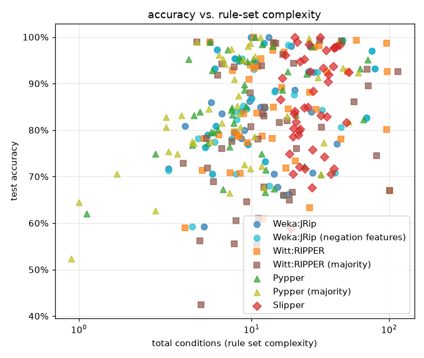
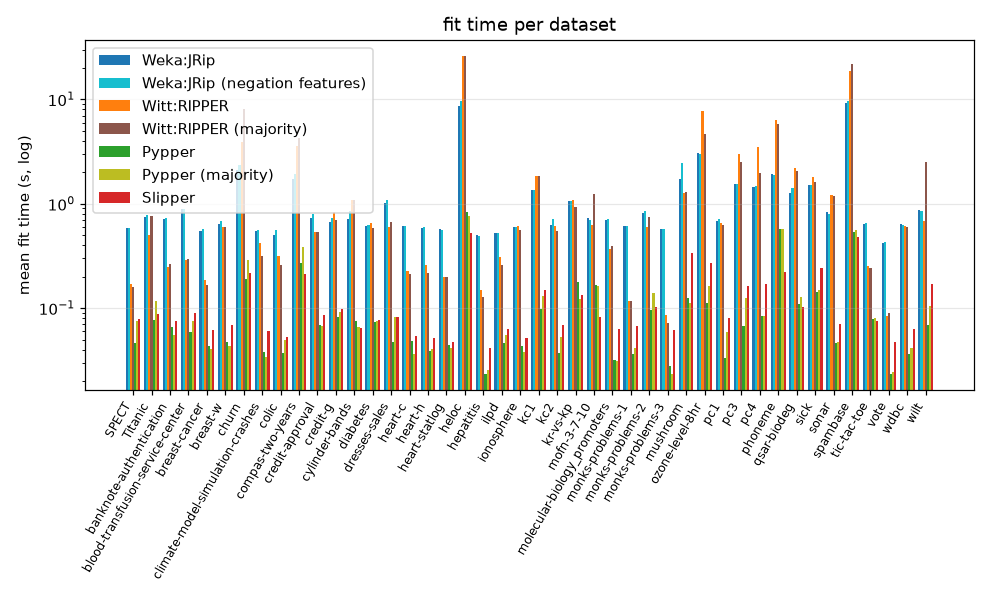
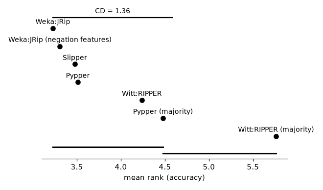
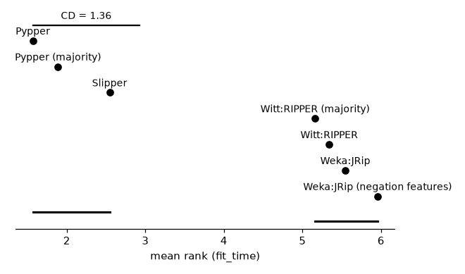

# RIPPER-family comparison: Weka:JRip / Witt:RIPPER / Pypper / Slipper

## Setup

**Full run** (44 binary datasets). For a quick sanity check instead (10 small datasets, 3-fold, well under a minute): `python demos/ripper_comparison.py` with no arguments -- its output isn't checked in (see `ripper_comparison_quick_report.md` after running it).

Four RIPPER-family rule learners -- Weka:JRip, Witt:RIPPER,
Pypper, Slipper -- compared on 44 binary datasets from
`pyrulearn.experiments.catalog`.

A fifth, IMod:Slipper (`imodels`' SlipperClassifier), is checked
separately first against the native Slipper on a handful of small,
low-feature-count datasets, then left out of the main comparison below --
see "Why IMod:Slipper isn't in the main comparison". Across 4 datasets (3-fold), IMod:Slipper was no more accurate than Slipper (mean accuracy 68.95% vs. 81.40%) while taking 127x as long per fit (7.58s vs. 0.06s, mean) -- not worth its cost at the scale of the main comparison below.

Protocol: `10`-fold stratified cross-validation
(`pyrulearn.experiments.runner.run_cv`), one `DataSpec` per training fold
(`build_dataspec(discretizer=TreeDiscretizer(max_intervals=6))`), the test fold binarized
against that same `DataSpec` -- every learner sees the identical
binary features per fold (as vertical bitmaps, the library's default representation;
the Weka learners convert them to the matrix they need), so differences
reflect the algorithms, not the data preparation. Each fit is capped at 180s; a
timeout or an exception is recorded as a failure, not fatal to the run.

A fold that times out fails the whole cross-validation of that learner on that dataset (`run_cv`'s `stop_on_timeout`): its remaining folds are not run, and all its folds count as failures, so no mean rests on just the folds that finished.

All three implementations of RIPPER learn their rules for the same class
on a binary dataset, the minority class, leaving the majority class to the
default rule: Weka:JRip and Pypper by their least-frequent-first ordering,
Witt:RIPPER by its `pos_class` default. And all three search the same
conditions: Weka:JRip and Witt:RIPPER test every Boolean column for both
values, so they get the features without their explicit negations
(`native_negation=True`) and provide those themselves by their `= False`
tests, while Pypper and Slipper, which only test a feature for being true,
get the negations as features.

Three variants show what these choices change: Weka:JRip (negation
features), handed the negation features too -- the same conditions, but
each twice, which changes the description lengths that decide when Ripper
stops and how it optimizes -- and Witt:RIPPER (majority) and Pypper
(majority), learning their rules for the majority class instead, the
minority class left to the default rule (Witt:RIPPER's former default on
most datasets: it used to pick the label that sorts first). Weka:JRip has
no such option: it always orders the classes by increasing frequency.

Measures: test accuracy, rule count, total condition count, fit time, and,
for the external implementations, the run time of the external algorithm
itself (`Provenance.run_time`: Weka's own "Time taken to build model",
wittgenstein's `fit`); the rest of their fit time is preparation --
converting the data, writing and reading files, starting the JVM, importing
the rules. Witt:RIPPER auto-dispatches one-vs-rest for multi-class (see the
module docstring); every other learner handles multi-class
natively.

Every learner runs single-threaded; fits run 10 at a time (`run_cv`'s `n_jobs`), each in its own process and timed there, with the numerical libraries limited to one thread (`OMP_NUM_THREADS=1` and its relatives). A check of the `dense_vs_modular` learners on 11 datasets found the fit times of 5 concurrent fits as close to a sequential run as a second sequential run (per-learner ratios and rankings alike); time ratios between learners are reproducible to about +-10% either way.

The same for fit time, rank 1 the fastest:

## Why IMod:Slipper isn't in the main comparison

Across 4 datasets (3-fold), IMod:Slipper was no more accurate than Slipper (mean accuracy 68.95% vs. 81.40%) while taking 127x as long per fit (7.58s vs. 0.06s, mean) -- not worth its cost at the scale of the main comparison below.

| learner | accuracy | fit_time |
|---|---|---|
| IMod:Slipper | 68.95% | 7.580 |
| Slipper | 81.40% | 0.060 |

## Summary by learner (mean across every dataset and fold)

| learner | accuracy | n_rules | conds/rule | fit_time (s) | wins | mean rank |
|---|--:|--:|--:|--:|--:|--:|
| Weka:JRip | 85.29% | 5.2 | 3.0 | 1.30 | 5.1 | 3.23 |
| Weka:JRip (negation features) | 84.99% | 5.1 | 3.0 | 1.37 | 6.6 | 3.31 |
| Slipper | 85.58% | 13.6 | 2.1 | 0.12 | 13.6 | 3.48 |
| Pypper | 85.15% | 4.4 | 3.0 | 0.11 | 6.1 | 3.51 |
| Witt:RIPPER | 84.46% | 6.0 | 3.5 | 2.16 | 4.1 | 4.24 |
| Pypper (majority) | 83.17% | 4.5 | 2.3 | 0.13 | 4.1 | 4.48 |
| Witt:RIPPER (majority) | 79.24% | 6.4 | 2.9 | 2.26 | 4.1 | 5.76 |

`wins` -- datasets where a learner's mean accuracy was (tied-for-)best, a tie split evenly (`pyrulearn.experiments.stats.win_counts`); `mean rank` -- average accuracy rank across datasets, failures tied for last (`stats.mean_rank`).

## Run time relative to Pypper

Seconds per fit (mean over datasets and folds), and relative to Pypper's fit time (geometric mean over the datasets): the fit time, the run time of the algorithm itself, and the preparation time (fit time minus run time -- converting the data, files, the JVM's start, importing the rules; zero for a native learner).

| learner | fit (s) | run (s) | preparation (s) | fit ×ref | run ×ref | preparation ×ref |
|---|--:|--:|--:|--:|--:|--:|
| Weka:JRip | 1.299 | 0.834 | 0.465 | 12.664 | 6.384 | 5.878 |
| Weka:JRip (negation features) | 1.366 | 0.891 | 0.475 | 13.132 | 6.707 | 5.991 |
| Witt:RIPPER | 2.158 | 2.143 | 0.015 | 10.059 | 9.924 | 0.102 |
| Witt:RIPPER (majority) | 2.257 | 2.241 | 0.016 | 10.160 | 10.007 | 0.115 |
| Pypper | 0.114 | 0.114 | 0.000 | 1.000 | 1.000 | -- |
| Pypper (majority) | 0.125 | 0.125 | 0.000 | 1.119 | 1.119 | -- |
| Slipper | 0.124 | 0.124 | 0.000 | 1.345 | 1.345 | -- |

## Per-dataset results, per learner (mean across folds)

| dataset | learner | accuracy | n_rules | n_conditions | conds_per_rule | fit_time | run_time |
|---|---|---|---|---|---|---|---|
| SPECT | Pypper | 80.11% | 1.0 | 5.7 | 5.7 | 0.046 | n/a |
| SPECT | Pypper (majority) | 77.51% | 3.4 | 3.7 | 1.1 | 0.074 | n/a |
| SPECT | Slipper | 83.13% | 11.3 | 31.8 | 2.8 | 0.079 | n/a |
| SPECT | Weka:JRip | 80.87% | 1.0 | 5.5 | 5.5 | 0.585 | 0.246 |
| SPECT | Weka:JRip (negation features) | 80.87% | 1.0 | 5.5 | 5.5 | 0.582 | 0.243 |
| SPECT | Witt:RIPPER | 78.68% | 1.6 | 12.0 | 7.5 | 0.169 | 0.168 |
| SPECT | Witt:RIPPER (majority) | 68.92% | 3.2 | 5.3 | 1.6 | 0.160 | 0.158 |
| Titanic | Pypper | 79.60% | 2.4 | 5.1 | 2.1 | 0.076 | n/a |
| Titanic | Pypper (majority) | 78.53% | 4.1 | 10.5 | 2.4 | 0.116 | n/a |
| Titanic | Slipper | 80.21% | 12.9 | 22.6 | 1.7 | 0.088 | n/a |
| Titanic | Weka:JRip | 79.53% | 3.3 | 7.5 | 2.3 | 0.749 | 0.347 |
| Titanic | Weka:JRip (negation features) | 78.23% | 3.1 | 7.2 | 2.3 | 0.786 | 0.370 |
| Titanic | Witt:RIPPER | 78.23% | 4.4 | 14.2 | 3.2 | 0.505 | 0.497 |
| Titanic | Witt:RIPPER (majority) | 76.09% | 5.9 | 21.3 | 3.2 | 0.760 | 0.750 |
| banknote-authentication | Pypper | 98.47% | 5.0 | 11.9 | 2.4 | 0.065 | n/a |
| banknote-authentication | Pypper (majority) | 98.69% | 4.3 | 9.8 | 2.3 | 0.055 | n/a |
| banknote-authentication | Slipper | 98.47% | 12.9 | 26.1 | 2.0 | 0.076 | n/a |
| banknote-authentication | Weka:JRip | 98.69% | 5.2 | 12.3 | 2.4 | 0.720 | 0.339 |
| banknote-authentication | Weka:JRip (negation features) | 98.69% | 5.2 | 12.3 | 2.4 | 0.729 | 0.329 |
| banknote-authentication | Witt:RIPPER | 98.54% | 6.0 | 14.6 | 2.4 | 0.248 | 0.239 |
| banknote-authentication | Witt:RIPPER (majority) | 98.76% | 5.8 | 14.4 | 2.4 | 0.267 | 0.258 |
| blood-transfusion-service-center | Pypper | 79.40% | 2.0 | 5.3 | 2.6 | 0.059 | n/a |
| blood-transfusion-service-center | Pypper (majority) | 77.14% | 2.8 | 3.8 | 1.3 | 0.074 | n/a |
| blood-transfusion-service-center | Slipper | 78.60% | 11.6 | 20.1 | 1.7 | 0.090 | n/a |
| blood-transfusion-service-center | Weka:JRip | 79.00% | 1.9 | 4.8 | 2.5 | 0.888 | 0.376 |
| blood-transfusion-service-center | Weka:JRip (negation features) | 79.00% | 1.9 | 4.8 | 2.5 | 0.897 | 0.403 |
| blood-transfusion-service-center | Witt:RIPPER | 77.26% | 2.7 | 9.3 | 3.4 | 0.292 | 0.287 |
| blood-transfusion-service-center | Witt:RIPPER (majority) | 64.57% | 3.9 | 9.2 | 2.4 | 0.298 | 0.292 |
| breast-cancer | Pypper | 74.84% | 1.0 | 2.0 | 2.0 | 0.043 | n/a |
| breast-cancer | Pypper (majority) | 70.58% | 1.4 | 1.5 | 1.1 | 0.041 | n/a |
| breast-cancer | Slipper | 72.03% | 13.9 | 22.3 | 1.6 | 0.062 | n/a |
| breast-cancer | Weka:JRip | 71.67% | 1.4 | 2.5 | 1.7 | 0.552 | 0.224 |
| breast-cancer | Weka:JRip (negation features) | 71.37% | 1.3 | 2.5 | 1.9 | 0.577 | 0.239 |
| breast-cancer | Witt:RIPPER | 71.35% | 1.6 | 4.4 | 2.8 | 0.185 | 0.183 |
| breast-cancer | Witt:RIPPER (majority) | 56.18% | 1.7 | 4.2 | 2.6 | 0.166 | 0.163 |
| breast-w | Pypper | 95.57% | 3.9 | 8.1 | 2.1 | 0.047 | n/a |
| breast-w | Pypper (majority) | 95.27% | 2.5 | 6.2 | 2.4 | 0.044 | n/a |
| breast-w | Slipper | 96.14% | 14.4 | 17.6 | 1.2 | 0.069 | n/a |
| breast-w | Weka:JRip | 95.42% | 4.0 | 7.6 | 1.9 | 0.638 | 0.280 |
| breast-w | Weka:JRip (negation features) | 95.42% | 4.5 | 8.5 | 1.9 | 0.683 | 0.321 |
| breast-w | Witt:RIPPER | 95.43% | 5.4 | 11.7 | 2.2 | 0.602 | 0.594 |
| breast-w | Witt:RIPPER (majority) | 93.56% | 3.0 | 7.5 | 2.5 | 0.602 | 0.596 |
| churn | Pypper | 92.04% | 8.6 | 25.2 | 2.9 | 0.189 | n/a |
| churn | Pypper (majority) | 91.36% | 6.6 | 30.4 | 4.6 | 0.290 | n/a |
| churn | Slipper | 91.88% | 15.9 | 36.2 | 2.3 | 0.219 | n/a |
| churn | Weka:JRip | 92.44% | 9.8 | 28.3 | 2.9 | 2.093 | 1.504 |
| churn | Weka:JRip (negation features) | 92.40% | 10.1 | 30.1 | 3.0 | 2.337 | 1.734 |
| churn | Witt:RIPPER | 92.58% | 13.7 | 49.9 | 3.6 | 3.934 | 3.890 |
| churn | Witt:RIPPER (majority) | 89.50% | 12.7 | 70.8 | 5.6 | 8.145 | 8.099 |
| climate-model-simulation-crashes | Pypper | 95.00% | 2.6 | 8.4 | 3.3 | 0.038 | n/a |
| climate-model-simulation-crashes | Pypper (majority) | 94.26% | 3.9 | 6.4 | 1.6 | 0.034 | n/a |
| climate-model-simulation-crashes | Slipper | 93.33% | 13.9 | 33.3 | 2.4 | 0.060 | n/a |
| climate-model-simulation-crashes | Weka:JRip | 94.81% | 2.7 | 8.1 | 3.0 | 0.547 | 0.243 |
| climate-model-simulation-crashes | Weka:JRip (negation features) | 94.81% | 2.7 | 8.1 | 3.0 | 0.561 | 0.254 |
| climate-model-simulation-crashes | Witt:RIPPER | 93.70% | 3.5 | 11.2 | 3.2 | 0.420 | 0.418 |
| climate-model-simulation-crashes | Witt:RIPPER (majority) | 91.85% | 3.7 | 5.7 | 1.5 | 0.317 | 0.314 |
| colic | Pypper | 84.26% | 2.9 | 7.1 | 2.4 | 0.037 | n/a |
| colic | Pypper (majority) | 84.50% | 2.8 | 4.9 | 1.7 | 0.049 | n/a |
| colic | Slipper | 81.81% | 13.9 | 21.0 | 1.5 | 0.052 | n/a |
| colic | Weka:JRip | 83.99% | 3.4 | 8.4 | 2.4 | 0.497 | 0.211 |
| colic | Weka:JRip (negation features) | 84.52% | 3.9 | 9.2 | 2.3 | 0.564 | 0.248 |
| colic | Witt:RIPPER | 83.68% | 4.3 | 10.9 | 2.5 | 0.312 | 0.309 |
| colic | Witt:RIPPER (majority) | 78.05% | 5.5 | 11.1 | 2.0 | 0.259 | 0.255 |
| compas-two-years | Pypper | 67.39% | 4.4 | 14.6 | 3.3 | 0.273 | n/a |
| compas-two-years | Pypper (majority) | 67.70% | 4.1 | 12.3 | 3.0 | 0.385 | n/a |
| compas-two-years | Slipper | 67.70% | 14.3 | 27.4 | 1.9 | 0.214 | n/a |
| compas-two-years | Weka:JRip | 67.73% | 5.5 | 15.5 | 2.7 | 1.741 | 1.234 |
| compas-two-years | Weka:JRip (negation features) | 68.00% | 5.1 | 13.5 | 2.6 | 1.927 | 1.365 |
| compas-two-years | Witt:RIPPER | 63.28% | 5.7 | 26.4 | 4.6 | 3.608 | 3.580 |
| compas-two-years | Witt:RIPPER (majority) | 64.93% | 4.7 | 18.8 | 3.5 | 4.253 | 4.225 |
| credit-approval | Pypper | 84.78% | 3.0 | 7.2 | 2.1 | 0.069 | n/a |
| credit-approval | Pypper (majority) | 85.22% | 2.8 | 7.9 | 2.8 | 0.067 | n/a |
| credit-approval | Slipper | 84.78% | 13.3 | 24.2 | 1.8 | 0.086 | n/a |
| credit-approval | Weka:JRip | 86.23% | 4.1 | 9.7 | 2.3 | 0.728 | 0.324 |
| credit-approval | Weka:JRip (negation features) | 85.22% | 4.0 | 8.7 | 2.1 | 0.793 | 0.362 |
| credit-approval | Witt:RIPPER | 84.49% | 6.3 | 18.4 | 2.9 | 0.533 | 0.527 |
| credit-approval | Witt:RIPPER (majority) | 84.93% | 3.9 | 12.4 | 3.1 | 0.541 | 0.536 |
| credit-g | Pypper | 71.40% | 3.2 | 12.7 | 3.8 | 0.082 | n/a |
| credit-g | Pypper (majority) | 66.50% | 3.4 | 6.9 | 1.9 | 0.091 | n/a |
| credit-g | Slipper | 74.30% | 15.0 | 33.9 | 2.3 | 0.098 | n/a |
| credit-g | Weka:JRip | 70.50% | 3.6 | 14.5 | 3.7 | 0.671 | 0.347 |
| credit-g | Weka:JRip (negation features) | 70.60% | 2.1 | 7.7 | 3.5 | 0.726 | 0.371 |
| credit-g | Witt:RIPPER | 71.80% | 3.6 | 17.7 | 5.0 | 0.842 | 0.837 |
| credit-g | Witt:RIPPER (majority) | 61.00% | 3.7 | 11.3 | 3.0 | 0.705 | 0.698 |
| cylinder-bands | Pypper | 66.67% | 4.0 | 12.5 | 3.2 | 0.075 | n/a |
| cylinder-bands | Pypper (majority) | 71.67% | 3.8 | 9.8 | 2.5 | 0.065 | n/a |
| cylinder-bands | Slipper | 70.56% | 17.4 | 20.1 | 1.2 | 0.064 | n/a |
| cylinder-bands | Weka:JRip | 66.30% | 7.7 | 18.6 | 2.4 | 0.720 | 0.377 |
| cylinder-bands | Weka:JRip (negation features) | 65.93% | 6.5 | 17.1 | 2.6 | 0.858 | 0.463 |
| cylinder-bands | Witt:RIPPER | 60.93% | 5.0 | 12.2 | 2.4 | 1.078 | 1.072 |
| cylinder-bands | Witt:RIPPER (majority) | 65.93% | 5.8 | 17.1 | 3.0 | 1.095 | 1.088 |
| diabetes | Pypper | 74.87% | 3.5 | 11.8 | 3.3 | 0.074 | n/a |
| diabetes | Pypper (majority) | 72.27% | 4.4 | 11.8 | 2.6 | 0.075 | n/a |
| diabetes | Slipper | 75.78% | 13.3 | 27.7 | 2.1 | 0.077 | n/a |
| diabetes | Weka:JRip | 73.17% | 3.8 | 12.5 | 3.2 | 0.615 | 0.294 |
| diabetes | Weka:JRip (negation features) | 73.17% | 3.8 | 12.5 | 3.2 | 0.619 | 0.295 |
| diabetes | Witt:RIPPER | 73.31% | 5.2 | 20.9 | 4.0 | 0.658 | 0.653 |
| diabetes | Witt:RIPPER (majority) | 66.66% | 5.8 | 19.8 | 3.4 | 0.588 | 0.582 |
| dresses-sales | Pypper | 62.00% | 1.0 | 1.1 | 1.1 | 0.047 | n/a |
| dresses-sales | Pypper (majority) | 52.40% | 0.8 | 0.9 | 1.1 | 0.082 | n/a |
| dresses-sales | Slipper | 58.80% | 16.2 | 19.2 | 1.2 | 0.083 | n/a |
| dresses-sales | Weka:JRip | 59.20% | 2.3 | 4.5 | 1.8 | 1.019 | 0.468 |
| dresses-sales | Weka:JRip (negation features) | 59.20% | 2.1 | 3.7 | 1.7 | 1.087 | 0.511 |
| dresses-sales | Witt:RIPPER | 59.00% | 1.2 | 3.3 | 3.0 | 0.600 | 0.595 |
| dresses-sales | Witt:RIPPER (majority) | 42.40% | 1.6 | 4.3 | 2.5 | 0.662 | 0.656 |
| heart-c | Pypper | 81.54% | 3.0 | 7.4 | 2.4 | 0.048 | n/a |
| heart-c | Pypper (majority) | 80.59% | 3.2 | 8.3 | 2.4 | 0.037 | n/a |
| heart-c | Slipper | 78.92% | 13.7 | 21.8 | 1.6 | 0.054 | n/a |
| heart-c | Weka:JRip | 78.20% | 3.6 | 8.4 | 2.3 | 0.613 | 0.264 |
| heart-c | Weka:JRip (negation features) | 79.54% | 3.2 | 7.6 | 2.3 | 0.616 | 0.267 |
| heart-c | Witt:RIPPER | 78.92% | 3.1 | 7.9 | 2.5 | 0.225 | 0.223 |
| heart-c | Witt:RIPPER (majority) | 83.51% | 4.1 | 12.1 | 2.9 | 0.214 | 0.210 |
| heart-h | Pypper | 77.18% | 2.2 | 4.8 | 2.1 | 0.039 | n/a |
| heart-h | Pypper (majority) | 77.49% | 3.1 | 5.1 | 1.6 | 0.041 | n/a |
| heart-h | Slipper | 79.91% | 14.2 | 22.1 | 1.6 | 0.051 | n/a |
| heart-h | Weka:JRip | 80.92% | 2.0 | 3.3 | 1.6 | 0.583 | 0.251 |
| heart-h | Weka:JRip (negation features) | 78.25% | 2.2 | 4.1 | 1.8 | 0.595 | 0.251 |
| heart-h | Witt:RIPPER | 79.63% | 3.2 | 7.5 | 2.4 | 0.258 | 0.256 |
| heart-h | Witt:RIPPER (majority) | 60.51% | 3.3 | 7.7 | 2.3 | 0.217 | 0.214 |
| heart-statlog | Pypper | 83.33% | 3.1 | 7.3 | 2.3 | 0.044 | n/a |
| heart-statlog | Pypper (majority) | 81.48% | 2.7 | 6.1 | 2.2 | 0.041 | n/a |
| heart-statlog | Slipper | 80.37% | 13.7 | 20.2 | 1.5 | 0.048 | n/a |
| heart-statlog | Weka:JRip | 80.00% | 3.7 | 8.9 | 2.3 | 0.570 | 0.237 |
| heart-statlog | Weka:JRip (negation features) | 82.22% | 3.5 | 7.8 | 2.2 | 0.556 | 0.239 |
| heart-statlog | Witt:RIPPER | 78.52% | 3.2 | 8.2 | 2.5 | 0.197 | 0.194 |
| heart-statlog | Witt:RIPPER (majority) | 80.74% | 3.7 | 9.9 | 2.7 | 0.197 | 0.193 |
| heloc | Pypper | 70.37% | 8.0 | 31.9 | 3.9 | 0.829 | n/a |
| heloc | Pypper (majority) | 70.37% | 8.0 | 31.9 | 3.9 | 0.769 | n/a |
| heloc | Slipper | 70.51% | 14.4 | 37.9 | 2.6 | 0.524 | n/a |
| heloc | Weka:JRip | 70.83% | 7.4 | 27.7 | 3.5 | 8.644 | 7.444 |
| heloc | Weka:JRip (negation features) | 70.79% | 10.0 | 40.5 | 4.0 | 9.559 | 8.349 |
| heloc | Witt:RIPPER | 66.99% | 15.7 | 100.7 | 6.4 | 25.899 | 25.777 |
| heloc | Witt:RIPPER (majority) | 66.99% | 15.7 | 100.7 | 6.4 | 26.083 | 25.966 |
| hepatitis | Pypper | 76.79% | 2.1 | 3.7 | 1.7 | 0.023 | n/a |
| hepatitis | Pypper (majority) | 74.83% | 2.2 | 2.9 | 1.3 | 0.026 | n/a |
| hepatitis | Slipper | 84.00% | 13.1 | 20.6 | 1.6 | 0.041 | n/a |
| hepatitis | Weka:JRip | 76.29% | 2.1 | 4.6 | 2.1 | 0.506 | 0.206 |
| hepatitis | Weka:JRip (negation features) | 76.29% | 2.1 | 4.6 | 2.1 | 0.488 | 0.201 |
| hepatitis | Witt:RIPPER | 78.92% | 2.6 | 5.8 | 2.1 | 0.149 | 0.147 |
| hepatitis | Witt:RIPPER (majority) | 72.83% | 2.1 | 3.2 | 1.6 | 0.128 | 0.126 |
| ilpd | Pypper | 67.24% | 1.7 | 6.2 | 3.5 | 0.047 | n/a |
| ilpd | Pypper (majority) | 62.62% | 1.7 | 2.0 | 1.1 | 0.055 | n/a |
| ilpd | Slipper | 71.69% | 12.5 | 24.5 | 2.0 | 0.064 | n/a |
| ilpd | Weka:JRip | 70.50% | 1.6 | 5.2 | 3.3 | 0.526 | 0.235 |
| ilpd | Weka:JRip (negation features) | 70.50% | 1.6 | 5.2 | 3.3 | 0.525 | 0.234 |
| ilpd | Witt:RIPPER | 70.84% | 1.5 | 7.0 | 4.6 | 0.311 | 0.309 |
| ilpd | Witt:RIPPER (majority) | 55.57% | 2.7 | 7.5 | 2.8 | 0.261 | 0.259 |
| ionosphere | Pypper | 89.74% | 5.4 | 8.9 | 1.7 | 0.043 | n/a |
| ionosphere | Pypper (majority) | 90.89% | 2.5 | 7.5 | 2.9 | 0.038 | n/a |
| ionosphere | Slipper | 91.15% | 14.4 | 16.7 | 1.2 | 0.051 | n/a |
| ionosphere | Weka:JRip | 86.89% | 5.8 | 10.0 | 1.6 | 0.604 | 0.273 |
| ionosphere | Weka:JRip (negation features) | 86.89% | 5.8 | 10.0 | 1.6 | 0.605 | 0.271 |
| ionosphere | Witt:RIPPER | 90.89% | 5.7 | 9.6 | 1.7 | 0.614 | 0.611 |
| ionosphere | Witt:RIPPER (majority) | 88.02% | 3.0 | 9.8 | 3.1 | 0.562 | 0.560 |
| kc1 | Pypper | 85.06% | 2.4 | 9.1 | 3.6 | 0.097 | n/a |
| kc1 | Pypper (majority) | 64.49% | 1.0 | 1.0 | 1.0 | 0.131 | n/a |
| kc1 | Slipper | 84.87% | 13.3 | 25.6 | 1.9 | 0.149 | n/a |
| kc1 | Weka:JRip | 84.97% | 3.0 | 11.6 | 3.6 | 1.354 | 0.812 |
| kc1 | Weka:JRip (negation features) | 84.83% | 3.2 | 12.5 | 3.7 | 1.359 | 0.824 |
| kc1 | Witt:RIPPER | 84.92% | 3.1 | 14.4 | 4.7 | 1.842 | 1.833 |
| kc1 | Witt:RIPPER (majority) | 55.48% | 3.0 | 10.9 | 3.5 | 1.855 | 1.846 |
| kc2 | Pypper | 83.89% | 1.7 | 4.2 | 2.3 | 0.037 | n/a |
| kc2 | Pypper (majority) | 80.63% | 1.5 | 2.4 | 1.4 | 0.052 | n/a |
| kc2 | Slipper | 83.51% | 13.4 | 20.5 | 1.5 | 0.068 | n/a |
| kc2 | Weka:JRip | 83.51% | 2.4 | 6.1 | 2.1 | 0.622 | 0.269 |
| kc2 | Weka:JRip (negation features) | 83.90% | 2.7 | 7.9 | 2.8 | 0.706 | 0.338 |
| kc2 | Witt:RIPPER | 83.50% | 2.9 | 8.8 | 3.0 | 0.613 | 0.608 |
| kc2 | Witt:RIPPER (majority) | 76.02% | 2.7 | 6.1 | 2.3 | 0.542 | 0.537 |
| kr-vs-kp | Pypper | 99.12% | 14.3 | 45.4 | 3.2 | 0.177 | n/a |
| kr-vs-kp | Pypper (majority) | 98.84% | 9.2 | 42.4 | 4.6 | 0.121 | n/a |
| kr-vs-kp | Slipper | 97.69% | 14.6 | 39.7 | 2.7 | 0.132 | n/a |
| kr-vs-kp | Weka:JRip | 99.19% | 14.6 | 44.9 | 3.1 | 1.071 | 0.637 |
| kr-vs-kp | Weka:JRip (negation features) | 99.31% | 14.6 | 46.2 | 3.2 | 1.064 | 0.622 |
| kr-vs-kp | Witt:RIPPER | 99.28% | 17.5 | 57.8 | 3.3 | 1.075 | 1.038 |
| kr-vs-kp | Witt:RIPPER (majority) | 99.22% | 9.8 | 45.1 | 4.6 | 0.928 | 0.901 |
| mofn-3-7-10 | Pypper | 95.16% | 14.6 | 69.7 | 4.8 | 0.166 | n/a |
| mofn-3-7-10 | Pypper (majority) | 93.35% | 17.0 | 46.0 | 2.7 | 0.163 | n/a |
| mofn-3-7-10 | Slipper | 97.89% | 14.1 | 41.3 | 2.9 | 0.082 | n/a |
| mofn-3-7-10 | Weka:JRip | 96.97% | 15.6 | 75.2 | 4.8 | 0.724 | 0.415 |
| mofn-3-7-10 | Weka:JRip (negation features) | 96.97% | 15.6 | 75.2 | 4.8 | 0.705 | 0.398 |
| mofn-3-7-10 | Witt:RIPPER | 98.64% | 19.3 | 95.6 | 4.9 | 0.619 | 0.601 |
| mofn-3-7-10 | Witt:RIPPER (majority) | 93.13% | 23.8 | 69.2 | 2.9 | 1.232 | 1.209 |
| molecular-biology_promoters | Pypper | 83.18% | 2.1 | 3.8 | 1.8 | 0.032 | n/a |
| molecular-biology_promoters | Pypper (majority) | 83.18% | 1.9 | 3.1 | 1.6 | 0.031 | n/a |
| molecular-biology_promoters | Slipper | 86.64% | 12.5 | 16.3 | 1.3 | 0.064 | n/a |
| molecular-biology_promoters | Weka:JRip | 86.00% | 2.6 | 5.1 | 2.0 | 0.698 | 0.284 |
| molecular-biology_promoters | Weka:JRip (negation features) | 77.45% | 2.5 | 5.4 | 2.1 | 0.719 | 0.295 |
| molecular-biology_promoters | Witt:RIPPER | 78.18% | 2.2 | 4.5 | 2.0 | 0.371 | 0.368 |
| molecular-biology_promoters | Witt:RIPPER (majority) | 78.18% | 2.5 | 4.7 | 1.9 | 0.396 | 0.392 |
| monks-problems-1 | Pypper | 95.30% | 3.6 | 10.3 | 2.8 | 0.036 | n/a |
| monks-problems-1 | Pypper (majority) | 95.84% | 3.6 | 10.6 | 2.9 | 0.042 | n/a |
| monks-problems-1 | Slipper | 100.00% | 12.8 | 31.6 | 2.4 | 0.067 | n/a |
| monks-problems-1 | Weka:JRip | 100.00% | 4.9 | 13.3 | 2.7 | 0.616 | 0.265 |
| monks-problems-1 | Weka:JRip (negation features) | 93.04% | 3.7 | 10.4 | 2.5 | 0.606 | 0.263 |
| monks-problems-1 | Witt:RIPPER | 96.76% | 5.0 | 17.2 | 3.4 | 0.117 | 0.113 |
| monks-problems-1 | Witt:RIPPER (majority) | 96.21% | 4.9 | 16.9 | 3.3 | 0.118 | 0.114 |
| monks-problems-2 | Pypper | 72.22% | 4.4 | 24.2 | 5.9 | 0.097 | n/a |
| monks-problems-2 | Pypper (majority) | 77.36% | 10.1 | 33.6 | 3.4 | 0.140 | n/a |
| monks-problems-2 | Slipper | 71.73% | 12.9 | 39.8 | 3.1 | 0.103 | n/a |
| monks-problems-2 | Weka:JRip | 77.08% | 7.2 | 41.6 | 5.7 | 0.819 | 0.373 |
| monks-problems-2 | Weka:JRip (negation features) | 80.57% | 7.6 | 44.6 | 5.8 | 0.849 | 0.390 |
| monks-problems-2 | Witt:RIPPER | 78.01% | 7.7 | 44.9 | 5.8 | 0.592 | 0.585 |
| monks-problems-2 | Witt:RIPPER (majority) | 86.02% | 15.4 | 55.5 | 3.6 | 0.749 | 0.737 |
| monks-problems-3 | Pypper | 98.92% | 3.0 | 5.0 | 1.7 | 0.028 | n/a |
| monks-problems-3 | Pypper (majority) | 98.92% | 2.0 | 4.0 | 2.0 | 0.023 | n/a |
| monks-problems-3 | Slipper | 98.92% | 10.4 | 21.5 | 2.1 | 0.061 | n/a |
| monks-problems-3 | Weka:JRip | 98.92% | 3.0 | 5.0 | 1.7 | 0.567 | 0.231 |
| monks-problems-3 | Weka:JRip (negation features) | 98.92% | 3.0 | 5.0 | 1.7 | 0.574 | 0.249 |
| monks-problems-3 | Witt:RIPPER | 98.92% | 3.0 | 5.0 | 1.7 | 0.085 | 0.082 |
| monks-problems-3 | Witt:RIPPER (majority) | 98.92% | 2.0 | 4.0 | 2.0 | 0.073 | 0.067 |
| mushroom | Pypper | 99.96% | 5.2 | 10.6 | 2.1 | 0.125 | n/a |
| mushroom | Pypper (majority) | 99.98% | 4.5 | 11.6 | 2.6 | 0.112 | n/a |
| mushroom | Slipper | 100.00% | 10.5 | 20.6 | 2.0 | 0.334 | n/a |
| mushroom | Weka:JRip | 99.98% | 6.4 | 9.9 | 1.6 | 1.742 | 0.951 |
| mushroom | Weka:JRip (negation features) | 99.98% | 6.0 | 10.1 | 1.7 | 2.448 | 1.356 |
| mushroom | Witt:RIPPER | 99.98% | 6.3 | 10.4 | 1.7 | 1.260 | 1.208 |
| mushroom | Witt:RIPPER (majority) | 98.62% | 6.2 | 15.0 | 2.4 | 1.290 | 1.239 |
| ozone-level-8hr | Pypper | 92.62% | 4.2 | 18.3 | 4.4 | 0.112 | n/a |
| ozone-level-8hr | Pypper (majority) | 87.29% | 4.1 | 8.0 | 2.0 | 0.161 | n/a |
| ozone-level-8hr | Slipper | 93.73% | 13.6 | 39.2 | 2.9 | 0.271 | n/a |
| ozone-level-8hr | Weka:JRip | 92.58% | 5.8 | 25.9 | 4.4 | 3.051 | 2.164 |
| ozone-level-8hr | Weka:JRip (negation features) | 92.58% | 5.8 | 25.9 | 4.4 | 2.966 | 2.114 |
| ozone-level-8hr | Witt:RIPPER | 92.46% | 7.5 | 35.6 | 4.8 | 7.803 | 7.785 |
| ozone-level-8hr | Witt:RIPPER (majority) | 81.69% | 5.9 | 16.0 | 2.7 | 4.623 | 4.608 |
| pc1 | Pypper | 92.79% | 1.8 | 5.2 | 2.7 | 0.034 | n/a |
| pc1 | Pypper (majority) | 82.78% | 1.7 | 2.4 | 1.3 | 0.059 | n/a |
| pc1 | Slipper | 92.61% | 13.6 | 26.7 | 2.0 | 0.081 | n/a |
| pc1 | Weka:JRip | 93.15% | 1.9 | 5.4 | 2.8 | 0.688 | 0.343 |
| pc1 | Weka:JRip (negation features) | 93.15% | 1.9 | 5.4 | 2.8 | 0.715 | 0.347 |
| pc1 | Witt:RIPPER | 92.88% | 2.2 | 7.3 | 3.4 | 0.652 | 0.648 |
| pc1 | Witt:RIPPER (majority) | 71.78% | 1.8 | 4.8 | 2.7 | 0.625 | 0.621 |
| pc3 | Pypper | 88.61% | 2.2 | 8.9 | 4.1 | 0.067 | n/a |
| pc3 | Pypper (majority) | 75.37% | 1.7 | 2.5 | 1.3 | 0.124 | n/a |
| pc3 | Slipper | 88.35% | 13.4 | 28.0 | 2.1 | 0.162 | n/a |
| pc3 | Weka:JRip | 88.48% | 3.5 | 14.8 | 4.2 | 1.551 | 0.876 |
| pc3 | Weka:JRip (negation features) | 88.29% | 3.3 | 14.7 | 4.3 | 1.537 | 0.882 |
| pc3 | Witt:RIPPER | 89.12% | 3.5 | 16.6 | 4.7 | 3.022 | 3.006 |
| pc3 | Witt:RIPPER (majority) | 67.76% | 4.0 | 12.3 | 3.1 | 2.488 | 2.472 |
| pc4 | Pypper | 88.68% | 3.8 | 16.8 | 4.3 | 0.084 | n/a |
| pc4 | Pypper (majority) | 83.54% | 3.7 | 8.2 | 2.2 | 0.085 | n/a |
| pc4 | Slipper | 90.40% | 12.4 | 35.8 | 2.9 | 0.169 | n/a |
| pc4 | Weka:JRip | 88.61% | 4.5 | 20.6 | 4.5 | 1.458 | 0.857 |
| pc4 | Weka:JRip (negation features) | 87.58% | 4.4 | 20.5 | 4.6 | 1.491 | 0.890 |
| pc4 | Witt:RIPPER | 88.13% | 5.0 | 26.4 | 5.3 | 3.521 | 3.503 |
| pc4 | Witt:RIPPER (majority) | 83.05% | 5.3 | 12.3 | 2.3 | 1.954 | 1.939 |
| phoneme | Pypper | 82.31% | 11.5 | 65.4 | 5.5 | 0.577 | n/a |
| phoneme | Pypper (majority) | 81.72% | 12.1 | 51.0 | 4.2 | 0.576 | n/a |
| phoneme | Slipper | 81.61% | 14.3 | 49.0 | 3.4 | 0.222 | n/a |
| phoneme | Weka:JRip | 82.62% | 12.9 | 68.7 | 5.3 | 1.944 | 1.420 |
| phoneme | Weka:JRip (negation features) | 82.62% | 12.9 | 68.7 | 5.3 | 1.872 | 1.367 |
| phoneme | Witt:RIPPER | 80.14% | 14.4 | 96.3 | 6.0 | 6.341 | 6.293 |
| phoneme | Witt:RIPPER (majority) | 74.46% | 15.8 | 81.0 | 5.2 | 5.840 | 5.778 |
| qsar-biodeg | Pypper | 83.23% | 5.4 | 21.0 | 4.0 | 0.110 | n/a |
| qsar-biodeg | Pypper (majority) | 83.04% | 7.8 | 18.1 | 2.3 | 0.128 | n/a |
| qsar-biodeg | Slipper | 82.85% | 14.4 | 35.3 | 2.5 | 0.103 | n/a |
| qsar-biodeg | Weka:JRip | 83.89% | 6.9 | 27.2 | 3.9 | 1.277 | 0.806 |
| qsar-biodeg | Weka:JRip (negation features) | 84.36% | 7.6 | 32.5 | 4.3 | 1.406 | 0.932 |
| qsar-biodeg | Witt:RIPPER | 84.46% | 7.0 | 29.5 | 4.2 | 2.208 | 2.195 |
| qsar-biodeg | Witt:RIPPER (majority) | 80.58% | 10.9 | 32.1 | 3.0 | 2.061 | 2.046 |
| sick | Pypper | 98.06% | 4.4 | 14.3 | 3.2 | 0.143 | n/a |
| sick | Pypper (majority) | 98.04% | 5.3 | 9.4 | 1.8 | 0.151 | n/a |
| sick | Slipper | 97.80% | 13.8 | 40.0 | 2.9 | 0.243 | n/a |
| sick | Weka:JRip | 98.09% | 5.5 | 19.5 | 3.5 | 1.527 | 0.849 |
| sick | Weka:JRip (negation features) | 98.28% | 5.3 | 18.4 | 3.4 | 1.522 | 0.836 |
| sick | Witt:RIPPER | 98.14% | 8.3 | 31.0 | 3.7 | 1.785 | 1.749 |
| sick | Witt:RIPPER (majority) | 82.03% | 7.0 | 18.2 | 2.6 | 1.611 | 1.577 |
| sonar | Pypper | 76.45% | 3.5 | 6.9 | 1.9 | 0.047 | n/a |
| sonar | Pypper (majority) | 72.64% | 3.6 | 8.9 | 2.5 | 0.048 | n/a |
| sonar | Slipper | 74.93% | 15.2 | 18.8 | 1.2 | 0.070 | n/a |
| sonar | Weka:JRip | 76.98% | 4.5 | 9.4 | 2.1 | 0.825 | 0.359 |
| sonar | Weka:JRip (negation features) | 76.98% | 4.5 | 9.4 | 2.1 | 0.796 | 0.356 |
| sonar | Witt:RIPPER | 70.71% | 3.7 | 8.3 | 2.2 | 1.207 | 1.204 |
| sonar | Witt:RIPPER (majority) | 77.52% | 3.2 | 7.2 | 2.3 | 1.175 | 1.172 |
| spambase | Pypper | 93.18% | 13.1 | 61.4 | 4.7 | 0.531 | n/a |
| spambase | Pypper (majority) | 92.37% | 14.0 | 59.8 | 4.2 | 0.565 | n/a |
| spambase | Slipper | 92.50% | 15.1 | 50.8 | 3.4 | 0.481 | n/a |
| spambase | Weka:JRip | 93.22% | 17.4 | 78.6 | 4.5 | 9.241 | 7.808 |
| spambase | Weka:JRip (negation features) | 93.22% | 17.4 | 78.6 | 4.5 | 9.539 | 8.196 |
| spambase | Witt:RIPPER | 92.63% | 19.6 | 96.8 | 4.9 | 18.585 | 18.522 |
| spambase | Witt:RIPPER (majority) | 92.59% | 24.1 | 115.9 | 4.8 | 21.817 | 21.739 |
| tic-tac-toe | Pypper | 98.02% | 8.6 | 27.5 | 3.2 | 0.078 | n/a |
| tic-tac-toe | Pypper (majority) | 99.69% | 8.0 | 26.1 | 3.3 | 0.080 | n/a |
| tic-tac-toe | Slipper | 98.33% | 15.0 | 43.9 | 2.9 | 0.074 | n/a |
| tic-tac-toe | Weka:JRip | 97.91% | 8.5 | 26.6 | 3.1 | 0.639 | 0.310 |
| tic-tac-toe | Weka:JRip (negation features) | 98.12% | 8.4 | 26.6 | 3.1 | 0.659 | 0.334 |
| tic-tac-toe | Witt:RIPPER | 97.81% | 8.9 | 28.5 | 3.2 | 0.255 | 0.247 |
| tic-tac-toe | Witt:RIPPER (majority) | 99.37% | 9.4 | 31.2 | 3.3 | 0.243 | 0.234 |
| vote | Pypper | 95.18% | 1.8 | 3.5 | 1.6 | 0.023 | n/a |
| vote | Pypper (majority) | 96.09% | 3.0 | 5.8 | 1.9 | 0.025 | n/a |
| vote | Slipper | 94.73% | 10.9 | 22.6 | 2.1 | 0.047 | n/a |
| vote | Weka:JRip | 95.42% | 3.1 | 7.6 | 2.2 | 0.423 | 0.176 |
| vote | Weka:JRip (negation features) | 95.42% | 3.1 | 7.6 | 2.2 | 0.429 | 0.178 |
| vote | Witt:RIPPER | 93.34% | 3.9 | 10.4 | 2.6 | 0.083 | 0.081 |
| vote | Witt:RIPPER (majority) | 94.26% | 3.0 | 6.1 | 2.0 | 0.090 | 0.088 |
| wdbc | Pypper | 94.72% | 4.1 | 9.3 | 2.3 | 0.037 | n/a |
| wdbc | Pypper (majority) | 95.08% | 3.8 | 8.7 | 2.3 | 0.041 | n/a |
| wdbc | Slipper | 95.25% | 13.8 | 24.1 | 1.7 | 0.063 | n/a |
| wdbc | Weka:JRip | 94.73% | 4.8 | 10.7 | 2.2 | 0.641 | 0.300 |
| wdbc | Weka:JRip (negation features) | 94.73% | 4.8 | 10.7 | 2.2 | 0.630 | 0.286 |
| wdbc | Witt:RIPPER | 94.02% | 4.6 | 9.8 | 2.1 | 0.606 | 0.602 |
| wdbc | Witt:RIPPER (majority) | 93.84% | 4.9 | 11.8 | 2.4 | 0.604 | 0.601 |
| wilt | Pypper | 97.27% | 2.4 | 6.7 | 2.8 | 0.068 | n/a |
| wilt | Pypper (majority) | 97.44% | 4.1 | 7.1 | 1.7 | 0.105 | n/a |
| wilt | Slipper | 97.17% | 12.2 | 34.9 | 2.9 | 0.172 | n/a |
| wilt | Weka:JRip | 97.33% | 2.1 | 5.6 | 2.7 | 0.878 | 0.453 |
| wilt | Weka:JRip (negation features) | 97.33% | 2.1 | 5.6 | 2.7 | 0.853 | 0.440 |
| wilt | Witt:RIPPER | 97.19% | 3.9 | 14.3 | 3.4 | 0.677 | 0.664 |
| wilt | Witt:RIPPER (majority) | 94.33% | 8.6 | 20.3 | 2.0 | 2.536 | 2.508 |

