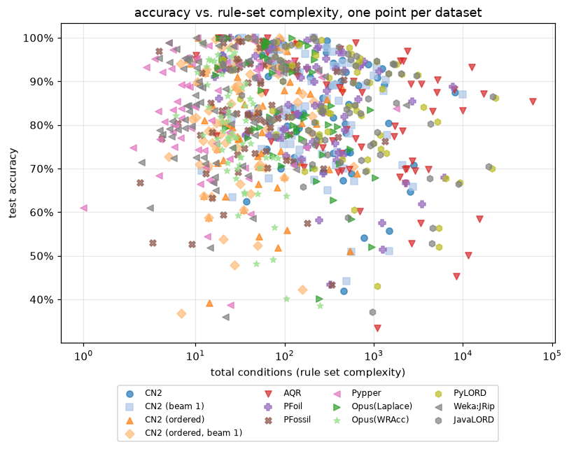
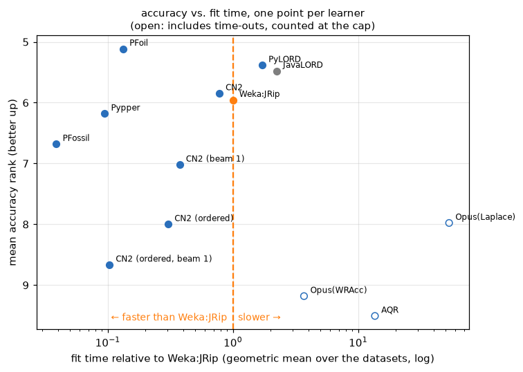
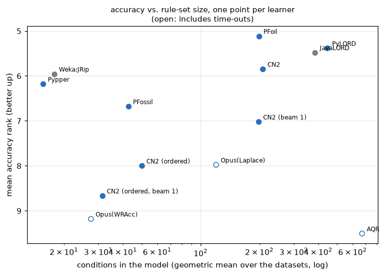
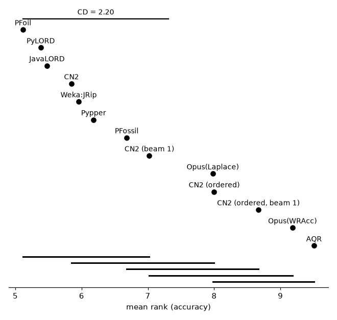

# Separate-and-conquer rule learners compared

## Setup

**Full run** (69 datasets). Quick sanity check instead: `python demos/seco_learners_comparison.py` with no arguments.

pyrulearn's separate-and-conquer rule learners compared with each other
and with two external baselines, on 44 two-class and
25 multi-class datasets from `pyrulearn.experiments.catalog` -- the
datasets of the other comparisons. All but the two LORDs learn one rule at a
time and remove the examples it covers; they differ in how a rule is searched
for, when it stops, and whether and how the rule set is pruned. The LORDs, which
learn a locally optimal rule per training example, are included as a reference
point. Every learner runs with its default settings, including its default way
of handling several classes; the variants of CN2 and Opus are named after
what differs.

- **CN2** -- Clark & Boswell's (1991) CN2: beam search (width 5) with the Laplace estimate; CN2's likelihood-ratio significance test, of the rule's class against the rest, filters the rules a search can return. Rules for every class (one-vs-rest rule set).
- **CN2 (beam 1)** -- The same with a beam of width 1.
- **CN2 (ordered)** -- Clark & Niblett's (1989) original CN2: one decision list over all classes, each rule predicting the majority of the examples it covers; beam search (width 5) with the entropy of the covered class distribution, and the significance test of that distribution over all classes (`LikelihoodRatioTest`).
- **CN2 (ordered, beam 1)** -- The same with a beam of width 1.
- **AQR** -- Clark & Niblett's (1989) AQ: each rule grown from a seed example by beam search over the seed's generalizations, ranked by the positives covered (then the negatives, then the length); only consistent rules are accepted. Rules for every class.
- **PFoil** -- FOIL: greedy search that adds the condition with the highest FOIL gain; Quinlan's encoding-length restriction stops rules that cost more bits than the examples they explain. Rules for every class.
- **PFossil** -- FOSSIL: hill climbing on the correlation between rule and class; rules below a correlation of 0.3 are dropped. Rules for every class.
- **Pypper** -- pyrulearn's RIPPER: grow on two thirds of the data, prune on the rest (IREP*), then optimize the rule set (replace/revise). Rules for the classes from least to most frequent, the most frequent one as default.
- **Opus(Laplace)** -- Opus: in every covering step the rule with the highest Laplace estimate among all conjunctions of up to 3 conditions, found by exhaustive branch-and-bound search (OPUS) -- Webb's setting, the rule CN2's beam search approximates. Rules for every class.
- **Opus(WRAcc)** -- The same with weighted relative accuracy, which prefers more general rules.
- **PyLORD** -- A simplified LORD: for every training example, the best rule covering it (greedy m-estimate search, then pruning); a test example is classified by the best rule that covers it. Many overlapping rules; not a covering algorithm.
- **Weka:JRip** -- Weka's RIPPER, run as a subprocess on the same binarized data. Fit time includes the JVM start. The unit of the run times.
- **JavaLORD** -- The reference LORD implementation (Java), run as a subprocess on the same binarized data, and, in this demo only, on a single thread: by default it uses half the machine's cores, which no other learner here does.

AQR, Opus(Laplace), Opus(WRAcc) are optional and take most of a full run's time: a run reports them from the cache of the last run with `--slow`, the only one that starts them.

Protocol: 10-fold stratified cross-validation
(`pyrulearn.experiments.runner.run_cv`), one `DataSpec` per training fold
(`build_dataspec(discretizer=TreeDiscretizer(max_intervals=8))`), the test fold binarized
against that same `DataSpec` -- every learner sees the identical binary
features per fold (as vertical bitmaps, the library's default representation; the learners
that need the dense matrix convert them). Each fit is capped at 900s (3600s for `letter`); a
time-out or an error counts as a failure (and as last in the ranking),
not as the end of the run. Which learners get through the larger datasets
at all is part of the result.

Every learner runs single-threaded; the reference Java LORD, which by default uses half the machine's cores, is limited to one thread here (`thread_count=1`, for this comparison only). Fits run 10 at a time (`run_cv`'s `n_jobs`), each in its own process and timed there, with the numerical libraries limited to one thread (`OMP_NUM_THREADS=1` and its relatives). A check of the `dense_vs_modular` learners on 11 datasets found the fit times of 5 concurrent fits as close to a sequential run as a second sequential run (per-learner ratios and rankings alike); time ratios between learners are reproducible to about +-10% either way.

A fold that times out fails the whole cross-validation of that learner on that dataset (`run_cv`'s `stop_on_timeout`): its remaining folds are not run, and all its folds count as failures, so no mean rests on just the folds that finished.

Measures: test accuracy, number of rules and conditions, fit time. Fit
times are given relative to Weka:JRip's: per dataset, a learner's mean fit
time divided by Weka:JRip's, and the geometric mean of these ratios over
the datasets (`time_ratios`). With a geometric mean, the ratio between any
two learners doesn't depend on the reference, which only sets the unit
(note that Weka:JRip's times include starting the JVM, which dominates on
the small datasets). A dataset a learner timed out on counts at the cap,
and its ratio is then a lower bound (marked ≥).

## Summary by learner (mean across the 69 datasets and their folds)

| learner | accuracy | n_rules | n_conditions | conds/rule | time (x Weka:JRip) | wins | mean rank | failures |
|---|--:|--:|--:|--:|--:|--:|--:|--:|
| PFoil | 84.38% | 99.0 | 571.5 | 4.0 | 0.133 | 14.2 | 5.12 | 0 |
| PyLORD | 84.29% | 264.0 | 1651.8 | 4.4 | 1.71 | 4.3 | 5.38 | 0 |
| JavaLORD | 83.67% | 258.1 | 1448.2 | 3.9 | 2.24 | 5.4 | 5.48 | 0 |
| CN2 | 83.90% | 120.2 | 502.7 | 3.3 | 0.779 | 5.7 | 5.85 | 0 |
| Weka:JRip | 83.08% | 14.9 | 65.4 | 3.0 | 1 | 10.2 | 5.96 | 0 |
| Pypper | 83.29% | 13.1 | 56.1 | 3.0 | 0.0947 | 6.2 | 6.18 | 0 |
| PFossil | 82.55% | 19.2 | 89.9 | 4.2 | 0.0389 | 5.2 | 6.68 | 0 |
| CN2 (beam 1) | 82.84% | 121.5 | 511.4 | 3.2 | 0.376 | 4.9 | 7.02 | 0 |
| Opus(Laplace) | 83.28% | 69.5 | 202.6 | 2.8 | ≥ 53.3 | 2.9 | 7.98 | 170 |
| CN2 (ordered) | 80.94% | 49.8 | 89.4 | 1.5 | 0.304 | 2.8 | 8.00 | 0 |
| CN2 (ordered, beam 1) | 80.16% | 33.7 | 53.9 | 1.4 | 0.103 | 1.6 | 8.67 | 0 |
| Opus(WRAcc) | 78.58% | 12.8 | 34.7 | 2.6 | ≥ 3.7 | 2.2 | 9.18 | 10 |
| AQR | 81.01% | 88.3 | 3260.8 | 27.5 | ≥ 13.6 | 3.2 | 9.51 | 40 |

Sorted by mean rank. `wins` -- datasets where a learner's mean accuracy was (tied-for-)best, a tie split evenly; `mean rank` -- average accuracy rank across datasets, failures tied for last; `time (x Weka:JRip)` -- the geometric mean over the datasets of the fit time relative to Weka:JRip's, a lower bound (≥) if it includes time-outs, counted at the cap. Accuracy and sizes are means over successful fits only; `failures` counts the fits that timed out or raised.

Time-outs in the time ratios: AQR on 4 of 69 datasets, Opus(Laplace) on 17 of 69 datasets, Opus(WRAcc) on 1 of 69 datasets.

### Small datasets only (39, fewer than 1,000 examples)

`SPECT`, `anneal`, `audiology`, `balance-scale`, `blood-transfusion-service-center`, `breast-cancer`, `breast-w`, `climate-model-simulation-crashes`, `colic`, `credit-approval`, `cylinder-bands`, `diabetes`, `dresses-sales`, `ecoli`, `glass`, `hayes-roth`, `heart-c`, `heart-h`, `heart-statlog`, `hepatitis`, `ilpd`, `ionosphere`, `iris`, `kc2`, `lymph`, `molecular-biology_promoters`, `monks-problems-1`, `monks-problems-2`, `monks-problems-3`, `primary-tumor`, `sonar`, `soybean`, `tic-tac-toe`, `vehicle`, `vote`, `vowel`, `wdbc`, `wine`, `zoo`

| learner | accuracy | n_rules | n_conditions | conds/rule | time (x Weka:JRip) | wins | mean rank | failures |
|---|--:|--:|--:|--:|--:|--:|--:|--:|
| PFoil | 83.07% | 38.3 | 133.9 | 3.2 | 0.0928 | 6.0 | 5.40 | 0 |
| CN2 | 82.68% | 48.2 | 153.0 | 2.9 | 0.508 | 4.5 | 5.54 | 0 |
| PyLORD | 82.95% | 78.3 | 326.4 | 3.6 | 0.969 | 2.0 | 5.54 | 0 |
| CN2 (beam 1) | 81.61% | 49.3 | 150.0 | 2.7 | 0.271 | 4.6 | 6.29 | 0 |
| JavaLORD | 81.77% | 75.0 | 280.1 | 3.2 | 1.07 | 3.1 | 6.33 | 0 |
| Pypper | 81.31% | 5.9 | 15.6 | 2.4 | 0.0897 | 2.2 | 6.45 | 0 |
| Weka:JRip | 80.93% | 6.4 | 16.7 | 2.4 | 1 | 6.2 | 6.46 | 0 |
| PFossil | 81.22% | 17.6 | 62.7 | 3.5 | 0.0468 | 1.2 | 6.67 | 0 |
| Opus(Laplace) | 82.80% | 45.9 | 131.9 | 2.8 | ≥ 33.6 | 2.6 | 7.15 | 30 |
| CN2 (ordered) | 79.48% | 27.7 | 45.9 | 1.5 | 0.25 | 2.1 | 8.40 | 0 |
| Opus(WRAcc) | 78.88% | 10.2 | 26.7 | 2.6 | 2.63 | 1.2 | 8.55 | 0 |
| CN2 (ordered, beam 1) | 78.74% | 21.4 | 31.7 | 1.3 | 0.0916 | 1.0 | 8.86 | 0 |
| AQR | 79.46% | 33.1 | 725.5 | 18.2 | 5.95 | 2.0 | 9.36 | 0 |

### Medium datasets only (29, 1,000 to 10,000 examples)

`Titanic`, `banknote-authentication`, `car`, `churn`, `cmc`, `compas-two-years`, `credit-g`, `dna`, `heloc`, `kc1`, `kr-vs-kp`, `led24`, `mofn-3-7-10`, `mushroom`, `optdigits`, `ozone-level-8hr`, `pc1`, `pc3`, `pc4`, `phoneme`, `qsar-biodeg`, `segment`, `sick`, `solar-flare`, `spambase`, `splice`, `texture`, `wilt`, `yeast`

| learner | accuracy | n_rules | n_conditions | conds/rule | time (x Weka:JRip) | wins | mean rank | failures |
|---|--:|--:|--:|--:|--:|--:|--:|--:|
| JavaLORD | 86.13% | 416.9 | 2330.8 | 4.6 | 5.99 | 2.3 | 4.38 | 0 |
| PFoil | 86.00% | 146.8 | 914.3 | 5.0 | 0.219 | 7.3 | 4.88 | 0 |
| PyLORD | 86.02% | 423.4 | 2684.0 | 5.2 | 3.82 | 2.3 | 5.19 | 0 |
| Weka:JRip | 85.93% | 13.5 | 53.8 | 3.7 | 1 | 4.0 | 5.24 | 0 |
| Pypper | 85.95% | 12.5 | 50.5 | 3.6 | 0.103 | 4.0 | 5.76 | 0 |
| CN2 | 85.41% | 175.6 | 710.8 | 3.8 | 1.43 | 1.3 | 6.40 | 0 |
| PFossil | 84.55% | 17.1 | 83.9 | 5.0 | 0.0313 | 4.0 | 6.62 | 0 |
| CN2 (ordered) | 83.93% | 70.8 | 132.3 | 1.7 | 0.412 | 0.6 | 7.40 | 0 |
| CN2 (beam 1) | 84.34% | 165.9 | 672.8 | 3.7 | 0.599 | 0.3 | 8.14 | 0 |
| CN2 (ordered, beam 1) | 83.37% | 47.2 | 80.2 | 1.4 | 0.129 | 0.6 | 8.33 | 0 |
| Opus(Laplace) | 84.34% | 122.8 | 361.8 | 2.9 | ≥ 102 | 0.3 | 8.91 | 130 |
| AQR | 83.24% | 139.5 | 4921.7 | 40.6 | ≥ 42.8 | 1.3 | 9.83 | 40 |
| Opus(WRAcc) | 79.59% | 13.8 | 38.0 | 2.7 | ≥ 6.09 | 1.0 | 9.93 | 10 |

### Large datasets only (1, more than 10,000 examples)

`letter`

| learner | accuracy | n_rules | n_conditions | conds/rule | time (x Weka:JRip) | wins | mean rank | failures |
|---|--:|--:|--:|--:|--:|--:|--:|--:|
| PFoil | 88.78% | 1083.6 | 7693.0 | 7.1 | 0.0903 | 1.0 | 1.00 | 0 |
| CN2 | 87.47% | 1318.7 | 8107.2 | 6.1 | 0.265 | 0.0 | 2.00 | 0 |
| CN2 (beam 1) | 86.98% | 1647.9 | 9923.7 | 6.0 | 0.179 | 0.0 | 3.00 | 0 |
| JavaLORD | 86.48% | 2789.6 | 21405.2 | 7.7 | 2.33 | 0.0 | 4.00 | 0 |
| PyLORD | 86.15% | 2882.7 | 23407.3 | 8.1 | 0.643 | 0.0 | 5.00 | 0 |
| AQR | 85.45% | 962.2 | 60615.9 | 63.0 | 5.82 | 0.0 | 6.00 | 0 |
| Weka:JRip | 84.64% | 382.0 | 2302.6 | 6.0 | 1 | 0.0 | 7.00 | 0 |
| Pypper | 83.72% | 308.2 | 1796.0 | 5.8 | 0.0675 | 0.0 | 8.00 | 0 |
| PFossil | 76.22% | 142.3 | 1325.6 | 9.3 | 0.0156 | 0.0 | 9.00 | 0 |
| CN2 (ordered) | 51.02% | 303.5 | 544.0 | 1.8 | 0.0991 | 0.0 | 10.00 | 0 |
| CN2 (ordered, beam 1) | 42.18% | 121.0 | 159.8 | 1.3 | 0.0202 | 0.0 | 11.00 | 0 |
| Opus(WRAcc) | 38.54% | 83.6 | 250.5 | 3.0 | 1.13 | 0.0 | 12.00 | 0 |

## Mean accuracy by target type

| learner | two-class | multi-class |
|---|--:|--:|
| PFoil | 86.00% | 81.54% |
| PyLORD | 86.02% | 81.24% |
| JavaLORD | 85.71% | 80.07% |
| CN2 | 85.55% | 81.01% |
| Weka:JRip | 85.04% | 79.64% |
| Pypper | 85.03% | 80.25% |
| PFossil | 83.33% | 81.16% |
| CN2 (beam 1) | 84.37% | 80.13% |
| Opus(Laplace) | 86.01% | 78.52% |
| CN2 (ordered) | 84.12% | 75.34% |
| CN2 (ordered, beam 1) | 83.66% | 73.98% |
| Opus(WRAcc) | 82.48% | 71.86% |
| AQR | 81.95% | 79.49% |

## Per-dataset results, per learner (mean across folds)

| dataset | learner | accuracy | n_rules | n_conditions | fit_time |
|---|---|---|---|---|---|
| SPECT | AQR | 74.83% | 34.8 | 265.3 | 1.489 |
| SPECT | CN2 | 79.74% | 26.8 | 105.6 | 0.206 |
| SPECT | CN2 (beam 1) | 78.66% | 26.0 | 91.9 | 0.082 |
| SPECT | CN2 (ordered) | 76.82% | 16.8 | 31.4 | 0.055 |
| SPECT | CN2 (ordered, beam 1) | 75.98% | 12.1 | 21.6 | 0.021 |
| SPECT | JavaLORD | 84.30% | 60.9 | 253.9 | 0.216 |
| SPECT | Opus(Laplace) | 77.56% | 39.2 | 110.5 | 5.419 |
| SPECT | Opus(WRAcc) | 78.65% | 9.8 | 20.6 | 0.317 |
| SPECT | PFoil | 82.05% | 25.8 | 82.1 | 0.025 |
| SPECT | PFossil | 78.68% | 9.7 | 41.1 | 0.013 |
| SPECT | PyLORD | 83.93% | 61.7 | 276.2 | 0.371 |
| SPECT | Pypper | 80.11% | 1.0 | 5.7 | 0.055 |
| SPECT | Weka:JRip | 80.87% | 1.0 | 5.5 | 0.314 |
| Titanic | AQR | 69.52% | 152.2 | 2895.6 | 61.947 |
| Titanic | CN2 | 77.31% | 76.8 | 241.7 | 0.900 |
| Titanic | CN2 (beam 1) | 74.41% | 50.1 | 148.4 | 0.196 |
| Titanic | CN2 (ordered) | 78.38% | 31.0 | 55.3 | 0.209 |
| Titanic | CN2 (ordered, beam 1) | 77.85% | 17.6 | 25.1 | 0.046 |
| Titanic | JavaLORD | 78.38% | 234.3 | 1100.0 | 1.469 |
| Titanic | Opus(Laplace) | 79.68% | 132.6 | 388.6 | 54.970 |
| Titanic | Opus(WRAcc) | 78.23% | 9.8 | 25.5 | 1.275 |
| Titanic | PFoil | 78.76% | 107.7 | 479.4 | 0.193 |
| Titanic | PFossil | 77.77% | 5.1 | 11.4 | 0.012 |
| Titanic | PyLORD | 77.77% | 235.0 | 1169.1 | 3.710 |
| Titanic | Pypper | 79.76% | 2.6 | 6.0 | 0.054 |
| Titanic | Weka:JRip | 78.91% | 2.9 | 6.4 | 0.463 |
| anneal | AQR | 99.11% | 12.2 | 58.1 | 0.861 |
| anneal | CN2 | 98.77% | 33.9 | 88.0 | 0.219 |
| anneal | CN2 (beam 1) | 98.88% | 38.4 | 90.4 | 0.106 |
| anneal | CN2 (ordered) | 99.44% | 30.1 | 30.1 | 0.068 |
| anneal | CN2 (ordered, beam 1) | 99.44% | 30.1 | 30.1 | 0.054 |
| anneal | JavaLORD | 90.87% | 28.9 | 46.1 | 0.787 |
| anneal | Opus(Laplace) | 98.44% | 26.9 | 59.9 | 3.156 |
| anneal | Opus(WRAcc) | 97.44% | 11.9 | 23.7 | 0.377 |
| anneal | PFoil | 97.21% | 25.9 | 68.7 | 0.036 |
| anneal | PFossil | 99.22% | 17.8 | 30.5 | 0.023 |
| anneal | PyLORD | 98.44% | 47.0 | 144.5 | 0.619 |
| anneal | Pypper | 94.32% | 8.9 | 22.5 | 0.067 |
| anneal | Weka:JRip | 89.98% | 6.7 | 10.9 | 0.487 |
| audiology | AQR | 75.28% | 30.0 | 226.9 | 2.518 |
| audiology | CN2 | 72.53% | 31.2 | 127.2 | 0.475 |
| audiology | CN2 (beam 1) | 75.61% | 39.3 | 117.4 | 0.175 |
| audiology | CN2 (ordered) | 63.68% | 12.5 | 12.5 | 0.060 |
| audiology | CN2 (ordered, beam 1) | 63.68% | 12.5 | 12.5 | 0.038 |
| audiology | JavaLORD | 65.81% | 69.6 | 162.2 | 0.285 |
| audiology | Opus(Laplace) | 73.00% | 29.5 | 73.8 | 2.851 |
| audiology | Opus(WRAcc) | 72.63% | 25.6 | 62.2 | 1.314 |
| audiology | PFoil | 77.04% | 42.3 | 94.3 | 0.046 |
| audiology | PFossil | 77.89% | 43.3 | 115.2 | 0.050 |
| audiology | PyLORD | 69.39% | 72.0 | 168.5 | 0.199 |
| audiology | Pypper | 75.71% | 11.1 | 17.3 | 0.091 |
| audiology | Weka:JRip | 74.84% | 14.7 | 26.2 | 0.445 |
| balance-scale | AQR | 75.02% | 73.4 | 729.3 | 2.424 |
| balance-scale | CN2 | 78.22% | 136.3 | 488.5 | 0.727 |
| balance-scale | CN2 (beam 1) | 78.05% | 149.0 | 528.3 | 0.437 |
| balance-scale | CN2 (ordered) | 80.31% | 85.7 | 228.8 | 0.435 |
| balance-scale | CN2 (ordered, beam 1) | 78.05% | 76.6 | 205.3 | 0.174 |
| balance-scale | JavaLORD | 82.86% | 130.6 | 533.1 | 0.573 |
| balance-scale | Opus(Laplace) | 80.16% | 103.5 | 310.1 | 34.476 |
| balance-scale | Opus(WRAcc) | 72.77% | 11.6 | 32.6 | 0.936 |
| balance-scale | PFoil | 82.87% | 72.7 | 272.8 | 0.090 |
| balance-scale | PFossil | 81.60% | 26.0 | 84.5 | 0.035 |
| balance-scale | PyLORD | 83.35% | 134.6 | 642.8 | 0.641 |
| balance-scale | Pypper | 78.38% | 7.9 | 23.8 | 0.066 |
| balance-scale | Weka:JRip | 80.31% | 8.1 | 25.2 | 0.415 |
| banknote-authentication | AQR | 98.54% | 17.1 | 137.1 | 1.114 |
| banknote-authentication | CN2 | 98.76% | 27.8 | 71.9 | 0.192 |
| banknote-authentication | CN2 (beam 1) | 97.23% | 32.9 | 82.8 | 0.096 |
| banknote-authentication | CN2 (ordered) | 98.98% | 37.7 | 63.2 | 0.147 |
| banknote-authentication | CN2 (ordered, beam 1) | 98.69% | 33.2 | 51.7 | 0.070 |
| banknote-authentication | JavaLORD | 99.05% | 26.8 | 75.0 | 0.407 |
| banknote-authentication | Opus(Laplace) | 98.83% | 23.9 | 63.8 | 0.968 |
| banknote-authentication | Opus(WRAcc) | 96.21% | 7.6 | 17.9 | 0.110 |
| banknote-authentication | PFoil | 98.40% | 25.7 | 77.8 | 0.040 |
| banknote-authentication | PFossil | 99.20% | 14.0 | 32.8 | 0.022 |
| banknote-authentication | PyLORD | 99.05% | 27.7 | 80.9 | 1.033 |
| banknote-authentication | Pypper | 98.47% | 5.2 | 12.2 | 0.042 |
| banknote-authentication | Weka:JRip | 98.91% | 5.3 | 12.0 | 0.414 |
| blood-transfusion-service-center | AQR | 69.92% | 42.8 | 531.0 | 21.256 |
| blood-transfusion-service-center | CN2 | 77.26% | 29.4 | 78.4 | 0.337 |
| blood-transfusion-service-center | CN2 (beam 1) | 78.19% | 25.8 | 67.2 | 0.105 |
| blood-transfusion-service-center | CN2 (ordered) | 77.39% | 16.2 | 29.8 | 0.095 |
| blood-transfusion-service-center | CN2 (ordered, beam 1) | 77.94% | 12.1 | 19.3 | 0.032 |
| blood-transfusion-service-center | JavaLORD | 76.61% | 78.5 | 228.9 | 0.297 |
| blood-transfusion-service-center | Opus(Laplace) | 76.87% | 56.2 | 154.5 | 2.651 |
| blood-transfusion-service-center | Opus(WRAcc) | 76.47% | 11.6 | 23.6 | 0.191 |
| blood-transfusion-service-center | PFoil | 76.07% | 57.4 | 208.1 | 0.076 |
| blood-transfusion-service-center | PFossil | 76.86% | 1.9 | 4.2 | 0.005 |
| blood-transfusion-service-center | PyLORD | 76.61% | 78.8 | 254.8 | 1.788 |
| blood-transfusion-service-center | Pypper | 78.33% | 2.0 | 5.6 | 0.025 |
| blood-transfusion-service-center | Weka:JRip | 79.14% | 2.0 | 5.1 | 0.353 |
| breast-cancer | AQR | 60.21% | 37.1 | 696.3 | 2.950 |
| breast-cancer | CN2 | 69.93% | 35.0 | 91.0 | 0.166 |
| breast-cancer | CN2 (beam 1) | 69.57% | 8.4 | 11.7 | 0.017 |
| breast-cancer | CN2 (ordered) | 71.96% | 11.7 | 20.7 | 0.082 |
| breast-cancer | CN2 (ordered, beam 1) | 72.67% | 5.0 | 5.0 | 0.010 |
| breast-cancer | JavaLORD | 71.37% | 92.7 | 417.9 | 0.287 |
| breast-cancer | Opus(Laplace) | 67.18% | 78.4 | 227.0 | 37.338 |
| breast-cancer | Opus(WRAcc) | 71.34% | 7.9 | 22.9 | 1.577 |
| breast-cancer | PFoil | 72.02% | 43.2 | 156.8 | 0.048 |
| breast-cancer | PFossil | 69.26% | 7.4 | 30.0 | 0.013 |
| breast-cancer | PyLORD | 72.04% | 93.9 | 447.1 | 0.349 |
| breast-cancer | Pypper | 74.84% | 1.0 | 2.0 | 0.020 |
| breast-cancer | Weka:JRip | 71.37% | 1.3 | 2.5 | 0.323 |
| breast-w | AQR | 94.71% | 8.1 | 129.0 | 3.435 |
| breast-w | CN2 | 94.42% | 37.1 | 69.7 | 0.117 |
| breast-w | CN2 (beam 1) | 94.99% | 42.7 | 77.8 | 0.080 |
| breast-w | CN2 (ordered) | 94.85% | 29.2 | 30.5 | 0.104 |
| breast-w | CN2 (ordered, beam 1) | 94.99% | 28.4 | 28.4 | 0.068 |
| breast-w | JavaLORD | 94.85% | 39.0 | 88.2 | 1.041 |
| breast-w | Opus(Laplace) | 95.85% | 19.9 | 57.5 | 74.152 |
| breast-w | Opus(WRAcc) | 94.85% | 5.0 | 14.8 | 7.016 |
| breast-w | PFoil | 95.85% | 17.1 | 47.3 | 0.026 |
| breast-w | PFossil | 94.13% | 15.6 | 40.6 | 0.023 |
| breast-w | PyLORD | 94.85% | 38.4 | 91.2 | 0.565 |
| breast-w | Pypper | 95.57% | 3.9 | 8.1 | 0.031 |
| breast-w | Weka:JRip | 95.42% | 4.5 | 8.5 | 0.481 |
| car | AQR | 97.45% | 52.4 | 421.6 | 0.858 |
| car | CN2 | 94.91% | 82.1 | 440.2 | 0.448 |
| car | CN2 (beam 1) | 94.27% | 104.9 | 548.2 | 0.314 |
| car | CN2 (ordered) | 94.33% | 57.0 | 128.0 | 0.312 |
| car | CN2 (ordered, beam 1) | 91.72% | 38.8 | 84.1 | 0.105 |
| car | JavaLORD | 95.83% | 104.1 | 637.1 | 1.281 |
| car | Opus(Laplace) | 92.07% | 42.0 | 121.5 | 4.565 |
| car | Opus(WRAcc) | 81.94% | 8.0 | 19.0 | 0.110 |
| car | PFoil | 96.70% | 75.4 | 449.1 | 0.161 |
| car | PFossil | 93.87% | 16.2 | 59.1 | 0.035 |
| car | PyLORD | 95.37% | 106.2 | 697.2 | 1.477 |
| car | Pypper | 94.56% | 23.2 | 118.9 | 0.245 |
| car | Weka:JRip | 94.33% | 18.2 | 90.1 | 0.601 |
| churn | AQR | 87.16% | 231.0 | 17012.7 | 324.436 |
| churn | CN2 | 89.20% | 316.9 | 1307.3 | 3.774 |
| churn | CN2 (beam 1) | 87.76% | 312.7 | 1298.6 | 2.554 |
| churn | CN2 (ordered) | 89.96% | 67.4 | 115.1 | 1.612 |
| churn | CN2 (ordered, beam 1) | 89.22% | 27.4 | 30.6 | 0.182 |
| churn | JavaLORD | 91.30% | 526.9 | 3038.7 | 50.139 |
| churn | Opus(Laplace) | n/a | n/a | n/a | 900.099 |
| churn | Opus(WRAcc) | 89.50% | 12.3 | 36.7 | 27.391 |
| churn | PFoil | 92.36% | 178.2 | 1153.7 | 0.799 |
| churn | PFossil | 90.00% | 9.2 | 53.6 | 0.052 |
| churn | PyLORD | 91.54% | 535.3 | 3139.6 | 10.626 |
| churn | Pypper | 93.92% | 10.6 | 30.8 | 0.197 |
| churn | Weka:JRip | 93.96% | 11.1 | 33.0 | 2.372 |
| climate-model-simulation-crashes | AQR | 89.26% | 12.5 | 292.5 | 5.619 |
| climate-model-simulation-crashes | CN2 | 92.41% | 38.7 | 91.7 | 0.156 |
| climate-model-simulation-crashes | CN2 (beam 1) | 91.85% | 38.9 | 88.4 | 0.093 |
| climate-model-simulation-crashes | CN2 (ordered) | 92.04% | 12.9 | 12.9 | 0.036 |
| climate-model-simulation-crashes | CN2 (ordered, beam 1) | 92.04% | 12.9 | 12.9 | 0.033 |
| climate-model-simulation-crashes | JavaLORD | 93.33% | 32.9 | 91.6 | 0.779 |
| climate-model-simulation-crashes | Opus(Laplace) | 92.04% | 25.6 | 72.7 | 27.378 |
| climate-model-simulation-crashes | Opus(WRAcc) | 91.67% | 7.2 | 19.7 | 2.659 |
| climate-model-simulation-crashes | PFoil | 93.33% | 19.2 | 53.1 | 0.024 |
| climate-model-simulation-crashes | PFossil | 92.78% | 8.9 | 28.5 | 0.014 |
| climate-model-simulation-crashes | PyLORD | 93.15% | 32.7 | 91.7 | 0.420 |
| climate-model-simulation-crashes | Pypper | 94.07% | 2.9 | 9.2 | 0.027 |
| climate-model-simulation-crashes | Weka:JRip | 94.81% | 2.7 | 8.1 | 0.422 |
| cmc | AQR | 45.22% | 383.5 | 8423.8 | 46.790 |
| cmc | CN2 | 54.11% | 183.2 | 777.2 | 1.719 |
| cmc | CN2 (beam 1) | 50.99% | 138.0 | 566.0 | 0.538 |
| cmc | CN2 (ordered) | 51.94% | 43.7 | 84.2 | 0.321 |
| cmc | CN2 (ordered, beam 1) | 47.80% | 19.2 | 27.5 | 0.052 |
| cmc | JavaLORD | 52.76% | 651.9 | 4472.5 | 2.583 |
| cmc | Opus(Laplace) | 52.08% | 317.1 | 946.3 | 214.861 |
| cmc | Opus(WRAcc) | 48.13% | 16.5 | 47.9 | 3.408 |
| cmc | PFoil | 51.40% | 211.0 | 1266.9 | 0.445 |
| cmc | PFossil | 52.61% | 2.1 | 9.2 | 0.013 |
| cmc | PyLORD | 52.08% | 662.7 | 5357.8 | 4.302 |
| cmc | Pypper | 54.52% | 4.2 | 13.5 | 0.104 |
| cmc | Weka:JRip | 51.94% | 3.6 | 14.5 | 0.522 |
| colic | AQR | 76.36% | 28.8 | 342.2 | 2.795 |
| colic | CN2 | 82.91% | 65.0 | 161.6 | 0.216 |
| colic | CN2 (beam 1) | 82.09% | 49.2 | 105.4 | 0.101 |
| colic | CN2 (ordered) | 76.68% | 23.0 | 30.1 | 0.143 |
| colic | CN2 (ordered, beam 1) | 78.55% | 15.8 | 15.8 | 0.038 |
| colic | JavaLORD | 78.26% | 74.5 | 205.9 | 0.484 |
| colic | Opus(Laplace) | 82.35% | 59.7 | 174.1 | 120.190 |
| colic | Opus(WRAcc) | 86.70% | 9.5 | 22.8 | 2.116 |
| colic | PFoil | 84.52% | 38.5 | 110.0 | 0.042 |
| colic | PFossil | 82.89% | 19.8 | 50.7 | 0.022 |
| colic | PyLORD | 83.45% | 85.0 | 250.7 | 0.314 |
| colic | Pypper | 83.72% | 3.0 | 7.0 | 0.032 |
| colic | Weka:JRip | 84.50% | 3.4 | 8.4 | 0.380 |
| compas-two-years | AQR | 58.47% | 479.0 | 15393.2 | 670.084 |
| compas-two-years | CN2 | 67.28% | 135.9 | 452.7 | 2.083 |
| compas-two-years | CN2 (beam 1) | 64.97% | 96.8 | 305.4 | 0.707 |
| compas-two-years | CN2 (ordered) | 66.48% | 34.3 | 51.0 | 0.450 |
| compas-two-years | CN2 (ordered, beam 1) | 66.50% | 25.8 | 31.6 | 0.182 |
| compas-two-years | JavaLORD | 67.71% | 828.2 | 4266.9 | 10.006 |
| compas-two-years | Opus(Laplace) | 67.87% | 353.6 | 1043.9 | 288.830 |
| compas-two-years | Opus(WRAcc) | 64.17% | 17.7 | 50.1 | 6.183 |
| compas-two-years | PFoil | 66.65% | 330.8 | 2313.9 | 1.448 |
| compas-two-years | PFossil | 52.96% | 1.0 | 3.3 | 0.018 |
| compas-two-years | PyLORD | 67.81% | 828.8 | 6483.5 | 34.827 |
| compas-two-years | Pypper | 67.03% | 4.8 | 15.5 | 0.203 |
| compas-two-years | Weka:JRip | 68.00% | 6.0 | 16.6 | 1.558 |
| credit-approval | AQR | 77.39% | 49.1 | 1695.5 | 16.548 |
| credit-approval | CN2 | 86.23% | 92.1 | 270.0 | 0.563 |
| credit-approval | CN2 (beam 1) | 84.35% | 64.2 | 171.2 | 0.190 |
| credit-approval | CN2 (ordered) | 83.04% | 29.3 | 47.7 | 0.283 |
| credit-approval | CN2 (ordered, beam 1) | 83.33% | 14.1 | 14.1 | 0.031 |
| credit-approval | JavaLORD | 83.62% | 126.5 | 499.1 | 0.858 |
| credit-approval | Opus(Laplace) | 84.49% | 112.3 | 330.0 | 230.926 |
| credit-approval | Opus(WRAcc) | 84.78% | 8.6 | 24.8 | 3.831 |
| credit-approval | PFoil | 84.49% | 57.5 | 220.2 | 0.082 |
| credit-approval | PFossil | 82.17% | 8.8 | 38.9 | 0.018 |
| credit-approval | PyLORD | 84.20% | 127.8 | 525.7 | 0.736 |
| credit-approval | Pypper | 85.36% | 2.7 | 6.3 | 0.034 |
| credit-approval | Weka:JRip | 84.78% | 4.2 | 10.1 | 0.416 |
| credit-g | AQR | 68.10% | 60.9 | 1949.4 | 21.960 |
| credit-g | CN2 | 73.70% | 187.5 | 539.3 | 0.982 |
| credit-g | CN2 (beam 1) | 70.80% | 137.0 | 375.0 | 0.526 |
| credit-g | CN2 (ordered) | 71.40% | 78.8 | 153.3 | 0.902 |
| credit-g | CN2 (ordered, beam 1) | 70.90% | 33.7 | 52.9 | 0.089 |
| credit-g | JavaLORD | 75.70% | 257.7 | 982.3 | 1.914 |
| credit-g | Opus(Laplace) | n/a | n/a | n/a | 900.096 |
| credit-g | Opus(WRAcc) | 72.60% | 10.7 | 31.7 | 24.868 |
| credit-g | PFoil | 73.10% | 94.4 | 450.0 | 0.175 |
| credit-g | PFossil | 73.20% | 3.4 | 29.3 | 0.016 |
| credit-g | PyLORD | 75.80% | 257.9 | 994.7 | 1.245 |
| credit-g | Pypper | 70.40% | 3.4 | 13.0 | 0.061 |
| credit-g | Weka:JRip | 71.20% | 3.6 | 12.9 | 0.531 |
| cylinder-bands | AQR | 70.00% | 25.2 | 2332.2 | 134.522 |
| cylinder-bands | CN2 | 71.67% | 88.3 | 140.6 | 0.424 |
| cylinder-bands | CN2 (beam 1) | 72.59% | 92.6 | 142.7 | 0.347 |
| cylinder-bands | CN2 (ordered) | 70.56% | 50.6 | 50.6 | 0.283 |
| cylinder-bands | CN2 (ordered, beam 1) | 70.56% | 50.6 | 50.6 | 0.263 |
| cylinder-bands | JavaLORD | 73.15% | 130.0 | 303.4 | 1.134 |
| cylinder-bands | Opus(Laplace) | n/a | n/a | n/a | 900.140 |
| cylinder-bands | Opus(WRAcc) | 69.44% | 7.9 | 22.6 | 124.488 |
| cylinder-bands | PFoil | 75.00% | 48.8 | 180.6 | 0.089 |
| cylinder-bands | PFossil | 70.19% | 9.4 | 64.3 | 0.031 |
| cylinder-bands | PyLORD | 78.52% | 127.9 | 305.8 | 0.579 |
| cylinder-bands | Pypper | 66.48% | 3.7 | 11.4 | 0.060 |
| cylinder-bands | Weka:JRip | 65.00% | 6.1 | 16.8 | 0.614 |
| diabetes | AQR | 69.79% | 94.3 | 2259.8 | 14.372 |
| diabetes | CN2 | 73.57% | 106.6 | 352.0 | 0.808 |
| diabetes | CN2 (beam 1) | 73.44% | 86.8 | 262.3 | 0.259 |
| diabetes | CN2 (ordered) | 73.95% | 48.2 | 89.9 | 0.364 |
| diabetes | CN2 (ordered, beam 1) | 74.87% | 21.5 | 29.7 | 0.043 |
| diabetes | JavaLORD | 75.26% | 196.2 | 917.0 | 1.052 |
| diabetes | Opus(Laplace) | 74.48% | 181.8 | 541.9 | 187.637 |
| diabetes | Opus(WRAcc) | 70.84% | 10.8 | 31.3 | 2.225 |
| diabetes | PFoil | 75.77% | 81.1 | 371.0 | 0.126 |
| diabetes | PFossil | 74.61% | 9.1 | 35.5 | 0.018 |
| diabetes | PyLORD | 74.48% | 219.8 | 1200.8 | 1.044 |
| diabetes | Pypper | 74.22% | 3.8 | 12.6 | 0.048 |
| diabetes | Weka:JRip | 72.53% | 3.9 | 12.4 | 0.423 |
| dna | AQR | 87.54% | 56.5 | 735.8 | 14.122 |
| dna | CN2 | 89.11% | 153.6 | 675.6 | 1.861 |
| dna | CN2 (beam 1) | 89.14% | 190.0 | 820.3 | 1.014 |
| dna | CN2 (ordered) | 88.42% | 207.4 | 444.1 | 3.536 |
| dna | CN2 (ordered, beam 1) | 85.47% | 104.1 | 213.0 | 0.537 |
| dna | JavaLORD | 91.78% | 323.0 | 1471.8 | 58.536 |
| dna | Opus(Laplace) | n/a | n/a | n/a | 900.145 |
| dna | Opus(WRAcc) | 67.73% | 11.2 | 28.6 | 41.192 |
| dna | PFoil | 92.50% | 89.0 | 469.4 | 0.308 |
| dna | PFossil | 93.69% | 27.8 | 137.4 | 0.102 |
| dna | PyLORD | 91.78% | 320.8 | 1463.3 | 5.946 |
| dna | Pypper | 92.12% | 15.8 | 82.6 | 0.309 |
| dna | Weka:JRip | 91.96% | 17.3 | 97.4 | 2.816 |
| dresses-sales | AQR | 52.80% | 50.6 | 2678.8 | 50.964 |
| dresses-sales | CN2 | 62.40% | 24.2 | 37.1 | 0.110 |
| dresses-sales | CN2 (beam 1) | 63.40% | 22.0 | 26.1 | 0.084 |
| dresses-sales | CN2 (ordered) | 58.80% | 14.2 | 14.2 | 0.077 |
| dresses-sales | CN2 (ordered, beam 1) | 58.80% | 14.2 | 14.2 | 0.072 |
| dresses-sales | JavaLORD | 58.80% | 171.3 | 514.3 | 0.827 |
| dresses-sales | Opus(Laplace) | n/a | n/a | n/a | 900.110 |
| dresses-sales | Opus(WRAcc) | 59.20% | 10.4 | 30.0 | 55.886 |
| dresses-sales | PFoil | 58.20% | 67.1 | 243.2 | 0.100 |
| dresses-sales | PFossil | 59.40% | 2.2 | 20.4 | 0.013 |
| dresses-sales | PyLORD | 60.60% | 190.3 | 607.5 | 0.606 |
| dresses-sales | Pypper | 61.00% | 0.9 | 1.0 | 0.021 |
| dresses-sales | Weka:JRip | 61.00% | 1.9 | 3.1 | 0.444 |
| ecoli | AQR | 78.97% | 40.0 | 492.5 | 2.881 |
| ecoli | CN2 | 83.97% | 33.0 | 123.6 | 0.342 |
| ecoli | CN2 (beam 1) | 84.01% | 40.6 | 142.7 | 0.162 |
| ecoli | CN2 (ordered) | 79.47% | 17.0 | 25.9 | 0.102 |
| ecoli | CN2 (ordered, beam 1) | 76.45% | 12.2 | 12.2 | 0.020 |
| ecoli | JavaLORD | 83.39% | 69.6 | 268.6 | 0.253 |
| ecoli | Opus(Laplace) | 83.07% | 28.9 | 83.8 | 1.504 |
| ecoli | Opus(WRAcc) | 80.99% | 12.8 | 36.6 | 0.252 |
| ecoli | PFoil | 82.51% | 42.6 | 139.2 | 0.048 |
| ecoli | PFossil | 81.92% | 30.0 | 107.5 | 0.038 |
| ecoli | PyLORD | 82.80% | 70.0 | 307.7 | 0.404 |
| ecoli | Pypper | 81.01% | 7.6 | 15.2 | 0.051 |
| ecoli | Weka:JRip | 83.39% | 7.2 | 16.2 | 0.366 |
| glass | AQR | 69.57% | 28.7 | 436.7 | 4.006 |
| glass | CN2 | 71.08% | 38.0 | 131.0 | 0.388 |
| glass | CN2 (beam 1) | 71.99% | 45.0 | 158.9 | 0.205 |
| glass | CN2 (ordered) | 63.59% | 17.6 | 21.9 | 0.093 |
| glass | CN2 (ordered, beam 1) | 63.53% | 15.1 | 15.1 | 0.027 |
| glass | JavaLORD | 71.00% | 55.4 | 203.9 | 0.269 |
| glass | Opus(Laplace) | 70.58% | 31.9 | 92.1 | 6.041 |
| glass | Opus(WRAcc) | 64.57% | 11.9 | 35.4 | 1.173 |
| glass | PFoil | 72.94% | 34.6 | 104.6 | 0.038 |
| glass | PFossil | 71.97% | 31.2 | 104.5 | 0.037 |
| glass | PyLORD | 70.04% | 55.1 | 213.7 | 0.251 |
| glass | Pypper | 67.38% | 6.2 | 14.3 | 0.049 |
| glass | Weka:JRip | 66.84% | 6.6 | 16.1 | 0.363 |
| hayes-roth | AQR | 87.50% | 16.1 | 61.0 | 0.337 |
| hayes-roth | CN2 | 80.62% | 23.8 | 68.0 | 0.101 |
| hayes-roth | CN2 (beam 1) | 77.50% | 25.9 | 71.0 | 0.048 |
| hayes-roth | CN2 (ordered) | 80.62% | 12.5 | 22.0 | 0.036 |
| hayes-roth | CN2 (ordered, beam 1) | 80.62% | 11.5 | 20.0 | 0.017 |
| hayes-roth | JavaLORD | 81.88% | 32.9 | 119.9 | 0.131 |
| hayes-roth | Opus(Laplace) | 81.88% | 25.1 | 67.8 | 0.917 |
| hayes-roth | Opus(WRAcc) | 75.62% | 8.1 | 18.1 | 0.094 |
| hayes-roth | PFoil | 77.50% | 25.8 | 68.4 | 0.021 |
| hayes-roth | PFossil | 82.50% | 13.5 | 38.8 | 0.013 |
| hayes-roth | PyLORD | 81.88% | 32.8 | 119.7 | 0.150 |
| hayes-roth | Pypper | 84.38% | 6.1 | 9.6 | 0.026 |
| hayes-roth | Weka:JRip | 83.12% | 5.8 | 8.5 | 0.304 |
| heart-c | AQR | 73.59% | 25.2 | 438.6 | 2.944 |
| heart-c | CN2 | 82.22% | 51.7 | 148.4 | 0.217 |
| heart-c | CN2 (beam 1) | 77.60% | 46.7 | 121.3 | 0.108 |
| heart-c | CN2 (ordered) | 73.59% | 31.0 | 54.4 | 0.198 |
| heart-c | CN2 (ordered, beam 1) | 75.90% | 13.5 | 15.5 | 0.022 |
| heart-c | JavaLORD | 80.57% | 60.9 | 215.9 | 0.327 |
| heart-c | Opus(Laplace) | 78.57% | 46.0 | 136.6 | 33.390 |
| heart-c | Opus(WRAcc) | 76.89% | 8.2 | 23.3 | 1.367 |
| heart-c | PFoil | 78.92% | 29.6 | 100.0 | 0.033 |
| heart-c | PFossil | 79.54% | 18.2 | 69.4 | 0.024 |
| heart-c | PyLORD | 80.57% | 62.1 | 223.6 | 0.269 |
| heart-c | Pypper | 79.23% | 3.4 | 9.0 | 0.029 |
| heart-c | Weka:JRip | 81.23% | 3.4 | 7.6 | 0.347 |
| heart-h | AQR | 76.84% | 35.0 | 630.3 | 4.945 |
| heart-h | CN2 | 79.25% | 50.1 | 143.8 | 0.272 |
| heart-h | CN2 (beam 1) | 82.33% | 38.1 | 98.8 | 0.097 |
| heart-h | CN2 (ordered) | 79.92% | 18.4 | 24.0 | 0.089 |
| heart-h | CN2 (ordered, beam 1) | 78.59% | 14.2 | 14.2 | 0.024 |
| heart-h | JavaLORD | 75.51% | 60.9 | 219.0 | 0.340 |
| heart-h | Opus(Laplace) | 79.29% | 49.6 | 137.6 | 20.100 |
| heart-h | Opus(WRAcc) | 77.21% | 8.0 | 23.3 | 0.848 |
| heart-h | PFoil | 78.93% | 30.4 | 97.3 | 0.033 |
| heart-h | PFossil | 81.28% | 17.2 | 52.9 | 0.020 |
| heart-h | PyLORD | 77.89% | 62.6 | 244.8 | 0.286 |
| heart-h | Pypper | 76.82% | 1.8 | 4.0 | 0.019 |
| heart-h | Weka:JRip | 77.89% | 2.2 | 4.3 | 0.336 |
| heart-statlog | AQR | 69.26% | 22.7 | 397.9 | 2.760 |
| heart-statlog | CN2 | 78.52% | 47.7 | 134.1 | 0.208 |
| heart-statlog | CN2 (beam 1) | 75.56% | 39.4 | 97.4 | 0.088 |
| heart-statlog | CN2 (ordered) | 72.96% | 27.9 | 49.9 | 0.219 |
| heart-statlog | CN2 (ordered, beam 1) | 70.00% | 12.6 | 13.5 | 0.020 |
| heart-statlog | JavaLORD | 78.89% | 53.4 | 184.3 | 0.299 |
| heart-statlog | Opus(Laplace) | 80.00% | 42.2 | 125.4 | 26.808 |
| heart-statlog | Opus(WRAcc) | 80.74% | 8.2 | 23.4 | 1.220 |
| heart-statlog | PFoil | 77.04% | 26.5 | 84.7 | 0.028 |
| heart-statlog | PFossil | 80.74% | 17.6 | 60.3 | 0.021 |
| heart-statlog | PyLORD | 78.89% | 53.4 | 187.2 | 0.236 |
| heart-statlog | Pypper | 81.48% | 2.9 | 6.9 | 0.029 |
| heart-statlog | Weka:JRip | 79.26% | 3.4 | 7.6 | 0.334 |
| heloc | AQR | n/a | n/a | n/a | 900.070 |
| heloc | CN2 | 70.78% | 760.6 | 2784.1 | 12.747 |
| heloc | CN2 (beam 1) | 70.73% | 573.4 | 2085.3 | 7.195 |
| heloc | CN2 (ordered) | 69.85% | 165.4 | 312.6 | 7.903 |
| heloc | CN2 (ordered, beam 1) | 70.16% | 46.7 | 60.7 | 0.618 |
| heloc | JavaLORD | 70.51% | 3116.0 | 19300.0 | 302.991 |
| heloc | Opus(Laplace) | n/a | n/a | n/a | 900.120 |
| heloc | Opus(WRAcc) | 70.20% | 17.7 | 53.0 | 256.724 |
| heloc | PFoil | 67.84% | 739.2 | 6188.3 | 5.934 |
| heloc | PFossil | 68.83% | 2.0 | 13.2 | 0.045 |
| heloc | PyLORD | 69.94% | 3223.8 | 21252.2 | 62.003 |
| heloc | Pypper | 70.13% | 8.5 | 36.0 | 0.601 |
| heloc | Weka:JRip | 70.61% | 8.6 | 33.6 | 6.412 |
| hepatitis | AQR | 76.21% | 12.1 | 70.7 | 0.362 |
| hepatitis | CN2 | 82.67% | 22.2 | 51.1 | 0.073 |
| hepatitis | CN2 (beam 1) | 82.71% | 22.5 | 47.3 | 0.045 |
| hepatitis | CN2 (ordered) | 84.67% | 12.5 | 15.3 | 0.047 |
| hepatitis | CN2 (ordered, beam 1) | 81.46% | 9.3 | 9.3 | 0.015 |
| hepatitis | JavaLORD | 81.38% | 28.2 | 66.6 | 0.176 |
| hepatitis | Opus(Laplace) | 79.50% | 19.6 | 53.1 | 2.592 |
| hepatitis | Opus(WRAcc) | 80.75% | 7.4 | 20.3 | 0.332 |
| hepatitis | PFoil | 77.58% | 17.1 | 37.0 | 0.014 |
| hepatitis | PFossil | 78.75% | 15.0 | 38.6 | 0.014 |
| hepatitis | PyLORD | 83.38% | 29.8 | 73.0 | 0.096 |
| hepatitis | Pypper | 80.75% | 2.1 | 4.5 | 0.017 |
| hepatitis | Weka:JRip | 78.75% | 2.1 | 4.0 | 0.304 |
| ilpd | AQR | 66.69% | 65.4 | 2244.6 | 18.346 |
| ilpd | CN2 | 69.30% | 80.0 | 272.9 | 0.642 |
| ilpd | CN2 (beam 1) | 67.41% | 65.0 | 214.1 | 0.253 |
| ilpd | CN2 (ordered) | 70.33% | 32.5 | 55.5 | 0.290 |
| ilpd | CN2 (ordered, beam 1) | 70.65% | 13.7 | 14.0 | 0.028 |
| ilpd | JavaLORD | 71.87% | 159.2 | 726.7 | 0.803 |
| ilpd | Opus(Laplace) | 71.20% | 139.9 | 412.6 | 215.587 |
| ilpd | Opus(WRAcc) | 69.97% | 10.0 | 29.6 | 4.943 |
| ilpd | PFoil | 68.94% | 64.2 | 273.3 | 0.094 |
| ilpd | PFossil | 63.28% | 2.8 | 15.5 | 0.009 |
| ilpd | PyLORD | 72.04% | 162.6 | 850.1 | 0.724 |
| ilpd | Pypper | 68.45% | 1.2 | 3.9 | 0.023 |
| ilpd | Weka:JRip | 72.39% | 1.8 | 5.7 | 0.391 |
| ionosphere | AQR | 91.18% | 9.1 | 139.6 | 7.944 |
| ionosphere | CN2 | 91.17% | 27.1 | 64.9 | 0.164 |
| ionosphere | CN2 (beam 1) | 92.03% | 32.8 | 79.2 | 0.127 |
| ionosphere | CN2 (ordered) | 93.16% | 17.9 | 17.9 | 0.066 |
| ionosphere | CN2 (ordered, beam 1) | 93.16% | 17.9 | 17.9 | 0.062 |
| ionosphere | JavaLORD | 90.04% | 34.3 | 95.6 | 0.974 |
| ionosphere | Opus(Laplace) | 88.02% | 20.2 | 54.3 | 258.190 |
| ionosphere | Opus(WRAcc) | 89.18% | 6.0 | 13.5 | 7.621 |
| ionosphere | PFoil | 90.87% | 18.1 | 49.8 | 0.025 |
| ionosphere | PFossil | 89.75% | 13.6 | 38.9 | 0.020 |
| ionosphere | PyLORD | 90.04% | 34.2 | 95.7 | 0.399 |
| ionosphere | Pypper | 89.17% | 4.4 | 7.0 | 0.028 |
| ionosphere | Weka:JRip | 86.88% | 5.8 | 10.0 | 0.427 |
| iris | AQR | 92.67% | 6.2 | 26.0 | 0.088 |
| iris | CN2 | 92.67% | 8.7 | 20.0 | 0.027 |
| iris | CN2 (beam 1) | 93.33% | 12.3 | 28.5 | 0.020 |
| iris | CN2 (ordered) | 94.00% | 8.6 | 8.8 | 0.017 |
| iris | CN2 (ordered, beam 1) | 94.67% | 8.5 | 8.5 | 0.011 |
| iris | JavaLORD | 92.67% | 11.1 | 24.7 | 0.128 |
| iris | Opus(Laplace) | 93.33% | 7.9 | 17.9 | 0.049 |
| iris | Opus(WRAcc) | 94.67% | 4.8 | 8.8 | 0.018 |
| iris | PFoil | 92.67% | 8.9 | 20.4 | 0.008 |
| iris | PFossil | 92.00% | 5.8 | 11.8 | 0.006 |
| iris | PyLORD | 92.67% | 11.4 | 25.8 | 0.080 |
| iris | Pypper | 93.33% | 2.0 | 2.8 | 0.011 |
| iris | Weka:JRip | 95.33% | 2.5 | 3.9 | 0.299 |
| kc1 | AQR | n/a | n/a | n/a | 900.113 |
| kc1 | CN2 | 84.73% | 159.5 | 523.7 | 12.201 |
| kc1 | CN2 (beam 1) | 85.54% | 131.0 | 405.1 | 1.916 |
| kc1 | CN2 (ordered) | 84.73% | 29.6 | 35.1 | 0.325 |
| kc1 | CN2 (ordered, beam 1) | 84.92% | 25.2 | 25.2 | 0.104 |
| kc1 | JavaLORD | 85.16% | 375.5 | 1794.1 | 4.008 |
| kc1 | Opus(Laplace) | n/a | n/a | n/a | 900.103 |
| kc1 | Opus(WRAcc) | 84.45% | 12.2 | 35.8 | 29.899 |
| kc1 | PFoil | 85.87% | 130.9 | 669.1 | 0.356 |
| kc1 | PFossil | 83.31% | 3.5 | 19.7 | 0.020 |
| kc1 | PyLORD | 84.12% | 371.7 | 3622.7 | 14.151 |
| kc1 | Pypper | 84.07% | 2.6 | 9.9 | 0.053 |
| kc1 | Weka:JRip | 85.25% | 3.0 | 11.3 | 0.996 |
| kc2 | AQR | 78.72% | 39.8 | 2094.9 | 188.540 |
| kc2 | CN2 | 82.35% | 54.5 | 140.3 | 2.468 |
| kc2 | CN2 (beam 1) | 83.70% | 44.8 | 107.3 | 0.530 |
| kc2 | CN2 (ordered) | 80.63% | 18.1 | 20.2 | 0.108 |
| kc2 | CN2 (ordered, beam 1) | 80.44% | 17.3 | 17.3 | 0.046 |
| kc2 | JavaLORD | 82.94% | 89.4 | 259.1 | 0.704 |
| kc2 | Opus(Laplace) | 81.59% | 55.5 | 163.4 | 202.313 |
| kc2 | Opus(WRAcc) | 83.13% | 7.9 | 23.3 | 7.369 |
| kc2 | PFoil | 82.55% | 41.0 | 139.9 | 0.062 |
| kc2 | PFossil | 82.74% | 7.4 | 29.2 | 0.016 |
| kc2 | PyLORD | 82.74% | 89.1 | 325.8 | 2.373 |
| kc2 | Pypper | 83.50% | 2.2 | 5.6 | 0.026 |
| kc2 | Weka:JRip | 84.46% | 3.0 | 8.0 | 0.476 |
| kr-vs-kp | AQR | 98.87% | 39.3 | 631.3 | 2.189 |
| kr-vs-kp | CN2 | 99.34% | 68.6 | 295.9 | 0.377 |
| kr-vs-kp | CN2 (beam 1) | 96.72% | 80.8 | 342.9 | 0.272 |
| kr-vs-kp | CN2 (ordered) | 99.00% | 73.5 | 129.1 | 0.483 |
| kr-vs-kp | CN2 (ordered, beam 1) | 97.87% | 22.6 | 25.1 | 0.075 |
| kr-vs-kp | JavaLORD | 99.41% | 47.5 | 224.6 | 4.646 |
| kr-vs-kp | Opus(Laplace) | 98.90% | 54.8 | 155.9 | 26.102 |
| kr-vs-kp | Opus(WRAcc) | 93.96% | 8.0 | 20.0 | 0.733 |
| kr-vs-kp | PFoil | 99.34% | 40.8 | 178.8 | 0.105 |
| kr-vs-kp | PFossil | 99.37% | 14.5 | 56.7 | 0.041 |
| kr-vs-kp | PyLORD | 99.44% | 49.7 | 259.4 | 2.829 |
| kr-vs-kp | Pypper | 99.12% | 14.3 | 45.4 | 0.131 |
| kr-vs-kp | Weka:JRip | 99.31% | 14.6 | 46.2 | 0.726 |
| led24 | AQR | 57.47% | 390.6 | 3362.5 | 6.052 |
| led24 | CN2 | 64.66% | 321.4 | 2565.6 | 3.178 |
| led24 | CN2 (beam 1) | 65.91% | 337.4 | 2772.4 | 1.846 |
| led24 | CN2 (ordered) | 68.88% | 153.8 | 651.3 | 2.141 |
| led24 | CN2 (ordered, beam 1) | 70.56% | 126.5 | 592.2 | 0.761 |
| led24 | JavaLORD | 66.47% | 1066.6 | 8946.3 | 9.817 |
| led24 | Opus(Laplace) | 62.81% | 116.8 | 350.4 | 49.670 |
| led24 | Opus(WRAcc) | 63.69% | 40.8 | 103.9 | 0.841 |
| led24 | PFoil | 61.81% | 444.2 | 3508.9 | 1.331 |
| led24 | PFossil | 70.00% | 45.4 | 272.8 | 0.159 |
| led24 | PyLORD | 66.75% | 1091.7 | 9288.9 | 8.625 |
| led24 | Pypper | 70.88% | 30.9 | 125.4 | 0.405 |
| led24 | Weka:JRip | 69.81% | 29.9 | 134.0 | 1.015 |
| letter | AQR | 85.45% | 962.2 | 60615.9 | 836.489 |
| letter | CN2 | 87.47% | 1318.7 | 8107.2 | 38.068 |
| letter | CN2 (beam 1) | 86.98% | 1647.9 | 9923.7 | 25.758 |
| letter | CN2 (ordered) | 51.02% | 303.5 | 544.0 | 14.233 |
| letter | CN2 (ordered, beam 1) | 42.18% | 121.0 | 159.8 | 2.901 |
| letter | JavaLORD | 86.48% | 2789.6 | 21405.2 | 334.315 |
| letter | Opus(Laplace) | n/a | n/a | n/a | 3600.114 |
| letter | Opus(WRAcc) | 38.54% | 83.6 | 250.5 | 162.047 |
| letter | PFoil | 88.78% | 1083.6 | 7693.0 | 12.967 |
| letter | PFossil | 76.22% | 142.3 | 1325.6 | 2.241 |
| letter | PyLORD | 86.15% | 2882.7 | 23407.3 | 92.405 |
| letter | Pypper | 83.72% | 308.2 | 1796.0 | 9.698 |
| letter | Weka:JRip | 84.64% | 382.0 | 2302.6 | 143.663 |
| lymph | AQR | 82.43% | 12.2 | 128.7 | 0.816 |
| lymph | CN2 | 83.95% | 18.5 | 50.2 | 0.061 |
| lymph | CN2 (beam 1) | 74.52% | 23.9 | 55.8 | 0.044 |
| lymph | CN2 (ordered) | 81.10% | 11.4 | 12.7 | 0.040 |
| lymph | CN2 (ordered, beam 1) | 81.76% | 10.1 | 10.1 | 0.017 |
| lymph | JavaLORD | 81.05% | 26.9 | 72.9 | 0.193 |
| lymph | Opus(Laplace) | 79.14% | 17.0 | 45.7 | 4.944 |
| lymph | Opus(WRAcc) | 74.38% | 8.0 | 19.8 | 0.698 |
| lymph | PFoil | 82.57% | 17.1 | 40.5 | 0.016 |
| lymph | PFossil | 81.71% | 16.2 | 45.0 | 0.016 |
| lymph | PyLORD | 81.05% | 26.8 | 73.1 | 0.112 |
| lymph | Pypper | 77.05% | 3.1 | 6.8 | 0.023 |
| lymph | Weka:JRip | 79.86% | 4.6 | 9.2 | 0.331 |
| mofn-3-7-10 | AQR | 100.00% | 22.0 | 63.8 | 0.080 |
| mofn-3-7-10 | CN2 | 100.00% | 56.0 | 210.0 | 0.189 |
| mofn-3-7-10 | CN2 (beam 1) | 100.00% | 56.0 | 210.0 | 0.115 |
| mofn-3-7-10 | CN2 (ordered) | 100.00% | 38.6 | 90.1 | 0.138 |
| mofn-3-7-10 | CN2 (ordered, beam 1) | 100.00% | 37.2 | 87.7 | 0.079 |
| mofn-3-7-10 | JavaLORD | 100.00% | 56.0 | 210.0 | 0.570 |
| mofn-3-7-10 | Opus(Laplace) | 100.00% | 40.0 | 120.0 | 1.724 |
| mofn-3-7-10 | Opus(WRAcc) | 84.07% | 8.0 | 14.0 | 0.032 |
| mofn-3-7-10 | PFoil | 100.00% | 56.0 | 210.0 | 0.079 |
| mofn-3-7-10 | PFossil | 83.68% | 6.4 | 22.6 | 0.013 |
| mofn-3-7-10 | PyLORD | 100.00% | 56.0 | 210.0 | 1.211 |
| mofn-3-7-10 | Pypper | 95.16% | 14.6 | 69.7 | 0.135 |
| mofn-3-7-10 | Weka:JRip | 96.97% | 15.6 | 75.2 | 0.480 |
| molecular-biology_promoters | AQR | 77.55% | 5.1 | 17.1 | 0.178 |
| molecular-biology_promoters | CN2 | 83.00% | 11.9 | 22.7 | 0.045 |
| molecular-biology_promoters | CN2 (beam 1) | 81.18% | 13.4 | 25.5 | 0.036 |
| molecular-biology_promoters | CN2 (ordered) | 74.55% | 14.1 | 17.4 | 0.038 |
| molecular-biology_promoters | CN2 (ordered, beam 1) | 74.55% | 13.9 | 17.1 | 0.024 |
| molecular-biology_promoters | JavaLORD | 86.82% | 16.9 | 33.0 | 0.278 |
| molecular-biology_promoters | Opus(Laplace) | 79.36% | 8.0 | 21.7 | 28.626 |
| molecular-biology_promoters | Opus(WRAcc) | 77.64% | 4.7 | 12.2 | 2.562 |
| molecular-biology_promoters | PFoil | 86.09% | 9.0 | 18.6 | 0.009 |
| molecular-biology_promoters | PFossil | 82.27% | 7.4 | 19.7 | 0.009 |
| molecular-biology_promoters | PyLORD | 86.00% | 16.4 | 31.9 | 0.093 |
| molecular-biology_promoters | Pypper | 83.18% | 2.1 | 3.8 | 0.015 |
| molecular-biology_promoters | Weka:JRip | 77.45% | 2.5 | 5.4 | 0.350 |
| monks-problems-1 | AQR | 100.00% | 7.5 | 18.2 | 0.032 |
| monks-problems-1 | CN2 | 100.00% | 7.9 | 18.9 | 0.021 |
| monks-problems-1 | CN2 (beam 1) | 100.00% | 16.5 | 46.9 | 0.029 |
| monks-problems-1 | CN2 (ordered) | 100.00% | 7.6 | 10.8 | 0.020 |
| monks-problems-1 | CN2 (ordered, beam 1) | 99.64% | 9.4 | 17.0 | 0.021 |
| monks-problems-1 | JavaLORD | 100.00% | 8.3 | 20.1 | 0.231 |
| monks-problems-1 | Opus(Laplace) | 100.00% | 7.6 | 18.4 | 0.116 |
| monks-problems-1 | Opus(WRAcc) | 82.20% | 4.0 | 6.0 | 0.031 |
| monks-problems-1 | PFoil | 100.00% | 12.0 | 45.9 | 0.015 |
| monks-problems-1 | PFossil | 80.41% | 4.0 | 6.4 | 0.005 |
| monks-problems-1 | PyLORD | 98.02% | 20.7 | 106.1 | 0.512 |
| monks-problems-1 | Pypper | 95.30% | 3.6 | 10.3 | 0.020 |
| monks-problems-1 | Weka:JRip | 93.04% | 3.7 | 10.4 | 0.330 |
| monks-problems-2 | AQR | 87.51% | 63.8 | 443.1 | 0.584 |
| monks-problems-2 | CN2 | 90.02% | 84.6 | 427.2 | 0.403 |
| monks-problems-2 | CN2 (beam 1) | 70.05% | 91.6 | 457.9 | 0.291 |
| monks-problems-2 | CN2 (ordered) | 88.02% | 55.6 | 145.9 | 0.258 |
| monks-problems-2 | CN2 (ordered, beam 1) | 72.39% | 33.8 | 106.1 | 0.114 |
| monks-problems-2 | JavaLORD | 86.02% | 169.5 | 866.7 | 0.338 |
| monks-problems-2 | Opus(Laplace) | 70.21% | 68.9 | 206.1 | 7.145 |
| monks-problems-2 | Opus(WRAcc) | 74.71% | 11.4 | 26.6 | 0.505 |
| monks-problems-2 | PFoil | 97.50% | 49.3 | 232.1 | 0.063 |
| monks-problems-2 | PFossil | 66.72% | 0.4 | 2.4 | 0.004 |
| monks-problems-2 | PyLORD | 88.36% | 148.7 | 1236.4 | 0.945 |
| monks-problems-2 | Pypper | 72.22% | 4.4 | 24.2 | 0.052 |
| monks-problems-2 | Weka:JRip | 80.57% | 7.6 | 44.6 | 0.355 |
| monks-problems-3 | AQR | 96.57% | 17.5 | 63.8 | 0.182 |
| monks-problems-3 | CN2 | 97.84% | 23.0 | 77.6 | 0.100 |
| monks-problems-3 | CN2 (beam 1) | 97.30% | 27.6 | 87.0 | 0.055 |
| monks-problems-3 | CN2 (ordered) | 97.84% | 28.1 | 54.3 | 0.084 |
| monks-problems-3 | CN2 (ordered, beam 1) | 97.30% | 26.5 | 51.1 | 0.042 |
| monks-problems-3 | JavaLORD | 98.02% | 30.8 | 101.4 | 0.205 |
| monks-problems-3 | Opus(Laplace) | 97.84% | 22.2 | 61.0 | 0.548 |
| monks-problems-3 | Opus(WRAcc) | 98.92% | 5.9 | 11.7 | 0.022 |
| monks-problems-3 | PFoil | 97.66% | 20.8 | 65.0 | 0.023 |
| monks-problems-3 | PFossil | 98.92% | 6.8 | 20.7 | 0.010 |
| monks-problems-3 | PyLORD | 97.84% | 30.6 | 105.2 | 0.374 |
| monks-problems-3 | Pypper | 98.92% | 3.0 | 5.0 | 0.016 |
| monks-problems-3 | Weka:JRip | 98.92% | 3.0 | 5.0 | 0.319 |
| mushroom | AQR | 100.00% | 4.5 | 19.6 | 0.655 |
| mushroom | CN2 | 100.00% | 23.0 | 30.0 | 0.130 |
| mushroom | CN2 (beam 1) | 100.00% | 26.3 | 33.8 | 0.136 |
| mushroom | CN2 (ordered) | 99.96% | 43.3 | 43.3 | 0.353 |
| mushroom | CN2 (ordered, beam 1) | 99.96% | 43.3 | 43.3 | 0.334 |
| mushroom | JavaLORD | 100.00% | 23.0 | 38.7 | 38.769 |
| mushroom | Opus(Laplace) | 100.00% | 9.0 | 23.0 | 2.112 |
| mushroom | Opus(WRAcc) | 98.58% | 4.3 | 12.6 | 0.558 |
| mushroom | PFoil | 100.00% | 11.5 | 24.7 | 0.065 |
| mushroom | PFossil | 99.95% | 12.3 | 23.0 | 0.068 |
| mushroom | PyLORD | 100.00% | 23.0 | 38.7 | 5.474 |
| mushroom | Pypper | 99.96% | 5.2 | 10.6 | 0.082 |
| mushroom | Weka:JRip | 99.98% | 6.0 | 10.1 | 1.516 |
| optdigits | AQR | 90.44% | 69.8 | 5191.2 | 476.303 |
| optdigits | CN2 | 90.87% | 285.0 | 1100.9 | 5.043 |
| optdigits | CN2 (beam 1) | 90.34% | 372.7 | 1370.6 | 3.307 |
| optdigits | CN2 (ordered) | 68.01% | 98.3 | 98.5 | 1.385 |
| optdigits | CN2 (ordered, beam 1) | 67.97% | 98.8 | 98.8 | 1.264 |
| optdigits | JavaLORD | 91.83% | 495.2 | 2037.4 | 167.827 |
| optdigits | Opus(Laplace) | n/a | n/a | n/a | 900.143 |
| optdigits | Opus(WRAcc) | 72.47% | 28.5 | 84.5 | 553.018 |
| optdigits | PFoil | 93.35% | 138.8 | 692.5 | 0.863 |
| optdigits | PFossil | 90.30% | 81.3 | 457.4 | 0.569 |
| optdigits | PyLORD | 91.64% | 495.7 | 2047.4 | 17.554 |
| optdigits | Pypper | 91.09% | 61.2 | 256.4 | 1.243 |
| optdigits | Weka:JRip | 91.19% | 67.8 | 285.0 | 25.073 |
| ozone-level-8hr | AQR | n/a | n/a | n/a | 839.014 |
| ozone-level-8hr | CN2 | 93.57% | 149.9 | 379.1 | 1.727 |
| ozone-level-8hr | CN2 (beam 1) | 93.61% | 145.7 | 360.0 | 0.931 |
| ozone-level-8hr | CN2 (ordered) | 93.76% | 66.7 | 66.7 | 0.441 |
| ozone-level-8hr | CN2 (ordered, beam 1) | 93.76% | 66.7 | 66.7 | 0.427 |
| ozone-level-8hr | JavaLORD | 93.53% | 236.9 | 628.0 | 51.869 |
| ozone-level-8hr | Opus(Laplace) | n/a | n/a | n/a | 900.206 |
| ozone-level-8hr | Opus(WRAcc) | n/a | n/a | n/a | 900.167 |
| ozone-level-8hr | PFoil | 93.29% | 56.6 | 225.7 | 0.212 |
| ozone-level-8hr | PFossil | 93.33% | 2.9 | 31.2 | 0.033 |
| ozone-level-8hr | PyLORD | 93.69% | 236.5 | 627.0 | 4.357 |
| ozone-level-8hr | Pypper | 93.02% | 4.0 | 17.8 | 0.097 |
| ozone-level-8hr | Weka:JRip | 92.86% | 5.8 | 25.8 | 2.915 |
| pc1 | AQR | 89.45% | 55.8 | 3406.4 | 192.390 |
| pc1 | CN2 | 91.07% | 58.8 | 195.0 | 2.468 |
| pc1 | CN2 (beam 1) | 90.08% | 57.5 | 200.5 | 0.727 |
| pc1 | CN2 (ordered) | 92.79% | 13.3 | 13.3 | 0.070 |
| pc1 | CN2 (ordered, beam 1) | 92.79% | 13.3 | 13.3 | 0.065 |
| pc1 | JavaLORD | 92.16% | 117.9 | 442.5 | 1.596 |
| pc1 | Opus(Laplace) | 92.16% | 69.8 | 203.1 | 100.497 |
| pc1 | Opus(WRAcc) | 93.06% | 9.6 | 27.5 | 7.342 |
| pc1 | PFoil | 93.06% | 48.8 | 178.3 | 0.089 |
| pc1 | PFossil | 92.88% | 7.2 | 24.2 | 0.017 |
| pc1 | PyLORD | 92.16% | 120.5 | 653.7 | 4.934 |
| pc1 | Pypper | 92.88% | 1.8 | 5.4 | 0.026 |
| pc1 | Weka:JRip | 92.97% | 2.6 | 7.4 | 0.581 |
| pc3 | AQR | 88.10% | 71.1 | 7987.8 | 565.718 |
| pc3 | CN2 | 89.38% | 118.9 | 360.7 | 10.917 |
| pc3 | CN2 (beam 1) | 89.12% | 120.5 | 371.6 | 2.448 |
| pc3 | CN2 (ordered) | 88.80% | 28.1 | 28.1 | 0.154 |
| pc3 | CN2 (ordered, beam 1) | 88.80% | 28.1 | 28.1 | 0.139 |
| pc3 | JavaLORD | 89.83% | 233.9 | 836.4 | 7.548 |
| pc3 | Opus(Laplace) | n/a | n/a | n/a | 900.089 |
| pc3 | Opus(WRAcc) | 88.68% | 11.3 | 33.3 | 136.451 |
| pc3 | PFoil | 87.78% | 72.1 | 296.8 | 0.187 |
| pc3 | PFossil | 85.09% | 2.1 | 14.9 | 0.015 |
| pc3 | PyLORD | 89.76% | 236.1 | 897.4 | 3.275 |
| pc3 | Pypper | 88.74% | 2.1 | 8.6 | 0.047 |
| pc3 | Weka:JRip | 88.54% | 2.7 | 11.9 | 0.994 |
| pc4 | AQR | 87.51% | 48.9 | 5074.1 | 342.891 |
| pc4 | CN2 | 88.89% | 104.1 | 323.9 | 1.489 |
| pc4 | CN2 (beam 1) | 89.09% | 106.4 | 348.1 | 0.534 |
| pc4 | CN2 (ordered) | 87.79% | 31.1 | 31.1 | 0.141 |
| pc4 | CN2 (ordered, beam 1) | 87.79% | 31.1 | 31.1 | 0.129 |
| pc4 | JavaLORD | 89.78% | 166.1 | 586.8 | 7.009 |
| pc4 | Opus(Laplace) | n/a | n/a | n/a | 900.118 |
| pc4 | Opus(WRAcc) | 87.79% | 8.7 | 24.0 | 106.423 |
| pc4 | PFoil | 89.85% | 52.3 | 215.6 | 0.138 |
| pc4 | PFossil | 89.51% | 13.8 | 54.0 | 0.039 |
| pc4 | PyLORD | 89.71% | 166.6 | 595.6 | 2.059 |
| pc4 | Pypper | 88.00% | 4.1 | 17.8 | 0.073 |
| pc4 | Weka:JRip | 88.34% | 4.6 | 21.7 | 1.137 |
| phoneme | AQR | 83.25% | 411.9 | 9945.5 | 150.599 |
| phoneme | CN2 | 80.39% | 326.5 | 1459.0 | 4.477 |
| phoneme | CN2 (beam 1) | 77.74% | 299.6 | 1400.6 | 1.807 |
| phoneme | CN2 (ordered) | 83.16% | 109.9 | 273.7 | 1.271 |
| phoneme | CN2 (ordered, beam 1) | 81.96% | 81.9 | 203.2 | 0.520 |
| phoneme | JavaLORD | 80.22% | 771.5 | 4324.1 | 8.833 |
| phoneme | Opus(Laplace) | 83.51% | 308.4 | 921.6 | 266.196 |
| phoneme | Opus(WRAcc) | 75.80% | 15.0 | 41.3 | 2.173 |
| phoneme | PFoil | 85.33% | 394.7 | 2724.0 | 1.607 |
| phoneme | PFossil | 78.35% | 4.4 | 15.3 | 0.029 |
| phoneme | PyLORD | 80.75% | 774.0 | 5222.9 | 16.653 |
| phoneme | Pypper | 83.18% | 15.9 | 86.6 | 0.519 |
| phoneme | Weka:JRip | 83.81% | 16.7 | 86.5 | 1.825 |
| primary-tumor | AQR | 33.36% | 116.8 | 1086.4 | 2.972 |
| primary-tumor | CN2 | 41.89% | 85.8 | 456.6 | 0.866 |
| primary-tumor | CN2 (beam 1) | 44.25% | 94.0 | 492.4 | 0.456 |
| primary-tumor | CN2 (ordered) | 39.22% | 9.3 | 14.3 | 0.064 |
| primary-tumor | CN2 (ordered, beam 1) | 36.85% | 7.0 | 7.0 | 0.015 |
| primary-tumor | JavaLORD | 37.17% | 180.9 | 962.9 | 0.300 |
| primary-tumor | Opus(Laplace) | 40.13% | 81.5 | 242.7 | 4.865 |
| primary-tumor | Opus(WRAcc) | 40.12% | 36.0 | 105.2 | 0.984 |
| primary-tumor | PFoil | 43.35% | 99.1 | 329.0 | 0.113 |
| primary-tumor | PFossil | 43.38% | 66.3 | 341.1 | 0.110 |
| primary-tumor | PyLORD | 43.07% | 191.8 | 1090.7 | 0.653 |
| primary-tumor | Pypper | 38.66% | 8.6 | 24.8 | 0.113 |
| primary-tumor | Weka:JRip | 36.00% | 6.4 | 21.9 | 0.404 |
| qsar-biodeg | AQR | 83.13% | 52.5 | 4562.3 | 289.439 |
| qsar-biodeg | CN2 | 81.72% | 133.7 | 348.4 | 3.885 |
| qsar-biodeg | CN2 (beam 1) | 83.61% | 118.7 | 283.2 | 1.082 |
| qsar-biodeg | CN2 (ordered) | 84.46% | 53.9 | 56.6 | 0.371 |
| qsar-biodeg | CN2 (ordered, beam 1) | 83.80% | 51.8 | 51.8 | 0.180 |
| qsar-biodeg | JavaLORD | 84.65% | 190.0 | 613.8 | 3.691 |
| qsar-biodeg | Opus(Laplace) | n/a | n/a | n/a | 900.132 |
| qsar-biodeg | Opus(WRAcc) | 77.16% | 9.2 | 27.5 | 98.311 |
| qsar-biodeg | PFoil | 84.55% | 62.7 | 254.7 | 0.150 |
| qsar-biodeg | PFossil | 84.65% | 12.7 | 71.4 | 0.044 |
| qsar-biodeg | PyLORD | 84.46% | 189.5 | 619.6 | 1.588 |
| qsar-biodeg | Pypper | 83.22% | 5.2 | 21.8 | 0.079 |
| qsar-biodeg | Weka:JRip | 82.56% | 6.8 | 26.4 | 1.056 |
| segment | AQR | 94.63% | 57.3 | 2140.5 | 57.681 |
| segment | CN2 | 94.29% | 96.3 | 350.4 | 1.484 |
| segment | CN2 (beam 1) | 94.24% | 123.2 | 441.7 | 0.768 |
| segment | CN2 (ordered) | 92.94% | 70.4 | 114.7 | 0.931 |
| segment | CN2 (ordered, beam 1) | 91.73% | 36.3 | 40.8 | 0.127 |
| segment | JavaLORD | 95.06% | 128.5 | 548.1 | 4.523 |
| segment | Opus(Laplace) | 95.02% | 73.4 | 214.5 | 282.887 |
| segment | Opus(WRAcc) | 85.97% | 14.5 | 40.6 | 4.319 |
| segment | PFoil | 95.19% | 68.8 | 291.3 | 0.176 |
| segment | PFossil | 93.33% | 30.5 | 121.8 | 0.087 |
| segment | PyLORD | 94.55% | 130.2 | 687.0 | 3.108 |
| segment | Pypper | 94.81% | 16.1 | 51.3 | 0.166 |
| segment | Weka:JRip | 94.59% | 21.5 | 65.0 | 1.307 |
| sick | AQR | 96.90% | 73.8 | 2386.7 | 27.557 |
| sick | CN2 | 97.91% | 83.8 | 294.4 | 0.912 |
| sick | CN2 (beam 1) | 97.83% | 84.8 | 297.5 | 0.444 |
| sick | CN2 (ordered) | 97.85% | 50.2 | 80.6 | 0.580 |
| sick | CN2 (ordered, beam 1) | 97.75% | 19.7 | 19.7 | 0.094 |
| sick | JavaLORD | 97.85% | 96.2 | 402.4 | 6.863 |
| sick | Opus(Laplace) | 98.22% | 63.2 | 183.6 | 68.138 |
| sick | Opus(WRAcc) | 96.66% | 10.5 | 27.4 | 2.818 |
| sick | PFoil | 97.99% | 63.5 | 241.2 | 0.185 |
| sick | PFossil | 98.30% | 16.4 | 59.4 | 0.058 |
| sick | PyLORD | 97.83% | 103.9 | 531.4 | 4.228 |
| sick | Pypper | 98.20% | 4.2 | 14.2 | 0.065 |
| sick | Weka:JRip | 98.22% | 5.3 | 18.1 | 0.831 |
| solar-flare | AQR | 71.76% | 124.0 | 2709.1 | 30.102 |
| solar-flare | CN2 | 73.82% | 112.1 | 504.7 | 1.435 |
| solar-flare | CN2 (beam 1) | 73.83% | 99.5 | 392.5 | 0.493 |
| solar-flare | CN2 (ordered) | 71.21% | 13.3 | 17.8 | 0.077 |
| solar-flare | CN2 (ordered, beam 1) | 71.02% | 11.2 | 11.2 | 0.025 |
| solar-flare | JavaLORD | 73.26% | 209.1 | 1171.2 | 0.752 |
| solar-flare | Opus(Laplace) | 73.17% | 92.8 | 266.4 | 18.956 |
| solar-flare | Opus(WRAcc) | 74.77% | 11.2 | 27.4 | 0.667 |
| solar-flare | PFoil | 73.73% | 85.2 | 403.4 | 0.149 |
| solar-flare | PFossil | 74.02% | 14.5 | 62.5 | 0.035 |
| solar-flare | PyLORD | 73.45% | 209.2 | 1377.7 | 2.358 |
| solar-flare | Pypper | 74.39% | 5.5 | 10.7 | 0.070 |
| solar-flare | Weka:JRip | 71.21% | 6.5 | 16.9 | 0.487 |
| sonar | AQR | 70.29% | 6.0 | 164.5 | 12.444 |
| sonar | CN2 | 74.55% | 36.6 | 62.8 | 0.169 |
| sonar | CN2 (beam 1) | 67.81% | 43.4 | 67.1 | 0.130 |
| sonar | CN2 (ordered) | 60.57% | 34.5 | 34.5 | 0.101 |
| sonar | CN2 (ordered, beam 1) | 60.57% | 34.5 | 34.5 | 0.098 |
| sonar | JavaLORD | 77.38% | 42.4 | 79.5 | 0.657 |
| sonar | Opus(Laplace) | 77.00% | 13.3 | 38.7 | 539.740 |
| sonar | Opus(WRAcc) | 76.98% | 6.2 | 17.5 | 87.234 |
| sonar | PFoil | 77.90% | 14.8 | 37.6 | 0.024 |
| sonar | PFossil | 73.55% | 16.7 | 46.5 | 0.029 |
| sonar | PyLORD | 77.86% | 42.3 | 79.1 | 0.250 |
| sonar | Pypper | 75.05% | 3.0 | 5.8 | 0.032 |
| sonar | Weka:JRip | 72.60% | 4.7 | 10.1 | 0.463 |
| soybean | AQR | 90.06% | 40.9 | 591.5 | 4.922 |
| soybean | CN2 | 92.39% | 43.0 | 138.7 | 0.409 |
| soybean | CN2 (beam 1) | 92.10% | 47.3 | 148.1 | 0.200 |
| soybean | CN2 (ordered) | 88.00% | 61.9 | 99.1 | 0.621 |
| soybean | CN2 (ordered, beam 1) | 87.43% | 41.6 | 54.2 | 0.100 |
| soybean | JavaLORD | 76.59% | 69.8 | 284.0 | 0.658 |
| soybean | Opus(Laplace) | 93.56% | 39.4 | 104.1 | 12.454 |
| soybean | Opus(WRAcc) | 84.92% | 19.6 | 43.6 | 0.976 |
| soybean | PFoil | 90.92% | 53.1 | 153.8 | 0.078 |
| soybean | PFossil | 92.24% | 42.1 | 135.4 | 0.069 |
| soybean | PyLORD | 90.93% | 80.3 | 316.5 | 0.628 |
| soybean | Pypper | 91.07% | 25.8 | 49.2 | 0.157 |
| soybean | Weka:JRip | 77.77% | 25.5 | 46.0 | 0.576 |
| spambase | AQR | n/a | n/a | n/a | 900.184 |
| spambase | CN2 | 92.96% | 409.3 | 1239.1 | 54.595 |
| spambase | CN2 (beam 1) | 91.33% | 356.3 | 998.3 | 8.909 |
| spambase | CN2 (ordered) | 93.22% | 86.5 | 86.5 | 0.842 |
| spambase | CN2 (ordered, beam 1) | 93.22% | 86.5 | 86.5 | 0.758 |
| spambase | JavaLORD | 93.98% | 399.9 | 1683.9 | 80.051 |
| spambase | Opus(Laplace) | n/a | n/a | n/a | 900.170 |
| spambase | Opus(WRAcc) | 82.22% | 8.0 | 23.8 | 398.714 |
| spambase | PFoil | 93.87% | 126.1 | 735.3 | 0.709 |
| spambase | PFossil | 92.81% | 12.1 | 101.2 | 0.100 |
| spambase | PyLORD | 93.91% | 404.9 | 1781.7 | 12.361 |
| spambase | Pypper | 92.59% | 11.2 | 48.2 | 0.322 |
| spambase | Weka:JRip | 93.13% | 16.6 | 73.2 | 7.632 |
| splice | AQR | 89.37% | 50.3 | 2585.9 | 119.926 |
| splice | CN2 | 92.07% | 120.9 | 489.4 | 1.516 |
| splice | CN2 (beam 1) | 85.99% | 89.9 | 300.5 | 0.515 |
| splice | CN2 (ordered) | 80.38% | 88.4 | 156.6 | 3.241 |
| splice | CN2 (ordered, beam 1) | 79.22% | 44.5 | 63.8 | 0.222 |
| splice | JavaLORD | 94.70% | 255.3 | 1077.6 | 76.373 |
| splice | Opus(Laplace) | n/a | n/a | n/a | 900.142 |
| splice | Opus(WRAcc) | 75.77% | 11.8 | 33.8 | 88.413 |
| splice | PFoil | 92.76% | 78.2 | 379.4 | 0.293 |
| splice | PFossil | 94.23% | 23.7 | 106.8 | 0.095 |
| splice | PyLORD | 94.61% | 254.4 | 1073.4 | 6.990 |
| splice | Pypper | 93.10% | 12.1 | 51.7 | 0.229 |
| splice | Weka:JRip | 94.80% | 9.7 | 39.4 | 3.059 |
| texture | AQR | 93.27% | 104.0 | 12515.4 | 751.932 |
| texture | CN2 | 93.89% | 210.5 | 864.6 | 7.303 |
| texture | CN2 (beam 1) | 93.27% | 269.2 | 1085.2 | 2.990 |
| texture | CN2 (ordered) | 85.87% | 198.4 | 297.7 | 8.262 |
| texture | CN2 (ordered, beam 1) | 85.24% | 131.4 | 139.0 | 1.051 |
| texture | JavaLORD | 94.09% | 373.7 | 1621.6 | 96.828 |
| texture | Opus(Laplace) | n/a | n/a | n/a | 900.110 |
| texture | Opus(WRAcc) | 72.51% | 24.9 | 74.0 | 150.733 |
| texture | PFoil | 94.51% | 156.3 | 777.3 | 0.784 |
| texture | PFossil | 92.22% | 77.9 | 385.6 | 0.419 |
| texture | PyLORD | 94.04% | 378.8 | 1677.2 | 11.272 |
| texture | Pypper | 92.33% | 56.0 | 237.1 | 0.970 |
| texture | Weka:JRip | 92.62% | 61.6 | 238.9 | 15.755 |
| tic-tac-toe | AQR | 88.62% | 51.8 | 411.2 | 0.975 |
| tic-tac-toe | CN2 | 98.33% | 28.6 | 98.8 | 0.110 |
| tic-tac-toe | CN2 (beam 1) | 98.23% | 41.3 | 145.3 | 0.100 |
| tic-tac-toe | CN2 (ordered) | 87.16% | 76.5 | 193.2 | 0.399 |
| tic-tac-toe | CN2 (ordered, beam 1) | 87.16% | 60.0 | 159.3 | 0.166 |
| tic-tac-toe | JavaLORD | 98.44% | 32.6 | 119.6 | 1.027 |
| tic-tac-toe | Opus(Laplace) | 99.38% | 20.7 | 62.1 | 4.080 |
| tic-tac-toe | Opus(WRAcc) | 77.04% | 10.9 | 28.9 | 0.906 |
| tic-tac-toe | PFoil | 99.06% | 23.2 | 83.9 | 0.033 |
| tic-tac-toe | PFossil | 97.71% | 14.7 | 52.5 | 0.023 |
| tic-tac-toe | PyLORD | 95.93% | 53.9 | 222.2 | 0.975 |
| tic-tac-toe | Pypper | 98.02% | 8.6 | 27.5 | 0.055 |
| tic-tac-toe | Weka:JRip | 98.12% | 8.4 | 26.6 | 0.431 |
| vehicle | AQR | 69.86% | 69.8 | 4118.0 | 75.397 |
| vehicle | CN2 | 68.80% | 153.1 | 557.2 | 1.857 |
| vehicle | CN2 (beam 1) | 67.15% | 175.6 | 608.9 | 0.976 |
| vehicle | CN2 (ordered) | 65.73% | 58.0 | 82.6 | 0.661 |
| vehicle | CN2 (ordered, beam 1) | 64.19% | 41.3 | 42.0 | 0.092 |
| vehicle | JavaLORD | 69.41% | 199.2 | 809.4 | 1.379 |
| vehicle | Opus(Laplace) | n/a | n/a | n/a | 900.116 |
| vehicle | Opus(WRAcc) | 64.29% | 11.9 | 35.1 | 16.947 |
| vehicle | PFoil | 71.87% | 87.8 | 382.2 | 0.156 |
| vehicle | PFossil | 71.64% | 26.1 | 124.9 | 0.056 |
| vehicle | PyLORD | 69.53% | 200.1 | 830.8 | 1.074 |
| vehicle | Pypper | 67.74% | 14.0 | 39.3 | 0.126 |
| vehicle | Weka:JRip | 68.45% | 13.9 | 38.4 | 0.685 |
| vote | AQR | 93.35% | 17.5 | 56.7 | 0.100 |
| vote | CN2 | 94.49% | 26.3 | 84.9 | 0.093 |
| vote | CN2 (beam 1) | 94.72% | 26.4 | 83.9 | 0.058 |
| vote | CN2 (ordered) | 91.04% | 15.0 | 29.4 | 0.048 |
| vote | CN2 (ordered, beam 1) | 93.34% | 13.5 | 27.5 | 0.024 |
| vote | JavaLORD | 92.87% | 33.7 | 102.0 | 0.216 |
| vote | Opus(Laplace) | 95.41% | 23.5 | 63.8 | 0.753 |
| vote | Opus(WRAcc) | 94.74% | 8.3 | 16.2 | 0.040 |
| vote | PFoil | 94.71% | 23.3 | 67.8 | 0.023 |
| vote | PFossil | 95.18% | 10.2 | 29.2 | 0.013 |
| vote | PyLORD | 93.79% | 38.7 | 121.4 | 0.295 |
| vote | Pypper | 95.18% | 1.8 | 3.5 | 0.017 |
| vote | Weka:JRip | 95.42% | 3.1 | 7.6 | 0.330 |
| vowel | AQR | 79.80% | 62.4 | 1730.7 | 18.416 |
| vowel | CN2 | 80.20% | 134.8 | 474.3 | 0.926 |
| vowel | CN2 (beam 1) | 80.00% | 170.0 | 566.5 | 0.555 |
| vowel | CN2 (ordered) | 55.96% | 71.1 | 105.8 | 0.698 |
| vowel | CN2 (ordered, beam 1) | 52.32% | 48.0 | 50.0 | 0.106 |
| vowel | JavaLORD | 82.63% | 174.5 | 707.1 | 1.521 |
| vowel | Opus(Laplace) | 78.48% | 119.0 | 349.9 | 259.527 |
| vowel | Opus(WRAcc) | 49.09% | 24.9 | 73.6 | 15.345 |
| vowel | PFoil | 81.82% | 115.8 | 465.9 | 0.196 |
| vowel | PFossil | 77.27% | 94.9 | 401.3 | 0.171 |
| vowel | PyLORD | 82.22% | 176.5 | 721.8 | 1.242 |
| vowel | Pypper | 74.85% | 48.1 | 173.6 | 0.380 |
| vowel | Weka:JRip | 76.06% | 49.4 | 162.8 | 0.954 |
| wdbc | AQR | 92.79% | 9.1 | 176.0 | 6.721 |
| wdbc | CN2 | 96.13% | 25.6 | 55.9 | 0.110 |
| wdbc | CN2 (beam 1) | 95.78% | 32.7 | 67.6 | 0.079 |
| wdbc | CN2 (ordered) | 93.32% | 25.0 | 25.1 | 0.068 |
| wdbc | CN2 (ordered, beam 1) | 93.15% | 25.2 | 25.2 | 0.056 |
| wdbc | JavaLORD | 95.60% | 34.4 | 77.9 | 1.276 |
| wdbc | Opus(Laplace) | 94.38% | 13.9 | 39.4 | 30.617 |
| wdbc | Opus(WRAcc) | 93.50% | 4.7 | 13.3 | 1.231 |
| wdbc | PFoil | 94.38% | 15.4 | 41.2 | 0.024 |
| wdbc | PFossil | 94.56% | 11.7 | 30.4 | 0.019 |
| wdbc | PyLORD | 95.60% | 34.5 | 78.3 | 0.516 |
| wdbc | Pypper | 95.08% | 3.8 | 8.3 | 0.031 |
| wdbc | Weka:JRip | 94.55% | 4.8 | 10.7 | 0.495 |
| wilt | AQR | 94.67% | 102.8 | 1983.1 | 84.951 |
| wilt | CN2 | 96.63% | 81.4 | 292.4 | 1.335 |
| wilt | CN2 (beam 1) | 96.24% | 57.5 | 171.5 | 0.408 |
| wilt | CN2 (ordered) | 96.98% | 51.3 | 106.8 | 0.518 |
| wilt | CN2 (ordered, beam 1) | 97.27% | 46.0 | 99.6 | 0.283 |
| wilt | JavaLORD | 96.26% | 136.0 | 509.5 | 2.337 |
| wilt | Opus(Laplace) | 96.67% | 78.7 | 221.3 | 9.208 |
| wilt | Opus(WRAcc) | 95.78% | 10.5 | 25.4 | 0.301 |
| wilt | PFoil | 96.55% | 101.2 | 413.7 | 0.333 |
| wilt | PFossil | 97.02% | 1.0 | 3.9 | 0.015 |
| wilt | PyLORD | 96.26% | 135.6 | 564.5 | 8.364 |
| wilt | Pypper | 97.31% | 2.0 | 5.6 | 0.049 |
| wilt | Weka:JRip | 97.35% | 2.2 | 6.1 | 0.623 |
| wine | AQR | 94.97% | 4.5 | 10.2 | 0.080 |
| wine | CN2 | 93.24% | 10.4 | 20.3 | 0.025 |
| wine | CN2 (beam 1) | 94.97% | 12.8 | 22.4 | 0.019 |
| wine | CN2 (ordered) | 89.93% | 10.5 | 10.5 | 0.018 |
| wine | CN2 (ordered, beam 1) | 89.93% | 10.5 | 10.5 | 0.014 |
| wine | JavaLORD | 93.76% | 10.6 | 20.6 | 0.204 |
| wine | Opus(Laplace) | 91.57% | 6.9 | 17.0 | 0.158 |
| wine | Opus(WRAcc) | 92.12% | 4.2 | 10.6 | 0.066 |
| wine | PFoil | 90.98% | 8.6 | 16.6 | 0.008 |
| wine | PFossil | 92.75% | 9.4 | 18.3 | 0.009 |
| wine | PyLORD | 93.76% | 10.3 | 20.3 | 0.092 |
| wine | Pypper | 92.09% | 2.8 | 4.3 | 0.016 |
| wine | Weka:JRip | 94.41% | 2.7 | 5.1 | 0.326 |
| yeast | AQR | 50.13% | 376.9 | 11507.2 | 76.262 |
| yeast | CN2 | 55.66% | 247.2 | 1496.0 | 3.919 |
| yeast | CN2 (beam 1) | 51.02% | 243.3 | 1495.1 | 1.806 |
| yeast | CN2 (ordered) | 54.52% | 33.2 | 51.9 | 0.327 |
| yeast | CN2 (ordered, beam 1) | 53.77% | 20.1 | 20.7 | 0.055 |
| yeast | JavaLORD | 56.40% | 643.3 | 4552.9 | 3.079 |
| yeast | Opus(Laplace) | 58.42% | 189.2 | 564.7 | 95.347 |
| yeast | Opus(WRAcc) | 56.47% | 26.6 | 77.6 | 4.710 |
| yeast | PFoil | 57.41% | 216.0 | 1245.0 | 0.470 |
| yeast | PFossil | 57.48% | 31.2 | 180.5 | 0.091 |
| yeast | PyLORD | 56.40% | 651.9 | 5420.5 | 4.303 |
| yeast | Pypper | 59.57% | 15.6 | 42.0 | 0.230 |
| yeast | Weka:JRip | 58.56% | 15.6 | 43.9 | 0.722 |
| zoo | AQR | 96.00% | 7.3 | 10.1 | 0.012 |
| zoo | CN2 | 96.00% | 8.9 | 19.8 | 0.023 |
| zoo | CN2 (beam 1) | 95.00% | 11.3 | 26.1 | 0.019 |
| zoo | CN2 (ordered) | 95.00% | 7.6 | 8.2 | 0.018 |
| zoo | CN2 (ordered, beam 1) | 94.00% | 6.8 | 6.8 | 0.008 |
| zoo | JavaLORD | 94.00% | 9.1 | 20.3 | 0.114 |
| zoo | Opus(Laplace) | 95.00% | 9.0 | 19.8 | 0.043 |
| zoo | Opus(WRAcc) | 95.00% | 7.0 | 14.0 | 0.026 |
| zoo | PFoil | 96.00% | 9.5 | 20.3 | 0.008 |
| zoo | PFossil | 95.00% | 8.9 | 21.0 | 0.008 |
| zoo | PyLORD | 95.00% | 9.1 | 20.3 | 0.046 |
| zoo | Pypper | 89.09% | 5.4 | 8.1 | 0.029 |
| zoo | Weka:JRip | 89.00% | 6.6 | 11.1 | 0.302 |

